# Ficha individual de inspeção heurística — Avaliador A01

**Autor:** Pedro Alexandre Custodio Silva — 22.123.049-3\
**Data da inspeção:** 20/11/2026\
**Versão avaliada:** `https://ihc-11.p4cs.com.br/` · commit `7405221`\
**Ambiente de inspeção:** computador desktop · meios de interação: mouse e teclado (`Tab`, `Enter`, setas, `Esc`, `/`) · navegador/versão e largura exata da janela: `[?] não registrados na rodada individual de 20/11/2026` (reinspeção consolidada em `Chromium 157.0.8103.78`, `1440×900`)\
**Status:** ✅ concluída\

> **Regra de independência:** conclua esta ficha antes de ler as fichas de A02 e A03 ou discutir achados com a equipe. Avalie apenas a interface do protótipo, não a acurácia do modelo de visão computacional do TCC.

## Procedimento rápido

1. Percorra o fluxo normal (`F01` até `F06`) uma vez para familiarização.
2. Inspecione sistematicamente todas as telas e estados da tabela abaixo aplicando **H1 a H10**.
3. Registre apenas violações observadas, sem forçar problemas onde não houver.
4. Salve uma captura anotada destacando a região de cada problema em `assets/13_heuristica/a01_v01.png`, `a01_v02.png` e assim por diante.
5. Atribua severidade de `0` a `4` depois de compreender o problema e justifique por **frequência**, **impacto** e **persistência**.

| Grau | Interpretação |
|---:|---|
| 0 | Não é considerado problema de usabilidade |
| 1 | Problema cosmético; corrigir se houver tempo |
| 2 | Problema menor; baixa prioridade |
| 3 | Problema maior; alta prioridade |
| 4 | Catástrofe de usabilidade; correção imperativa antes de disponibilizar |

## Cobertura de telas e estados

Marque cada grupo conforme concluir a verificação. Em `F04, falha`, verifique `QA10` (se a interface identifica o vídeo incompleto, distingue o material pronto do trecho afetado e preserva os demais resultados ao tentar novamente ou deixar pendente).

| Tela ou percurso | Estados a examinar | Verificado? | Observações rápidas |
|---|---|---:|---|
| F01, entrada | Carregamento dos exemplos e aviso de envio próprio indisponível. Falha de manifesto, se reproduzida em condição controlada. | [x] | Carregamento dos exemplos observado com resposta retardada. O aviso de envio indisponível permaneceu visível. Na falha controlada, o botão sumiu e voltou após a recarga com o acesso restabelecido. |
| F02, lote | Quatro tempos, remoção, lote vazio, reposição dos exemplos e escolha dos cenários normal, falha e vídeo sem lances. | [x] | Conferi os quatro tempos, retirei os vídeos até esvaziar o lote e repus os quatro pela entrada. Iniciar ficou desativado com o lote vazio. Alternei entre os três cenários. |
| F03, análise | Fila, processamento, resultados parciais, conclusão, falha encenada, vídeo concluído sem lances e transições para F04. | [x] | Acompanhei dois vídeos em análise e dois na fila, com avanço das prévias e lances parciais. Entrei na base pelo botão de resultados e por um marcador. Verifiquei conclusão normal, reinício, falha e conclusão sem lances, inclusive com um lote de um vídeo. |
| F04, destaques | Lista A, trilhas B, mosaico C, busca sem resultado e limpeza, filtros disponíveis, atualização parcial e preservação da seleção ao trocar de modo. | [x] | A lista exibiu três gols de segundo tempo, apresentou o estado vazio e voltou a oito lances ao limpar a busca e os filtros. Alternei entre A, B e C com a seleção preservada. Conferi os filtros das trilhas e incorporei novos lances a uma lista parcial. |
| F04, falha (QA10) | Identificação do vídeo afetado, resultados preservados, confirmação e cancelamento de nova tentativa localizada e opção de deixar pendente. | [x] | A faixa indicou o primeiro tempo de Bayern x Real Madrid, o lance preservado e o trecho incompleto após 35:19 do arquivo. Cancelei a confirmação, deixei o vídeo pendente e tentei de novo. Os outros três vídeos e seus resultados permaneceram disponíveis. A lista voltou a oito lances após incluir o novo. |
| F05, detalhe | Origem e tempos (relógio do jogo e posição no arquivo), reprodução, falha de mídia e nova tentativa (se reproduzida), inclusão/retirada e retorno à base. | [x] | Conferi o detalhe em A, B e C. Na defesa, o relógio do jogo marcava 47:55 e o corte ocupava 2:43 a 3:10 do arquivo. Reproduzi, selecionei, retirei, fechei o detalhe e baixei um MP4 individual. A reprodução voltou após nova tentativa na falha controlada. |
| F06, obtenção | Seleção vazia, abertura e fechamento do diálogo, distinção entre CSV e MP4, arquivos salvos e comportamento do navegador. | [x] | Com a seleção vazia, Obter seleção estava desativado. Abri e fechei o diálogo pelo botão e por Esc. O CSV salvo tinha dois lances, com origem e tempos. O navegador gravou os dois MP4 do lote automaticamente, sem solicitar permissão nesta sessão. O diálogo explicou a diferença entre os formatos e a possível solicitação de permissão do navegador. |
| Navegação transversal | Etapa ativa na barra lateral, foco visível, navegação por teclado, retorno à tela anterior, preservação na sessão e efeito de recarga. | [x] | Conferi a etapa ativa, Tab, Enter, setas, Esc, o atalho `/` e o foco ao fechar os diálogos. Testei o botão Voltar do navegador. O mosaico e a seleção sobreviveram à troca de etapa. A recarga manteve o mosaico e zerou a seleção. |

## Matriz de cobertura das 10 heurísticas

| Heurística | Descrição | Telas e estados examinados | Houve violação? | IDs dos achados |
|---|---|---|---|---|
| H1 | Visibilidade do status do sistema | F01 espera e erro. F02 tamanho e estado do lote. F03 fila, avanço, falha, conclusão e vídeo sem lances. F04 contagens, atualização parcial e foco em QA10. F05 estado do player. F06 confirmação de download. Etapa ativa na barra lateral. | sim | V05, V06, V09 |
| H2 | Compatibilidade entre o sistema e o mundo real | F01 chamada e aviso de envio. F02 partidas, tempos e publicação. F03 análise simulada. F04 origem dos lances e mensagem QA10. F05 relógio do jogo, posição no arquivo e anotação. F06 CSV e MP4. | sim | V01, V04, V10 |
| H3 | Controle e liberdade do usuário | F01 retorno à entrada. F02 remoção e reposição. F03 reinício e saída para a base. F04 limpar busca, cancelar e deixar pendente. F05 retirar seleção e fechar. F06 fechar por botão ou Esc. Retorno pelo navegador e recarga. | sim | V12, V13 |
| H4 | Consistência e padrões | F01 e F02 rótulos das ações. F03 e F04 atalhos para resultados. F04 modos, filtros e confirmação QA10. F05 abertura e retorno em A, B e C. F06 diálogo e foco. Comportamento do botão Voltar. | sim | V07, V09, V12 |
| H5 | Prevenção de erros | F01 envio indisponível. F02 lote vazio. F03 acesso antes do primeiro lance e resultado sem lances. F04 confirmação localizada e recarga com seleção. F05 inclusão, retirada e tamanho do MP4. F06 seleção vazia e conferência antes de baixar. | sim | V13 |
| H6 | Reconhecimento em vez de memorização | F01 ação para avançar. F02 identificação de partidas e controle de remoção. F03 correspondência entre prévias e progresso. F04 filtros, origem e seleção. F05 tempos e controles. F06 identificação de arquivos. Etapa ativa e foco. | sim | V03, V05, V11 |
| H7 | Flexibilidade e eficiência de uso | F01 caminho pelos exemplos. F02 remoção e reposição. F03 acesso antecipado e abertura por marcador. F04 combinação de filtros, troca de modos e rolagem. F05 atalhos de detalhe. F06 download individual e em lote. | sim | V07, V08 |
| H8 | Estética e design minimalista | F01 hierarquia da entrada. F02 cartões e cenário. F03 prévias e faixas. F04 densidade na lista, trilhas, mosaico e faixa de falha. F05 detalhe e player. F06 legibilidade do diálogo. Contraste e foco na navegação. | sim | V01 |
| H9 | Ajudar usuários a reconhecer, diagnosticar e recuperar-se de erros | F01 falha ao carregar exemplos. F02 bloqueio do lote vazio. F03 interrupção e processamento sem lances. F04 consulta vazia e opções de QA10. F05 falha de reprodução e nova tentativa. F06 aviso de múltiplos downloads. | sim | V02 |
| H10 | Ajuda e documentação | F01 limites da demonstração. F02 descrições dos cenários. F03 continuidade da análise. F04 instruções das trilhas, mosaico e recuperação. F05 orientação para navegar no detalhe. F06 explicação de formatos e aviso do navegador. | sim | V08 |

## Declaração de violações (Modelo 02)

Siga o [Modelo 02 da disciplina](../../slides_plinio/Modelo%2002%20Avaliacao%20Heuristica.doc). Descreva o que ocorre, onde ocorre, em qual ação e qual consequência traz para P01 ou P03. Se faltar um elemento, marque na captura onde a ausência afeta a interação.

| ID | Heurística | Tela e estado | Problema observado (ação, local e consequência) | Evidência | Severidade | Justificativa (frequência, impacto e persistência) | Recomendação |
|---|---|---|---|---|---:|---|---|
| V01 | H2, H8 | F01, Entrada com exemplos prontos | Na entrada, o título «Envie as gravações da partida» e a área central com ícone de envio dão destaque à ação indisponível. O botão que inicia a demonstração aparece abaixo, como um link secundário. P03 pode procurar como iniciar na área central antes de perceber o botão de exemplos. | 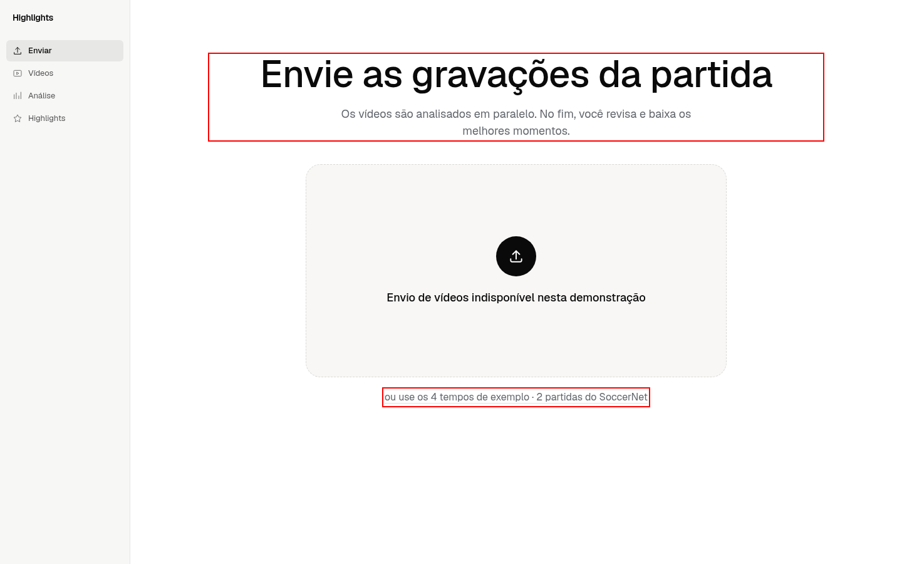 | 2 | A hierarquia se repete em toda entrada. Pode atrasar o primeiro uso, mas o botão de exemplos está visível na mesma tela. A dificuldade diminui assim que P03 aprende onde clicar. | Usar um título sobre a demonstração e destacar «Usar os vídeos de exemplo» como ação principal. Mostrar a indisponibilidade do envio próprio como aviso junto à ação. |
| V02 | H9 | F01, Falha no carregamento dos exemplos | Com o carregamento dos exemplos interrompido, o botão some e o aviso manda servir a pasta por HTTP com `python3 -m http.server`, embora a página já esteja aberta no site. P03 fica sem uma instrução aplicável para retomar. | 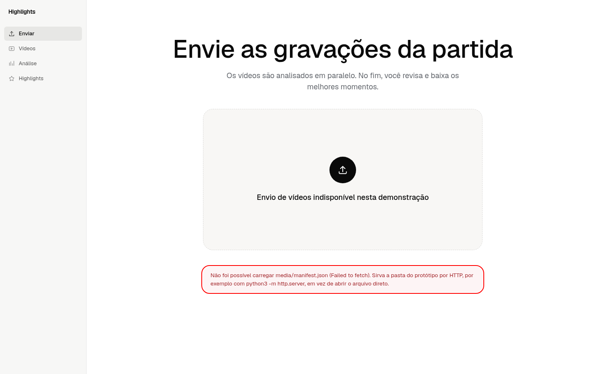 | 2 | A mensagem aparece quando a lista de exemplos falha. Nesse estado impede o início do fluxo. Depois de restabelecer o acesso, recarregar devolve o botão, mas a mensagem não orienta essa ação. | Informar que os vídeos de exemplo estão temporariamente indisponíveis e oferecer «Tentar carregar novamente» no próprio aviso. |
| V03 | H6 | F02, Lote com quatro tempos | Os cartões escondem o botão × até o ponteiro passar sobre um cartão ou o botão receber foco. P01 precisa passar o ponteiro sobre a miniatura ou chegar ao botão com Tab para descobrir como retirar um tempo antes de iniciar o lote. | 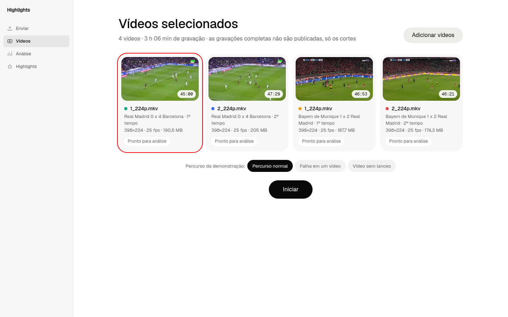 | 2 | Acontece em todos os cartões em repouso. Atrasa a conferência inicial sem impedir a remoção. Depois que P01 descobre o controle, a posição se repete. | Deixar a ação «Remover» visível e associada ao cartão mesmo em repouso. Usar partida e tempo também no nome acessível, pois os nomes dos arquivos se repetem. |
| V04 | H2 | F02, Lote pronto para análise | O resumo diz que as gravações completas não são publicadas e que só os cortes são. O percurso observado entrega arquivos para edição externa. P03 pode entender que iniciar a análise publica os cortes, antes de decidir quais quer baixar. | 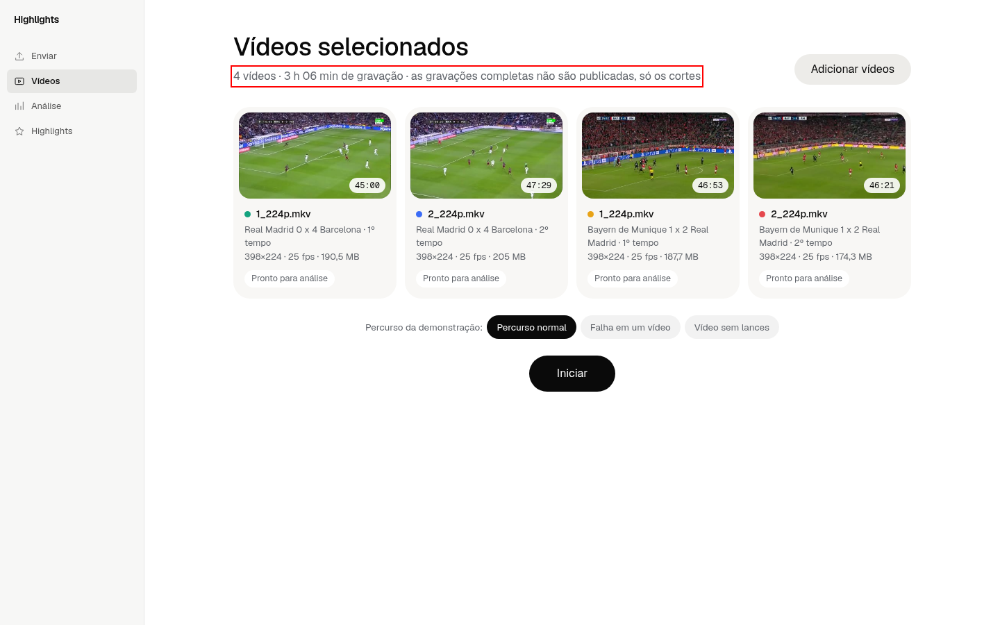 | 2 | O texto aparece sempre que há vídeos no lote. A dúvida afeta a decisão de iniciar, embora o diálogo de obtenção explique depois o trabalho no editor. O aviso permanece durante a conferência do lote. | Dizer que os cortes ficam disponíveis para revisão e download. Descrever a publicação como etapa posterior do trabalho editorial. |
| V05 | H1, H6 | F03, Fila e progresso por vídeo | A faixa de progresso mostra segmentos numerados por cor. No início, os dois tempos de Bayern x Real Madrid aguardam, mas seus nomes só aparecem ao passar o ponteiro pelos segmentos 3 e 4. P01 precisa consultar as dicas ou lembrar a ordem do lote para localizar cada tempo. | 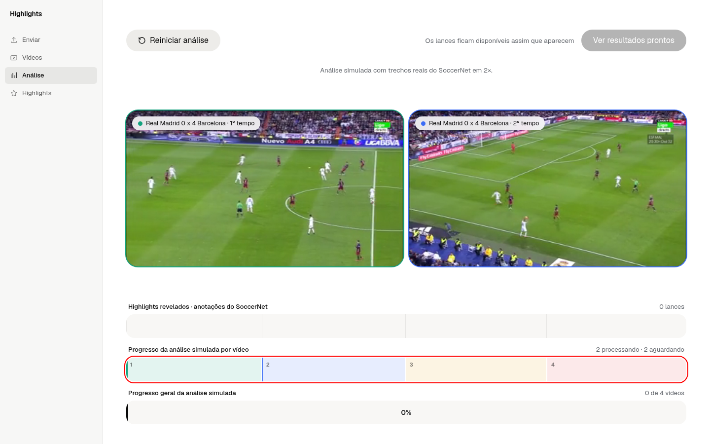 | 2 | A associação precisa ser refeita sempre que o usuário consulta a faixa. Aumenta o esforço de acompanhar as partidas, sobretudo quando as duas prévias mudam de vídeo. As dicas com o nome permitem recuperar a informação. | Identificar cada segmento com partida e tempo e expor o estado por vídeo em texto, inclusive para quem navega pelo teclado. |
| V06 | H1 | F04, Lista A com filtros de tipo e tempo | Ao combinar «Gol» e «2º tempo», a lista mostra três lances e o filtro ativo continua exibindo «Gol 6». Sem um total dos resultados filtrados, P01 precisa contar as linhas para verificar quantos candidatos vai revisar. | 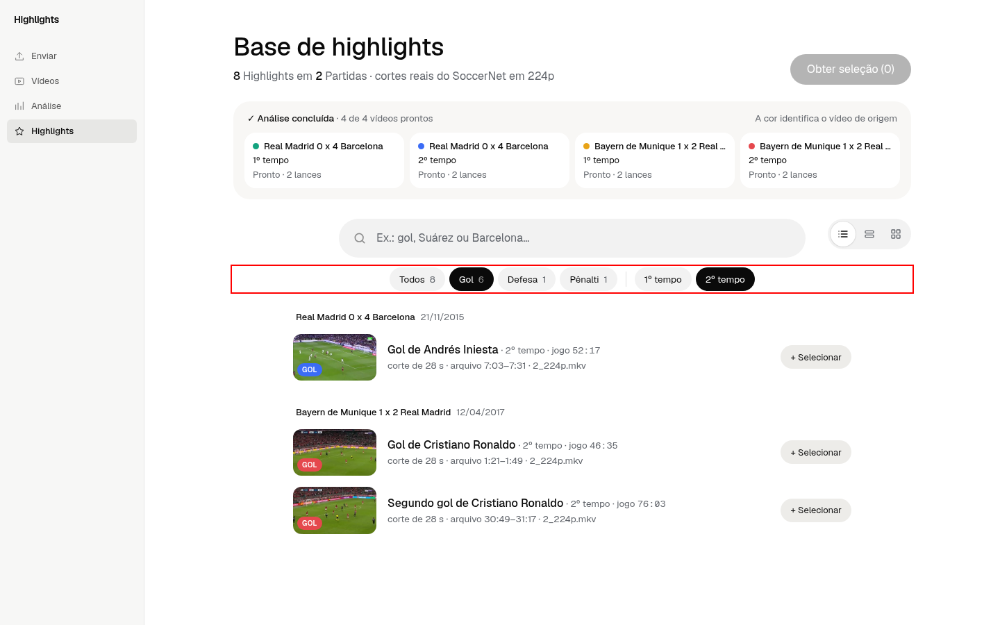 | 2 | Ocorre ao restringir a lista sem alterar os totais da base. Prejudica a conferência do subconjunto, mas todos os resultados da consulta ficam acessíveis. A divergência permanece enquanto os filtros estão ativos. | Mostrar o total filtrado junto da lista, por exemplo «3 de 8 lances». Atualizar as contagens por tipo conforme o contexto ou identificá-las como totais da base. |
| V07 | H4, H7 | F04, Troca da lista A para trilhas B e retorno | Depois de filtrar «Gol» e «2º tempo» na lista, as trilhas voltam a mostrar lances de outras categorias e dos dois tempos. Ao retornar à lista, «Todos» está ativo e os oito lances voltam sem aviso. P01 precisa reaplicar os filtros para continuar a revisão do mesmo conjunto. | 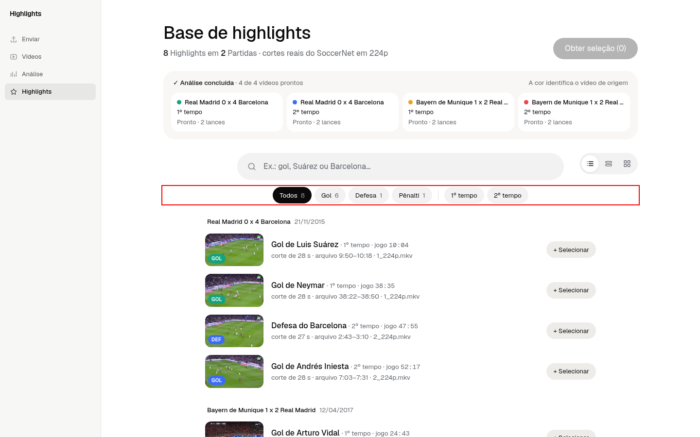 | 2 | A perda acontece ao trocar de visualização com filtros ativos. Gera retrabalho e expande o conjunto à vista. A seleção de cortes é preservada e os filtros podem ser reaplicados. | Compartilhar os filtros compatíveis entre as visualizações. Se algum filtro ficar indisponível em um modo, indicar a mudança e restaurá-lo ao voltar. |
| V08 | H7, H10 | F04, Mosaico C, faixa de gols | A faixa anuncia seis gols, exibe três cartões completos e corta o quarto na borda. Com o ponteiro sobre a faixa, não há seta, dica nem barra de rolagem perceptível. P03 pode parar antes de alcançar os dois gols de Cristiano Ronaldo. | 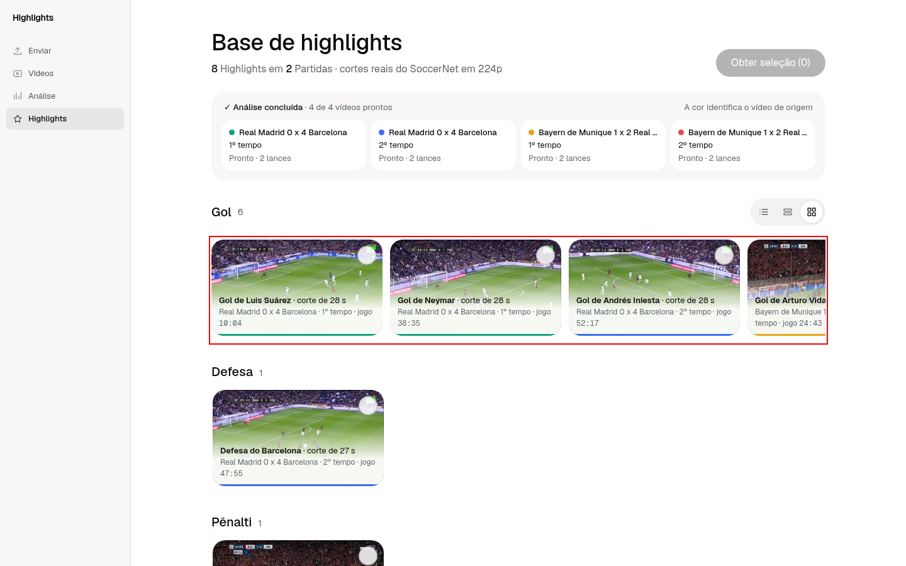 | 2 | Ocorre quando a faixa tem mais lances do que cabem na tela. Pode deixar candidatos fora da revisão, embora a rolagem horizontal, o Tab e as outras visualizações ofereçam acesso. A falta de indicação persiste enquanto há cartões fora da faixa. | Adicionar controles visíveis para avançar e voltar na faixa, com rótulos acessíveis e indicação de que ainda há cartões. |
| V09 | H1, H4 | F04, QA10, confirmação e cancelamento pelo teclado | Ao pressionar Enter em «Tentar de novo este vídeo», surgem «Confirmar nova tentativa» e «Cancelar», mas o foco visível desaparece. O mesmo acontece ao cancelar. P01 precisa pressionar Tab para localizar de novo onde está antes de prosseguir. | 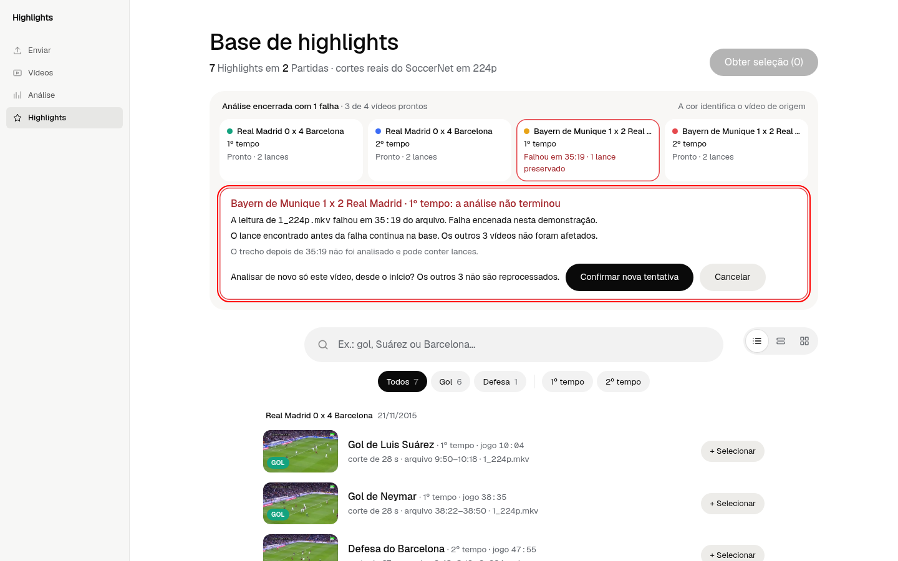 | 2 | Ocorreu na abertura e no cancelamento da confirmação pelo teclado. A ausência de foco interrompe a sequência, mas Tab alcança o próximo controle e o lote fica intacto. O efeito dura até a próxima ação de navegação. | Ao abrir a confirmação, colocar o foco visível na ação segura «Cancelar». Ao cancelar, devolver o foco ao botão «Tentar de novo este vídeo». |
| V10 | H2 | F05, Detalhe da Defesa do Barcelona na lista A | A linha temporal abaixo dos tempos do corte mostra «anotação ‘Shots on target’» sem traduzir o termo. P03 lê «Defesa do Barcelona» no título e precisa interpretar a expressão em inglês para entender o que o marcador destaca. | 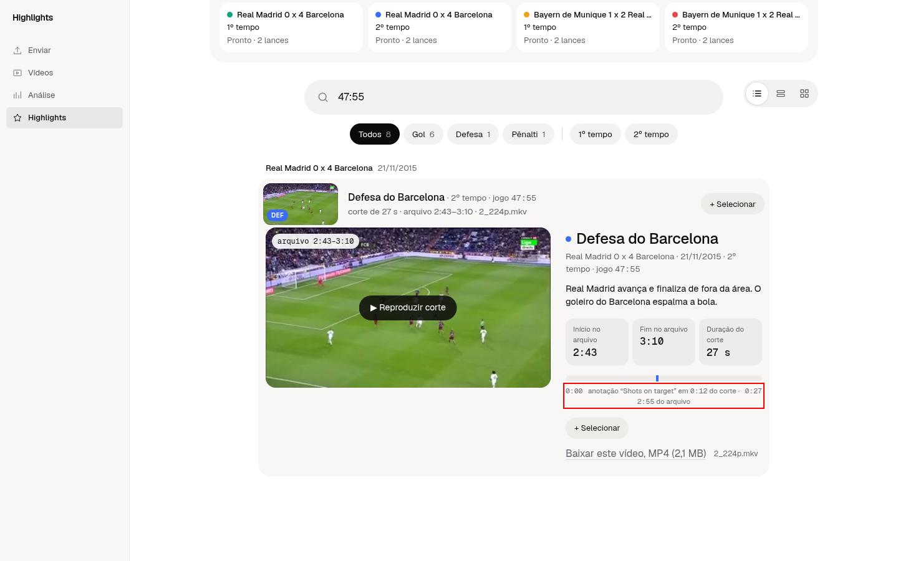 | 1 | O texto aparece ao abrir esse detalhe e permanece durante a revisão. O título e a descrição em português permitem reconhecer e revisar o lance. A dificuldade fica restrita à leitura da anotação. | Exibir «Finalização no alvo» e indicar que o marcador assinala o instante da jogada no corte. |
| V11 | H6 | F06, Download de MP4 de duas partidas | Ao baixar os gols de Suárez e Vidal, os arquivos salvos se chamam `suarez.mp4` e `vidal.mp4`. O diálogo também lista esses nomes sem partida ou minuto. Para identificar a origem no editor externo, P01 precisa voltar à base, consultar o CSV ou reconhecer o lance pela imagem. | 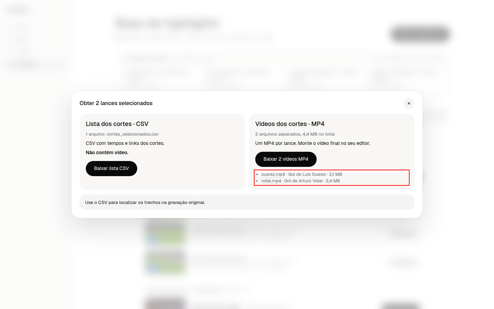 | 2 | Acontece ao obter MP4 com nomes sem contexto, em especial ao reunir cortes de várias partidas. Aumenta o esforço na passagem para o editor. A identificação não acompanha o nome do arquivo e exige uma consulta separada. | Incluir partida, tempo e minuto do jogo no nome do MP4 e na lista do diálogo, preservando um identificador único no caso de nomes iguais. |
| V12 | H3, H4 | Navegação transversal, Voltar do navegador de F04 para F01 | Com a entrada no histórico, ao abrir Vídeos, avançar para Highlights pela barra lateral e acionar Voltar do navegador, reaparece Enviar. P01 não retorna ao lote que acabou de consultar e precisa reencontrá-lo pela navegação interna. | 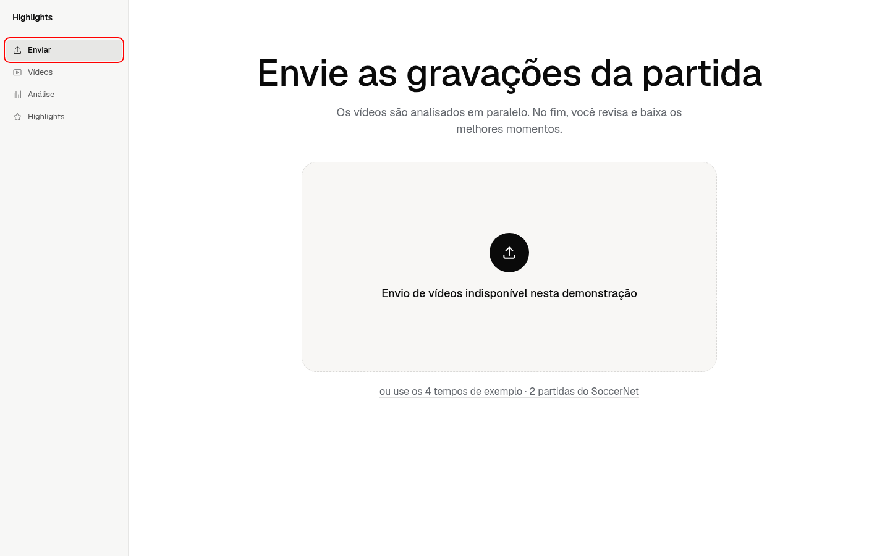 | 2 | Ocorre quando se usa Voltar depois de mudar de etapa dentro da página. O salto quebra o percurso esperado. A barra lateral permite regressar a Vídeos, o que limita o retrabalho neste caso. | Registrar as mudanças de etapa no histórico do navegador e restaurar a etapa anterior ao acionar Voltar. |
| V13 | H3, H5 | F04, Recarga com um lance selecionado no mosaico C | Depois de selecionar Suárez, mudar para o mosaico e recarregar, o mosaico permanece, mas «Obter seleção» passa de 1 para 0. A tela reaparece sem oferecer recuperação. P01 precisa lembrar quais lances marcou para montar a seleção de novo. | 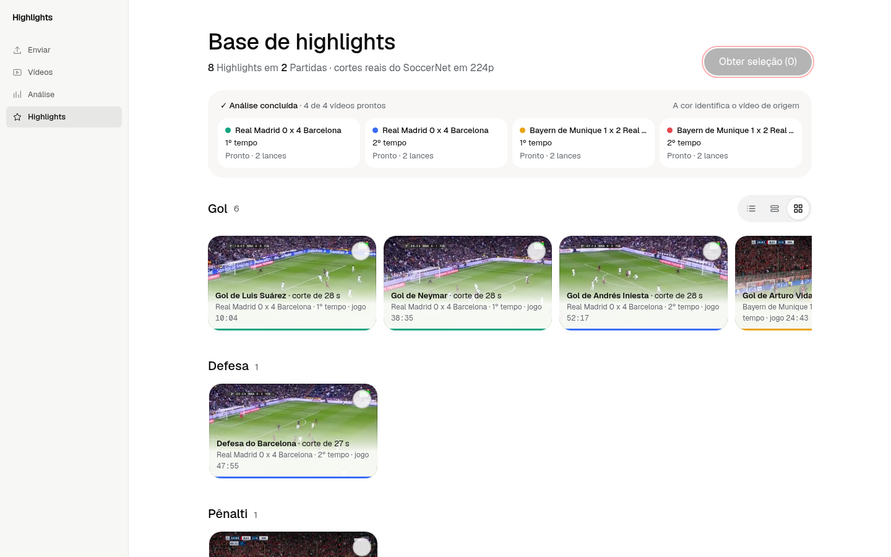 | 3 | Ocorre a cada recarga com uma seleção ainda aberta. Perde decisões feitas durante a revisão e o retrabalho cresce com o número de cortes marcados, embora os lances continuem disponíveis. A perda persiste até refazer a seleção. | Preservar a seleção ao recarregar a aba. Se não for possível restaurá-la, avisar sobre a perda antes de recarregar quando houver seleção em andamento. |
