# Ficha individual de inspeção heurística — Avaliador A02

**Autor:** Lucas Roberto Boccia dos Santos — 22.123.012-1\
**Data da inspeção:** 20/11/2026\
**Versão avaliada:** `https://ihc-11.p4cs.com.br/` · commit `7405221`\
**Ambiente de inspeção:** computador desktop · viewport `1440×900` (conforme registrado em `V10`) · meios de interação: mouse e teclado (`Tab`, `Enter`, `/`, setas, `Esc`) · navegador/versão exatos da rodada individual: `[?] não registrados na ficha de 20/11/2026` (reinspeção consolidada em `Chromium 157.0.8103.78`, `1440×900`)\
**Status:** ✅ concluída\

> **Regra de independência:** conclua esta ficha antes de ler as fichas de A01 e A03 ou discutir achados com a equipe. Avalie apenas a interface do protótipo, não a acurácia do modelo de visão computacional do TCC.

## Procedimento rápido

1. Percorra o fluxo normal (`F01` até `F06`) uma vez para familiarização.
2. Inspecione sistematicamente todas as telas e estados da tabela abaixo aplicando **H1 a H10**.
3. Registre apenas violações observadas, sem forçar problemas onde não houver.
4. Salve uma captura anotada destacando a região de cada problema em `assets/13_heuristica/a02_v01.png`, `a02_v02.png` e assim por diante.
5. Atribua severidade de `0` a `4` depois de compreender o problema e justifique por **frequência**, **impacto** e **persistência**.

| Grau | Interpretação |
|---:|---|
| 0 | Não é considerado problema de usabilidade |
| 1 | Problema cosmético; corrigir se houver tempo |
| 2 | Problema menor; baixa prioridade |
| 3 | Problema maior; alta prioridade |
| 4 | Catástrofe de usabilidade; correção imperativa antes de disponibilizar |

## Cobertura de telas e estados

Marque cada grupo conforme concluir a verificação. Em `F04, falha`, verifique `QA10` (se a interface identifica o vídeo incompleto, distingue o material pronto do trecho afetado e preserva os demais resultados ao tentar novamente ou deixar pendente).

| Tela ou percurso | Estados a examinar | Verificado? | Observações rápidas |
|---|---|---:|---|
| F01, entrada | Carregamento dos exemplos e aviso de envio próprio indisponível. Falha de manifesto, se reproduzida em condição controlada. | [x] | Caixa de envio indisponível domina o centro com destaque maior que o link dos exemplos (V05). Links laterais permitem pular F02 (V04). Em falha de manifesto, alerta mostra erro técnico e instrução de servidor Python sem botão de nova tentativa (V03); estado transitório de carregamento não chegou a ser visível por ser imediato. |
| F02, lote | Quatro tempos, remoção, lote vazio, reposição dos exemplos e escolha dos cenários normal, falha e vídeo sem lances. | [x] | Botão `×` de remoção fica invisível até passar o mouse e não há desfazer nem reposição individual (V01). Títulos destacam nomes repetidos `1_224p.mkv` e `2_224p.mkv` (V02). Com lote vazio, `Iniciar` desabilita corretamente, embora os controles de percurso subam para a linha do título; reposição via F01 funciona e os três cenários explicam o comportamento previsto. |
| F03, análise | Fila, processamento, resultados parciais, conclusão, falha encenada, vídeo concluído sem lances e transições para F04. | [x] | Fluxo de fila, resultados parciais e conclusão comunica bem o avanço geral e abre F04 corretamente. Barras por vídeo exibem só números `1` a `4` e os marcadores têm 5 px sem tooltip (V06). Prévias em 2× não têm pausa (V07). Reiniciar análise não pede confirmação e deixa seleção anterior em conflito com base zerada (V08). No lote com 0 lances, `Ver os 0 lances na base` fica desativado e falta atalho direto para ajustar o lote. |
| F04, destaques | Lista A, trilhas B, mosaico C, busca sem resultado e limpeza, filtros disponíveis, atualização parcial e preservação da seleção ao trocar de modo. | [x] | Seleção preserva bem entre A, B e C, e a atualização parcial via "Mostrar lances novos" evita saltos bruscos na lista. Alternador de modos usa apenas ícones; filtros divergem entre A, B e C, perdem-se ao voltar a A e deixam B vazio sem aviso quando desmarcados (V09). Mosaico C corta cartões à direita sem botões de rolagem (V10). Trilhas B omitem jogador/título nos marcadores (V11). Na faixa do lote, o nome do segundo jogo trunca o adversário. |
| F04, falha (QA10) | Identificação do vídeo afetado, resultados preservados, confirmação e cancelamento de nova tentativa localizada e opção de deixar pendente. | [x] | QA10 atendida em A, B e C: painel identifica o 1º tempo de Bayern x Real Madrid e o ponto `35:19`, informa que o lance anterior e os outros 3 vídeos seguem preservados, pede confirmação antes de reprocessar só o vídeo afetado, permite cancelar ou marcar pendente e mantém a seleção de lances durante a recuperação; em B, a faixa hachurada marca claramente o trecho não analisado. |
| F05, detalhe | Origem e tempos (relógio do jogo e posição no arquivo), reprodução, falha de mídia e nova tentativa (se reproduzida), inclusão/retirada e retorno à base. | [x] | Origem, relógio do jogo, posição no arquivo e reprodução com controles nativos funcionam bem. Em falha de mídia, aparece `(Failed to fetch)` no rótulo, mas o botão "Tentar de novo" recupera o player no mesmo painel. Na Lista A faltam controles `Anterior`, `Próximo` e `Fechar` presentes em B e C, e o botão `+ Selecionar` aparece duplicado (V12). Rótulo da anotação mantém inglês do SoccerNet (V13). |
| F06, obtenção | Seleção vazia, abertura e fechamento do diálogo, distinção entre CSV e MP4, arquivos salvos e comportamento do navegador. | [x] | Botão `Obter seleção (0)` fica desativado com dica; diálogo separa claramente CSV ("Não contém vídeo") de MP4, mantém foco preso ao usar Tab, fecha por `×` e `Esc` e baixa `cortes_selecionados.csv` e os MP4 válidos. O resumo de MP4 omite partida, tempo e relógio e não permite retirar itens (V14). O CSV grava tempos em segundos brutos e mantém `anotacao_gameTime` do dataset (V13). Pedido nativo de múltiplos downloads não apareceu nesta configuração do navegador, mas o aviso do protótipo foi exibido. |
| Navegação transversal | Etapa ativa na barra lateral, foco visível, navegação por teclado, retorno à tela anterior, preservação na sessão e efeito de recarga. | [x] | Etapa ativa (`aria-current="step"`), link "Pular para o conteúdo", foco visível na barra lateral e atalhos (`Tab`, `Enter`, `/`, setas e `Esc`) funcionam, e a seleção sobrevive a trocas entre etapas na sessão. Contudo, `history.replaceState` faz o Voltar do navegador sair da aplicação e a recarga descarta a seleção sem aviso (V15). Não há ajuda contextual nem lista de atalhos em nenhuma tela (V16). |

## Matriz de cobertura das 10 heurísticas

| Heurística | Descrição | Telas e estados examinados | Houve violação? | IDs dos achados |
|---|---|---|---|---|
| H1 | Visibilidade do status do sistema | F01 (normal, manifesto), F02 (lote, vazio, cenários), F03 (fila, andamento, parcial, conclusão, falha, vazio), F04 (A/B/C, parcial, QA10), F05, F06 e barra lateral | sim | V04, V06, V08 |
| H2 | Compatibilidade entre o sistema e o mundo real | F01 (manifesto), F02 (cartões), F03 (legendas), F04 (A/B/C, QA10), F05 (metadados e erro de mídia) e F06 (diálogo e CSV baixado) | sim | V02, V03, V13 |
| H3 | Controle e liberdade do usuário | F01, F02 (remoção e reposição), F03 (prévias, reinício e lote sem lances), F04 (A/B/C e QA10), F05 (abertura/fechamento), F06 e navegação transversal (Voltar e Esc) | sim | V01, V04, V07, V12, V14, V15 |
| H4 | Consistência e padrões | F01–F06 completos, comparação entre visualizações A, B e C, detalhe F05 nos três modos e convenções entre interface e CSV | sim | V09, V12, V13 |
| H5 | Prevenção de erros | F01, F02 (remoção sem desfazer e lote vazio), F03 (reinício com seleção), F04 (QA10 confirmação/cancelamento), F06 (seleção vazia e distinção CSV/MP4) e recarga | sim | V08, V15 |
| H6 | Reconhecimento em vez de memorização | F01 (entrada), F02 (cartões e remoção), F03 (barras e marcadores), F04 (seletor de modos, filtros, trilhas B e mosaico C), F05 e F06 (resumo de seleção) | sim | V01, V05, V06, V09, V10, V11, V14 |
| H7 | Flexibilidade e eficiência de uso | F02, F03 (acesso antecipado e marcadores), F04 (busca, filtros, rolagem em C e leitura em B), F05, F06 e atalhos de teclado | sim | V10, V11, V16 |
| H8 | Estética e design minimalista | F01 (hierarquia da entrada), F02 (cartões e lote vazio), F03, F04 (A/B/C e faixa do lote), F05 e F06 | sim | V02, V05 |
| H9 | Ajudar usuários a reconhecer, diagnosticar e recuperar-se de erros | F01 (falha de manifesto), F02 (lote vazio), F03/F04 (falha encenada e QA10), F04 (busca vazia) e F05 (falha de mídia e nova tentativa) | sim | V03 |
| H10 | Ajuda e documentação | Todas as telas (F01 a F06), barra lateral, dicas de teclado e explicação de termos técnicos e saídas | sim | V16 |

## Declaração de violações (Modelo 02)

Siga o [Modelo 02 da disciplina](../../slides_plinio/Modelo%2002%20Avaliacao%20Heuristica.doc). Descreva o que ocorre, onde ocorre, em qual ação e qual consequência traz para P01 ou P03. Se faltar um elemento, marque na captura onde a ausência afeta a interação.

| ID | Heurística | Tela e estado | Problema observado (ação, local e consequência) | Evidência | Severidade | Justificativa (frequência, impacto e persistência) | Recomendação |
|---|---|---|---|---|---:|---|---|
| V01 | H6, H3 | F02, lote (quatro tempos carregados) | Nos cartões de vídeo em F02, o botão `×` de remoção fica oculto (`opacity: 0`) em repouso e só aparece ao passar o mouse sobre o cartão. Ao clicar em `×`, o vídeo some imediatamente sem opção de desfazer; para recolocar só um vídeo removido por engano, a pessoa precisa voltar a F01 ("Adicionar vídeos") e recarregar os quatro exemplos. P01 e P03 podem achar que não é possível ajustar o lote antes da análise ou perder o ajuste ao tentar corrigir um clique acidental. | 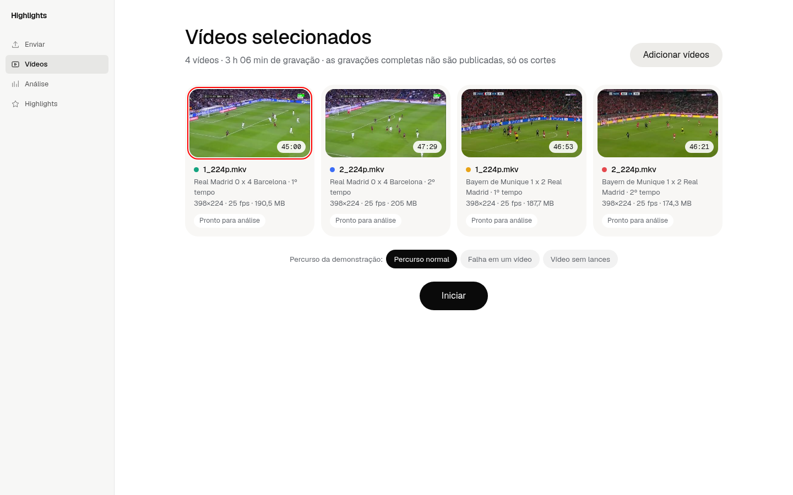 | 3 | Frequência alta, pois ocorre em toda preparação de lote em F02. Impacto alto, pois oculta uma ação central da etapa e dificulta desfazer erro. Persistência alta, já que o controle segue invisível em repouso em todos os cartões. | Manter o botão "Remover" sempre visível em cada cartão com rótulo ou ícone contrastado, e oferecer ação imediata de "Desfazer" em aviso ou botão para restaurar o vídeo removido sem resetar todo o lote. |
| V02 | H2, H8 | F02, lote (cartões dos quatro tempos) | Cada cartão em F02 usa como título em negrito o nome técnico do arquivo (`1_224p.mkv`, `2_224p.mkv`), que se repete de forma idêntica em duas partidas diferentes, enquanto o nome da partida e o tempo (`Real Madrid 0 x 4 Barcelona · 1º tempo`) ficam em fonte menor e cinza abaixo. O rótulo acessível do botão de remoção também repete `Remover 1_224p.mkv` sem citar a partida. P01 sob prazo e P03 precisam ler a linha secundária para diferenciar os arquivos e podem remover o tempo da partida errada. | 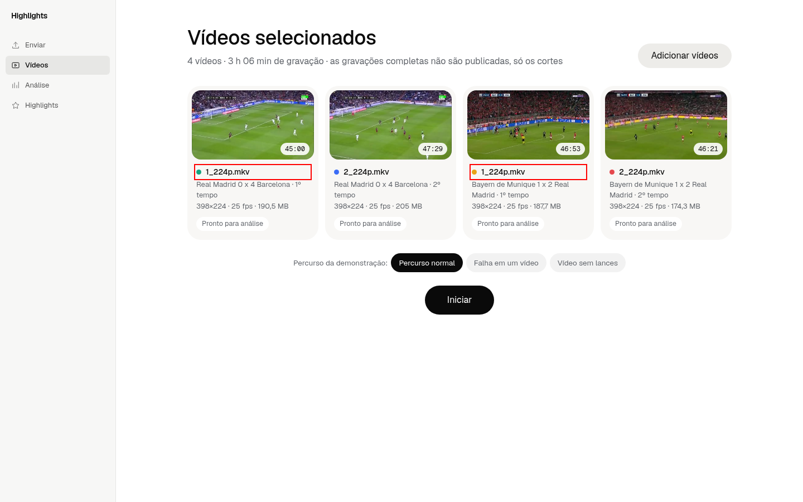 | 2 | Frequência alta, visível em todos os cartões do lote. Impacto moderado, pois a partida consta logo abaixo, mas a hierarquia invertida exige releitura e gera ambiguidade em leitores de tela. Persistência alta sempre que as gravações seguem nomes genéricos por tempo. | Inverter a hierarquia do cartão para destacar partida e tempo no título principal, mover o nome do arquivo para os metadados secundários e incluir partida e tempo no `aria-label` do botão de remoção. |
| V03 | H9, H2 | F01, entrada (falha de carregamento do manifesto) | Quando a requisição de `media/manifest.json` falha, o botão dos exemplos desaparece e o alerta exibe jargão técnico e uma orientação de desenvolvedor local (`Não foi possível carregar media/manifest.json (Failed to fetch). Sirva a pasta do protótipo por HTTP, por exemplo com python3 -m http.server, em vez de abrir o arquivo direto.`), mesmo com a página aberta em HTTPS. Não existe botão "Tentar novamente". P01 e P03 não programam nem usam terminal, ficando bloqueados sem diagnóstico compreensível nem ação de recuperação. | 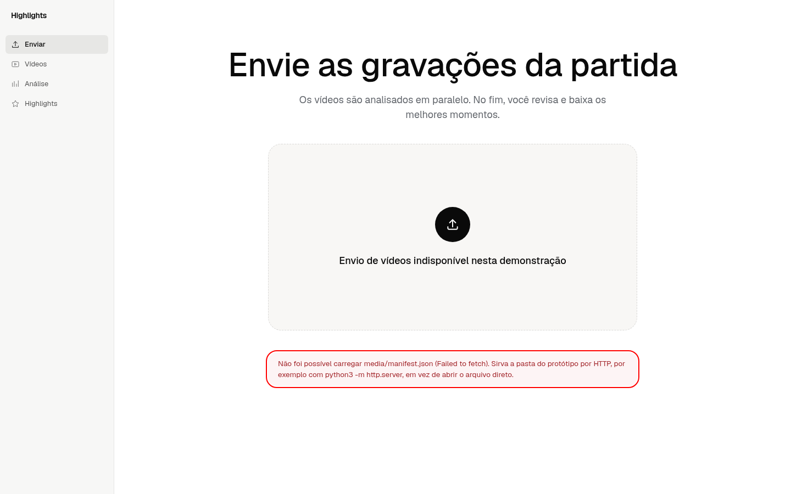 | 3 | Frequência baixa, restrita a quedas de rede ou indisponibilidade do servidor. Impacto alto, pois bloqueia o início do fluxo com instrução técnica inadequada e sem saída na interface. Persistência média, pois exige recarga manual do navegador. | Substituir a mensagem por linguagem clara para o usuário final explicando que os vídeos de exemplo não carregaram agora, ocultar instruções de terminal fora de `file://` e incluir um botão "Tentar novamente" no próprio alerta. |
| V04 | H1, H3 | F01, entrada (navegação pela barra lateral) | Em F01, antes de carregar os exemplos ou confirmar o lote em F02, os links `Análise` e `Highlights` na barra lateral permanecem habilitados com a mesma aparência da etapa atual. Ao clicar em `Análise` ou `Highlights` diretamente de F01, o sistema carrega os quatro exemplos e dispara o processamento automaticamente sem passar por F02. P01 ou P03 explorando a barra lateral podem iniciar uma análise sem conferir quais vídeos entraram no lote. | 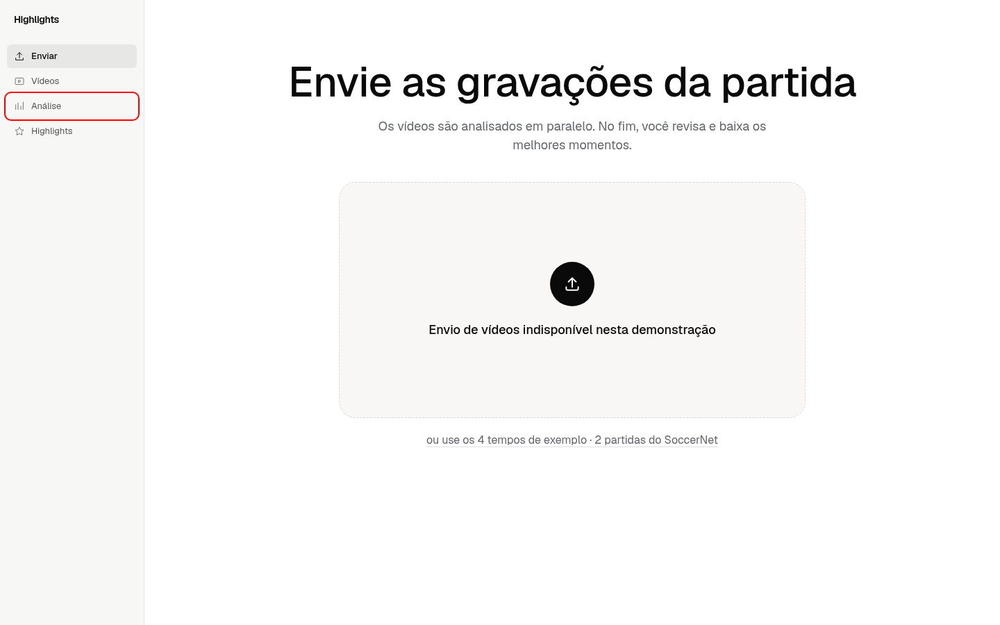 | 2 | Frequência baixa a moderada, ocorrendo quando a pessoa clica no menu lateral antes de carregar o lote. Impacto moderado, pois inicia processamento inesperado, embora permita voltar a Vídeos depois. Persistência baixa após aprender o percurso linear. | Desabilitar ou sinalizar como indisponíveis as etapas `Análise` e `Highlights` enquanto não houver lote confirmado, ou exibir aviso explicando que é necessário selecionar e iniciar o lote primeiro. |
| V05 | H8, H6 | F01, entrada (carregamento dos exemplos) | Na tela inicial, a caixa desativada "Envio de vídeos indisponível nesta demonstração" ocupa o centro da tela com ícone preto de forte destaque visual, enquanto a única ação funcional disponível (`ou use os 4 tempos de exemplo · 2 partidas do SoccerNet`) aparece abaixo como link cinza pequeno (`16 px`) e discreto. No primeiro contato, P01 e P03 têm a atenção puxada para uma área que não responde a clique antes de localizar o ponto real de entrada. | 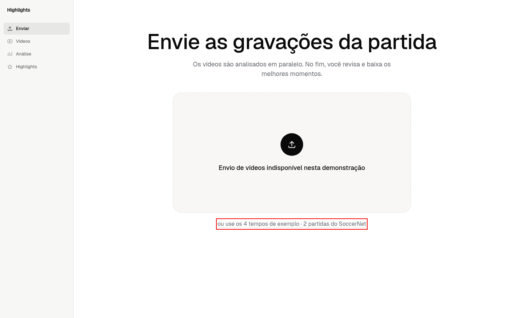 | 2 | Frequência alta no primeiro contato com o protótipo. Impacto moderado, pois atrasa a entrada no fluxo e faz o usuário testar uma área morta antes de notar o link. Persistência baixa depois que o usuário conhece a tela. | Promover "Usar os 4 tempos de exemplo" a botão primário de destaque e reduzir o peso visual do aviso de envio indisponível para um bloco informativo secundário. |
| V06 | H6, H1 | F03, análise (trilhas de progresso por vídeo e marcadores) | Na barra "Progresso da análise simulada por vídeo", os quatro segmentos são identificados apenas pelos números `1`, `2`, `3` e `4` sobre cores, sem legenda que associe cada bloco à partida e ao tempo. Acima dela, a trilha "Highlights revelados" mostra marcadores clicáveis com apenas 5 px de largura, sem rótulo nem atributo `title` visível ao passar o mouse. Quando as prévias avançam para os vídeos 3 e 4, P01 e P03 precisam memorizar a qual partida corresponde cada cor e dificilmente percebem que os traços abrem o detalhe do lance. | 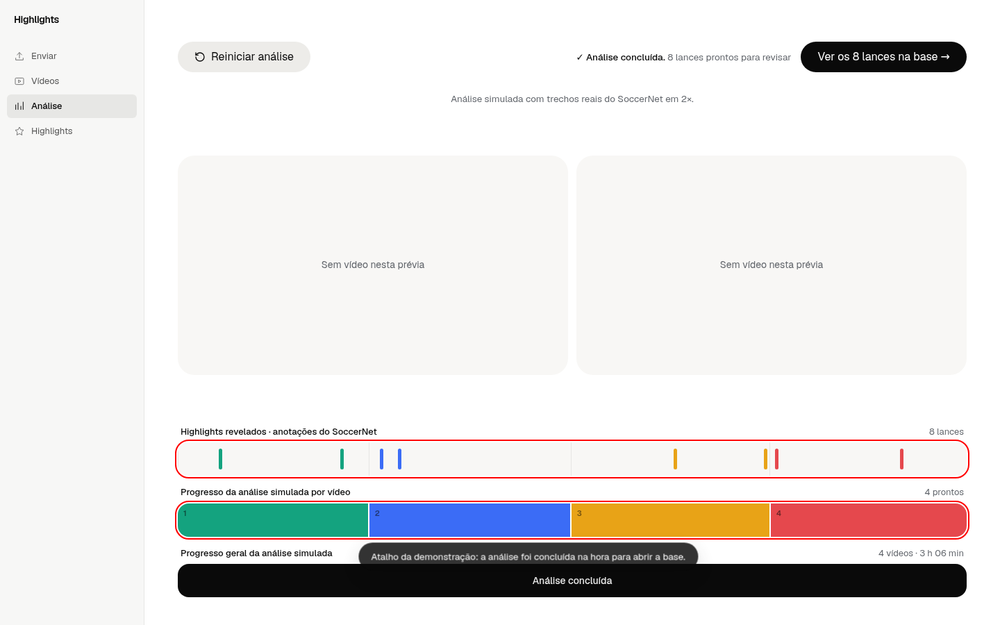 | 2 | Frequência alta, presente durante toda a análise e na tela concluída. Impacto moderado, pois dificulta acompanhar qual jogo terminou e esconde o atalho direto dos marcadores. Persistência alta durante toda a permanência em F03. | Exibir legenda curta de partida e tempo em cada segmento da barra de progresso por vídeo e ampliar os marcadores de lances com tooltip visível indicando jogador, tipo e ação de clique. |
| V07 | H3 | F03, análise (prévias de vídeo em processamento) | Durante a análise em F03, as duas prévias reproduzem cortes automaticamente em velocidade 2× sem controles nativos nem botão para pausar ou ocultar a prévia. Caso P01 receba uma interrupção da supervisão ou P03 queira ler as informações da tela sem movimento contínuo, não há meio direto na interface para pausar as prévias sem trocar de aba. | 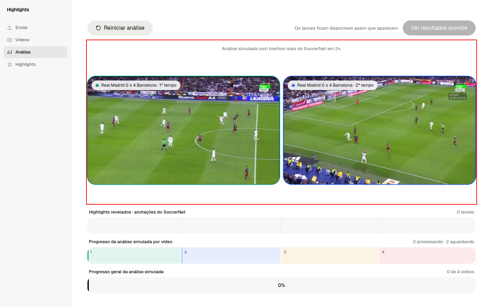 | 2 | Frequência alta em toda execução natural da análise. Impacto moderado, pois incomoda quem precisa ler a tela ou pausar movimento contínuo sem afetar o processamento (critério WCAG 2.2.2). Persistência alta ao longo de toda a simulação. | Adicionar um botão explícito "Pausar prévias" em F03 que interrompa a animação visual das prévias sem cancelar o acompanhamento do progresso. |
| V08 | H5, H1 | F03 e F04, reinício da análise com seleção existente | Clicar em `Reiniciar análise` em F03 reinicia imediatamente todo o lote sem pedir confirmação, mesmo quando o usuário já revisou e marcou lances em F04. Ao abrir F04 durante esse reinício, a interface exibe `0 Highlights em 0 Partidas` ao mesmo tempo em que mantém ativo `Obter seleção (2)`, preservando uma seleção antiga contraditória com a base vazia. P01 pode disparar um reinício acidental, perder o andamento concluído e se confundir ao ver dois cortes selecionados em uma base zerada. | 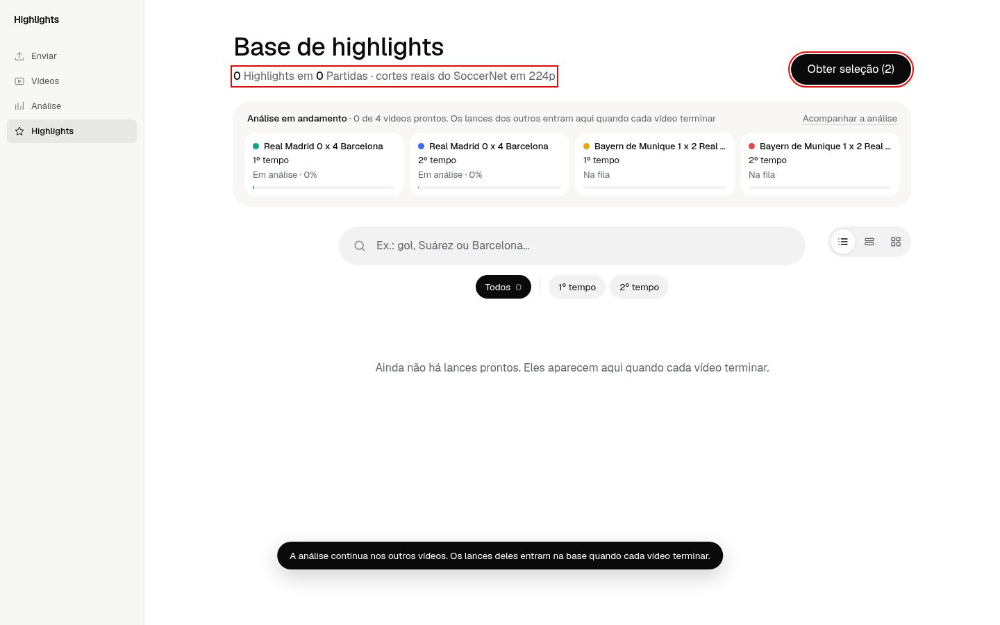 | 3 | Frequência baixa, ligada a clique acidental ou necessidade de recomeçar. Impacto alto, pois reinicia a análise sem aviso e deixa o contador de seleção incoerente com os resultados visíveis. Persistência média, até todos os vídeos concluírem de novo ou a seleção ser revista. | Exigir confirmação antes de reiniciar quando já houver análise concluída ou lances selecionados, informando claramente se a seleção atual será mantida ou limpa, e não exibir contador ativo acima dos lances disponíveis na base. |
| V09 | H4, H6 | F04, destaques (alternador de modos e filtros entre A, B e C) | O alternador de visualizações em F04 usa três ícones sem rótulo textual visível para "Busca primeiro" (A), "Trilhas por partida" (B) e "Mosaico por tipo" (C). Além disso, os filtros mudam de padrão e disponibilidade entre modos: A tem busca, pílulas pretas de tipo e filtro de `1º`/`2º tempo`; B remove busca e tempo e troca o padrão visual para botões com `✓`; C remove todos os filtros. Ao sair de A com filtros ativos para B ou C e voltar, os filtros de A são perdidos. Em B, desmarcar os três tipos deixa as trilhas vazias (`0 lances`) sem mensagem nem botão para restaurar filtros. | 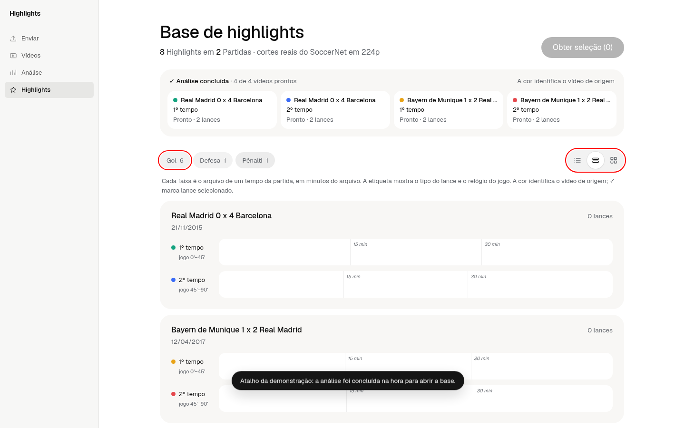 | 2 | Frequência moderada a alta sempre que P01 ou P03 exploram modos e filtros em F04. Impacto moderado, pois obriga a refazer filtros e exige tentativa e erro para entender ícones e o estado vazio em B. Persistência alta enquanto o usuário alterna visualizações. | Adicionar rótulos curtos ao alternador de modos ("Lista", "Trilhas", "Mosaico"), unificar e preservar os filtros entre visualizações e exibir aviso com botão "Limpar filtros" quando nenhum lance corresponder em B. |
| V10 | H7, H6 | F04, destaques — Mosaico C (faixa horizontal de gols) | No modo Mosaico C, a fileira `Gol 6` dispõe os seis cartões em uma faixa horizontal (`1696 px` dentro de `976 px`) sem botões laterais de avançar ou voltar. No viewport 1440×900, o quarto cartão (`Gol de Arturo Vidal`) aparece cortado e os dois gols de Cristiano Ronaldo ficam totalmente fora da área visível à direita. Para P01 ou P03 usando mouse desktop sem rolagem horizontal dedicada, há risco real de não alcançar ou nem notar os lances ocultos à direita, provocando omissão no compacto. | 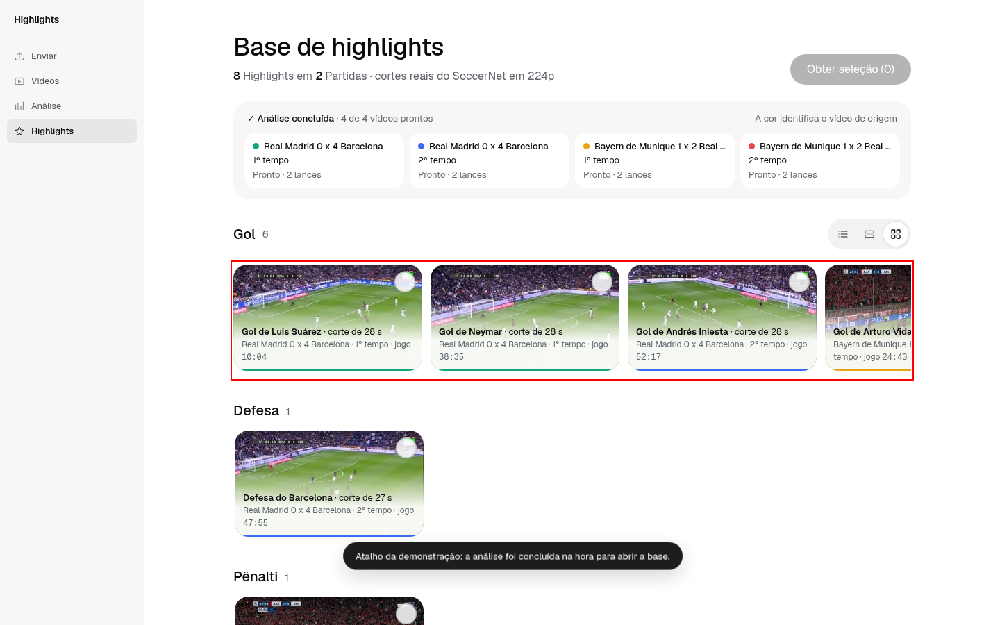 | 3 | Frequência alta para quem utiliza o Mosaico C já com seis gols. Impacto alto, pois oculta um terço dos gols fora da tela sem controle explícito de navegação horizontal, alimentando o risco de omissão temido por P01. Persistência alta e pior conforme cresce o volume de partidas. | Substituir o carrossel horizontal por grade com quebra de linha ou adicionar botões laterais visíveis de avançar/voltar acompanhados de indicador de quantidade oculta (por exemplo, "mostrando 3 de 6"). |
| V11 | H6, H7 | F04, destaques — Trilhas B (marcadores nas faixas de tempo) | Na visualização Trilhas B, cada marcador sobre a faixa de tempo exibe apenas a categoria genérica e o relógio do jogo (`Gol / jogo 10:04`, `Gol / jogo 38:35`), sem o nome do jogador nem resumo do lance. Para P03, que procura jogadas de um atleta específico, ou P01 revisando uma partida com vários gols, é preciso clicar em cada marcador individualmente para descobrir quem participou do lance. | 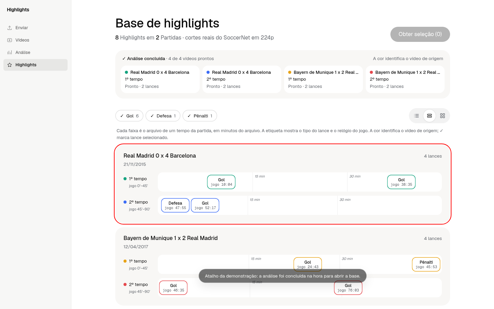 | 2 | Frequência alta para quem usa o modo Trilhas B. Impacto moderado, pois aumenta o número de cliques para localizar um jogador ou lance específico em jogos movimentados. Persistência alta em toda partida com múltiplos gols. | Incluir o nome curto do jogador ou título resumido no marcador (ou em tooltip imediato ao passar o mouse e focar por teclado) mantendo a leitura limpa da faixa temporal. |
| V12 | H4, H3 | F05, detalhe expandido na Lista A | Ao abrir o detalhe de um lance na Lista A (visualização padrão), o painel expandido omite os botões `Anterior`, `Próximo`, `× Fechar` e a legenda de navegação por teclado que existem em B e C. Além disso, o cabeçalho da linha mantém `+ Selecionar` visível logo acima de um segundo botão `+ Selecionar` idêntico dentro do detalhe aberto. P01 e P03 que revisam lances em sequência na Lista A não veem controle explícito para avançar ou fechar o detalhe e encontram controles duplicados para a mesma ação. | 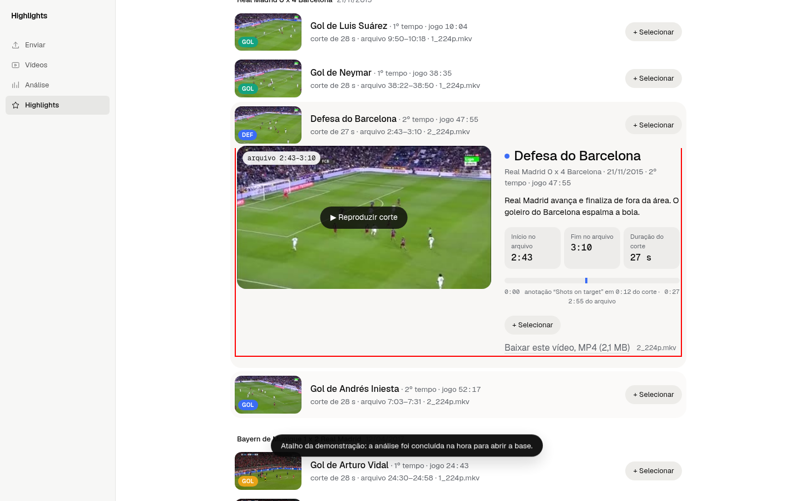 | 2 | Frequência alta, pois a Lista A é a tela padrão de entrada em F04. Impacto moderado, gerando redundância visual e falta de affordance para navegar entre lances e recolher o detalhe. Persistência alta a cada lance inspecionado em A. | Adicionar barra superior discreta no detalhe da Lista A com `Anterior`, `Próximo`, `Fechar` e dica de teclas (`↑ ↓` e `Esc`), e evitar duplicar o botão `+ Selecionar` quando a linha já está expandida. |
| V13 | H2, H4 | F05, detalhe e F06, CSV baixado (`cortes_selecionados.csv`) | O detalhe F05 (assim como legendas em F03) exibe categorias técnicas em inglês do SoccerNet (`anotação "Shots on target"`, `"Goal"`, `"Penalty"`). No arquivo `cortes_selecionados.csv` baixado em F06, que a interface indica usar para localizar os trechos na gravação original, as colunas `inicio_corte_no_arquivo_s` e `fim_corte_no_arquivo_s` trazem apenas segundos brutos (`1849`, `1877`) em vez do formato `mm:ss` mostrado na tela (`30:49–31:17`), ao lado da coluna técnica `anotacao_gameTime` (`2 - 31:03`) que diverge de `relogio_jogo` (`76:03`). P03 encontra termos sem tradução e P01/P02 precisam converter segundos manualmente no editor externo. | 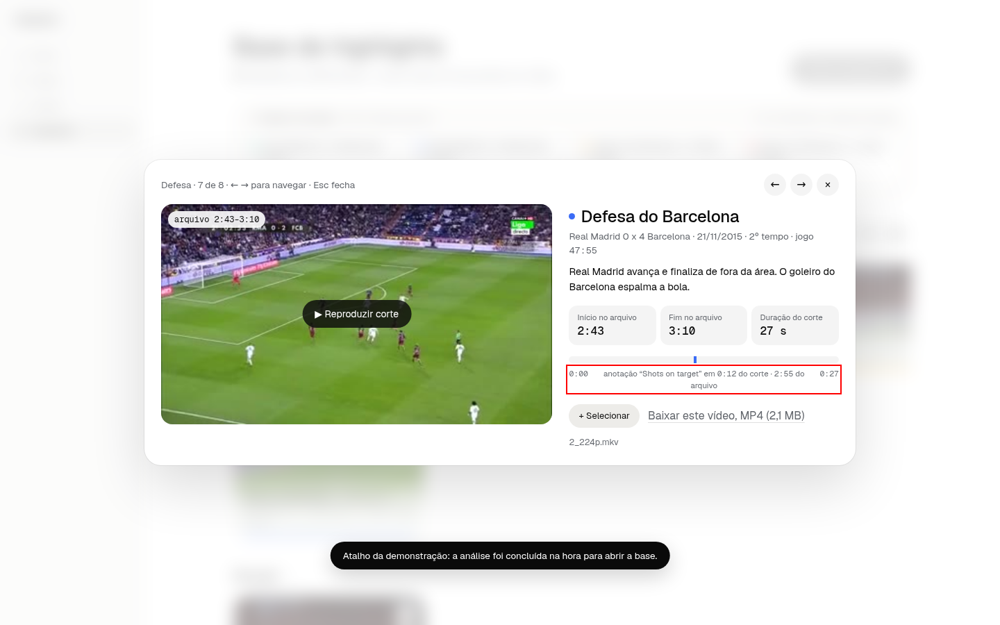 | 2 | Frequência alta, afetando todo detalhe de defesa em F05 e toda exportação CSV em F06. Impacto moderado, pois exige conversão mental de segundos e pode gerar confusão de tempo no 2º tempo ao passar o CSV a P02. Persistência alta em todas as exportações. | Traduzir as categorias de anotação exibidas na interface para português e incluir no CSV colunas formatadas em `mm:ss` (início e fim no arquivo) alinhadas exatamente aos rótulos da tela, mantendo os segundos brutos apenas como dado complementar se necessário. |
| V14 | H6, H3 | F06, diálogo "Obter seleção" | No diálogo de obtenção (F06), a lista sob "Vídeos dos cortes · MP4" mostra apenas o nome do arquivo, o título do lance e o tamanho (`suarez.mp4 · Gol de Luis Suárez · 2,1 MB`), sem informar a partida de origem, o tempo (`1º`/`2º tempo`) nem o relógio do jogo. O diálogo também não oferece botão para remover um corte da seleção diretamente no resumo, nem há comando de "Limpar seleção". Em lotes com várias partidas, P01 precisa fechar o diálogo, procurar o lance na base para conferir a origem ou desmarcá-lo e abrir F06 de novo. | 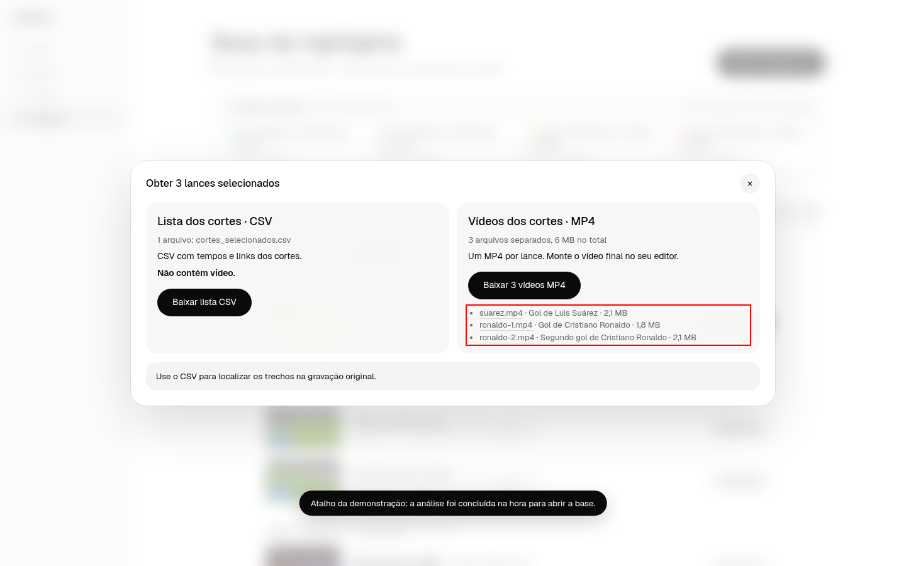 | 2 | Frequência alta, presente em toda exportação de seleção. Impacto moderado, pois enfraquece a conferência final antes do download e adiciona passos extras para corrigir a seleção. Persistência alta especialmente com várias partidas no lote. | Exibir partida, tempo e relógio do jogo ao lado de cada item na lista de F06, permitir retirar itens individualmente dentro do diálogo e incluir uma ação de "Limpar seleção" com confirmação. |
| V15 | H3, H5 | Navegação transversal (Voltar do navegador e recarga em F04) | As trocas internas entre F01, F02, F03 e F04 usam `history.replaceState`, sem registrar histórico no navegador; ao percorrer o fluxo normal e acionar o botão **Voltar** do navegador esperando regressar à etapa anterior, o usuário é levado para fora da aplicação. Além disso, recarregar a página em F04 descarta silenciosamente todos os lances selecionados (`Obter seleção` volta a `0`) sem alerta prévio nem persistência em sessão. P01 sob pressão de prazo e sujeito a interrupções, ou P03 por hábito de navegação web, pode perder toda a seleção revisada em um único gesto. | 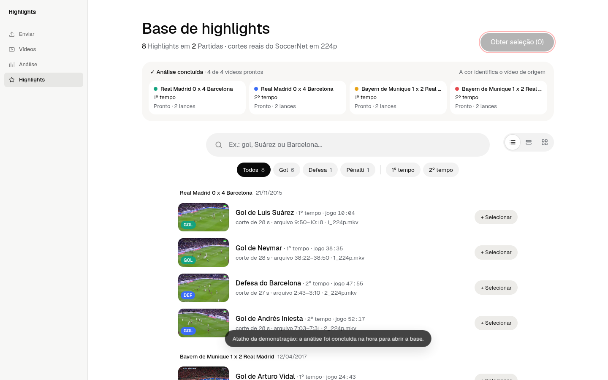 | 3 | Frequência moderada, pois usar o botão Voltar e recarregar a página são ações rotineiras na web. Impacto alto, causando perda imediata e silenciosa de todo o trabalho de seleção feito na sessão. Persistência alta enquanto não houver histórico de estados nem armazenamento em sessão. | Registrar as transições de etapa com `history.pushState` (tratando `popstate`), salvar a seleção e os filtros em `sessionStorage` para sobreviver a recargas e exibir confirmação `beforeunload` quando houver seleção não exportada. |
| V16 | H10, H7 | Navegação transversal e F04, Lista A (ausência de ajuda e referência de atalhos) | A interface não oferece botão de ajuda, glossário rápido nem resumo de atalhos de teclado em nenhuma tela. Atalhos implementados (`/` para focar a busca em F04-A, `←`/`→` para trocar etapas em F01–F03 e `↑`/`↓` na Lista A) permanecem ocultos, e termos como `224p`, `SoccerNet`, `relógio do jogo` × `posição no arquivo` e `CSV` não dispõem de explicação sob demanda no local de uso. P01 deixa de aproveitar ganhos de produtividade no teclado e P03 não encontra apoio rápido ao deparar com termos menos familiares. | 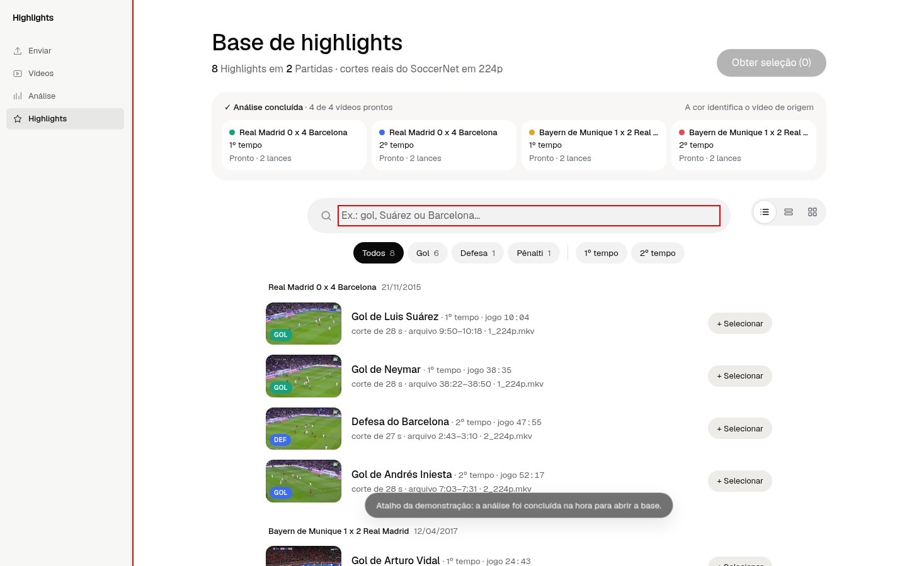 | 1 | Frequência moderada no primeiro uso e na adoção de atalhos. Impacto baixo, pois o fluxo principal permanece operável sem ajuda externa e parte das telas já traz frases breves de contexto. Persistência baixa depois que o usuário aprende os termos. | Adicionar um botão discreto de "Ajuda e atalhos" na barra lateral com guia curto de termos (relógio do jogo, posição no arquivo, CSV × MP4) e lista de atalhos de teclado disponíveis, além de indicar `/` no placeholder da busca. |
