# Ficha individual de inspeção heurística — Avaliador A03

**Autor:** Giovanni Chahin Morassi — 22.123.025-3\
**Data da inspeção:** 20/11/2026\
**Status:** ✅ concluída\

> **Regra de independência:** conclua esta ficha antes de ler as fichas de A01 e A02 ou discutir achados com a equipe. Avalie apenas a interface do protótipo, não a acurácia do modelo de visão computacional do TCC.

## Procedimento rápido

1. Percorra o fluxo normal (`F01` até `F06`) uma vez para familiarização.
2. Inspecione sistematicamente todas as telas e estados da tabela abaixo aplicando **H1 a H10**.
3. Registre apenas violações observadas, sem forçar problemas onde não houver.
4. Salve uma captura anotada destacando a região de cada problema em `assets/13_heuristica/a03_v01.png`, `a03_v02.png` e assim por diante.
5. Atribua severidade de `0` a `4` depois de compreender o problema e justifique por **frequência**, **impacto** e **persistência**.

| Grau | Interpretação |
|---:|---|
| 0 | Não é considerado problema de usabilidade |
| 1 | Problema cosmético; corrigir se houver tempo |
| 2 | Problema menor; baixa prioridade |
| 3 | Problema maior; alta prioridade |
| 4 | Catástrofe de usabilidade; correção imperativa antes de disponibilizar |

## Cobertura de telas e estados

Marque cada grupo conforme concluir a verificação. Em `F04, falha`, verifique `QA10` (se a interface identifica o vídeo incompleto, distingue o material pronto do trecho afetado e preserva os demais resultados ao tentar novamente ou deixar pendente).

| Tela ou percurso | Estados a examinar | Verificado? | Observações rápidas |
|---|---|---:|---|
| F01, entrada | Carregamento dos exemplos e aviso de envio próprio indisponível. Falha de manifesto, se reproduzida em condição controlada. | [x] | Os quatro exemplos ficaram disponíveis. O envio próprio apareceu como indisponível. Na falha controlada, recarregar após restabelecer a requisição recuperou os exemplos. O aviso transitório de carregamento passou antes da observação. |
| F02, lote | Quatro tempos, remoção, lote vazio, reposição dos exemplos e escolha dos cenários normal, falha e vídeo sem lances. | [x] | Conferi os quatro tempos. Remover todos desativou Iniciar. Adicionar vídeos permitiu repor os quatro exemplos. Alternei entre os três cenários e conferi o que ocorre ao retirar o vídeo do cenário de falha. |
| F03, análise | Fila, processamento, resultados parciais, conclusão, falha encenada, vídeo concluído sem lances e transições para F04. | [x] | Acompanhei a fila, as duas prévias e a liberação de lances. Entrei na base pelo botão, por um marcador e pelo aviso de falha. Conferi a conclusão normal, a interrupção em 35:19 do arquivo e a conclusão com seis lances e um vídeo sem lances. Com apenas esse vídeo, a conclusão informou zero lances. |
| F04, destaques | Lista A, trilhas B, mosaico C, busca sem resultado e limpeza, filtros disponíveis, atualização parcial e preservação da seleção ao trocar de modo. | [x] | Usei a busca, a limpeza, os filtros por tipo e tempo em A e os filtros por tipo em B. A seleção de Suárez permaneceu em A, B e C. Na base parcial, solicitei a atualização e conferi os lances que entraram na lista. |
| F04, falha (QA10) | Identificação do vídeo afetado, resultados preservados, confirmação e cancelamento de nova tentativa localizada e opção de deixar pendente. | [x] | A faixa distinguiu o primeiro tempo do Bayern, interrompido em 35:19 do arquivo, do lance preservado e dos outros vídeos. Cancelei a confirmação, deixei pendente e fiz nova tentativa só desse vídeo. Os sete lances e os dois que selecionei permaneceram. A atualização final acrescentou o pênalti de Vidal. |
| F05, detalhe | Origem e tempos (relógio do jogo e posição no arquivo), reprodução, falha de mídia e nova tentativa (se reproduzida), inclusão/retirada e retorno à base. | [x] | Abri o detalhe em A, B e C. Conferi a defesa do Barcelona no segundo tempo, jogo 47:55 e arquivo 2:43 a 3:10. Reproduzi, selecionei, retirei e fechei com Esc. Na falha controlada, Tentar de novo voltou a reproduzir após restabelecer a mídia. Conferi o MP4 individual de Cristiano Ronaldo às 76:03. |
| F06, obtenção | Seleção vazia, abertura e fechamento do diálogo, distinção entre CSV e MP4, arquivos salvos e comportamento do navegador. | [x] | Sem seleção, Obter seleção ficou desativado. Saí do diálogo pelo botão Fechar e por Esc. O CSV salvo contém os dois cortes esperados. Os MP4 de Suárez e Vidal foram salvos separadamente. Vi o aviso sobre a permissão, e o navegador da sessão salvou ambos de imediato. |
| Navegação transversal | Etapa ativa na barra lateral, foco visível, navegação por teclado, retorno à tela anterior, preservação na sessão e efeito de recarga. | [x] | Conferi a etapa ativa, o contorno de foco, Tab, Enter, setas, Esc e o atalho / da busca. O diálogo manteve o foco dentro dele e o devolveu a Obter seleção. A navegação interna preservou a seleção. Verifiquei Voltar e a recarga, que esvaziou a seleção. |

## Matriz de cobertura das 10 heurísticas

| Heurística | Descrição | Telas e estados examinados | Houve violação? | IDs dos achados |
|---|---|---|---|---|
| H1 | Visibilidade do status do sistema | F01, disponibilidade dos exemplos. F02, cenário e quantidade no lote. F03, fila e conclusão. F04, análise parcial, falha, recuperação e base sem lances. F06, seleção e retorno dos downloads. Recarga da base. | sim | V06, V10, V11 |
| H2 | Compatibilidade entre o sistema e o mundo real | F02, partida, tempo e arquivo. F03 e F04, lances e mensagens de falha. F05, relógio do jogo, posições no arquivo e texto do player. F06, nomes e conteúdo das saídas. | sim | V08, V09 |
| H3 | Controle e liberdade do usuário | F02, retirada e reposição. F03, prévias e passagem à base. F04, limpar busca, cancelar e deixar pendente. F05 e F06, fechamento e retorno. Voltar do navegador. | sim | V04, V05, V12 |
| H4 | Consistência e padrões | F02 e F03, continuidade entre etapas. F04, seleção em A, B e C. F05, abertura e retorno. F06, atalhos usuais do diálogo. Barra lateral e Voltar. | sim | V05, V07, V12 |
| H5 | Prevenção de erros | F01, envio indisponível. F02, lote vazio e cenário após retirada do vídeo. F04, confirmação da tentativa e recarga. F06, obtenção sem seleção e distinção entre arquivos. | sim | V10, V11 |
| H6 | Reconhecimento em vez de memorização | F01, ação disponível. F02, cartões e remoção. F03, prévias e estados. F04, busca, seleção e origem dos candidatos. F05 e F06, identificação dos cortes e saídas. | sim | V01, V03, V07 |
| H7 | Flexibilidade e eficiência de uso | F02, retirada por teclado. F03, acesso antecipado e por marcador. F04, buscas por nome, filtros e modos alternativos. F05 e F06, setas, Tab, Enter, Esc e links individuais. | não | Sem achados |
| H8 | Estética e design minimalista | F01, destaque da ação disponível. F02, identificação dos cartões. F03, organização da fila e do andamento. F04, densidade e contraste em A, B e C. F05 e F06, leitura dos tempos e dos formatos. | sim | V01 |
| H9 | Ajudar usuários a reconhecer, diagnosticar e recuperar-se de erros | F01, falha de carregamento. F02, lote vazio. F04, busca vazia, falha localizada, cancelamento e recuperação. F05, falha de mídia e nova tentativa. F06, orientação para downloads múltiplos. | sim | V02, V09 |
| H10 | Ajuda e documentação | F01, orientação para usar os exemplos ou recuperar o carregamento. F03, indicação do próximo passo. F04, legenda das trilhas e opções de falha. F05, dicas de teclado. F06, conteúdo das saídas e links individuais. | sim | V02 |

## Declaração de violações (Modelo 02)

Siga o [Modelo 02 da disciplina](../../slides_plinio/Modelo%2002%20Avaliacao%20Heuristica.doc). Descreva o que ocorre, onde ocorre, em qual ação e qual consequência traz para P01 ou P03. Se faltar um elemento, marque na captura onde a ausência afeta a interação.

| ID | Heurística | Tela e estado | Problema observado (ação, local e consequência) | Evidência | Severidade | Justificativa (frequência, impacto e persistência) | Recomendação |
|---|---|---|---|---|---:|---|---|
| V01 | H8, H6 | F01, entrada com exemplos disponíveis | Em Enviar, a maior área e o título convidam ao envio de gravações, indisponível na demonstração. O link para usar os exemplos fica abaixo desse bloco e começa com 'ou use'. P03 precisa procurar pela única ação que inicia o fluxo. | 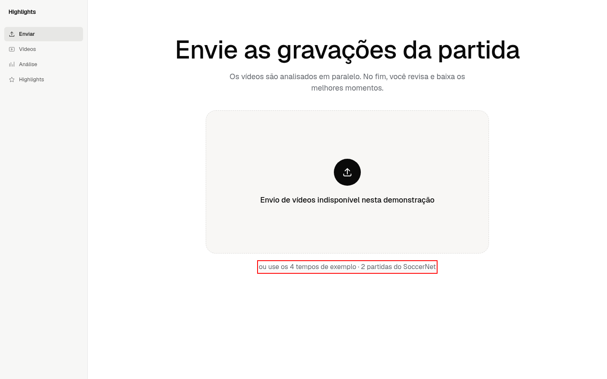 | 2 | A hierarquia aparece a cada entrada. Pode atrasar o início, pois a ação está abaixo do elemento mais saliente. Depois que P03 encontra o link, consegue seguir normalmente. | Apresentar 'Usar os 4 tempos de exemplo' como ação principal e mostrar a indisponibilidade do envio junto a ela. |
| V02 | H9, H10 | F01, falha controlada no carregamento do manifesto | Quando os exemplos deixam de carregar, Enviar mostra 'media/manifest.json', 'Failed to fetch' e recomenda servir a pasta por HTTP com Python, embora a página já esteja on-line. O link dos exemplos desaparece. P03 fica sem um próximo passo aplicável à página aberta. | 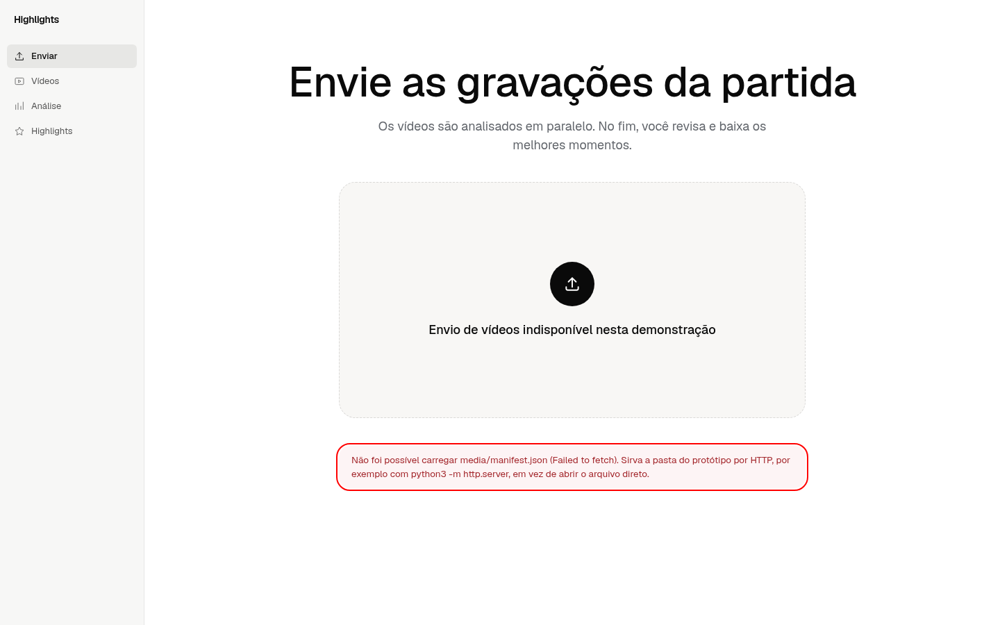 | 2 | Ocorre quando o carregamento falha. Impede iniciar o fluxo e a orientação fica na tela enquanto os exemplos estiverem indisponíveis. Recarregar resolveu após restabelecer a requisição. A mensagem não indica essa ação. | Informar que os vídeos de exemplo não carregaram e oferecer 'Tentar carregar os exemplos novamente'. Manter os detalhes técnicos fora da mensagem principal. |
| V03 | H6 | F02, lote pronto com ponteiro fora dos cartões | Em Vídeos, os quatro cartões aparecem sem indicação de como retirar uma gravação. O × só se revela quando o ponteiro entra no cartão ou o botão recebe foco pelo teclado. P03 precisa explorar o cartão para encontrar a ação. | 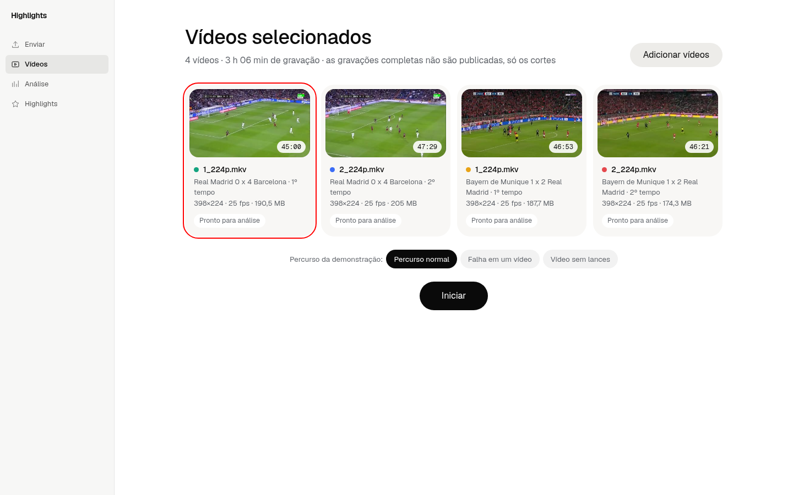 | 1 | Acontece em todos os cartões enquanto o ponteiro está fora deles e o botão está sem foco. A retirada funciona assim que o controle aparece. O problema retorna ao tirar o ponteiro ou mudar o foco. | Deixar a ação Remover visível em cada cartão e manter o contorno de foco para quem usa teclado. |
| V04 | H3 | F03, análise normal em andamento com duas prévias | Ao clicar em Iniciar, as duas prévias da análise começam a tocar em 2×. A tela de acompanhamento não oferece pausa nem opção de esconder as prévias. P01 precisa lidar com o movimento das duas gravações enquanto tenta ler a fila e o progresso. | 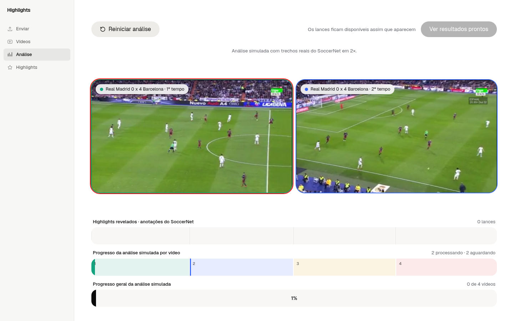 | 2 | Ocorre durante o fluxo normal com as prévias ativas. Dificulta a leitura do andamento para quem precisa reduzir movimento. Cessa quando a etapa termina ou ao sair da tela. | Oferecer um controle para pausar ou ocultar só as prévias e deixar os estados de processamento acessíveis. |
| V05 | H3, H4 | F03, análise concluída com lote sem lances | Ao analisar apenas o segundo tempo de Bayern x Real Madrid no cenário sem lances, a etapa termina com 'Ver os 0 lances na base' desativado. A base com o resumo continua acessível pelo item Highlights na barra lateral. P03 perde a passagem que usaria na conclusão normal. | 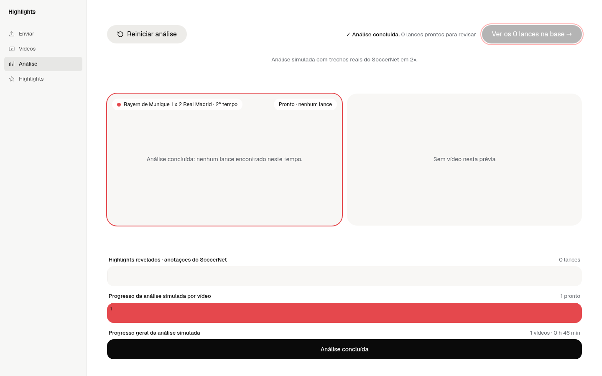 | 2 | Acontece no caso em que todo o lote termina sem cortes. A ação principal fica indisponível durante o estado final. É possível contornar pela barra lateral. | Na conclusão sem cortes, trocar o botão por 'Ver resumo da análise' e abrir a base vazia com o resultado por vídeo. |
| V06 | H1 | F04, lista após analisar somente um tempo sem lances | Na base após analisar um único tempo sem lances, o subtítulo mostra '0 Highlights em 0 Partidas'. A faixa logo abaixo confirma um de um vídeo pronto. P01 precisa ler a faixa para saber se uma partida foi analisada ou se a base abriu sem lote. | 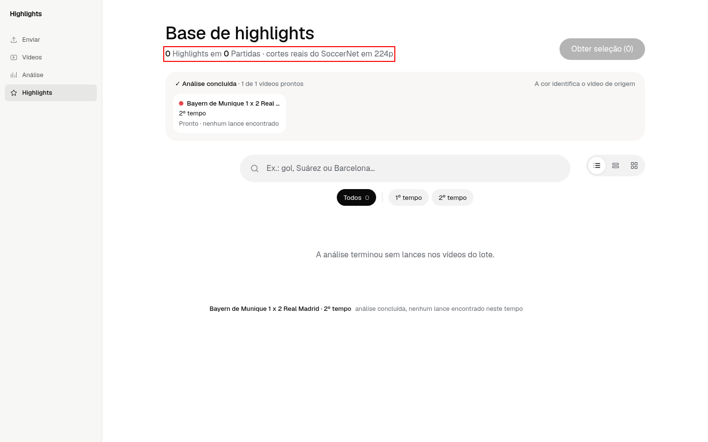 | 1 | A leitura ambígua aparece nesse estado vazio e permanece no cabeçalho. O cartão do vídeo esclarece o que foi analisado e a sequência continua acessível. | Distinguir a quantidade de partidas analisadas da quantidade de partidas com lances. No estado vazio, informar quantos vídeos foram analisados e que nenhum lance foi encontrado. |
| V07 | H6, H4 | F04, mosaico C com lances ainda não selecionados | Ao trocar para Mosaico por tipo, o controle no canto superior direito do cartão de Suárez aparece como um círculo claro sem símbolo. O detalhe oferece '+ Selecionar'. No mosaico, P03 precisa experimentar o círculo para descobrir como marcar um lance diretamente. | 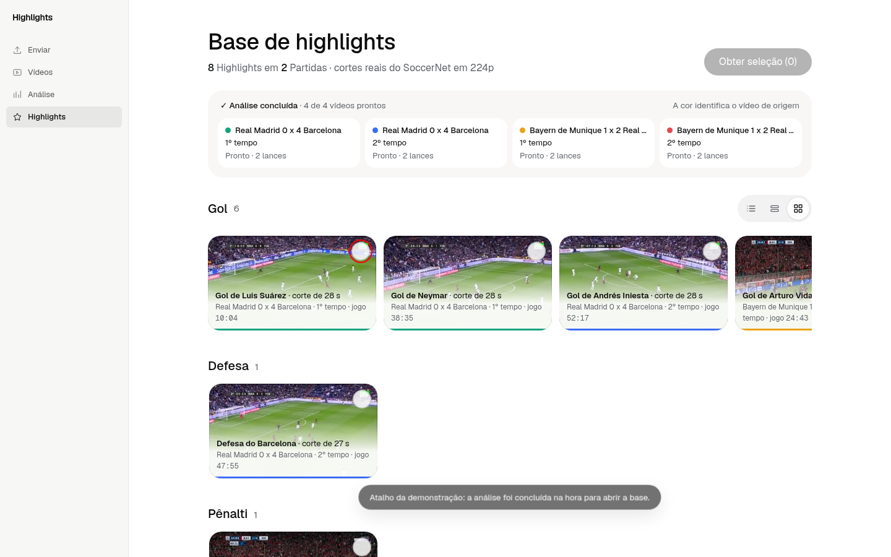 | 2 | O círculo vazio aparece nos cartões ainda não selecionados e continua assim enquanto a seleção não é acionada. É possível selecionar pelo detalhe, ao custo de abrir o lance. | Exibir um sinal de adição com contraste no círculo vazio e manter a marca de seleção para o estado ativo. Identificar a ação também ao passar o mouse ou focar o controle. |
| V08 | H2 | F05, detalhe da defesa do Barcelona | Ao abrir a defesa do Barcelona, o detalhe descreve a defesa em português. A marca de 0:12 no corte aparece como 'Shots on target'. P03 precisa interpretar um termo em inglês para associar o marcador à finalização descrita. | 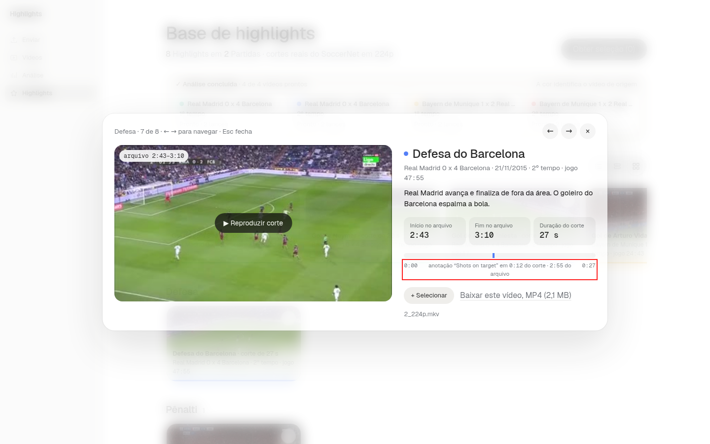 | 1 | É visível toda vez que o detalhe desse lance abre. Afeta uma referência de tempo secundária e os rótulos de jogo, arquivo e duração continuam disponíveis. O termo persiste ao longo da revisão. | Apresentar 'Finalização no alvo' na linha do tempo e preservar a categoria original nos metadados de origem. |
| V09 | H2, H9 | F05, falha controlada de reprodução da defesa do Barcelona | Ao tentar reproduzir a defesa do Barcelona com a mídia indisponível, o botão mostra 'Não deu para carregar (Failed to fetch). Tentar de novo'. P03 recebe uma expressão técnica em inglês no meio da ação em português. | 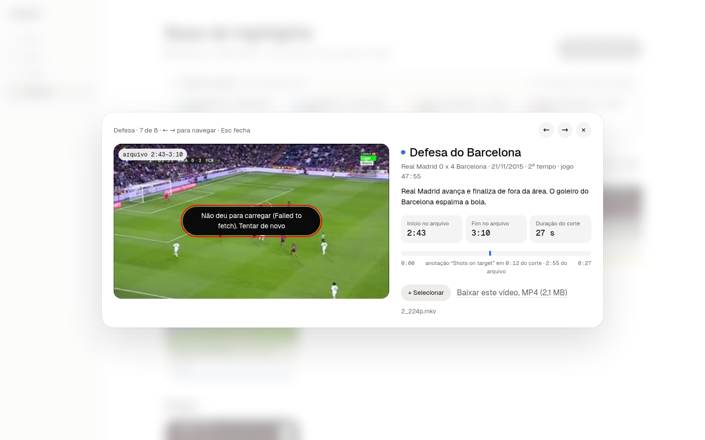 | 1 | Ocorre na falha de carregamento, sob condição controlada. A mensagem dificulta entender o ocorrido. O botão de nova tentativa funcionou quando a mídia voltou. O termo fica até a ação de recuperação. | Informar em português que o corte não pôde ser carregado e apresentar 'Tentar de novo' como ação separada do diagnóstico. |
| V10 | H1, H5 | F04, recarga depois de selecionar um lance no mosaico | Selecionei Suárez no mosaico e recarreguei a página. A base reabriu no mesmo modo com 'Obter seleção (0)', sem explicar o descarte da seleção. P01 precisa reconhecer a mudança no contador e refazer as marcações antes de baixar. | 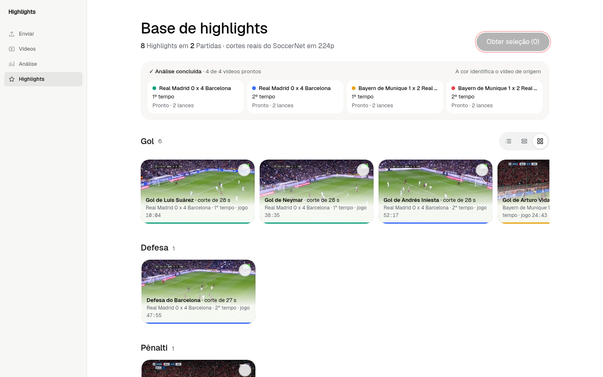 | 2 | Ocorre a cada recarga com seleção aberta. A obtenção continua possível após refazer as marcações. | Avisar junto a Obter seleção que recarregar limpa as marcações e sinalizar antes da recarga quando houver uma seleção em andamento. |
| V11 | H1, H5 | F02, cenário de falha com o vídeo afetado retirado do lote | Em Vídeos, selecionei 'Falha em um vídeo' e retirei o primeiro tempo de Bayern x Real Madrid. O cenário continuou ativo e a descrição ainda dizia que a análise desse primeiro tempo seria interrompida. P01 pode iniciar o lote esperando tratar a falha de um vídeo que deixou de fazer parte da análise. | 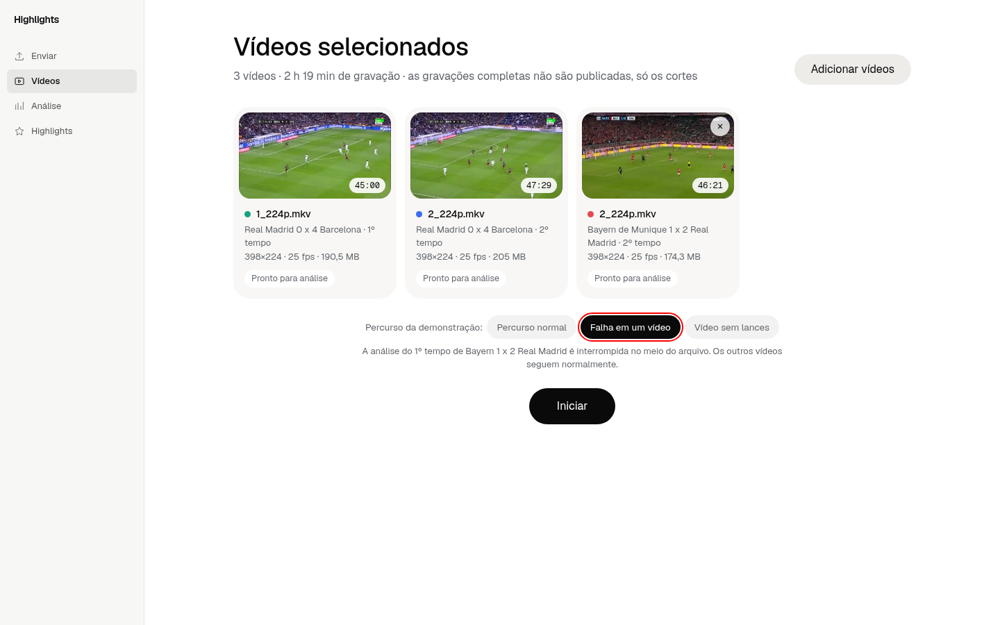 | 2 | Ocorre ao retirar o alvo com o cenário ativo. A promessa incorreta persiste até mudar o lote ou o cenário. Iniciar permanece disponível com uma previsão que já não corresponde aos vídeos escolhidos. | Ao retirar o vídeo necessário, desativar o cenário de falha e informar que aquele cenário depende do primeiro tempo de Bayern x Real Madrid. |
| V12 | H3, H4 | F04 → F01, voltar do navegador após passar de Vídeos a Highlights | Com Enviar como página anterior no histórico, abri Vídeos e avancei até Highlights pela barra lateral. O Voltar do navegador retornou a Enviar e pulou Vídeos. Para rever o lote, P01 precisa escolher a etapa pela barra lateral. | 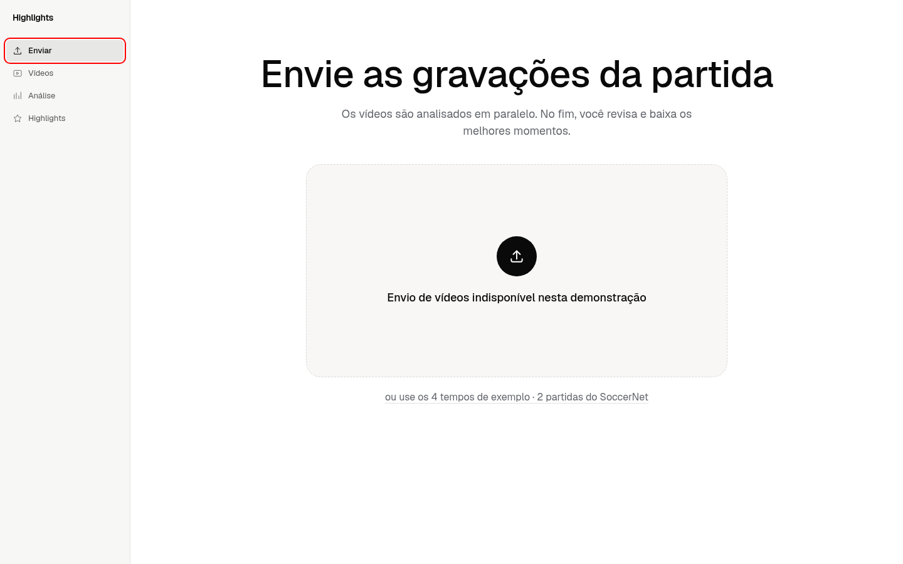 | 2 | Acontece quando se usa Voltar após essa troca interna de etapa. Interrompe a revisão e exige recuperar o caminho no menu. O menu oferece um contorno imediato. | Registrar no histórico do navegador as mudanças de etapa acionadas pela pessoa e restaurar a etapa ao usar Voltar ou Avançar. |
