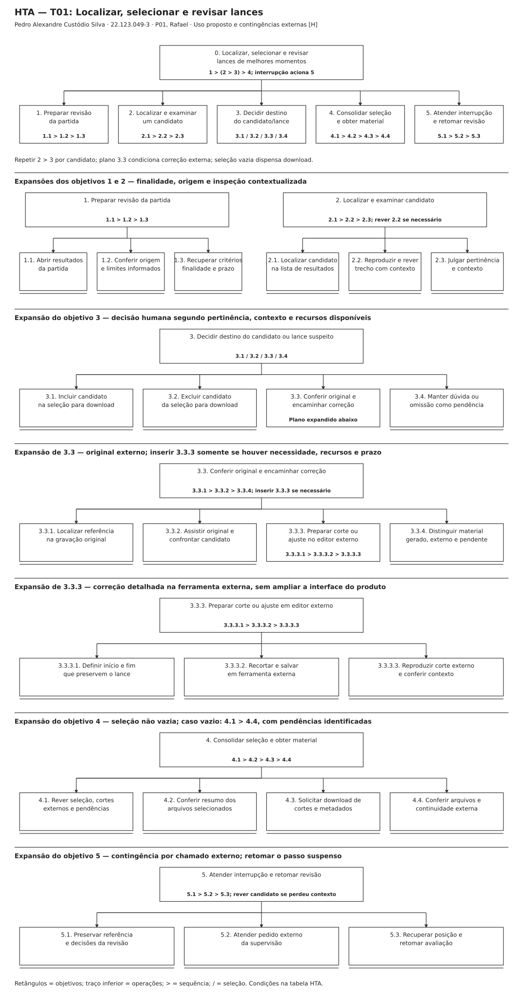
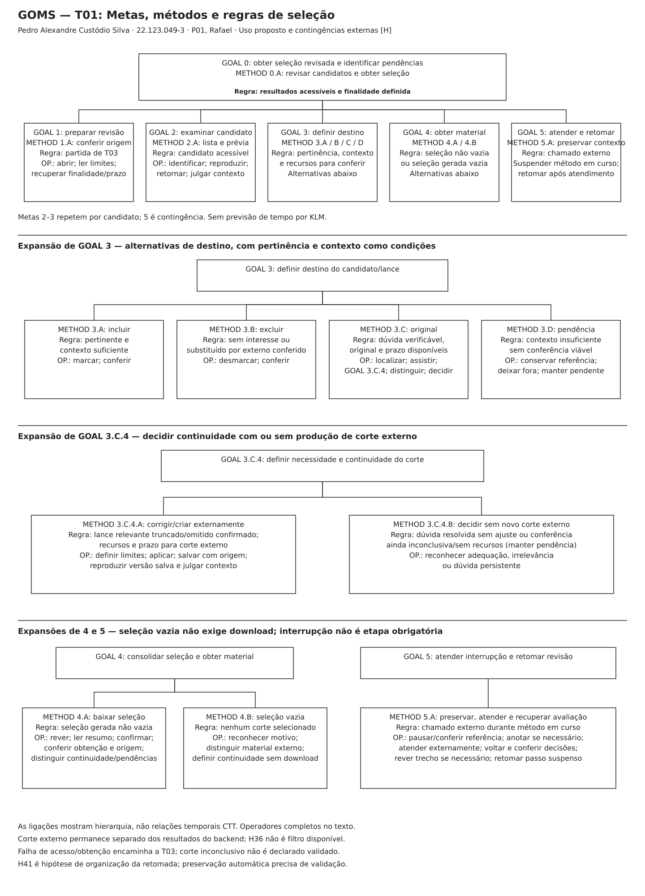
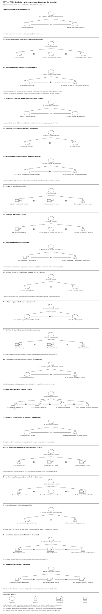
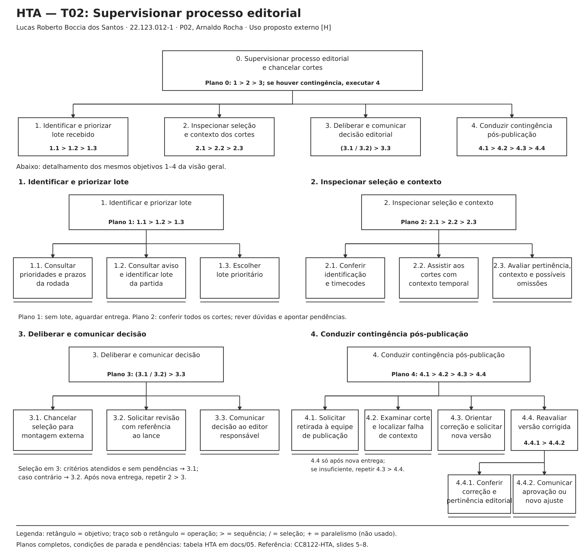
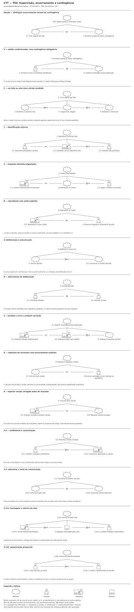
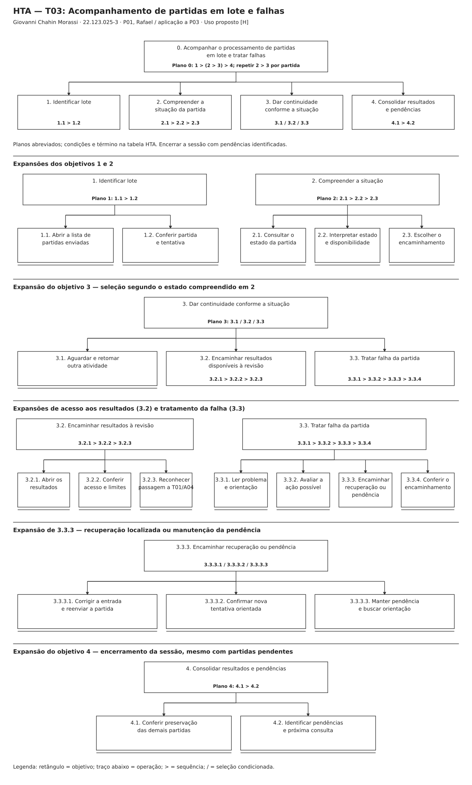
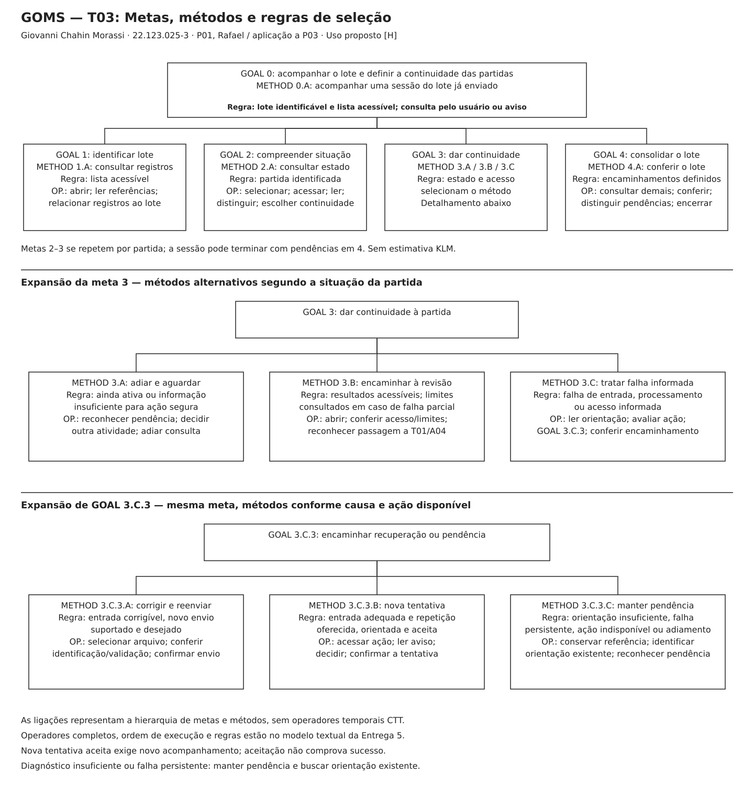
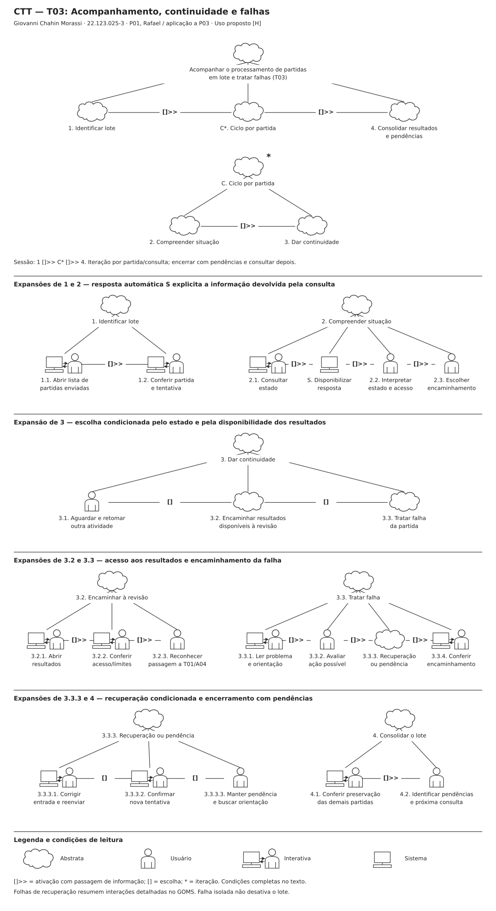

# Entrega 5 — Análise de tarefas: HTA, GOMS e CTT

**Data:** 07/10/2026  
**Revisão de T02:** 09/10/2026, adequação aos modelos dos slides do professor\
**Preenchimento de T03:** 12/10/2026, acompanhamento de partidas em lote e tratamento de falhas\
**Preenchimento de T01:** 13/10/2026, localização, seleção e revisão de lances de melhores momentos\
**Status:** 🟩 T01 (Pedro), T02 (Lucas) e T03 (Giovanni) preenchidas nas três técnicas (HTA, GOMS e CTT); modelos hipotéticos a validar\
**Responsabilidade:** cada integrante modela pelo menos 1 HTA, 1 GOMS e 1 CTT para sua tarefa prioritária. A associação entre tarefas e personas não é exclusiva: T03 tem P01 como referência principal e também atende necessidades de P03; T02 representa o consumo externo de resultados por P02.

---

## Objetivo da atividade

Modelar tarefas importantes sob perspectivas complementares: decomposição hierárquica de objetivos e planos ([HTA — Hierarchical Task Analysis](#hta--t02-supervisionar-processo-editorial)), estrutura cognitiva de metas, operadores, métodos e regras de seleção ([GOMS](#goms--t02-supervisionar-processo-editorial)) e relações temporais e lógicas entre tarefas de usuário, sistema e interação ([CTT — ConcurTaskTrees](#ctt--t02-supervisionar-processo-editorial)). Os diagramas são acompanhados de fundamentação conceitual, interpretação textual e rastreabilidade direta com os artefatos anteriores do projeto.

---

## Para projetos cujo TCC não previa interface

Em conformidade com as diretrizes da disciplina, a modelagem foca nas **tarefas humanas relacionadas ao uso da contribuição técnica**, e não no processamento algorítmico interno dos modelos de visão computacional.

O tema do TCC (*Identificação de Melhores Momentos em Partidas de Futebol Utilizando Sistemas Híbridos de Visão Computacional*, [Entrega 1, seção 0.2](01_conhecendo_o_problema.md#02-qual-é-o-tema-do-trabalho)) tem como saída computacional a detecção automatizada de eventos esportivos e a geração de cortes acompanhados de metadados ([RASTREABILIDADE.md, seção 1](../RASTREABILIDADE.md#1-derivação-do-escopo-de-ihc-a-partir-do-tcc)). As tarefas humanas analisadas descrevem:

- como o editor de vídeo esportivo localiza, seleciona e revisa lances de melhores momentos, com julgamento de pertinência e contexto (T01);
- como o supervisor editorial / editor-chefe recebe, inspeciona e chancela esses resultados para publicação nas redes sociais da emissora, validando o contexto temporal dos lances capitais sob forte pressão de prazo (T02);
- como o editor acompanha o processamento de partidas em lote, interpreta os estados e trata falhas para encaminhar os resultados disponíveis à revisão, preservando as demais partidas (T03, P01; aplicável também a P03).

A análise não modela funções internas da rede neural ou etapas do pipeline de inferência, mas a **tomada de decisão, a inspeção de contexto, o fluxo de aprovação e o tratamento de contingências humanas**.

---

## Seleção das tarefas

A tabela abaixo consolida as tarefas prioritárias a partir dos cenários de problema ([Entrega 4](04_cenarios_problema.md)), das jornadas de uso proposto ([Entrega 3](03_personas_contexto_jornada.md#4-jornada-do-usuário--equipe)) e das necessidades registradas na matriz de rastreabilidade ([RASTREABILIDADE.md, seção 3](../RASTREABILIDADE.md#3-rastreabilidade-entre-contribuição-técnica-necessidades-e-artefatos)). T03 aprofunda A02; o envio inicial (A01) é sua precondição, e a revisão/seleção (A04) é a continuidade apoiada por T01.

| ID | Tarefa | Persona / cenário de origem | Frequência / criticidade | Autor responsável | Status na entrega |
|---|---|---|---|---|---|
| **T01** | Localizar, selecionar e revisar lances de melhores momentos | [P01, Rafael](03_personas_contexto_jornada.md#persona-p01--rafael) / [C01](04_cenarios_problema.md#cenário-c01--seleção-manual-de-melhores-momentos-sob-pressão-de-prazo); jornada proposta, etapas 5–7. Aplicação ao fluxo de revisão de P03, sem filtro automático por jogador | [H] Repetida por candidato e por partida, H07/H39; frequência não medida. Prioridade alta por apoiar pertinência, contexto e continuidade; omissões podem causar retrabalho, H09/H10/H16 | Pedro Alexandre Custódio Silva — 22.123.049-3 | 🟩 Concluída (HTA, GOMS e CTT) |
| **T02** | Supervisionar processo editorial e chancelar cortes esportivos | [P02, Arnaldo](03_personas_contexto_jornada.md#persona-p02--arnaldo) / [C02](04_cenarios_problema.md#cenário-c02--controle-do-processo-editorial-engessado) | Alta frequência em dias de rodada; altíssima criticidade editorial (portão final de controle antes do ar; risco de dano à reputação da emissora) | Lucas Roberto Boccia dos Santos — 22.123.012-1 | 🟩 Concluída (HTA, GOMS e CTT) |
| **T03** | Acompanhar o processamento de partidas em lote e tratar falhas | [P01, Rafael](03_personas_contexto_jornada.md#persona-p01--rafael), jornada, etapas 3–4; [C01](04_cenarios_problema.md#cenário-c01--seleção-manual-de-melhores-momentos-sob-pressão-de-prazo) como contexto. Aplicação a P03, jornada, etapas 3–4, e C03 | [H] Recorrente a cada lote; frequência não medida. Prioridade alta por apoiar a continuidade do trabalho; falhas podem causar atraso, retrabalho e novo custo, H13/H16/H26 | Giovanni Chahin Morassi — 22.123.025-3 | 🟩 Concluída (HTA, GOMS e CTT) |

## Justificativa da prioridade de T01 (Localização, seleção e revisão)

[H] **T01 — Localizar, selecionar e revisar lances de melhores momentos**, de Pedro Alexandre Custódio Silva, aprofunda A04 da [Entrega 1](01_conhecendo_o_problema.md#92-que-ações-o-usuário-deverá-conseguir-realizar). Rafael precisa entregar seleções pertinentes e compreensíveis dentro do prazo; procurar lances, sustentar a atenção e recuperar contexto são dificuldades de C01/H01/H09/H10/H11. H07 sustenta a hipótese de revisão frequente, H30 a preferência por conferir candidatos extras, H39 o volume de partidas e H41 a retomada após interrupções. Essas características não são medições nem garantias de redução de esforço.

**Origem e rastreabilidade:** [P01, Rafael](03_personas_contexto_jornada.md#persona-p01--rafael), [C01](04_cenarios_problema.md#cenário-c01--seleção-manual-de-melhores-momentos-sob-pressão-de-prazo) e jornada proposta de P01, etapas 5–7; R01 é a relação principal. C01 descreve a procura e o corte manuais atuais. Os modelos abaixo representam o **uso proposto**: localizar candidatos nos resultados gerados, assistir, decidir a seleção e baixar; conferir o original e recortar em ferramenta externa são contingências humanas. A ligação está explicitada nas implicações de C01. R04 registra a aplicação à revisão manual por P03: reconhecer a participação do atleta é julgamento do criador; filtro automático por jogador permanece hipótese H36.

**Recorte comum aos modelos:** resultados da partida acessíveis, encaminhados por T03. Revisar uma partida por vez, conservando referências para dúvidas, interrupções e continuidade externa. Seleção para download é distinta da aprovação editorial por P02/T02. Envio inicial e falhas de processamento pertencem a A01/T03; ajustes de limites, novos cortes, montagem e publicação continuam fora da interface. Resultado vazio ou revisão de todos os candidatos não comprovam cobertura completa da partida.

**Base e limites:** RC04/RC05 da [Entrega 2](02_analise_concorrencia.md#5-recomendações-derivadas) apoiam prévia com contexto e decisão humana; RC08 mantém filtros como hipóteses; RC09 orienta resumo antes do download; RC11 orienta acesso por teclado. Critérios, contexto necessário, original acessível e preservação da posição/seleção após interrupção precisam de validação. Não se presume identificação automática de atletas, margem universal de segundos, confiança calibrada ou importação de cortes externos para a aplicação.

---

## HTA — T01: Localizar, selecionar e revisar lances de melhores momentos

**Autor(a):** Pedro Alexandre Custódio Silva — 22.123.049-3\
**Persona relacionada:** P01, Rafael, primária; aplicação à revisão manual de P03, Jorginho Jr.\
**Cenário de origem:** C01, seleção manual sob pressão de prazo; transferência para o uso proposto pela jornada de P01, etapas 5–7.\
**Rastreabilidade:** R01 (principal), R04 (aplicação a P03); A04; H01, H07, H09, H10, H11, H16, H17, H25, H28, H30, H32, H39, H40 e H41; H36/H38 na aplicação a P03.

### Descrição da tarefa

- **Objetivo central [H]:** obter seleção revisada de lances relevantes, com contexto suficiente e origem identificável, para continuar a produção ou encaminhá-la à supervisão.
- **Entrada [H]:** resultados acessíveis, cortes/metadados disponíveis, finalidade editorial e prazo. Original e editor externo são recursos de contingência, cuja disponibilidade precisa ser investigada.
- **Resultado [H]:** cortes gerados selecionados e baixados, se houver seleção não vazia; cortes corrigidos/criados externamente identificados à parte; dúvidas, omissões suspeitas e trechos não conferidos reconhecidos como pendentes. Revisão não autoriza publicação.
- **Exceções [H]:** corte sem contexto, suspeita de omissão, prévia/download indisponível e interrupção pela supervisão. Problemas técnicos são encaminhados a T03; dúvidas editoriais podem exigir o original ou permanecer pendentes.
- **Término:** candidatos acessíveis receberam decisão ou pendência identificada e a seleção foi conferida/obtida. Se o prazo encerrar a revisão, finalizar com material parcial e pendências explícitas, sem declarar candidatos não vistos como revisados. Seleção vazia é possível e não exige download vazio.

### Diagrama HTA



*Figura 6 — HTA de T01, por Pedro Alexandre Custódio Silva. Visão geral, expansões e contingências de original/correção externa e retomada. [SVG editável](../assets/05_tarefas/hta_t01.svg).*

Retângulos representam objetivos; operações têm traço abaixo do retângulo. Planos usam `>` para sequência e `/` para seleção condicionada, conforme os slides 5–8 de **CC8122-HTA**. A tabela completa os planos abreviados do SVG com repetição, desvios e término. O ramo 5 é acionado por interrupção, não uma etapa obrigatória após download.

### Decomposição e planos

| Objetivos / Operações | Problemas e Recomendações |
|---|---|
| **0. Localizar, selecionar e revisar lances de melhores momentos** | **Input:** resultados acessíveis e finalidade. **Plano 0:** `1 > (2 > 3) > 4`; repetir `2 > 3` por candidato. Suspeita de omissão pode iniciar 3.3 com a referência disponível, mesmo sem candidato correspondente. Interrupção aciona 5 e retoma o passo suspenso; contexto perdido exige repetir 2. **Feedback:** seleção obtida ou continuidade parcial/pendências identificadas. **Problema:** cansaço, prazo e omissões, C01. **Recomendação:** revisão contextualizada e decisão humana, RC04/RC05. |
| **1. Preparar a revisão da partida** | **Plano 1:** `1.1 > 1.2 > 1.3`. **Feedback:** origem, limites conhecidos e critérios recuperados. Resultados inacessíveis retornam a T03. Lista vazia segue a 4 para reconhecer seleção vazia e necessidade de conferência, sem afirmar ausência de lances. |
| 1.1. Abrir os resultados da partida | **Ação:** acessar a partida encaminhada por T03. **Feedback:** candidatos/metadados acessíveis ou falha reconhecida; não continuar sem acesso. **Problema:** confusão de partidas/tentativas, H25. |
| 1.2. Conferir origem e limites informados | **Ação:** conferir partida, timecodes, falhas parciais e partes não analisadas quando informadas. **Feedback:** alcance conhecido da revisão. Ausência de alerta não comprova análise integral, RC05. |
| 1.3. Recuperar finalidade, critérios e prazo | **Input:** pauta ou finalidade definida externamente. **Ação:** decidir o que procura e quanto tempo há para revisão. **Feedback:** critérios provisórios de pertinência. Tipos de lance não são regra universal, H11/H28. |
| **2. Localizar e examinar um candidato** | **Plano 2:** `2.1 > 2.2 > 2.3`; repetir reprodução/retorno em 2.2 se necessário. **Feedback:** avaliação com dúvida reconhecida, se houver. |
| 2.1. Localizar candidato na lista de resultados | **Ação:** reconhecer tipo de lance/timecode disponíveis e escolher o próximo candidato. **Feedback:** candidato identificado. Filtros ajudam somente se existentes; não são precondição nem asseguram cobertura, RC08. |
| 2.2. Reproduzir e rever o trecho com contexto | **Ação:** assistir, pausar e retornar para observar construção e desfecho. **Feedback:** contexto percebido ou insuficiente. Quantidade de contexto a investigar; ajuste do limite fica no editor externo, RC04/RC05. |
| 2.3. Julgar pertinência e suficiência do contexto | **Ação:** confrontar o trecho com a finalidade e identificar dúvida, truncamento ou suspeita de omissão. **Feedback:** decisão fundamentada para 3. Discordar da sugestão é julgamento editorial, H10/H30. |
| **3. Decidir o destino do candidato ou lance suspeito** | **Plano 3:** `3.1 / 3.2 / 3.3 / 3.4`. Incluir se pertinente e compreensível; excluir se sem interesse editorial ou substituído por corte externo conferido; conferir original se dúvida/omissão verificável; manter pendência se inconclusivo sem conferência possível. Depois de 3.3, decidir novamente 3.1/3.2/3.4 para o candidato gerado; cortes externos são identificados à parte. **Feedback:** inclusão, exclusão, esclarecimento ou pendência. |
| 3.1. Incluir candidato na seleção para download | **Ação:** marcar o corte gerado e conferir inclusão. **Feedback:** candidato selecionado. H30 favorece conferir candidatos extras, sem tratar contexto insuficiente como resolvido. |
| 3.2. Excluir candidato da seleção para download | **Ação:** desmarcar ou deixar fora da seleção o candidato sem pertinência ou substituído por corte externo conferido. **Feedback:** corte gerado não incluído; origem e eventual versão externa preservadas. Não excluir definitivamente o vídeo nem tratar escolha como erro, RC05. |
| **3.3. Conferir lance no original e encaminhar correção** | **Plano 3.3:** `3.3.1 > 3.3.2 > 3.3.4`; inserir 3.3.3 entre 3.3.2 e 3.3.4 somente se houver corte necessário e recursos/prazo. Se não localizar o trecho ou não conseguir assistir, manter pendência por 3.4. **Feedback:** dúvida esclarecida, corte externo conferido ou pendência. Não garante encontrar lance omitido. |
| 3.3.1. Localizar referência na gravação original | **Ação:** relacionar partida/timecode ao original e procurar o instante no editor externo; sem tempo exato, usar referência disponível e reconhecer incerteza. **Feedback:** trecho localizado ou busca pendente. Não confundir tempo do arquivo e minuto do jogo, H25. |
| 3.3.2. Assistir ao original e confrontar o candidato | **Ação:** observar construção/desfecho e comparar com o corte ou conferir lance ausente. **Feedback:** adequação/necessidade de ajuste reconhecida ou dúvida persistente. Sem original acessível, escolher 3.4. |
| **3.3.3. Preparar corte ou ajuste em editor externo** | **Plano 3.3.3:** `3.3.3.1 > 3.3.3.2 > 3.3.3.3`; repetir se insuficiente e houver prazo, ou manter pendência. **Feedback:** corte externo conferido, sem importação presumida para o produto. |
| 3.3.3.1. Definir início e fim que preservem o lance | **Ação:** escolher limites no original conforme construção/desfecho. **Feedback:** intervalo definido por julgamento humano, H11; sem margem universal de segundos. |
| 3.3.3.2. Recortar e salvar em ferramenta externa | **Ação:** aplicar limites no editor habitual e salvar com origem identificável. **Feedback:** arquivo externo produzido ou salvamento pendente. Produto não oferece edição detalhada. |
| 3.3.3.3. Reproduzir corte externo e conferir contexto | **Ação:** assistir à versão salva e verificar compreensão do lance. **Feedback:** adequação ou novo ajuste necessário. Corte manual não recebe automaticamente metadados do backend. |
| 3.3.4. Distinguir material gerado, externo e pendente | **Ação:** decidir destino do candidato gerado e reconhecer cortes externos conferidos ou lacunas. **Feedback:** versões identificadas. Dúvida resolvida sem ajuste retorna a 3.1/3.2; inconclusiva, a 3.4. Se um corte externo substitui o gerado truncado, deixar o gerado fora do download. |
| 3.4. Manter dúvida ou omissão como pendência | **Ação:** conservar referência/motivo e não declarar lance validado; manter candidato inconclusivo fora da seleção utilizável. **Feedback:** pendência explícita. Anotação pode ser externa; recurso próprio ainda a validar. |
| **4. Consolidar seleção e obter material** | **Plano 4:** `4.1 > 4.2 > 4.3 > 4.4` se houver seleção gerada não vazia; com seleção vazia, `4.1 > 4.4`, sem download. Seleção incorreta retorna a 2/3; falha de obtenção encaminha a T03 e mantém entrega pendente. **Feedback:** material obtido e limites reconhecidos. |
| 4.1. Rever seleção, cortes externos e pendências | **Ação:** conferir inclusões e dúvidas resolvidas; distinguir não vistos, pendentes e descartados. **Feedback:** seleção coerente com a finalidade. Candidatos vistos não significa todos os lances encontrados, H10/RC05. |
| 4.2. Conferir resumo dos arquivos selecionados | **Ação:** ler quantidade, origem, duração/formato conhecidos e tamanho somente quando estimável. **Feedback:** seleção para download conferida. Resumo do produto não conta cortes externos, RC09. |
| 4.3. Solicitar download dos cortes e metadados | **Ação:** confirmar obtenção apenas da seleção gerada e metadados disponíveis. **Feedback:** estados reais da preparação/transferência e arquivos acessíveis ou falha. Não montar compacto no produto. |
| 4.4. Conferir arquivos e continuidade externa | **Ação:** verificar obtenção, origem e associação dos metadados; separar cortes externos e pendências. **Feedback:** material para montagem externa ou encaminhamento a Arnaldo/T02 pelo canal externo H40, com pendências informadas. Com seleção vazia, distinguir cortes externos e conferências futuras. Não executar publicação nem chancela. |
| **5. Atender interrupção e retomar revisão** | **Input:** chamado da supervisão durante o trabalho, H41. **Plano 5:** `5.1 > 5.2 > 5.3`; retornar ao passo suspenso. **Feedback:** contexto recuperado. Preservação automática é hipótese de design a validar. |
| 5.1. Preservar referência e decisões da revisão | **Ação:** pausar e conferir partida, candidato, posição e seleção; anotar se a interface não preservar referência. **Feedback:** ponto de retorno identificável. Não pausar a inferência. |
| 5.2. Atender pedido externo da supervisão | **Ação:** consultar a referência solicitada e responder pelo canal externo ou presencialmente. **Feedback:** demanda encaminhada; não é tela de aprovação, H40/H41. |
| 5.3. Recuperar posição e retomar avaliação | **Ação:** voltar à partida/candidato, conferir decisões e rever trecho se perdeu o contexto. **Feedback:** continuidade ou reconstrução ainda pendente. Posição do vídeo sozinha pode não bastar. |

### Verificação do HTA

Ramos 1–4 formam o percurso regular; 5 trata suspensão/retomada. Busca no original e correção externa são condicionadas: 3.3 explicita quando inserir 3.3.3. Cada objetivo decomposto tem plano; folhas são operações sublinhadas no SVG. Decisões cognitivas são separadas dos comandos, e o material gerado permanece distinto de cortes externos e pendências. Término não depende de promessa de cobertura completa.

---

## GOMS — T01: Localizar, selecionar e revisar lances de melhores momentos

**Autor(a):** Pedro Alexandre Custódio Silva — 22.123.049-3\
**Recorte:** uso proposto de P01/R01, conferência/correção externas e retomada H41; aplicação à revisão manual de P03/R04.\
**Abordagem:** GOMS hierárquico conforme slides 3–13 de **CC8122-GOMS-CTT**. Sem KLM: tempo de vídeo, julgamento, busca e interrupções exigem observação e interface definida.

### Diagrama GOMS



*Figura 7 — GOMS de T01, por Pedro Alexandre Custódio Silva. Resumo das metas/alternativas; operadores completos abaixo. [SVG editável](../assets/05_tarefas/goms_t01.svg).*

### Modelo hierárquico de metas, métodos e operadores

```text
GOAL 0: obter seleção revisada e identificar pendências da partida
  METHOD 0.A: revisar candidatos disponíveis e obter a seleção
  (SEL. RULE: resultados acessíveis e finalidade definida)
    GOAL 1: preparar revisão
      METHOD 1.A: conferir origem, limites e critérios
      (SEL. RULE: partida encaminhada por T03)
        OP. 1.A.1: abrir os resultados da partida
        OP. 1.A.2: ler origem, timecodes e limites conhecidos
        OP. 1.A.3: recuperar finalidade e prazo
    GOAL 2: examinar candidato
      METHOD 2.A: localizar na lista e assistir ao trecho
      (SEL. RULE: candidato acessível; repetir por candidato)
        OP. 2.A.1: identificar próximo candidato por dados disponíveis
        OP. 2.A.2: selecionar candidato e iniciar reprodução
        OP. 2.A.3: assistir à construção e ao desfecho disponíveis
        OP. 2.A.4: pausar e retornar quando necessário
        OP. 2.A.5: julgar pertinência, contexto e dúvidas
    GOAL 3: definir destino do candidato ou lance suspeito
      METHOD 3.A: incluir corte gerado
      (SEL. RULE: pertinente e com contexto suficiente)
        OP. 3.A.1: acionar inclusão na seleção
        OP. 3.A.2: conferir inclusão
      METHOD 3.B: deixar corte gerado fora da seleção
      (SEL. RULE: sem pertinência editorial ou substituído por corte externo conferido)
        OP. 3.B.1: desmarcar ou manter desmarcado o corte
        OP. 3.B.2: conferir exclusão apenas da seleção para download
      METHOD 3.C: esclarecer dúvida ou omissão no original
      (SEL. RULE: dúvida verificável, original disponível e prazo;
       suspeita de omissão pode iniciar o método sem candidato gerado)
        OP. 3.C.1: recuperar partida e referência temporal disponível
        OP. 3.C.2: abrir gravação no editor externo e localizar o trecho
        OP. 3.C.3: assistir ao contexto e comparar com candidato, se existente
        GOAL 3.C.4: definir necessidade e continuidade do corte
          METHOD 3.C.4.A: corrigir/criar corte externamente
          (SEL. RULE: lance relevante truncado/omitido confirmado;
           recursos e prazo para corte externo)
            OP. 3.C.4.A.1: definir início e fim com construção/desfecho
            OP. 3.C.4.A.2: aplicar limites no editor externo
            OP. 3.C.4.A.3: salvar com identificação de origem
            OP. 3.C.4.A.4: reproduzir arquivo salvo e julgar contexto
          METHOD 3.C.4.B: decidir sem novo corte externo
          (SEL. RULE: original resolve a dúvida sem ajuste ou a conferência
           permanece inconclusiva/sem recursos; neste caso, manter pendência)
            OP. 3.C.4.B.1: reconhecer adequação, irrelevância ou dúvida persistente
        OP. 3.C.5: distinguir candidato gerado, corte externo e pendência
        OP. 3.C.6: decidir 3.A/3.B para candidato gerado ou 3.D se inconclusivo;
         deixar gerado truncado fora do download se substituído por corte externo
      METHOD 3.D: manter pendência editorial
      (SEL. RULE: contexto insuficiente, original inacessível, prazo esgotado
       ou avaliação inconclusiva, sem inclusão segura)
        OP. 3.D.1: conservar referência e motivo da conferência
        OP. 3.D.2: manter candidato não validado fora da seleção utilizável
        OP. 3.D.3: reconhecer pendência sem declarar revisão completa
    GOAL 4: consolidar seleção e obter material
      METHOD 4.A: baixar seleção gerada não vazia e conferir continuidade
      (SEL. RULE: seleção conferida com ao menos um corte gerado)
        OP. 4.A.1: rever inclusões, cortes externos e pendências
        OP. 4.A.2: ler resumo de quantidade, origem e formato disponíveis
        OP. 4.A.3: conferir seleção e confirmar download de cortes/metadados
        OP. 4.A.4: verificar obtenção e vínculo dos arquivos com a origem
        OP. 4.A.5: distinguir material utilizável e pendências para uso externo
      METHOD 4.B: encerrar com seleção gerada vazia
      (SEL. RULE: nenhum corte gerado selecionado ou resultados vazios)
        OP. 4.B.1: reconhecer seleção vazia e motivo conhecido
        OP. 4.B.2: distinguir cortes externos e conferências pendentes
        OP. 4.B.3: definir continuidade externa ou conferência posterior, sem download vazio
    GOAL 5: atender interrupção e retomar revisão
      METHOD 5.A: preservar referência, atender e recuperar avaliação
      (SEL. RULE: chamado externo durante a tarefa; suspender método em curso)
        OP. 5.A.1: pausar e conferir partida, candidato, posição e decisões
        OP. 5.A.2: anotar referência se a interface não a conservar
        OP. 5.A.3: atender pedido por canal externo ou presencialmente
        OP. 5.A.4: voltar à partida/candidato e conferir decisões preservadas
        OP. 5.A.5: rever trecho se necessário e retomar passo suspenso
```

**Regras e repetições:** executar metas 2–3 por candidato e rever dúvidas resolvidas antes de 4. Meta 5 é contingência por interrupção, não etapa depois do download. Contexto perdido exige repetir 2 antes de decidir 3. Métodos 3.A–D condicionam o destino; 3.C.4.A/B definem continuidade com ou sem nova versão externa. Se o ajuste continuar insuficiente, repetir enquanto viável ou adotar 3.D. Busca/reprodução/salvamento sem sucesso interrompem aquele encaminhamento e mantêm pendência. Falha de prévia/download encaminha a T03; não prosseguir como se tivesse ocorrido sucesso. Lista vazia dispensa 2–3 e usa 4.B.

**Correspondência com HTA:** metas 1, 2, 4 e 5 seguem ramos homônimos; 3.A–D correspondem a 3.1–3.4. 3.C.4.A expande 3.3.3; 3.C.4.B representa a dispensa condicionada. Ler/assistir são perceptivos; selecionar/pausar/salvar são externos; julgar/reconhecer/decidir são cognitivos. Cortes externos não são saídas do backend nem entram automaticamente na seleção do produto. Métodos não pressupõem seleção editorial única correta; participação de atleta por P03 é conferida manualmente, H36/H38.

---

## CTT — T01: Localizar, selecionar e revisar lances de melhores momentos

**Autor(a):** Pedro Alexandre Custódio Silva — 22.123.049-3\
**Abordagem:** árvore e relações temporais conforme slides 19–24 de **CC8122-GOMS-CTT**.\
**Fronteira dos sistemas:** lista/player/seleção/download na interface proposta; original/recorte/salvamento no editor externo; contato com supervisão por canal externo. Backend disponibiliza resultados e prepara arquivos selecionados, sem decidir a seleção editorial.

### Diagrama CTT



*Figura 8 — CTT de T01, por Pedro Alexandre Custódio Silva. Visão geral e expansões com relações entre irmãs; 5 suspende o percurso regular e permite retomada. [SVG editável](../assets/05_tarefas/ctt_t01.svg).*

IDs acompanham o HTA. `R` agrupa o percurso regular e `C` o ciclo por candidato. `D` escolhe produzir corte externo (3.3.3) ou reconhecer sua dispensa/impossibilidade (`N`), segundo a conferência. `S` explicita preparação/disponibilização automática do download, implícita em 4.3 no HTA. Ligações descendentes representam decomposição; horizontais representam relações temporais entre irmãs.

### Leitura da árvore e condições

1. **Tarefa global:** `R |> 5`, com `R = (1 []>> C* []>> 4)` e `C = (2 []>> 3)`. Repetir inspeção/decisão por candidato, incluindo nova conferência de dúvida resolvida. Prazo esgotado leva à consolidação parcial em 4, com não vistos identificados; lista vazia dispensa C. Suspeita de omissão permite entrar em 3.3 com referência disponível, mesmo sem candidato correspondente, conforme o plano HTA.
2. **Preparação (1):** `1.1 []>> 1.2 []>> 1.3`. Resultados/origem/limites informam a recuperação da finalidade e prazo. Falha de acesso retorna a T03, sem iniciar inspeção sem prévia acessível.
3. **Inspeção (2):** `2.1 []>> 2.2* []>> 2.3`. Candidato localizado é reproduzido e alimenta julgamento humano. Iteração em 2.2 significa rever o trecho quando necessário, não assistir a vários vídeos simultaneamente.
4. **Decisão (3):** `3.1 [] 3.2 [] 3.3 [] 3.4`: incluir, excluir da seleção, conferir original ou manter pendência. Depois de 3.3, retornar à decisão conforme a informação obtida. Escolha não permite incluir corte inconclusivo como validado sem satisfazer 3.1.
5. **Original/correção (3.3):** `3.3.1 []>> 3.3.2 []>> D []>> 3.3.4`, com `D = (3.3.3 [] N)`. Original informa se é necessário corte externo; N reconhece dispensa/impossibilidade, não aprova automaticamente. Dúvida persistente segue a 3.4. Produção externa: `3.3.3.1 []>> 3.3.3.2 []>> 3.3.3.3` (definir limites, recortar/salvar, conferir). Repetir se insuficiente e viável; falha de busca/acesso/salvamento mantém pendência, conforme HTA/GOMS.
6. **Consolidação (4):** seleção não vazia usa `4.1 []>> 4.2 []>> 4.3 []>> S []>> 4.4`. Resumo precede pedido; S prepara/disponibiliza arquivos sem novo comando; 4.4 confere obtenção/origem, separando cortes externos. Seleção vazia dispensa 4.2, 4.3 e S, usando `4.1 []>> 4.4`. Falha na obtenção exige T03; não equivale a arquivo obtido. Esses desvios são condições dos planos, não operações de montagem ou publicação.
7. **Interrupção (5):** `5.1 []>> 5.2 []>> 5.3`. Preservar referência informa atendimento externo e retorno. `|>` suspende R e o retoma após 5; `[>` encerraria a instância e não foi usado. Preservação é requisito hipotético H41; quando insuficiente, reinspecionar. O operador modela organização do trabalho humano, não pausa da inferência. Novos chamados podem reaplicar a regra durante R.

### Legenda e relações temporais usadas

| Relação CTT | Notação | Significado e ocorrência em T01 |
|---|---|---|
| Ativação com passagem de informação | `T1 []>> T2` | Informação alimenta a tarefa seguinte: candidato para inspeção, contexto para decisão e seleção para resumo. |
| Escolha | `T1 [] T2` | Iniciar uma alternativa desabilita as demais naquela decisão, conforme as condições de pertinência/contexto. |
| Suspensão/retomada | `T1 \|> T2` | T2 suspende T1, que retoma após T2. Percurso R e interrupção 5. |
| Iteração | `T*` | Repetir ciclo C e reprodução 2.2; condições de término/retorno no texto. |

Não se presume inspeção concorrente de vários vídeos por Rafael. Processamento remoto de T03 não exige `|||` na revisão. A correção externa é interação com outra ferramenta, sem ampliar a interface do produto.

### Tipos de tarefas

| Símbolo no diagrama | Tipo nos slides | Aplicação no modelo |
|---|---|---|
| Nuvem | Abstrata | Objetivo global, R, C, ramos 1–5, conferência 3.3, decisão D e correção 3.3.3. |
| Pessoa | Usuário | Recuperar critérios (1.3), julgar (2.3), reconhecer dispensa/impossibilidade (N), definir limites (3.3.3.1), distinguir versões/pendências (3.3.4), manter pendência (3.4) e avaliar seleção/pendências (4.1). |
| Pessoa e computador, com seta dupla | Interativa | Consultar origem/resultados (1.1–2), localizar/reproduzir (2.1–2), marcar/desmarcar (3.1–2), localizar/assistir original (3.3.1–2), recortar/salvar/reproduzir externamente (3.3.3.2–3), conferir resumo/pedir download (4.2–3), conferir arquivos (4.4) e preservar/recuperar referência (5.1/5.3). 5.2 usa chat externo na variante desenhada; alternativa presencial no GOMS. |
| Computador | Sistema | Preparar/disponibilizar arquivos selecionados (S), sem realizar decisão editorial. |

---

## Síntese da modelagem de T01 e implicações para o projeto

Os modelos são **propostas a validar**, derivadas de C01 e da jornada proposta de P01:

1. **Contexto e julgamento:** lista e referência temporal localizam candidatos; reprodução apoia inspeção. Relevância depende da finalidade; H30 favorece conferir candidatos extras sem garantir cobertura completa. Contexto suficiente precisa de pesquisa, RC04/RC05.
2. **Correção externa identificável:** suspeita de omissão/truncamento exige original quando disponível. Limites e salvamento acontecem no editor externo; cortes manuais não herdam metadados do backend nem entram automaticamente na seleção da aplicação.
3. **Interrupções e continuidade:** preservar partida, posição e decisões e reinspecionar quando necessário é hipótese H41. T03 trata disponibilidade/falhas; T01 prepara seleção/obtenção; T02 recebe material para decisão externa, H40.
4. **Resultados parciais/vazios:** candidatos vistos não comprovam todos os lances encontrados. Separar descartes deliberados, não vistos e dúvidas evita tratar seleção parcial como completamente conferida. Não exigir download vazio.
5. **Aplicação e investigação:** R04 liga a revisão a P03, com identificação manual do atleta e vocabulário H38; H36 permanece exploratória. Na Entrega 7, investigar critérios, contexto, tempo de revisão, suspeitas de omissão, interrupções e uso externo dos arquivos. Não se fixam métricas empíricas nem funcionalidades fora do recorte.

---

### Justificativa da prioridade de T02 (Supervisão Editorial)

[H] A tarefa **T02 — Supervisionar processo editorial e chancelar cortes esportivos**, de Lucas Roberto, foi escolhida porque Arnaldo Rocha (P02) precisa decidir se o material recebido preserva a intenção editorial e o contexto dos lances sob pressão de prazo. O [cenário C02](04_cenarios_problema.md#cenário-c02--controle-do-processo-editorial-engessado) descreve a dificuldade de atender vários editores, o risco de aprovar cortes sem conferência suficiente e uma contingência de despublicação. São situações hipotéticas, derivadas de H10, H14, H22, H23 e H33, a investigar com profissionais.

**Recorte comum aos três modelos:** uso proposto dos cortes e metadados **fora da interface do produto**, após a revisão e o download pelo editor (A04). Arnaldo consulta os arquivos em sua estação ou ao lado do editor e comunica a decisão por canal externo. A pasta compartilhada e o chat são escolhas hipotéticas da jornada de P02 e de H40; a inspeção presencial é uma alternativa descrita em C02. A contingência retoma esse cenário como exceção ao uso proposto. Não se modela uma tela própria de aprovação, auditoria ou publicação no produto. H35 continua exploratória.

**Base e limites:** P02 é uma proto-persona, e os modelos não resultam de observação empírica. Critérios editoriais, canais, volume de partidas, duração do contexto temporal e benefício esperado precisam de validação na Entrega 7. O índice automático não comprova que todos os lances relevantes foram encontrados; uma suspeita de omissão exige conferência com o editor e, se necessário, com a gravação original.

**Referência de notação:** [CC8122-HTA](../slides_plinio/CC8122-HTA.pdf), slides 4–8 (objetivos, operações, planos e tabela detalhada), e [CC8122-GOMS-CTT](../slides_plinio/CC8122-GOMS-CTT.pdf), slides 3–13 (hierarquia GOMS) e 19–24 (tipos de tarefas e relações CTT). T01, T02 e T03 seguem esses exemplos.

---

## HTA — T02: Supervisionar processo editorial

**Autor(a):** Lucas Roberto Boccia dos Santos — 22.123.012-1\
**Persona relacionada:** [P02, Arnaldo Rocha](03_personas_contexto_jornada.md#persona-p02--arnaldo), editor-chefe, persona atendida\
**Cenário de origem:** [C02 — Controle do Processo Editorial Engessado](04_cenarios_problema.md#cenário-c02--controle-do-processo-editorial-engessado)\
**Rastreabilidade:** [R03](../RASTREABILIDADE.md#3-rastreabilidade-entre-contribuição-técnica-necessidades-e-artefatos); H10, H14, H16, H22, H23, H25, H33, H34, H35 e H40. H41 trata das interrupções do editor e não comprova uma rotina de retomada de Arnaldo.

### Descrição da tarefa

- **Objetivo central [H]:** avaliar a seleção recebida, preservar contexto e pertinência editorial e orientar sua continuidade para montagem externa ou revisão.
- **Entrada [H]:** lote de cortes e metadados identificado por partida, aviso do editor e prioridades da rodada. Um pedido presencial de ajuda pode iniciar a inspeção na ilha de edição.
- **Resultado [H]:** decisão comunicada ao editor, identificando o lote aprovado para montagem ou os ajustes necessários. Devolução é um resultado daquele ciclo, mas a chancela fica pendente até a versão corrigida ser conferida.
- **Exceção [H]:** alerta de publicação com falha de contexto; Arnaldo solicita retirada à equipe responsável, orienta correção e reavalia a nova versão. A remoção e a postagem são realizadas fora do produto.

### Diagrama HTA



*Figura 1 — HTA de T02, por Lucas Roberto. A visão geral e os detalhamentos dos ramos 1–4 compõem a mesma hierarquia. [SVG editável](../assets/05_tarefas/hta_t02.svg).*

Como nos slides 5 e 6 de **CC8122-HTA**, retângulos representam objetivos e um traço abaixo do retângulo identifica **operações**, onde a decomposição termina. Os planos ficam nos objetivos decompostos. `>` indica sequência, `/` indica seleção segundo uma condição e `+` indicaria paralelismo. Não foi presumida execução simultânea por Arnaldo; vários editores trabalhando em paralelo não obrigam a usar `+` na sua tarefa. Nos planos, usam-se os IDs completos para evitar ambiguidade entre ramos.

### Decomposição e planos

A tabela segue o modelo do slide 8: **Objetivos/Operações** e **Problemas e Recomendações**, com entrada (*Input*), ação, avaliação do resultado (*Feedback*) e plano quando pertinente. Recomendações são propostas a investigar, não funcionalidades automaticamente incluídas.

| Objetivos / Operações | Problemas e Recomendações |
|---|---|
| **0. Supervisionar processo editorial e chancelar cortes** | **Input:** prioridades da rodada, lotes recebidos e eventuais alertas externos. **Plano 0:** `1 > 2 > 3` para cada lote. Se 3.2 for escolhido, aguardar nova versão e repetir `2 > 3`. Encerrar quando os lotes recebidos estiverem encaminhados ou ao fim do turno, deixando explícitas as pendências. Em caso de falha editorial publicada, interromper o ciclo e executar 4; os demais lotes permanecem pendentes e exigem um novo ciclo. **Feedback:** editor informado sobre a seleção aprovada ou sobre a revisão necessária. **Problema:** aprovações apressadas e material difícil de identificar, C02/H33. **Recomendação:** preservar identificação e contexto nos resultados baixados, RC05/RC09. |
| **1. Identificar e priorizar lote recebido** | **Plano 1:** `1.1 > 1.2 > 1.3`; se nenhum lote estiver disponível, aguardar a entrega. **Feedback:** partida, material e prioridade definidos. **Problema:** chamados simultâneos dificultam ordenar o atendimento, C02. **Recomendação:** investigar como o editor comunica andamento e entrega, H40. |
| 1.1. Consultar prioridades e prazos da rodada | **Input:** pauta e anotações externas. **Ação:** conferir prioridades combinadas com os editores. **Feedback:** critérios de atendimento recuperados. |
| 1.2. Consultar aviso e identificar lote da partida | **Input:** aviso no chat e arquivos na pasta compartilhada, H40. **Ação:** conferir partida de origem e lote recebido. **Problema:** arquivos misturados ou sem identificação, H25/H33. **Recomendação:** nomes e metadados legíveis fora da interface, RC05/RC09. |
| 1.3. Escolher lote prioritário | **Ação:** escolher o próximo lote considerando prazo, pauta e dúvidas sinalizadas. **Feedback:** lote a inspecionar definido. **Problema:** prioridade e quantidade de atendimentos ainda não validadas. |
| **2. Inspecionar seleção e contexto dos cortes** | **Plano 2:** `2.1 > 2.2 > 2.3`; em 2.2, assistir aos cortes da seleção e rever os trechos duvidosos. Se dados ou contexto forem insuficientes, apontar a pendência em 3.2. **Feedback:** avaliação do lote e eventuais lacunas identificadas. |
| 2.1. Conferir identificação e timecodes | **Input:** metadados disponíveis: partida, timecodes e tipo de lance. **Ação:** relacionar cada corte à sua origem; não presumir placar ou súmula como saídas asseguradas do backend. **Problema:** informação ausente ou inconsistente impede referência precisa. **Recomendação:** manter vínculo entre corte e original, H25/RC05. |
| 2.2. Assistir aos cortes com contexto temporal | **Ação:** reproduzir os trechos em player externo ou na ilha do editor, incluindo a construção e o desfecho da jogada. **Feedback:** contexto percebido para julgamento. **Problema:** limite truncado pode ocultar a falta anterior, C02. **Recomendação:** investigar quanto contexto cada tipo de lance exige, RC04; não fixar uma duração universal. |
| 2.3. Avaliar pertinência, contexto e possíveis omissões | **Ação:** confrontar a seleção com a pauta, os critérios editoriais e as informações do editor. Se houver dúvida de omissão, pedir conferência no original. **Feedback:** parecer sobre o lote ou pendência de verificação. **Problema:** o índice de eventos detectados não é prova de cobertura completa, H10/H16. |
| **3. Deliberar e comunicar decisão editorial** | **Plano 3:** `(3.1 / 3.2) > 3.3`. Escolher 3.1 somente se a seleção atender aos critérios e não houver pendência de conferência; caso contrário, escolher 3.2. **Feedback:** editor recebe orientação vinculada ao material avaliado. |
| 3.1. Chancelar seleção para montagem externa | **Ação:** aprovar a seleção conferida para continuidade pelo editor. **Feedback:** lote aprovado; montagem e publicação ainda cabem às equipes externas, H23/H33. |
| 3.2. Solicitar revisão com referência ao lance | **Ação:** indicar partida, corte, timecode disponível e motivo do ajuste ou da conferência solicitada. **Feedback:** seleção devolvida, com chancela pendente. **Recomendação:** reduzir ambiguidade da orientação com metadados identificáveis. |
| 3.3. Comunicar decisão ao editor responsável | **Ação:** comunicar aprovação ou revisão pelo chat, ou presencialmente na alternativa de inspeção na ilha. **Feedback:** decisão comunicada. **Problema:** utilidade de recuperar decisões anteriores ainda aberta, H35. **Recomendação:** investigar se os registros externos bastam; não criar auditoria no produto. |
| **4. Conduzir contingência pós-publicação** | **Input:** alerta externo e identificação da publicação com falha editorial. **Plano 4:** `4.1 > 4.2 > 4.3 > 4.4`. Acionar somente quando a falha justificar retirada; críticas isoladas não bastam para concluir que há erro. **Feedback:** decisão sobre a versão corrigida comunicada; demais lotes continuam pendentes. |
| 4.1. Solicitar retirada à equipe de publicação | **Ação:** identificar a publicação afetada e solicitar a remoção pelo canal externo. **Problema:** propagação de material sem contexto, C02. **Feedback:** solicitação encaminhada; a confirmação da retirada depende da equipe responsável. |
| 4.2. Examinar corte e localizar falha de contexto | **Ação:** relacionar o vídeo publicado ao corte e ao timecode original com ajuda do editor. **Feedback:** trecho e falha identificados para correção. |
| 4.3. Orientar correção e solicitar nova versão | **Ação:** apontar o contexto faltante e pedir a reedição em ferramenta externa. **Feedback:** orientação transmitida; aguardar a entrega corrigida antes de 4.4. |
| **4.4. Reavaliar versão corrigida** | **Plano 4.4:** `4.4.1 > 4.4.2`. Se a versão continuar insuficiente, solicitar novo ajuste e repetir `4.3 > 4.4`. **Feedback:** nova decisão comunicada, sem autorização automática de republicação. |
| 4.4.1. Conferir correção e pertinência editorial | **Ação:** assistir à nova versão e verificar o contexto e os critérios usados em 2. **Feedback:** aprovação possível ou ajuste ainda necessário. |
| 4.4.2. Comunicar aprovação ou novo ajuste | **Ação:** comunicar a decisão sobre a versão identificada. **Feedback:** continuidade externa autorizada ou revisão pendente. |

### Verificação do HTA

O objetivo 0 expressa a meta humana de supervisão. Os ramos 1–3 cobrem o ciclo regular e o ramo 4 trata a contingência de C02. Cada folha está marcada como operação, e os objetivos decompostos têm planos explícitos com sequência, seleção, repetição, espera e término. A decomposição termina na consulta, inspeção, avaliação e comunicação úteis ao projeto, sem detalhar inferência do backend. A suficiência desses passos é uma hipótese de modelagem a validar com P02.

---

## GOMS — T02: Supervisionar processo editorial

**Autor(a):** Lucas Roberto Boccia dos Santos — 22.123.012-1\
**Recorte:** mesmo uso proposto externo de P02, H33/H40, com alternativa presencial e contingência de C02.\
**Abordagem:** modelo GOMS hierárquico conforme os exemplos dos slides 4–13 de **CC8122-GOMS-CTT**. Não se estima tempo por KLM: julgamento editorial, reprodução de vídeo, espera por correção e deslocamento exigiriam dados específicos.

### Modelo hierárquico de metas, métodos e operadores

Como nos slides, cada método pertence a uma meta, sua regra de seleção aparece junto dele e seus operadores são identificados dentro da sequência. Os métodos de uma mesma meta atingem o mesmo objetivo em condições diferentes. As folhas `OP.` representam ações concretas ou primitivas cognitivas no nível adotado; os trechos de reprodução devem ser repetidos para os cortes a avaliar.

```text
GOAL 0: supervisionar processo editorial e chancelar cortes
  METHOD 0.A: avaliar um lote recebido
  (SEL. RULE: lote disponível e nenhuma contingência editorial prioritária)
    GOAL 1: identificar e priorizar lote
      METHOD 1.A: consultar prioridades e entrega externa
      (SEL. RULE: aviso de entrega disponível pelo canal combinado)
        OP. 1.A.1: ler prioridades e prazos nas anotações da rodada
        OP. 1.A.2: ler o aviso do editor no chat corporativo
        OP. 1.A.3: abrir a pasta indicada no aviso
        OP. 1.A.4: conferir identificação da partida e do lote
        OP. 1.A.5: escolher o lote a inspecionar segundo prazo e pauta
    GOAL 2: avaliar a seleção e o contexto dos cortes
      METHOD 2.A: inspecionar arquivos na estação de supervisão
      (SEL. RULE: arquivos acessíveis e dúvida avaliável nos cortes recebidos)
        OP. 2.A.1: abrir o arquivo de metadados disponível
        OP. 2.A.2: ler partida, tipo de lance e timecodes dos cortes
        OP. 2.A.3: apontar o cursor para o corte a conferir
        OP. 2.A.4: abrir o corte no player externo
        OP. 2.A.5: assistir ao trecho com contexto anterior e posterior
        OP. 2.A.6: confrontar o trecho com os critérios editoriais
        OP. 2.A.7: identificar lacunas de contexto ou suspeitas de omissão
        OP. 2.A.8: anotar a referência e o motivo de eventual revisão
      METHOD 2.B: inspecionar com o editor na ilha de edição
      (SEL. RULE: arquivos inacessíveis ou dúvida não resolvida em 2.A;
       chamado presencial pode iniciar diretamente esta meta)
        OP. 2.B.1: deslocar-se até a ilha do editor responsável
        OP. 2.B.2: pedir identificação da partida e do trecho duvidoso
        OP. 2.B.3: pedir ao editor a reprodução do corte e do contexto no original
        OP. 2.B.4: assistir à reprodução apresentada pelo editor
        OP. 2.B.5: confrontar o trecho com os critérios editoriais
        OP. 2.B.6: identificar o trecho e o motivo de eventual revisão
    GOAL 3: deliberar e comunicar decisão sobre o lote
      METHOD 3.A: chancelar a seleção
      (SEL. RULE: seleção atende aos critérios e não há conferência pendente)
        OP. 3.A.1: formular a aprovação do lote identificado
        OP. 3.A.2: digitar a aprovação no chat ou comunicá-la presencialmente
        OP. 3.A.3: enviar a mensagem, se usado o chat
        OP. 3.A.4: verificar o envio ou a compreensão pelo editor presente
      METHOD 3.B: devolver a seleção para revisão
      (SEL. RULE: contexto insuficiente, suspeita de omissão ou dado inconsistente)
        OP. 3.B.1: recuperar a referência do corte ou do lance a conferir
        OP. 3.B.2: formular o ajuste, indicando partida, timecode disponível e motivo
        OP. 3.B.3: digitar o pedido no chat ou comunicá-lo presencialmente
        OP. 3.B.4: enviar a mensagem, se usado o chat
        OP. 3.B.5: verificar o envio ou a compreensão pelo editor presente
        GOAL 3.B.6: reavaliar o lote após a nova entrega
          METHOD 3.B.6.A: repetir inspeção e deliberação
          (SEL. RULE: nova versão recebida; enquanto não recebida, chancela pendente)
            GOAL 2: avaliar a nova versão pelos métodos 2.A ou 2.B
            GOAL 3: deliberar novamente pelos métodos 3.A ou 3.B
  METHOD 0.B: tratar contingência de publicação
  (SEL. RULE: alerta externo e falha editorial que justifica retirada;
   substituir o método regular em andamento, mantendo os demais lotes pendentes)
    GOAL 4: orientar correção e reavaliar material publicado com falha
      METHOD 4.A: solicitar retirada e coordenar nova versão externa
      (SEL. RULE: publicação afetada e equipe responsável identificadas)
        OP. 4.A.1: ler ou ouvir o alerta e identificar a publicação afetada
        OP. 4.A.2: avaliar se a falha justifica a retirada
        OP. 4.A.3: comunicar pedido de retirada à equipe de publicação
        OP. 4.A.4: examinar o corte e localizar a falha com o editor
        OP. 4.A.5: apontar a referência e o contexto que precisa ser corrigido
        OP. 4.A.6: comunicar pedido de reedição e nova entrega
        GOAL 4.A.7: reavaliar a versão corrigida
          METHOD 4.A.7.A: inspecionar e comunicar nova deliberação
          (SEL. RULE: versão corrigida recebida)
            GOAL 2: avaliar a versão corrigida pelos métodos 2.A ou 2.B
            GOAL 3: comunicar aprovação ou novo ajuste pelos métodos 3.A ou 3.B
```

**Leitura das regras de seleção:** 0.A e 0.B distinguem rotina e contingência; 2.A e 2.B são maneiras alternativas de obter a mesma avaliação; 3.A e 3.B comunicam resultados alternativos da mesma deliberação. Se ambos os meios de inspeção estiverem disponíveis e a dúvida puder ser resolvida nos arquivos, adotar 2.A; recorrer a 2.B nas condições explicitadas. A seleção de método não é um operador temporal CTT.

**Operadores:** ler e assistir são perceptivos; apontar, abrir, digitar, enviar e deslocar-se são externos; confrontar critérios, identificar lacunas, recuperar referências e formular a decisão são cognitivos. Arnaldo não precisa operar a linha do tempo do NLE: na alternativa presencial, o editor controla a reprodução. A hipótese H34 precisa ser investigada antes de pressupor domínio técnico de P02.

---

## CTT — T02: Supervisionar processo editorial

**Autor(a):** Lucas Roberto Boccia dos Santos — 22.123.012-1\
**Abordagem:** árvore de tarefas e relações temporais conforme os slides 19–24 de **CC8122-GOMS-CTT**.\
**Fronteira dos sistemas:** as interações e tarefas automáticas são do **chat, da pasta compartilhada e do player externos**, usados no percurso proposto de P02. Arnaldo não recebe notificações diretamente do backend do TCC. O aviso no chat vem do editor após A04, H33/H40. A alternativa presencial é detalhada no GOMS.

### Diagrama CTT



*Figura 2 — CTT de T02, por Lucas Roberto. Nuvem: abstrata; pessoa: usuário; computador: sistema; pessoa e computador com seta dupla: interação. Os painéis inferiores expandem os nós da visão geral. [SVG editável](../assets/05_tarefas/ctt_t02.svg).*

As ligações descendentes mostram **decomposição**. As ligações horizontais entre tarefas irmãs carregam as **relações temporais**, como nos slides 23 e 24; não são planos HTA nem setas de um fluxograma. Os identificadores dos ramos 1–4 facilitam a comparação com o HTA; `D` agrupa as decisões de 3 e `S` identifica uma resposta automática do chat, que complementa as operações humanas do HTA.

### Leitura da árvore e condições

1. **Ciclo regular:** `1 []>> 2 []>> 3`. O lote identificado alimenta a inspeção; a avaliação alimenta a deliberação. O marcador `*` indica repetição do ciclo para cada lote recebido, incluindo novas versões após devolução. Encerrar quando não houver lotes pendentes de atendimento ou ao fim do turno, declarando as revisões ainda aguardadas.
2. **Identificação e prioridade (1):** `1.1 >> 1.2 []>> 1.3`. Arnaldo consulta prioridades em suas anotações, consulta o aviso e a pasta externos, e escolhe o lote. Não se presume atenção simultânea a vários vídeos nem uma fila de supervisão no produto.
3. **Inspeção (2):** `2.1 >> 2.2 []>> 2.3`. Consulta os metadados, reproduz os cortes e usa o que viu para julgar contexto, pertinência e suspeitas de omissão. Repetir a reprodução para os cortes da seleção e rever trechos duvidosos antes de concluir a avaliação. Essa repetição fica marcada em 2.2; não representa várias decisões finais independentes para o mesmo lote.
4. **Deliberação (3):** `D []>> 3.3 []>> S`, com `D = (3.1 [] 3.2)`. A chancela e a devolução são decisões humanas; enviar a mensagem é interação; entregar a mensagem é processamento automático do chat. A opção 3.1 exige critérios atendidos e ausência de pendências; 3.2 cobre ajuste ou conferência necessária. A escolha não implica que uma seleção insuficiente possa ser aprovada indistintamente. Em 3.2, a próxima avaliação depende de nova versão recebida, conforme o plano 0 do HTA.
5. **Contingência:** `Ciclo regular* [> 4`. Um alerta com falha que justifique retirada habilita 4 e **encerra a instância** do ciclo interrompido. O operador `[>` não guarda um ponto de retomada. Os demais lotes continuam pendentes; atendê-los depois exige iniciar um novo ciclo. Não se usou `|>`, que significaria suspensão e retomada automática do ponto interrompido.
6. **Correção emergencial (4):** `4.1 >> 4.2 []>> 4.3 >> 4.4`, e `4.4 = (4.4.1 []>> 4.4.2)`. Solicitar retirada, examinar o erro e orientar a reedição são interações externas. A nova versão precisa chegar antes da reavaliação. Arnaldo confere a correção e comunica aprovação ou novo ajuste; repetir `4.3 > 4.4` se ainda insuficiente, conforme o plano HTA. A árvore não executa a despublicação nem a montagem pelo produto.

### Legenda e relações temporais usadas

| Relação CTT | Notação | Significado e ocorrência em T02 |
|---|---|---|
| Ativação | `T1 >> T2` | T2 inicia após T1 terminar. Ex.: consultar prioridades antes de identificar o lote. |
| Ativação com passagem de informação | `T1 []>> T2` | T1 termina e transmite informação a T2. Ex.: lote identificado para inspeção; avaliação para decisão. |
| Escolha | `T1 [] T2` | Iniciar uma alternativa desabilita a outra naquela decisão. Ex.: chancelar ou solicitar revisão do mesmo lote. |
| Desativação | `T1 [> T2` | T2 interrompe completamente T1. Ex.: contingência encerra o ciclo regular em andamento. |
| Iteração | `T*` | Marcador de repetição, usado no ciclo por lote e na reprodução dos cortes, com condições descritas acima. |

`|||`, `|[]|`, `|=|` e `|>` aparecem nos slides, mas não são necessários neste recorte. A concorrência das ilhas de edição é parte do contexto; não comprova execução concorrente das ações de Arnaldo.

### Tipos de tarefas

| Símbolo no diagrama | Tipo nos slides | Aplicação no modelo |
|---|---|---|
| Nuvem | Abstrata | Objetivo global, ciclo regular, ramos 1–4, decisão D e reavaliação 4.4; agrupam outras tarefas. |
| Pessoa | Usuário | Consultar prioridades em anotações, escolher lote, julgar pertinência, chancelar ou solicitar revisão como decisões, conferir a correção. Atividades fora dos sistemas externos, incluindo julgamentos mentais. |
| Pessoa e computador, com seta dupla | Interativa | Consultar aviso e arquivos, ler metadados, reproduzir cortes, enviar decisão e orientações pelo chat. Há diálogo com aplicações externas. |
| Computador | Sistema | Entregar a mensagem no chat, sem nova ação de Arnaldo. Ler ou perceber o aviso é ação do usuário, não tarefa automática do TCC. |

---

## Síntese da modelagem de T02 e implicações para o projeto

Os três modelos de P02 detalham uma **proposta a validar**, não demonstram redução de tempo nem prevenção comprovada de crises:

1. **Identificação externa:** partida, corte e timecodes precisam permanecer compreensíveis após o download para que Arnaldo possa referenciar uma dúvida ao editor, H25/H33/H40 e RC05/RC09.
2. **Contexto e cobertura:** a inspeção requer construção e desfecho dos lances. A duração deve ser investigada, RC04; nem uma margem fixa de 5–10 segundos nem a lista de eventos detectados asseguram contexto ou cobertura editorial suficiente, H10/H16.
3. **Decisão humana e correção:** aprovação e devolução são alternativas condicionadas à avaliação. Ajuste de limites, montagem, retirada e publicação continuam em ferramentas e equipes externas. A nova versão exige nova conferência.
4. **Investigação com P02:** validar canais, critérios de chancela, compreensão dos metadados, forma de apontar omissões e como a equipe lida com contingências. H35 exige investigar se os registros externos atendem à recuperação de decisões antes de propor auditoria no produto. A revisão e o download devem conservar as informações usadas pela supervisão, sem ampliar automaticamente o escopo de IHC.

---

### Justificativa da prioridade de T03 (Acompanhamento e falhas)

[H] **T03 — Acompanhar o processamento de partidas em lote e tratar falhas**, de Giovanni Chahin Morassi, aprofunda A02 da [Entrega 1, seção 9.2](01_conhecendo_o_problema.md#92-que-ações-o-usuário-deverá-conseguir-realizar). O objetivo é saber quais partidas já podem seguir para revisão e como prosseguir com as que falharam. H13, H16, H25 e H26 fundamentam espera, compreensão dos estados e recuperação; H32 detalha a alternância de Rafael entre outras edições e a consulta aos resultados. A frequência de consulta e a criticidade real precisam de investigação; prioridade alta é uma decisão inicial de projeto, não uma medição.

**Origem direta:** [jornada de P01, etapas 3–4](03_personas_contexto_jornada.md#persona-p01--rafael-2), e necessidades/comportamentos da ficha de Rafael. [C01](04_cenarios_problema.md#cenário-c01--seleção-manual-de-melhores-momentos-sob-pressão-de-prazo) contextualiza volume, prazo e interrupções no trabalho atual; não contém observação de falhas do processamento automático. A [ponte para T03 na Entrega 4](04_cenarios_problema.md#ponte-para-t03--acompanhamento-no-uso-proposto) explicita a transferência para o uso proposto. R02 é a relação principal. A jornada de P03, etapas 3–4, e R05 sustentam a aplicação ao criador amador, considerando vocabulário acessível (H38) e processamento remoto (H37).

**Recorte comum aos modelos:** lote já enviado e identificável, com lista de partidas acessível; consultas e tratamento de falhas por partida na interface proposta, com continuidade das demais. T03 termina com resultados encaminhados para revisão ou pendências identificadas. O envio inicial não é remodelado; a correção de uma entrada e seu novo envio aparecem somente como recuperação. A revisão editorial dos cortes pertence a T01/A04, e a chancela externa a T02. Consultar histórico permanente (A03/H15), alterar prioridades da fila, cancelar execução e escolher parâmetros de IA não são necessários neste recorte.

**Base e limites:** são modelos hipotéticos, a validar na Entrega 7. As ações de recuperação dependem da causa conhecida e do suporte técnico; não se presume retomada automática, percentual, prazo estimado, disponibilidade de resultados parciais ou diagnóstico completo. Demora, sozinha, não caracteriza falha. Os exemplos de quantidade de partidas são narrativos. RC02, RC03, RC05, RC07, RC10 e RC11 da [Entrega 2](02_analise_concorrencia.md#5-recomendações-derivadas) orientam validação de entrada, feedback, limites dos resultados, linguagem, nova tentativa e acesso por teclado; RC10 não transforma histórico permanente em requisito de T03.

---

## HTA — T03: Acompanhar o processamento de partidas em lote e tratar falhas

**Autor(a):** Giovanni Chahin Morassi — 22.123.025-3\
**Persona relacionada:** P01, Rafael, primária; aplicação às necessidades de P03, Jorginho Jr.\
**Origem:** jornadas propostas de P01/P03, etapas 3–4; C01/C03 como contexto do problema atual, conforme a ponte da Entrega 4.\
**Rastreabilidade:** R02 (principal), R05 (aplicação a P03); A02; H08, H13, H16, H24, H25, H26 e H32; H37/H38 na aplicação a P03.

### Descrição da tarefa

- **Objetivo central [H]:** decidir a continuidade de cada partida do lote, encaminhando resultados disponíveis à revisão e tratando falhas sem perder o trabalho das demais.
- **Entrada [H]:** registros das partidas enviadas, identificação dos arquivos/tentativas e estados realmente disponíveis no backend. Um aviso de conclusão pode motivar a consulta se esse recurso existir; o canal continua aberto em H32.
- **Resultado [H]:** partidas com resultados acessíveis encaminhadas para T01/A04; partidas ainda ativas ou com falha mantidas como pendentes, com próximo passo identificado. Abrir resultados não significa aprovar os cortes nem comprovar cobertura completa.
- **Exceção [H]:** falha isolada de entrada ou processamento. O usuário pode corrigir e reenviar, solicitar nova tentativa orientada ou manter a pendência. A confirmação de uma tentativa aceita não comprova sucesso do processamento.
- **Término:** encerrar a sessão quando as partidas consultadas tiverem um encaminhamento e as pendências estiverem identificadas. Consultas posteriores repetem o ciclo; a tarefa não exige vigiar a tela até todo o lote terminar.

### Diagrama HTA



*Figura 3 — HTA de T03, por Giovanni Chahin Morassi. Visão geral e expansão dos objetivos 1–4 e de 3.2, 3.3 e 3.3.3. [SVG editável](../assets/05_tarefas/hta_t03.svg).*

Retângulos representam objetivos; o traço sob as folhas marca operações. Os planos usam `>` para sequência e `/` para seleção condicionada, como nos slides 5–8 de **CC8122-HTA**. As condições e repetições abaixo complementam os planos abreviados do diagrama. A execução assíncrona do backend não é uma operação humana nem exige paralelismo entre decisões do editor.

### Decomposição e planos

| Objetivos / Operações | Problemas e Recomendações |
|---|---|
| **0. Acompanhar o processamento de partidas em lote e tratar falhas** | **Input:** lote já enviado, com identificação por partida. **Plano 0:** `1 > (2 > 3) > 4`; repetir `2 > 3` para cada partida a consultar na sessão e após uma nova tentativa quando houver novo estado disponível. Se escolher 3.1, voltar à consulta em outra ocasião; não bloquear as demais partidas. **Feedback:** resultados encaminhados ou pendências identificadas. **Problema:** uma falha pode atrasar o lote, H16/H26. **Recomendação:** preservar os resultados e estados das outras partidas, R02/R05. |
| **1. Identificar lote a acompanhar** | **Plano 1:** `1.1 > 1.2`. **Feedback:** registros associados às gravações corretas. **Problema:** arquivos e tentativas podem ser confundidos, H24/H26. **Recomendação:** identificação legível, RC02/RC07. |
| 1.1. Abrir a lista de partidas enviadas | **Input:** lote enviado e lista acessível, precondição da sessão. **Ação:** acessar o acompanhamento na interface proposta. **Feedback:** lista disponível. Se a lista inteira estiver inacessível, T03 não pode ser iniciada; essa indisponibilidade não prova falha do processamento. Não exige dashboard com métricas, H29. |
| 1.2. Conferir partida e tentativa | **Ação:** relacionar nome/arquivo e identificador da tentativa, quando disponível, à gravação pretendida. **Feedback:** lote reconhecido. **Recomendação:** distinguir novo processamento do anterior sem exigir histórico permanente, RC10. |
| **2. Compreender a situação de uma partida** | **Plano 2:** `2.1 > 2.2 > 2.3`. **Feedback:** caso de continuidade escolhido para aquela partida. |
| 2.1. Consultar o estado da partida | **Input:** registro identificado. **Ação:** acessar o estado disponível, por exemplo, na fila, processando, concluído ou falhou. **Feedback:** informação apresentada ou consulta indisponível. **Recomendação:** exibir apenas estados reais em texto, RC03; percentual e prazo somente se confiáveis. |
| 2.2. Interpretar estado e disponibilidade | **Ação:** distinguir espera, resultados acessíveis e falha informada. Se a consulta estiver indisponível, reconhecer que o estado não pôde ser confirmado. **Feedback:** situação compreendida, inclusive quando incerta. **Problema:** demora não prova falha e conclusão não prova resultado editorialmente completo, H16/H26. |
| 2.3. Escolher o encaminhamento | **Ação:** escolher 3.1 se ainda ativo ou sem informação suficiente; 3.2 se houver resultados acessíveis; 3.3 se houver falha informada ou falha de acesso aos resultados com orientação disponível. **Feedback:** decisão por partida. Em falha parcial, consultar os limites conhecidos em 3.3 antes de encaminhar somente os resultados que o sistema disponibilizar. |
| **3. Dar continuidade conforme a situação** | **Plano 3:** `3.1 / 3.2 / 3.3`, conforme 2.3. **Feedback:** espera, acesso para revisão ou tratamento da falha. Uma falha parcial pode exigir novo ciclo para abrir resultados preservados; nunca presumir sua existência. |
| 3.1. Aguardar e retomar outra atividade | **Ação:** adiar a nova consulta e continuar outro trabalho, se houver. **Feedback:** partida permanece pendente; consultar novamente por iniciativa do usuário ou após aviso disponível. **Problema:** vigilância contínua interrompe outras edições, H32. **Recomendação:** investigar meio de aviso; sem temporizador ou frequência de consulta presumidos. |
| **3.2. Encaminhar resultados disponíveis à revisão** | **Plano 3.2:** `3.2.1 > 3.2.2 > 3.2.3`. Se o acesso falhar, escolher 3.3 no próximo ciclo. **Feedback:** acesso conferido, sem julgamento editorial dos cortes. |
| 3.2.1. Abrir os resultados da partida | **Ação:** acessar os resultados vinculados à partida/tentativa. **Feedback:** lista apresentada ou falha de acesso informada. |
| 3.2.2. Conferir acesso e limites informados | **Ação:** verificar se cortes/metadados estão acessíveis e ler indicação de resultado vazio, falha parcial ou partes não analisadas quando o backend fornecer essa informação. **Feedback:** condições para revisão conhecidas. Resultado vazio não significa ausência de lances relevantes, RC05. |
| 3.2.3. Reconhecer o encaminhamento para T01/A04 | **Ação:** considerar a partida pronta para iniciar a revisão dos resultados acessíveis e manter eventuais lacunas como pendentes. **Feedback:** continuidade definida. É decisão humana; não exige botão para marcar o lote como concluído. |
| **3.3. Tratar falha da partida** | **Plano 3.3:** `3.3.1 > 3.3.2 > 3.3.3 > 3.3.4`. **Feedback:** tentativa encaminhada ou pendência mantida. **Problema:** repetir indiscriminadamente pode gerar atraso e novo custo, H08/H16. |
| 3.3.1. Ler o problema e a orientação disponível | **Input:** falha informada, partida e tentativa identificadas. **Ação:** consultar causa conhecida, limites e próximo passo. **Feedback:** informação compreensível ou diagnóstico insuficiente reconhecido. **Recomendação:** evitar jargão e não inventar a causa, RC07/H38. |
| 3.3.2. Avaliar a ação possível | **Ação:** distinguir entrada corrigível, nova tentativa orientada e ausência de recuperação segura; considerar prazo e eventual novo consumo de recursos. **Feedback:** condição de escolha identificada. Sem causa/orientação suficiente, manter pendência; falha persistente não justifica repetição automática. |
| **3.3.3. Encaminhar recuperação ou pendência** | **Plano 3.3.3:** `3.3.3.1 / 3.3.3.2 / 3.3.3.3`. Escolher correção apenas para problema de entrada corrigível; nova tentativa apenas quando oferecida e orientada; nos demais casos, manter pendência. **Feedback:** ação escolhida para a partida afetada, preservando as outras. |
| 3.3.3.1. Corrigir a entrada e reenviar a partida | **Ação:** selecionar arquivo corrigido/substituto, conferir a identificação e a validação e confirmar seu envio, se suportado. **Feedback:** novo envio aceito ou rejeição explicada. Não pressupõe continuar do ponto interrompido, RC02/RC03. |
| 3.3.3.2. Confirmar nova tentativa orientada | **Ação:** solicitar nova tentativa para a partida afetada, quando disponível, conferindo o aviso de novo processamento/possível custo antes de confirmar. **Feedback:** solicitação aceita ou recusada. Valor monetário somente se calculável e pertinente; não duplicar o lote, H08/H16/RC10. |
| 3.3.3.3. Manter pendência e buscar orientação | **Ação:** adiar a recuperação, conservar a referência da partida/tentativa e consultar ajuda ou suporte externo existente, se disponível. **Feedback:** pendência e próximo passo reconhecidos. Não cria serviço de suporte nem implica envio automático de mensagens. |
| 3.3.4. Conferir o encaminhamento da falha | **Ação:** verificar confirmação da ação solicitada ou reconhecer que a pendência continua. **Feedback:** nova tentativa identificada para acompanhamento ou recuperação não realizada. Aceitação não é conclusão; falha persistente exige orientação, não ciclo ilimitado de novas tentativas. |
| **4. Consolidar resultados e pendências do lote** | **Plano 4:** `4.1 > 4.2`. **Feedback:** fim da sessão com continuidade explícita, mesmo que existam partidas em andamento. |
| 4.1. Conferir a preservação das demais partidas | **Ação:** consultar se os resultados/estados das outras partidas continuam acessíveis; se indisponíveis, reconhecer a pendência. **Feedback:** preservação conferida ou problema adicional identificado. A interface precisa apoiar essa independência, R02/R05. |
| 4.2. Identificar pendências e próxima consulta | **Ação:** distinguir partidas encaminhadas para revisão, ainda ativas e com recuperação pendente. **Feedback:** usuário sabe o que pode revisar e o que deve acompanhar depois. Não equivale a auditoria editorial nem exige registro permanente de decisões. |

### Verificação do HTA

O objetivo 0 expressa a continuidade do trabalho. Os ramos 1–4 cobrem identificação, compreensão, encaminhamento condicionado e consolidação. Cada objetivo decomposto tem plano, e cada folha tem operação sublinhada no SVG. As repetições têm condições de retorno e término; aguardar não impede tratar outra partida. As operações de correção são detalhadas até seleção/conferência/envio, sem reproduzir todo A01 nem os processos internos de inferência. Os estados e controles específicos permanecem dependentes da validação técnica e com usuários.

---

## GOMS — T03: Acompanhar o processamento de partidas em lote e tratar falhas

**Autor(a):** Giovanni Chahin Morassi — 22.123.025-3\
**Recorte:** mesmo uso proposto de P01/R02, aplicável a P03/R05; lote já enviado, com espera, resultados acessíveis e falhas.\
**Abordagem:** modelo GOMS hierárquico conforme os slides 3–13 de **CC8122-GOMS-CTT**. Não se estima tempo por KLM: espera assíncrona, diagnóstico e alternância de trabalhos ainda não têm dados empíricos.

### Diagrama GOMS



*Figura 4 — GOMS de T03, por Giovanni Chahin Morassi. Visão das metas, métodos e regras de seleção; os operadores completos aparecem no modelo textual. [SVG editável](../assets/05_tarefas/goms_t03.svg).*

### Modelo hierárquico de metas, métodos e operadores

```text
GOAL 0: acompanhar o lote e definir a continuidade das partidas
  METHOD 0.A: acompanhar uma sessão do lote já enviado
  (SEL. RULE: lote identificável e lista acessível; consulta iniciada pelo usuário ou aviso)
    GOAL 1: identificar lote
      METHOD 1.A: consultar registros das partidas enviadas
      (SEL. RULE: lista de partidas acessível)
        OP. 1.A.1: abrir a lista de partidas enviadas
        OP. 1.A.2: ler nomes e referências das tentativas disponíveis
        OP. 1.A.3: relacionar os registros ao lote pretendido
    GOAL 2: compreender a situação de uma partida
      METHOD 2.A: consultar estado e escolher encaminhamento
      (SEL. RULE: partida identificada; repetir por partida e em consultas posteriores)
        OP. 2.A.1: selecionar a partida a consultar
        OP. 2.A.2: acessar a informação de estado disponível
        OP. 2.A.3: ler o estado ou a mensagem de consulta indisponível
        OP. 2.A.4: distinguir espera, resultados acessíveis e falha informada
        OP. 2.A.5: escolher encaminhamento conforme a informação obtida
    GOAL 3: dar continuidade à partida
      METHOD 3.A: adiar a consulta e aguardar
      (SEL. RULE: partida ainda ativa ou estado indisponível sem ação segura)
        OP. 3.A.1: reconhecer a partida como pendente
        OP. 3.A.2: decidir retomar outro trabalho ou aguardar fora do acompanhamento
        OP. 3.A.3: deixar a consulta para outra ocasião ou aviso disponível
      METHOD 3.B: encaminhar resultados para revisão
      (SEL. RULE: resultados acessíveis; em falha parcial, limites já consultados)
        OP. 3.B.1: abrir os resultados da partida identificada
        OP. 3.B.2: conferir acesso aos cortes/metadados e limites informados
        OP. 3.B.3: reconhecer continuidade em T01/A04 e eventuais lacunas pendentes
      METHOD 3.C: tratar falha informada
      (SEL. RULE: falha de entrada, processamento ou acesso informada)
        OP. 3.C.1: ler a causa conhecida e a orientação disponível
        OP. 3.C.2: avaliar correção, repetição orientada ou manutenção da pendência
        GOAL 3.C.3: encaminhar recuperação ou pendência
          METHOD 3.C.3.A: corrigir entrada e reenviar a partida afetada
          (SEL. RULE: problema de entrada corrigível; novo envio suportado e desejado)
            OP. 3.C.3.A.1: selecionar arquivo corrigido ou substituto
            OP. 3.C.3.A.2: conferir partida e resultado da validação disponível
            OP. 3.C.3.A.3: confirmar o envio somente dessa partida
          METHOD 3.C.3.B: confirmar nova tentativa orientada
          (SEL. RULE: entrada adequada; nova tentativa oferecida e orientada;
           usuário aceita novo processamento após conferir suas implicações)
            OP. 3.C.3.B.1: acessar a ação de nova tentativa da partida afetada
            OP. 3.C.3.B.2: ler o aviso de novo processamento e possível custo
            OP. 3.C.3.B.3: decidir confirmar a tentativa
            OP. 3.C.3.B.4: acionar a confirmação
          METHOD 3.C.3.C: manter pendência e buscar orientação
          (SEL. RULE: diagnóstico insuficiente, falha persistente, ação indisponível
           ou decisão de adiar a recuperação)
            OP. 3.C.3.C.1: conservar a referência da partida/tentativa
            OP. 3.C.3.C.2: identificar orientação ou suporte externo, se existente
            OP. 3.C.3.C.3: reconhecer a recuperação como pendente
        OP. 3.C.4: conferir aceitação/rejeição da ação ou permanência da pendência
    GOAL 4: consolidar resultados e pendências
      METHOD 4.A: conferir o lote antes de encerrar a sessão
      (SEL. RULE: partidas consultadas com encaminhamento definido, inclusive estado incerto)
        OP. 4.A.1: consultar as demais partidas e resultados já disponíveis
        OP. 4.A.2: verificar preservação ou identificar indisponibilidade adicional
        OP. 4.A.3: distinguir partidas para revisão e partidas ainda pendentes
        OP. 4.A.4: decidir quais pendências consultar depois e encerrar a sessão
```

**Regras de seleção:** os métodos 3.A–3.C atingem a meta de definir a continuidade de uma partida em situações diferentes. 3.C.3.A–C atingem a meta de encaminhar uma falha por correção, repetição orientada ou manutenção da pendência. Se a entrada precisar de correção, não repetir o mesmo arquivo sem ajuste; se a falha persistir ou faltar orientação, adotar C. Se o usuário desistir de confirmar uma tentativa, adotar C. Consulta de estado indisponível não prova falha de execução: manter pendência por 3.A e consolidar em 4. Acesso à lista de partidas é precondição para iniciar o modelo. Nenhum método garante que o backend conclua com sucesso.

**Correspondência com HTA:** metas 1, 2 e 4 mantêm os mesmos ramos; 3.A corresponde a 3.1, 3.B a 3.2 e 3.C a 3.3. A meta 3.C.3 corresponde ao objetivo 3.3.3 do HTA. Se o acesso falhar durante 3.B, não executar 3.B.3: iniciar novo ciclo com 3.C, conforme a condição de 3.2 no HTA. Repetir as metas 2–3 por partida; após nova tentativa aceita, aguardar informação disponível antes de repetir. Encerrar a sessão com pendências explícitas em 4, sem repetição ilimitada de tentativas.

**Operadores:** ler e conferir são perceptivos; selecionar, abrir e confirmar são ações externas; distinguir estados, avaliar ações e decidir continuidade são cognitivos. O processamento remoto e sua espera não são operadores de digitação. O diagrama resume a hierarquia; a sequência detalhada e suas condições são as do modelo textual. Na aplicação a P03, outra atividade pode ser estudo ou tarefa doméstica, sem pressupor edição profissional nem conhecimento de IA, H37/H38.

---

## CTT — T03: Acompanhar o processamento de partidas em lote e tratar falhas

**Autor(a):** Giovanni Chahin Morassi — 22.123.025-3\
**Abordagem:** árvore de tarefas e relações temporais conforme os slides 19–24 de **CC8122-GOMS-CTT**.\
**Fronteira dos sistemas:** a interface proposta consulta estados e disponibiliza ações suportadas pelo backend. A execução da detecção é assíncrona, tratada como capacidade técnica; não se decompõe a inferência. Continuar outro trabalho acontece fora dessa interface. O canal de aviso permanece em investigação, H32.

### Diagrama CTT



*Figura 5 — CTT de T03, por Giovanni Chahin Morassi. Visão geral e expansões dos ramos; ícones distinguem tarefas abstratas, de usuário, interativas e de sistema. [SVG editável](../assets/05_tarefas/ctt_t03.svg).*

As ligações descendentes indicam decomposição; relações horizontais ligam tarefas irmãs. Os IDs seguem o HTA. `C` agrupa o ciclo por partida; `S` explicita a resposta automática à consulta, implícita na operação 2.1 do HTA. A escolha das alternativas é condicionada pela avaliação em 2.3 e 3.3.2; não equivale a um fluxograma com setas “sim/não”.

### Leitura da árvore e condições

1. **Sessão:** `1 []>> C* []>> 4`, com `C = (2 []>> 3)`. A identificação alimenta o acompanhamento; cada encaminhamento alimenta a consolidação. Repetir C por partida escolhida ou em nova consulta. O marcador `*` não obriga a tratar o lote inteiro antes de revisar uma partida pronta: é possível encerrar a sessão em 4 com pendências e iniciar outra depois.
2. **Identificação (1):** `1.1 []>> 1.2`. Abrir a lista permite conferir partida e tentativa. A lista acessível é precondição da sessão; T03 não pode ser iniciada sem identificação do lote.
3. **Compreensão (2):** `2.1 []>> S []>> 2.2 []>> 2.3`. A consulta transmite a referência da partida ao sistema, que devolve o estado disponível ou informa indisponibilidade. O usuário interpreta a resposta e escolhe o encaminhamento. `S` é uma resposta automática, não a leitura humana nem a execução completa do processamento da partida.
4. **Continuidade (3):** `3.1 [] 3.2 [] 3.3`. Escolher 3.1 para espera/informação insuficiente, 3.2 para resultados acessíveis e 3.3 para falha informada. São alternativas naquela decisão por partida; não representam várias ações editoriais simultâneas. Em falha parcial, tratar a ocorrência e seus limites em 3.3 antes de um novo ciclo para resultados preservados, se acessíveis.
5. **Acesso aos resultados (3.2):** `3.2.1 []>> 3.2.2 []>> 3.2.3`. Abrir, conferir acesso/limites e reconhecer a passagem à revisão. Se o acesso falhar, interromper esse encaminhamento e escolher 3.3 no próximo ciclo, conforme a condição do HTA. A avaliação editorial detalhada começa em T01/A04.
6. **Falha (3.3):** `3.3.1 []>> 3.3.2 []>> 3.3.3 []>> 3.3.4`. A orientação alimenta a escolha da recuperação; a ação escolhida alimenta a conferência do encaminhamento. `3.3.3 = (3.3.3.1 [] 3.3.3.2 [] 3.3.3.3)`: corrigir e reenviar, confirmar nova tentativa orientada ou manter pendência. As precondições de cada alternativa são as do HTA/GOMS. As duas primeiras são interações compostas cujo detalhamento operacional está no GOMS; a terceira é decisão humana com eventual consulta externa de orientação.
7. **Consolidação (4):** `4.1 []>> 4.2`. Conferir as demais partidas informa o reconhecimento das pendências e da próxima consulta. A falha de uma partida não encerra o acompanhamento das outras. Nova tentativa aceita retorna ao ciclo quando houver nova informação; nova falha sem orientação segue para pendência.

### Legenda e relações temporais usadas

| Relação CTT | Notação | Significado e ocorrência em T03 |
|---|---|---|
| Ativação com passagem de informação | `T1 []>> T2` | T2 inicia após T1 e usa sua informação: identificação para consulta, estado para interpretação e ação para conferência. |
| Escolha | `T1 [] T2` | Iniciar uma alternativa desabilita as outras naquele encaminhamento. Ex.: aguardar, acessar resultados ou tratar a falha. As condições são explicitadas acima. |
| Iteração | `T*` | Repetição do ciclo C para partidas e consultas, com término por sessão e pendências identificadas. |

Não se usaram `|||`, `|[]|`, `|=|`, `[>` ou `|>`: o processamento remoto pode continuar durante outras atividades, mas o recorte representa as consultas e decisões por estado, sem modelar uma segunda tarefa externa completa. Falha de uma partida não desativa o lote inteiro, e aguardar outra consulta não significa suspensão/retomada automática pelo operador `|>`.

### Tipos de tarefas

| Símbolo no diagrama | Tipo nos slides | Aplicação no modelo |
|---|---|---|
| Nuvem | Abstrata | Objetivo global, ciclo C, ramos 1–4 e agrupamentos 3.2, 3.3 e 3.3.3. |
| Pessoa | Usuário | Interpretar estado (2.2), escolher encaminhamento (2.3), aguardar/continuar outra atividade (3.1), reconhecer passagem à revisão (3.2.3), avaliar recuperação (3.3.2), manter pendência (3.3.3.3) e identificar pendências (4.2). |
| Pessoa e computador, com seta dupla | Interativa | Abrir/conferir lote, consultar estado (2.1), abrir/conferir resultados (3.2.1–2), ler orientação (3.3.1), corrigir/reenviar ou confirmar nova tentativa (3.3.3.1–2), conferir encaminhamento (3.3.4) e consultar demais partidas (4.1). |
| Computador | Sistema | Disponibilizar a resposta à consulta (S), com estado ou indisponibilidade, sem novo comando humano. |

---

## Síntese da modelagem de T03 e implicações para o projeto

Os três modelos aprofundam uma necessidade já registrada e permanecem **propostas a validar**, sem demonstrar economia de tempo ou recuperação garantida:

1. **Visibilidade por partida:** identificação e estados em texto ajudam a distinguir espera, acesso e falha, H13/H25/RC03. Demora não basta para indicar travamento; a interface deve reconhecer consulta indisponível sem inventar o estado da execução.
2. **Recuperação localizada:** tratar apenas a partida afetada, preservar as outras e conferir aceitação da tentativa, H08/H16/H26 e R02/R05. Corrigir entrada, repetir de forma orientada e manter pendência são alternativas condicionadas. Retomada automática e valores de custo dependem de dados técnicos ainda não confirmados.
3. **Continuidade editorial:** abrir resultados acessíveis encaminha a T01/A04; resultado vazio, falha parcial e cobertura desconhecida precisam permanecer explícitos, RC05. T03 não aprova a seleção nem substitui T02.
4. **Aplicação às duas primárias:** P01 precisa continuar outras edições durante a espera, H32; P03 precisa de processamento remoto e vocabulário acessível, H37/H38. O mesmo fluxo deve apoiar os dois sem exigir computador potente, parâmetros de IA ou histórico permanente.
5. **Investigação na Entrega 7:** verificar frequência das consultas, percepção dos estados, meio de aviso, causas de falha compreensíveis, critérios para tentar novamente ou adiar e preservação efetiva dos resultados. Investigar com a equipe técnica estados, validação, recuperação e informações de custo disponíveis. Esses resultados poderão orientar metas de usabilidade e testes futuros; não há valores quantitativos fixados nesta modelagem.

---

## Checklist da Entrega 5
---

## Histórico de revisões

| Data | Versão | Descrição da alteração | Autor(es) |
|---|---|---|---|
| 29/09/2026 | 0.1 | Criação do esqueleto base da Entrega 5 a partir do template da disciplina. | Equipe 16 |
| 07/10/2026 | 1.0 | Elaboração completa da tarefa T02 (*Supervisionar processo editorial*): contextualização no escopo do TCC, tabela de seleção de tarefas, modelagem HTA com planos 0 a 4 e decisões de design, modelagem CMN-GOMS com métodos e regras de seleção, modelagem CTT com operadores formais e tipos de tarefas de Paternò, síntese de requisitos e criação dos diagramas vetoriais `hta_t02.svg` e `ctt_t02.svg`. T01 e T03 permanecem engatilhadas para seus respectivos autores. | Lucas Roberto Boccia dos Santos |
| 09/10/2026 | 1.1 | Adequação exclusiva de P02/T02 aos slides CC8122-HTA e CC8122-GOMS-CTT: operações sublinhadas e planos no HTA, tabela com Input/Ação/Feedback, hierarquia GOMS, ícones e relações entre irmãs no CTT. Corrigidos o consumo externo por Arnaldo, a reavaliação após ajustes e os limites das hipóteses de contexto, cobertura e auditoria. | Lucas Roberto Boccia dos Santos |
| 12/10/2026 | 1.2 | Preenchimento de T03, Acompanhar o processamento de partidas em lote e tratar falhas: HTA com planos e tabela, GOMS hierárquico e diagrama, CTT com tipos e relações entre irmãs. P01 como referência principal, aplicação a P03, estados e recuperação condicionados à viabilidade técnica. Criados os SVGs de T03 e atualizadas R02/R05 e a ponte de uso proposto na Entrega 4. Delimitada a passagem para T01/A04; T01 permanece pendente. | Giovanni Chahin Morassi |
| 13/10/2026 | 1.3 | Preenchimento de T01 por Pedro: HTA com planos/tabela, GOMS hierárquico e CTT com suspensão/retomada; três SVGs. R01/R04 vinculadas à revisão proposta, correção externa e pendências. Corrigida autoria/matrícula na seleção; os três modelos das três tarefas estão preenchidos, sem validação empírica. | Pedro Alexandre Custódio Silva |
