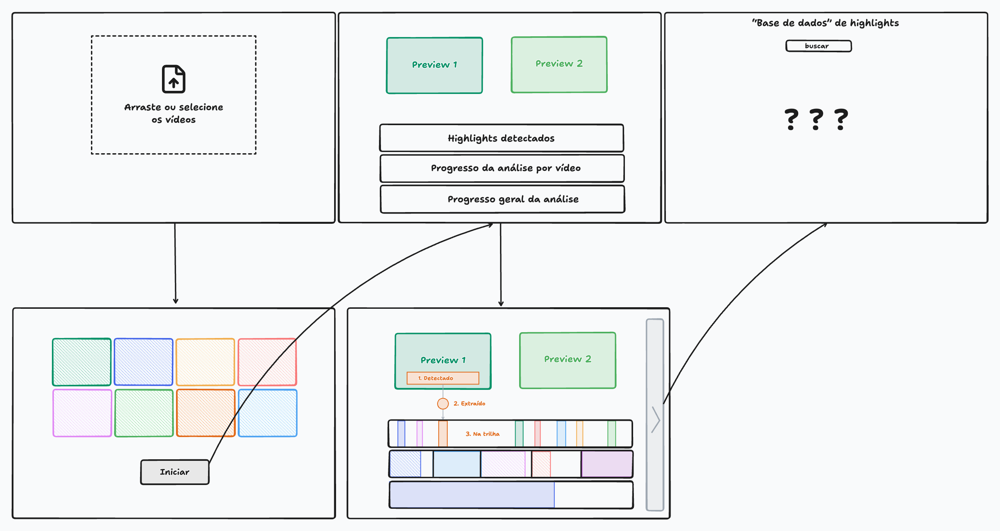

# Entrega 6 — Prototipação em papel

**Data da documentação:** 22/10/2026

**Status:** concluída nesta iteração; protótipo, walkthrough formativo e decisões de revisão documentados

**Responsabilidade:** 1 solução integrada por equipe, Equipe 16

## Objetivo da atividade

Explorar a interação para preparar gravações, acompanhar uma análise simulada e escolher melhores momentos para download. A equipe usa um protótipo digital descartável antes da consolidação no Figma.

O ciclo da atividade compreende construir, simular, observar e revisar. Em 22/10/2026, Pedro conduziu uma sessão acompanhada com um colega que não participou do desenho e não conhecia o projeto. A transcrição do áudio, o feedback e as decisões estão nas seções 4 e 5. As melhorias de interface registradas para a próxima iteração ainda não foram implementadas nem reavaliadas.

## 1. Escopo do protótipo

### 1.1 Personas, cenários e tarefas

As referências são as proto-personas da [Entrega 3](03_personas_contexto_jornada.md), os cenários hipotéticos da [Entrega 4](04_cenarios_problema.md) e as tarefas da [Entrega 5](05_analise_tarefas.md). Sua representação no protótipo não constitui validação empírica.

| Persona e contexto | Participação no fluxo | Relação com as tarefas |
|---|---|---|
| P01, Rafael, editor de vídeo esportivo; C01, seleção sob pressão de prazo | Referência principal para preparar gravações, acompanhar o lote e revisar candidatos com contexto | A01 como entrada, T03/A02 no acompanhamento e T01/A04 na revisão e obtenção; R01/R02 |
| P03, Jorginho Jr., criador amador; C03, decupagem com recursos limitados | Compartilha o acompanhamento e a revisão; a identificação do atleta depende da conferência humana | Aplicação de T03 e T01; R04/R05. Reconhecimento automático de jogadores permanece em investigação, H36 |
| P02, Arnaldo, supervisor editorial; C02, controle do processo editorial | Recebe o material por um canal externo após o trabalho do editor | T02 como continuidade externa, R03. O protótipo não inclui tela própria de aprovação |

O recorte é a pós-produção de partidas encerradas em computador. Edição detalhada, ajuste dos limites de cortes, montagem, publicação e chancela editorial continuam em ferramentas e canais externos. O protótipo demonstra uma aplicação potencial da contribuição do TCC.

Os exemplos usam quatro vídeos, um por tempo, de duas partidas reais do SoccerNet-v2. Cada vídeo corresponde a um tempo de uma partida, não a uma partida inteira. O protótipo usa "highlight" na interface; a escolha de vocabulário permanece sem validação empírica com participantes.

Os objetivos desta iteração são:

- Conferir quais gravações entram na análise antes de iniciá-la.
- Reconhecer a espera, o progresso por vídeo e a revelação simulada dos lances anotados.
- Localizar candidatos e conferir origem, timecodes e contexto antes de incluir ou retirar da seleção.
- Comparar formas de organizar os resultados e obter uma relação identificável dos itens escolhidos.

### 1.2 Artefatos e limites da simulação

| Artefato | Papel nesta entrega |
|---|---|
| [Esboço original no tldraw](../assets/06_prototipos/esboco_original.tldr) ([imagem](../assets/06_prototipos/esboco_original.png)) | Registro inicial do fluxo, com envio, seleção dos vídeos, acompanhamento da análise e base de highlights ainda em aberto |
| [Protótipo principal: fluxo de highlights](../assets/06_prototipos/PROTOTIPO_fluxo_highlights.html) ([versão publicada](https://ihc.p4cs.com.br)) | Versão de referência sincronizada com o código em 22/10/2026. Quatro telas e três alternativas para a base de resultados |
| [Exploração anterior em baixa fidelidade](../assets/06_prototipos/PROTOTIPO_baixa_fidelidade_base_highlights.html) | Registro das alternativas anteriores: lista com filtros, galeria por partida, facetas por jogador e mapa das partidas. As facetas fictícias não confirmam a capacidade de identificar jogadores |
| [Mapa do fluxo documentado](../assets/06_prototipos/prototipo_fluxo_01.svg) | Identificação das quatro telas, transições e limites da demonstração |
| [Guia da simulação](../assets/06_prototipos/GUIA_simulacao.html) ([versão publicada](https://ihc.p4cs.com.br/guia)) | Material enviado a quem participa da simulação: contexto do projeto, fluxo, particularidades da demonstração, tarefas e formulário de feedback. Ver seção 4.1 |

A versão principal está publicada em <https://ihc.p4cs.com.br>. Para executar uma cópia local, rode:

```sh
cd assets/06_prototipos
python3 -m http.server
```

Abra `http://localhost:8000/PROTOTIPO_fluxo_highlights.html`. Não abra o HTML com `file://`, porque o navegador bloqueia a leitura de `media/manifest.json`. O botão **ou use os 4 tempos de exemplo · 2 partidas do SoccerNet** carrega os vídeos disponíveis. O envio de arquivos próprios não funciona. As setas esquerda e direita alternam as telas. Os parâmetros `?tela=1` até `?tela=4` abrem uma etapa diretamente; na tela 4, `&variant=A`, `B` ou `C` escolhe a visualização. Por exemplo, `http://localhost:8000/PROTOTIPO_fluxo_highlights.html?tela=4&variant=B` abre a alternativa B localmente.

Na tela 3, duas prévias reproduzem trechos em 2× e sem som. O protótipo revela cada lance quando a reprodução alcança a anotação do SoccerNet. Passar o mouse sobre um marcador mostra a miniatura, o tipo, a partida, o tempo e o horário do jogo. O botão **Ir para o lance** abre esse item na tela 4, na visualização A.

Os quatro vídeos de origem são tempos completos de partidas reais em 224p, 398 × 224 pixels e 25 fps. O manifesto identifica Real Madrid 0 x 4 Barcelona, de 21/11/2015, e Bayern de Munique 1 x 2 Real Madrid, de 12/04/2017. Os oito cortes publicados têm entre 27 e 28 segundos, dois por tempo. As anotações vêm do SoccerNet-v2. O protótipo não envia arquivos próprios nem executa um modelo: a análise simulada reproduz os cortes e revela cada evento na posição anotada. Os metadados e caminhos dos arquivos estão em [`media/README.md`](../assets/06_prototipos/media/README.md) e [`media/manifest.json`](../assets/06_prototipos/media/manifest.json).

Na tela 3, as prévias tocam automaticamente sem controles de reprodução. Na tela 4, **Reproduzir corte** abre o vídeo com os controles nativos do navegador, incluindo pausa e busca. Os cortes publicados não usam uma margem fixa de cinco segundos: o instante anotado fica entre 12,605 e 14,840 segundos após o início do corte, conforme o manifesto. O contexto anterior e posterior varia entre os clipes. Sua suficiência para o julgamento editorial continua em investigação, conforme RC04/RC05.

**Baixar CSV** gera `cortes_selecionados.csv`, com metadados e o endereço de cada corte selecionado. No detalhe de cada lance, **Baixar MP4** baixa o vídeo individual. A seleção permanece durante a sessão e a troca de visualização, mas não é salva após recarregar a página.

O detalhe mostra o início e o fim do corte no arquivo de origem, a duração e a posição da anotação dentro do corte e do arquivo. O CSV registra esses campos, a partida, o tempo, o tipo de evento e o endereço do MP4. O relógio do jogo é distinto da posição em segundos dentro do arquivo de cada tempo. A segunda etapa continua usando seu próprio arquivo, sem concatenar os tempos.

A inspeção técnica confirma que o manifesto liga cada corte a uma partida, um tempo, um instante anotado e um arquivo MP4. O protótipo oferece três formas de consultar os mesmos oito lances, um player com controles nativos, download individual de MP4 e exportação CSV. Essa inspeção não mede a adequação dos cortes ao trabalho editorial nem substitui o walkthrough.

O título da atividade foi preservado. Pedro confirmou em 16/10/2026 que o professor aceita o formato digital clicável adotado para esta entrega. A versão anterior conserva a aparência de baixa fidelidade, enquanto a principal tem maior acabamento visual. A exploração dos fluxos e a simulação formativa continuam como foco da atividade.

### 1.3 Esboço original no tldraw



O esboço original fornecido por Pedro em 16/10/2026 está preservado no [arquivo editável do tldraw](../assets/06_prototipos/esboco_original.tldr), sem alterações em relação ao anexo recebido. A imagem acima foi exportada desse arquivo.

O desenho apresenta o envio das gravações, os vídeos selecionados e o botão **Iniciar**. O acompanhamento aparece em dois quadros, com prévias, highlights detectados, progresso por vídeo e progresso geral. No quadro inferior central, as marcações **1. Detectado**, **2. Extraído** e **3. Na trilha** explicitam o percurso de um highlight. A base de highlights contém uma busca e a indicação **? ? ?**, registrando a organização dos resultados ainda em aberto. As alternativas documentadas na seção 3.2 desenvolvem essa parte do fluxo no protótipo principal.

## 2. Fluxos escolhidos

| Fluxo | Tarefa e objetivo | Percurso | Por que foi priorizado |
|---|---|---|---|
| PF01 | Preparar entradas de A01, precondição de T03 | E06-P01 → E06-P02 → E06-P03 | Permite conferir arquivos e retirar uma entrada antes de iniciar, H08/H13/H16 |
| PF02 | Acompanhar o lote, recorte de T03/A02 | E06-P03, com espera, reprodução das anotações e progresso | Explora a visibilidade da análise simulada; não representa falhas nem intervalos não analisados, R02/R05 e RC03/RC05 |
| PF03 | Localizar, examinar e selecionar candidatos, recorte de T01/A04 | E06-P04A, B ou C → E06-P04D → inclusão ou retirada | Apoia o julgamento de pertinência e contexto; compara organizações dos mesmos resultados, R01/R04 e RC04/RC08 |
| PF04 | Obter a seleção e reconhecer a continuidade externa de T01 para T02 | Seleção em E06-P04 → E06-P04S → montagem e supervisão externas | Explora a identificação dos itens escolhidos por CSV e MP4, R03 e RC09. Transferência e supervisão continuam externas |

PF02 não cobre todos os métodos de recuperação de T03. PF03/PF04 representam parte de T01; conferência no original, correção externa, tratamento de dúvidas e retomada exigem aprofundamento. T02 fornece o contexto da entrega externa, sem ser executada dentro da interface.

## 3. Telas e estados

Os IDs `E06-Pxx` identificam telas desta entrega. `P01`, `P02` e `P03`, sem o prefixo, continuam identificando personas.


### 3.1 Inventário e navegação

| ID | Tela ou estado | Informação e controles | Transição ou retorno |
|---|---|---|---|
| E06-P01 | Preparar os vídeos de exemplo | Envio de arquivos próprios não é suportado. O botão carrega os quatro tempos disponíveis, dois jogos do SoccerNet | O botão abre E06-P02 com os exemplos. Selecionar ou arrastar arquivos próprios mostra um aviso |
| E06-P02 | Vídeos selecionados | Miniatura, nome do arquivo, partida, tempo, resolução, taxa de quadros e duração da fonte; remoção antes de iniciar | **Iniciar** abre E06-P03. **Adicionar vídeos** retorna a E06-P01; escolher os exemplos carrega a lista padrão |
| E06-P03 | Análise simulada do lote | Duas prévias simultâneas em 2×, sem som; eventos do SoccerNet revelados durante a reprodução; progresso por vídeo e do lote | Seta direita abre E06-P04 e conclui a análise restante imediatamente. Seta esquerda retorna a E06-P02. **Reiniciar análise** reinicia o lote inteiro |
| E06-P04A | Base, alternativa A: Busca primeiro | Busca por lance, jogador, partida, time ou arquivo; filtros por tipo e tempo; lista com inclusão no CSV | Clique na linha abre E06-P04D. Busca ou filtros sem correspondência mostram E06-P04V |
| E06-P04B | Base, alternativa B: Trilhas por partida | Trilhas por tempo, marcadores e filtros por tipo | Clique em marcador abre E06-P04D; controles anterior/próximo percorrem candidatos |
| E06-P04C | Base, alternativa C: Mosaico por tipo | Miniaturas agrupadas por tipo de lance e marcação de inclusão no CSV | Clique na miniatura abre E06-P04D em uma janela sobre a base; **Fechar** ou `Esc` retorna |
| E06-P04D | Detalhe nas três alternativas | Vídeo real, título do lance, partida, tempo, data, horário do jogo, posição no arquivo, início, fim e duração do corte | **Reproduzir corte** abre o player nativo. **+ Incluir** adiciona o lance ao CSV; o botão passa a **✓ No CSV**. **Baixar MP4** baixa o corte individual |
| E06-P04V | Nenhuma correspondência na alternativa A | **Nenhum lance encontrado** e **Limpar busca e filtros** | Limpar restaura a lista. Filtro vazio não demonstra uma análise que terminou sem candidatos |
| E06-P04S | Seleção vazia ou com itens | **Baixar CSV (0)** desabilitado sem seleção; contador atualizado após inclusão ou retirada | Com itens, gera o CSV com metadados e endereço dos MP4 selecionados |

O seletor troca entre E06-P04A, B e C mantendo a seleção. Busca, filtros e detalhe aberto não são preservados nessa troca. Com todas as entradas de exemplo mantidas, a demonstração revela os oito eventos definidos no manifesto. Não simula falhas de processamento nem análise sem candidatos. Erros de carregamento do manifesto ou dos clipes têm mensagens próprias; no player da tela 4, é possível tentar carregar o corte novamente.

Nas alternativas A e C, a duração exibida é a do corte; o horário junto ao candidato indica o horário do jogo. No detalhe, o player reproduz o MP4 completo e mostra a posição da anotação dentro do corte e do arquivo de origem.

As setas entre telas são atalhos de demonstração. Na alternativa B, com detalhe aberto, e na C, com a janela aberta, as setas percorrem candidatos. É preciso fechar o detalhe para usar novamente as setas entre telas. A passagem de E06-P03 para E06-P04 conclui imediatamente qualquer análise restante. Esse atalho não demonstra acesso real a resultados parciais.

### 3.2 Alternativas para a base de resultados

| Alternativa | Questão de interação a investigar | Ponto a observar na simulação |
|---|---|---|
| A, Busca primeiro | Busca e filtros ajudam a localizar um lance conhecido e conferir sua origem? | Compreensão dos filtros, retorno da busca vazia e revisão de itens fora do recorte filtrado |
| B, Trilhas por partida | A posição temporal ajuda a compreender a distribuição dos candidatos entre os tempos? | Leitura dos marcadores, identificação do arquivo e distinção entre tempo do arquivo e minuto do jogo |
| C, Mosaico por tipo | Miniaturas e agrupamento por evento ajudam a percorrer candidatos? | Recuperação da partida de origem e continuidade ao abrir e fechar o detalhe |

A é a visualização inicial do HTML. Na sessão de 22/10/2026, U01 declarou preferência por A. A decisão desta iteração é manter essa entrada e preservar B e C para exploração. A preferência de uma pessoa sem experiência em edição não estabelece uma vencedora para o público profissional. O resultado e suas limitações estão na seção 4.3.

### 3.3 Cobertura e lacunas identificadas na revisão

A conferência documental e a inspeção do protótipo em 16/10/2026 incluíram uma revisão por subagente GPT-6.1-Sol, com esforço High e serviço Fast, solicitada por Pedro. A cobertura e as lacunas abaixo foram atualizadas em 22/10/2026 conforme o código atual. Não são observações de participantes. A prioridade considera a correspondência com as tarefas modeladas, sem medida empírica de gravidade.

| Prioridade e referência | Cobertura atual | Lacuna e evidência no protótipo |
|---|---|---|
| Alta, T03, recuperação localizada | Espera, progresso e reprodução simulada das anotações do manifesto | A demonstração não representa falhas de processamento nem recuperação localizada de uma entrada. **Reiniciar análise** reinicia o lote inteiro, conforme controle da tela 3 e função `startAnalysis` |
| Alta, T03 → T01, resultados disponíveis | Base com candidatos ao final da demonstração | Falta abrir resultados de uma partida pronta enquanto outras continuam. A função `go` força `finishAll` ao entrar na tela 4 |
| Alta, T01, inspeção do contexto | Origem, timecodes, vídeo real e player com controles nativos; primeira exploração por U01 na seção 4.3 | A suficiência do contexto e a utilidade dos controles para o julgamento editorial profissional continuam sem avaliação com editores |
| Alta, T01/T02, consolidação e obtenção | Contagem de selecionados, CSV com metadados e download de cada MP4 | Falta representar preparação, transferência, falha e retorno do material para Arnaldo ou para o editor externo. O controle `#dl` exporta o CSV diretamente |
| Média, T01, dúvidas e retomada | Inclusão/retirada e seleção mantida ao trocar de visualização | Não distingue não vistos, descartados e dúvidas; filtro e detalhe aberto se perdem ao reconstruir a base. T01 admite anotação externa, que pode ser demonstrada sem criar um sistema próprio |
| Média, T01/T03, vazio e indisponibilidade | Busca sem correspondência, download bloqueado com seleção vazia e mensagens de erro no carregamento da mídia | Faltam cenários simulados de análise sem candidatos e falha de acesso aos resultados. A função `load` sempre carrega os exemplos do manifesto |

A01 continua parcialmente coberta: o fluxo permite remover exemplos antes de iniciar, mas não selecionar arquivos próprios nem acrescentar entradas. **Adicionar vídeos** retorna à tela inicial; a opção de exemplos restaura o conjunto padrão. A base representa o lote atual; o histórico de trabalhos anteriores de A03 não está implementado e sua tarefa própria continua pendente.

Essas lacunas podem ser exploradas com estados e transições simulados. Não exigem implementar o backend, gerar vídeos reais, criar edição detalhada, aprovação no produto, auditoria ou filtro automático por atleta. Dúvidas e correções externas precisam de referências demonstráveis, conforme T01, sem ampliar automaticamente o recorte.

## 4. Simulação e walkthrough

### 4.1 Situação da atividade

A sessão formativa foi realizada em 22/10/2026, com Pedro como facilitador e um colega da turma identificado como **U01** neste documento. Conforme o relato de Pedro, U01 não participou da elaboração das telas nem conhecia o projeto. No formulário, declarou nunca ter editado vídeos e ter realizado a sessão com alguém da equipe acompanhando.

Foram usados o protótipo publicado com clipes reais, o guia da simulação e as três visualizações da base. As evidências preservadas são a [transcrição automática do áudio](../artifacts/entrega6/sessao-2026-10-22/transcricao.txt) e o [feedback de produção anonimizado](../artifacts/entrega6/sessao-2026-10-22/feedback-producao.json). A [nota de procedência](../artifacts/entrega6/sessao-2026-10-22/README.md) descreve as fontes e seus limites. O formulário corresponde ao registro 1 do D1, versão do guia `2026-10-21`, enviado em `2026-10-22T22:45:39.868Z`.

O áudio tem aproximadamente 4min36s e não inclui uma gravação da tela. Sua transcrição tem tempos aproximados, trechos incertos e falantes sem identificação automática. A análise abaixo usa os relatos do formulário e os trechos compreensíveis do diálogo. Não extrai contagens de erros nem tempos por tarefa. As falas de orientação mostram que o percurso foi acompanhado e teve ajuda.

Esta sessão atende à exploração formativa com alguém de fora do desenho. O perfil acadêmico e sem experiência em edição limita as conclusões sobre o público profissional. A atividade não substitui a coleta da Entrega 7 nem a avaliação com participantes finais da Entrega 14. As hipóteses de personas, frequência das tarefas, contexto profissional e ganhos de produtividade continuam abertas.

Em 16/10/2026 foi publicado o [guia da simulação](https://ihc.p4cs.com.br/guia), destinado às pessoas convidadas. As decisões de Pedro sobre a sessão foram registradas naquela data. A tabela descreve suas consequências no guia atual, já com os clipes reais:

| Decisão | Consequência para a sessão |
|---|---|
| Sessões ao vivo, com um integrante acompanhando, ou assíncronas, com a pessoa sozinha | O guia funciona nos dois casos. O formulário registra o modo, porque a sessão assíncrona produz apenas relato da pessoa, sem observação do uso |
| O guia revela só as particularidades da demonstração | Clipes reais, análise simulada, setas ← →, três visualizações, downloads em CSV e MP4 e ausência de persistência da sessão são informados antes do uso. O uso das setas passa a ser instrução recebida, e não descoberta espontânea. O próprio protótipo já exibe a dica das setas |
| Público misto, de leigos a pessoas que editam vídeo | O contexto evita jargão e traz um glossário curto. O formulário pergunta a experiência com edição |
| Papel genérico em vez de persona | As tarefas pedem que a pessoa imagine editar vídeos de futebol, sem apresentar Rafael (P01) |
| Aviso curto de consentimento | O guia informa que a atividade é da disciplina, que a pessoa pode parar a qualquer momento e que as respostas aparecem nos documentos sem o nome. O termo formal continua previsto para a Entrega 14 |

As respostas do formulário são gravadas no banco D1 `ihc-feedback`, tabela `feedback`, com data, versão do guia e respostas. Não são guardados IP nem navegador, e o nome é opcional. Os campos de texto são opcionais. São obrigatórios o perfil, o modo da sessão, o resultado de cada tarefa (conseguiu, com dificuldade, não conseguiu) e a visualização preferida. A consulta está descrita em [`site/README.md`](../site/README.md).

### 4.2 Roteiro de referência e uso na sessão

O roteiro completo orientou a preparação. U01 usou a versão curta de quatro tarefas do guia. A tabela abaixo preserva o roteiro de referência, com duas revisões após a sessão: incluir a passagem da análise para a base no passo 2 e separar a obtenção do CSV da obtenção do MP4 no passo 6. Essas revisões documentais preparam a próxima sessão; não são resultados de uma reaplicação.

| Passo | Situação proposta à pessoa | O que observar |
|---|---|---|
| 1 | Carregar os exemplos, retirar uma gravação e iniciar a análise | Se distingue o carregamento dos exemplos do envio de arquivos e consegue conferir o lote |
| 2 | Identificar o progresso, acompanhar os lances e abrir os resultados ao terminar a análise | Se reconhece a conclusão e encontra a continuidade sem ajuda do facilitador |
| 3 | Localizar um candidato, conferir a origem e explicar se o trecho permite decidir sobre sua inclusão | Compreensão dos timecodes, contexto percebido e limites da prévia |
| 4 | Incluir dois candidatos, retirar um e repetir a localização nas alternativas A, B e C | Se distingue seleção de descarte e mantém a referência da partida nos agrupamentos |
| 5 | Fazer uma busca sem correspondência na alternativa A e recuperar a lista | Se diferencia ausência de correspondência de ausência de lances na partida |
| 6 | Obter a lista dos escolhidos, abrir o CSV e identificar suas informações; depois baixar e reproduzir o MP4 de um lance | Registrar separadamente a obtenção dos metadados e do vídeo, a ajuda recebida e o que falta para continuar a edição externa |

O guia usa uma versão curta deste roteiro, com quatro tarefas: preparar a análise com os exemplos e conferir o lote (passo 1), acompanhar a análise (passo 2), escolher três lances conferindo partida e momento nas três visualizações (passos 3 e 4) e baixar o CSV e pelo menos um MP4 (passo 6). O guia não pede a remoção de uma gravação. O passo 5, a retirada de um item já incluído e a continuidade externa ficam fora das tarefas curtas. Nas sessões ao vivo, o facilitador pode propô-los à parte.

A era a entrada inicial do protótipo, e o diálogo identifica B como a segunda visualização, por volta de 02:42. O percurso registrado é compatível com a ordem A, B, C, sem comparação entre ordens de apresentação. Em sessões futuras, variar a ordem quando houver mais participantes e registrar a ajuda do facilitador, inclusive o ensino das setas entre telas.

### 4.3 Resultados e observações

U01 marcou **Consegui** nas quatro tarefas. A coluna de evidência abaixo distingue esse autorrelato do que o áudio permite reconhecer. Não se atribui sucesso independente quando houve explicação durante o percurso.

| Tarefa do guia | Resposta no formulário | Evidência complementar e ajuda registrada |
|---|---|---|
| Preparar a análise, `t1` | Consegui | O áudio começa com a escolha dos exemplos e a identificação da tela 2, de 00:00 a 00:21. Não permite conferir cada clique ou a remoção de uma entrada |
| Acompanhar a análise, `t2` | Consegui | De 01:01 a 01:36 há dúvida sobre navegação e explicação de que a tela serve para acompanhar e depois passar à próxima. O formulário confirma a dúvida ao final do processamento |
| Escolher três lances e explorar as visualizações, `t3` | Consegui | O diálogo registra seleção por categoria, de 02:03 a 02:23, apresentação de B pelo facilitador em 02:42 e explicações sobre a timeline e a inclusão, de 03:04 a 03:17. Não há registro visual para conferir todos os itens selecionados |
| Obter lista e vídeo, `t4` | Consegui | De 03:46 a 04:20 há referência ao download de metadados e discussão dos campos do CSV. A obtenção de um MP4 não fica comprovada no áudio. A explicação de que o download entrega apenas CSV pode ter influenciado a expectativa registrada |

As observações abaixo têm identificadores próprios para ligar evidência e decisão. Os tempos se referem à transcrição e são aproximados. As propriedades `travou`, `variante`, `variante_porque` e `download` podem ser consultadas no JSON do feedback.

| ID | Tela ou ação | Evidência | Interpretação e limite |
|---|---|---|---|
| E06-O01 | E06-P03, passagem para a base | `travou` relata dúvida entre mudar de página com as setas e esperar outra ação; diálogo de 01:01 a 01:36 inclui ajuda para avançar | A conclusão e o próximo passo não ficaram claros nesta sessão; o percurso contou com explicação para continuar |
| E06-O02 | E06-P04B, labels e trilhas | `variante_porque` descreve labels confusas; de 02:50 a 03:10 o diálogo menciona botões escuros, contraste e explicação da timeline | Rever legibilidade e significado das marcações. Não houve medição de contraste nem avaliação de severidade |
| E06-O03 | E06-P04C, quantidade de lances | `variante_porque` considera o mosaico bom, mas antecipa dificuldade no carrossel se houver muitos lances | É uma preocupação declarada. Não demonstra falha de uso com grande volume, pois a sessão usou o conjunto pequeno de exemplos |
| E06-O04 | E06-P04S e detalhe, obtenção | `download` informa a expectativa de um vídeo único com todos os highlights ou dos highlights separados; o diálogo, em 02:23 e de 03:46 a 04:20, trata do CSV | Existe diferença entre a expectativa e a obtenção descrita na sessão. O protótipo já oferece MP4 individual; sua descoberta e uso não ficam comprovados. A orientação do facilitador é uma possível influência |
| E06-O05 | E06-P04A, comparação das alternativas | `variante` é A; a justificativa contrapõe a confusão das labels de B e o possível limite do carrossel de C | É a preferência de U01 nesta sessão. A entrada inicial em A, a ausência de comparação entre ordens e a ausência de experiência em edição limitam sua generalização |
| E06-O06 | Identificação temporal, cores e campos exportados | De 03:04 a 03:17 há explicação da timeline; de 03:37 a 03:42 há pergunta sobre cores; de 04:08 a 04:20 há pergunta sobre ID e explicação dos títulos | São pontos para verificar compreensão de metadados. O áudio sem tela não permite determinar exatamente qual marcador ou cor motivou cada fala |

## 5. Decisões após a simulação

O fechamento desta iteração registra as decisões abaixo a partir de U01. As revisões do roteiro foram aplicadas à seção 4.2. As mudanças de interface estão indicadas para a próxima iteração e não são apresentadas como implementadas ou verificadas com uma nova sessão.

| ID e evidência | Antes ou problema | Decisão e justificativa | Situação |
|---|---|---|---|
| E06-D01, O01 | Ao terminar a análise, U01 não soube se deveria esperar ou avançar | Revisar a indicação de conclusão e de acesso à base. O próximo teste deve verificar se a pessoa encontra essa continuidade sem ajuda | Roteiro do passo 2 revisado; alteração de interface para a próxima iteração |
| E06-D02, O02 e O06 | Labels, contraste e significado temporal exigiram esclarecimento em B | Revisar legibilidade e identificação de tempo, origem e cores antes de repetir a comparação. As falas justificam investigar esses elementos, sem atribuir uma gravidade numérica | Revisão de interface e nova verificação previstas para a próxima iteração |
| E06-D03, O05 | A já era a entrada inicial e foi a preferência declarada | Manter A como entrada e conservar B e C como alternativas exploratórias. A sessão dá um motivo para manter o padrão atual, mas não para encerrar a comparação com o público profissional | Organização atual mantida |
| E06-D04, O03 | U01 antecipa dificuldade no carrossel com mais lances | Manter C nesta versão e investigar um conjunto maior em avaliação futura. A preocupação sozinha não justifica descartar o mosaico | Investigação futura; sem mudança na interface |
| E06-D05, O04 | O autorrelato de obtenção não permite confirmar a diferença entre lista e vídeo | Manter CSV e MP4 individuais, já disponíveis. Separar no roteiro a abertura do CSV e o download com reprodução do MP4; o facilitador deve descrever as duas saídas. A montagem de vídeo único permanece na edição externa | Roteiro do passo 6 revisado; obtenção independente de MP4 a verificar em nova sessão |
| E06-D06, O06 | Metadados foram explicados durante o uso | Em nova sessão, pedir que a pessoa identifique origem e momento do lance e explique os campos usados, registrando sua resposta antes de oferecer ajuda. Não inferir compreensão pelo preenchimento do formulário | Orientação de condução documentada para a próxima avaliação |

O protótipo documentado, o walkthrough acompanhado, as observações e as decisões encerram a Entrega 6 nesta iteração. Permanecem as lacunas técnicas da seção 3.3 e as revisões de interface acima. A sessão não demonstra ganho de produtividade, cobertura completa dos lances ou adequação ao trabalho editorial profissional. As versões anteriores e a inclusão de contexto nos clipes ocorreram antes desta sessão e continuam identificadas como evolução técnica, não como correções motivadas por U01.

## Checklist

- [x] O protótipo cobre tarefas relevantes da Entrega 5, com cobertura parcial e limites indicados.
- [x] Cada tela e estado documentado tem uma tarefa, decisão ou informação que o justifica.
- [x] O projeto mantém o recorte de envio, acompanhamento, revisão e obtenção, sem acrescentar login ou administração.
- [x] Telas e estados estão numerados, com controles e retornos descritos.
- [x] Há pelo menos uma simulação ou walkthrough com pessoa que não desenhou as telas, registrada em 22/10/2026 com U01.
- [x] As observações da simulação geraram decisões de revisão documentadas, E06-D01 a E06-D06, com aplicação e próximos passos distinguidos.
- [x] O formato digital clicável do protótipo principal foi confirmado como aceito para a Entrega 6, conforme informação de Pedro em 16/10/2026.

## Histórico de revisões

| Data | Versão | Descrição | Responsável |
|---|---|---|---|
| 16/10/2026 | 0.2 | Documentação do protótipo principal, fluxos, telas, alternativas, lacunas e roteiro formativo. Substituição do diagrama de exemplo pelo mapa do fluxo. Versão, alternativas, ausência de sessão e contexto nos clipes confirmados por Pedro. | Equipe 16, documentação assistida pelo Codex a pedido de Pedro |
| 16/10/2026 | 0.3 | Registrada a confirmação de Pedro de que o professor aceita o formato digital clicável. Encerrada essa pendência no checklist; walkthrough e revisões a partir da observação continuam pendentes. | Equipe 16, documentação assistida pelo Codex a pedido de Pedro |
| 16/10/2026 | 0.4 | Contexto incorporado ao intervalo e à duração do corte no detalhe, na prévia e no CSV, com limites do vídeo respeitados e intervalo do lance separado. Correção por Opus a pedido de Pedro, com verificações técnicas. Registradas as decisões de manter a terminologia e tratar cada vídeo como partida; sessão formativa continua pendente. | Equipe 16, implementação assistida por Opus e documentação assistida pelo Codex a pedido de Pedro |
| 16/10/2026 | 0.5 | Incluído o esboço original do tldraw, com imagem, fonte editável preservada e descrição de sua relação com o protótipo principal. | Equipe 16, documentação assistida pelo Codex a pedido de Pedro |
| 16/10/2026 | 0.6 | Publicado o guia da simulação em ihc.p4cs.com.br/guia, com formulário de feedback gravado em D1. Registradas as decisões de Pedro sobre modo das sessões, informações reveladas, público, papel e consentimento, e a relação das tarefas do guia com o roteiro 4.2. Sessões continuam pendentes. | Equipe 16, implementação e documentação assistidas por Opus a pedido de Pedro |
| 22/10/2026 | 0.7 | Documentação sincronizada com o protótipo atual após o commit 74041d3e. Corrigidas origem e quantidade dos vídeos, suporte a envio, comportamento da análise, controles de reprodução, downloads, tempos e roteiro. A sessão com pessoa que não desenhou as telas continua pendente. Esta atualização documental não registra observação com participante. | Equipe 16, documentação assistida pelo Codex |
| 22/10/2026 | 0.8 | Registrados o walkthrough acompanhado por Pedro com U01, a transcrição automática e o feedback do D1 anonimizado. Separados autorrelato, diálogo e ajuda; documentadas O01 a O06 e D01 a D06. Revisados os passos 2 e 6 do roteiro. Checklist encerrado nesta iteração, com melhorias futuras e limites da evidência explícitos. | Pedro Alexandre Custódio Silva, condução da sessão e fechamento documental assistido pelo Codex |
