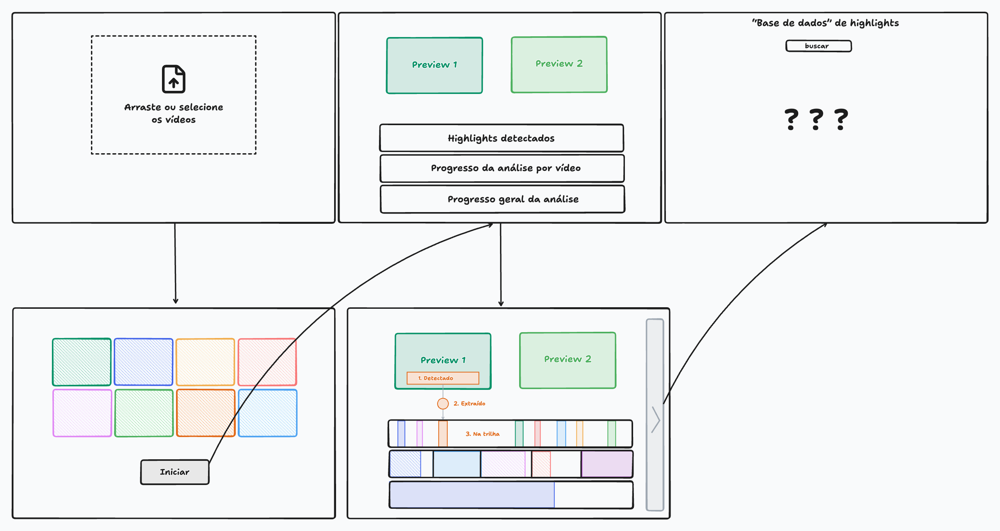
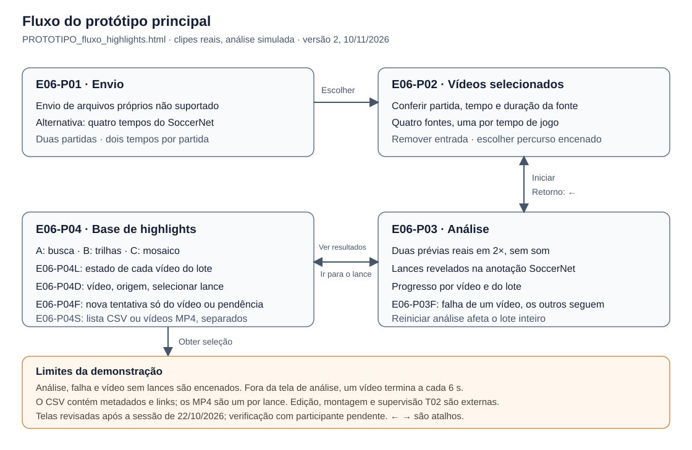
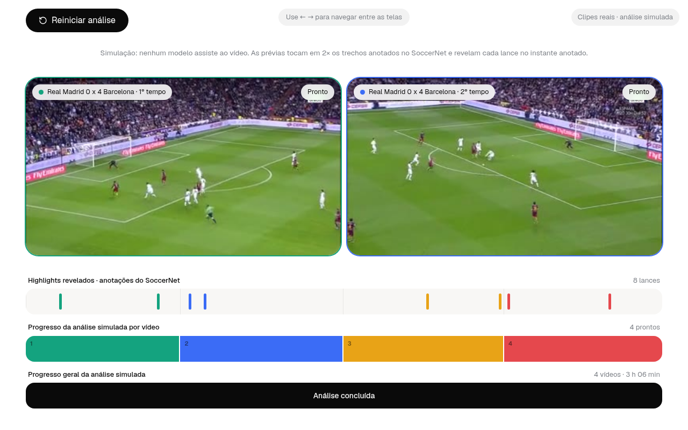
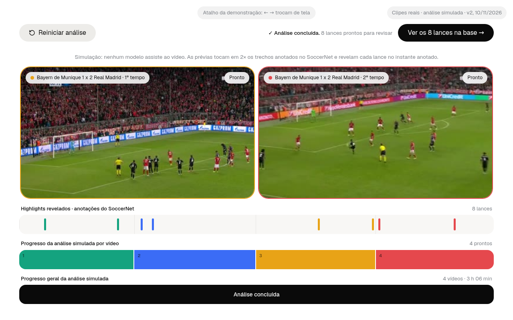
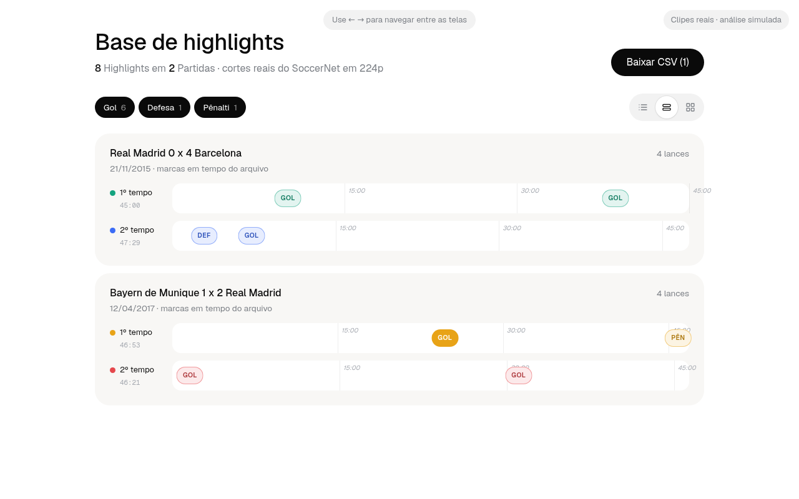
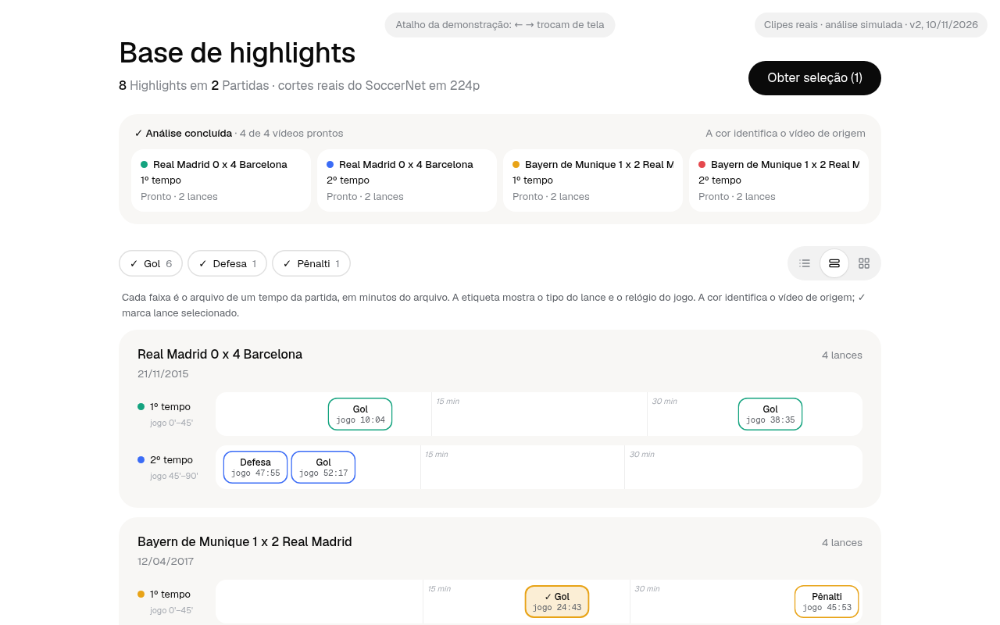

# Entrega 6 — Prototipação em papel

**Data da documentação:** 22/10/2026 (versão original)

**Revisão:** 10/11/2026, aplicação do [feedback do professor](../feedbacks_professor/Feedback_Professor_Entrega06_Equipe16.md)

**Status:** walkthrough formativo de 22/10/2026 documentado; telas revisadas na versão 2 do protótipo, de 10/11/2026, para E06-O01, O02, O04 e O06. A verificação das telas revisadas com uma pessoa de fora do desenho está pendente, conforme o roteiro da seção 5.3

**Responsabilidade:** 1 solução integrada por equipe, Equipe 16

## Objetivo da atividade

Explorar a interação para preparar gravações, acompanhar uma análise simulada e escolher melhores momentos para download. A equipe usa um protótipo digital descartável antes da consolidação no Figma.

O ciclo da atividade compreende construir, simular, observar e revisar. Em 22/10/2026, Pedro conduziu uma sessão acompanhada com um colega que não participou do desenho e não conhecia o projeto. A transcrição do áudio, o feedback e as decisões estão nas seções 4 e 5. A versão 2 do protótipo, de 10/11/2026, revisa as telas ligadas a E06-O01, O02, O04 e O06, conforme a seção 5.1. Essas telas ainda não foram usadas por um participante.

## 1. Escopo do protótipo

### 1.1 Personas, cenários e tarefas

As referências são as proto-personas da [Entrega 3](03_personas_contexto_jornada.md), os cenários hipotéticos da [Entrega 4](04_cenarios_problema.md) e as tarefas da [Entrega 5](05_analise_tarefas.md). Sua representação no protótipo não constitui validação empírica.

| Persona e contexto | Participação no fluxo | Relação com as tarefas |
|---|---|---|
| P01, Rafael, editor de vídeo esportivo; C01, seleção sob pressão de prazo | Referência principal para preparar gravações, acompanhar o lote e revisar candidatos com contexto | A01 como entrada, T03/A02 no acompanhamento e T01/A04 na revisão e obtenção; R01/R02 |
| P03, Jorginho Jr., criador amador; C03, decupagem com recursos limitados | Compartilha o acompanhamento e a revisão; a identificação do atleta depende da conferência humana | Aplicação de T03 e T01; R04/R05. Reconhecimento automático de jogadores permanece em investigação, H36 |
| P02, Arnaldo, supervisor editorial; C02, controle do processo editorial | Recebe o material por um canal externo após o trabalho do editor | T02 como continuidade externa, R03. O protótipo não inclui tela própria de aprovação |

O recorte é a pós-produção de partidas encerradas em computador. Edição detalhada, ajuste dos limites de cortes, montagem, publicação e chancela editorial continuam em ferramentas e canais externos. O protótipo demonstra uma aplicação potencial da contribuição do TCC.

Os exemplos usam quatro vídeos, um por tempo, de duas partidas reais do SoccerNet-v2. Cada vídeo corresponde a um tempo de uma partida, não a uma partida inteira. O protótipo usa "highlight" na interface; a escolha de vocabulário permanece sem validação empírica com participantes.

Os objetivos desta iteração são:

- Conferir quais gravações entram na análise antes de iniciá-la.
- Reconhecer a espera, o progresso por vídeo e a revelação simulada dos lances anotados.
- Localizar candidatos e conferir origem, timecodes e contexto antes de incluir ou retirar da seleção.
- Comparar formas de organizar os resultados e obter uma relação identificável dos itens escolhidos.

### 1.2 Artefatos e limites da simulação

| Artefato | Papel nesta entrega |
|---|---|
| [Esboço original no tldraw](../assets/06_prototipos/esboco_original.tldr) ([imagem](../assets/06_prototipos/esboco_original.png)) | Registro inicial do fluxo, com envio, seleção dos vídeos, acompanhamento da análise e base de highlights ainda em aberto |
| [Protótipo principal: fluxo de highlights](../assets/06_prototipos/PROTOTIPO_fluxo_highlights.html) | Versão 2, de 10/11/2026, revisada após o walkthrough. A versão 1, usada na sessão de 22/10/2026, corresponde ao commit `bce19c4` e às capturas da seção 5.1. Quatro telas e três alternativas para a base de resultados |
| [Exploração anterior em baixa fidelidade](../assets/06_prototipos/PROTOTIPO_baixa_fidelidade_base_highlights.html) | Registro das alternativas anteriores: lista com filtros, galeria por partida, facetas por jogador e mapa das partidas. As facetas fictícias não confirmam a capacidade de identificar jogadores |
| [Mapa do fluxo documentado](../assets/06_prototipos/prototipo_fluxo_01.svg) | Identificação das quatro telas, dos estados da versão 2, das transições e dos limites da demonstração |
| [Capturas por versão](../assets/06_prototipos/capturas/README.md) | Imagens da versão 1, usada em 22/10/2026, e da versão 2, de 10/11/2026: alternativas A, B e C e estados revisados, com data e versão no nome da pasta |
| [Verificação técnica da versão 2](../artifacts/entrega6/verificacao-2026-11-10/README.md) | Scripts que percorrem as telas no Chromium local e seus resultados. Não substituem a verificação com participante |
| [Guia da simulação](../assets/06_prototipos/GUIA_simulacao.html) | Material enviado a quem participa da simulação: contexto do projeto, fluxo, particularidades da demonstração, tarefas e formulário de feedback. Ver seção 4.1 |

Os artefatos desta entrega estão no repositório e a análise não depende da hospedagem externa usada na sessão de 22/10/2026. Para executar o protótipo, rode:

```sh
cd assets/06_prototipos
python3 -m http.server
```

Abra `http://localhost:8000/PROTOTIPO_fluxo_highlights.html`. Não abra o HTML com `file://`, porque o navegador bloqueia a leitura de `media/manifest.json`. O botão **ou use os 4 tempos de exemplo · 2 partidas do SoccerNet** carrega os vídeos disponíveis. O envio de arquivos próprios não funciona. As setas esquerda e direita alternam as telas. Os parâmetros `?tela=1` até `?tela=4` abrem uma etapa diretamente; na tela 4, `&variant=A`, `B` ou `C` escolhe a visualização. Por exemplo, `http://localhost:8000/PROTOTIPO_fluxo_highlights.html?tela=4&variant=B` abre a alternativa B localmente.

Na tela 3, duas prévias reproduzem trechos em 2× e sem som. O protótipo revela cada lance quando a reprodução alcança a anotação do SoccerNet. Passar o mouse sobre um marcador mostra a miniatura, o tipo, a partida, o tempo e o horário do jogo. O botão **Ir para o lance** abre esse item na tela 4, na visualização A.

[F] Na versão 2, de 10/11/2026, o topo da tela 3 mostra quantos lances estão prontos e o botão **Ver resultados prontos (n) →**, habilitado a partir do primeiro lance revelado. Ao fim, o texto passa a **✓ Análise concluída** e o botão a **Ver os 8 lances na base →**. **Reiniciar análise** deixou de ser o único botão escuro da tela. Ao abrir a base com a análise em andamento, a tela 4 mostra apenas os lances prontos e um painel com o estado de cada vídeo: em análise, na fila ou pronto. Fora da tela 3, a demonstração conclui um vídeo a cada 6 segundos, sem reproduzir os trechos. Os lances novos não alteram a lista aberta; o botão **Mostrar n lances novos na lista** os inclui quando a pessoa decide. **Acompanhar a análise** volta à tela 3.

Os quatro vídeos de origem são tempos completos de partidas reais em 224p, 398 × 224 pixels e 25 fps. O manifesto identifica Real Madrid 0 x 4 Barcelona, de 21/11/2015, e Bayern de Munique 1 x 2 Real Madrid, de 12/04/2017. Os oito cortes publicados têm entre 27 e 28 segundos, dois por tempo. As anotações vêm do SoccerNet-v2. O protótipo não envia arquivos próprios nem executa um modelo: a análise simulada reproduz os cortes e revela cada evento na posição anotada. Os metadados e caminhos dos arquivos estão em [`media/README.md`](../assets/06_prototipos/media/README.md) e [`media/manifest.json`](../assets/06_prototipos/media/manifest.json).

Na tela 3, as prévias tocam automaticamente sem controles de reprodução. Na tela 4, **Reproduzir corte** abre o vídeo com os controles nativos do navegador, incluindo pausa e busca. Os cortes publicados não usam uma margem fixa de cinco segundos: o instante anotado fica entre 12,605 e 14,840 segundos após o início do corte, conforme o manifesto. O contexto anterior e posterior varia entre os clipes. Sua suficiência para o julgamento editorial continua em investigação, conforme RC04/RC05.

[F] **Obter seleção (n)** abre um painel com duas saídas separadas. **Lista dos cortes · CSV** gera `cortes_selecionados.csv`, com metadados e o endereço de cada corte, e informa que o arquivo não contém vídeo. **Vídeos dos cortes · MP4** baixa um MP4 por lance selecionado, informa o tamanho total, lista os links individuais e explica que os cortes não são juntados em um vídeo único. O painel termina com o próximo passo fora do protótipo: montar o vídeo final no editor e usar o CSV para localizar cada trecho na gravação original. No detalhe de cada lance, **Baixar este vídeo, MP4** continua disponível. Os botões de inclusão passaram a **+ Selecionar** e **✓ Selecionado**, sem citar o CSV. A seleção permanece durante a sessão e a troca de visualização, mas não é salva após recarregar a página.

O detalhe mostra o início e o fim do corte no arquivo de origem, a duração e a posição da anotação dentro do corte e do arquivo. O CSV registra esses campos, a partida, o tempo, o tipo de evento e o endereço do MP4. O relógio do jogo é distinto da posição em segundos dentro do arquivo de cada tempo. A segunda etapa continua usando seu próprio arquivo, sem concatenar os tempos.

A inspeção técnica confirma que o manifesto liga cada corte a uma partida, um tempo, um instante anotado e um arquivo MP4. O protótipo oferece três formas de consultar os mesmos oito lances, um player com controles nativos, download individual de MP4 e exportação CSV. Essa inspeção não mede a adequação dos cortes ao trabalho editorial nem substitui o walkthrough.

O título da atividade foi preservado. Pedro confirmou em 16/10/2026 que o professor aceita o formato digital clicável adotado para esta entrega. A versão anterior conserva a aparência de baixa fidelidade, enquanto a principal tem maior acabamento visual. A exploração dos fluxos e a simulação formativa continuam como foco da atividade.

### 1.3 Esboço original no tldraw



O esboço original fornecido por Pedro em 16/10/2026 está preservado no [arquivo editável do tldraw](../assets/06_prototipos/esboco_original.tldr), sem alterações em relação ao anexo recebido. A imagem acima foi exportada desse arquivo.

O desenho apresenta o envio das gravações, os vídeos selecionados e o botão **Iniciar**. O acompanhamento aparece em dois quadros, com prévias, highlights detectados, progresso por vídeo e progresso geral. No quadro inferior central, as marcações **1. Detectado**, **2. Extraído** e **3. Na trilha** explicitam o percurso de um highlight. A base de highlights contém uma busca e a indicação **? ? ?**, registrando a organização dos resultados ainda em aberto. As alternativas documentadas na seção 3.2 desenvolvem essa parte do fluxo no protótipo principal.

## 2. Fluxos escolhidos

| Fluxo | Tarefa e objetivo | Percurso | Por que foi priorizado |
|---|---|---|---|
| PF01 | Preparar entradas de A01, precondição de T03 | E06-P01 → E06-P02 → E06-P03 | Permite conferir arquivos e retirar uma entrada antes de iniciar, H08/H13/H16 |
| PF02 | Acompanhar o lote, recorte de T03/A02 | E06-P03, com espera, reprodução das anotações e progresso; percursos encenados E06-P03F → E06-P04F e E06-P04Z | Explora a visibilidade da análise simulada, a falha de uma entrada com as demais preservadas e o vídeo sem lances, R02/R05 e RC03/RC05 |
| PF03 | Localizar, examinar e selecionar candidatos, recorte de T01/A04 | E06-P04A, B ou C → E06-P04D → inclusão ou retirada | Apoia o julgamento de pertinência e contexto; compara organizações dos mesmos resultados, R01/R04 e RC04/RC08 |
| PF04 | Obter a seleção e reconhecer a continuidade externa de T01 para T02 | Seleção em E06-P04 → E06-P04S → montagem e supervisão externas | Explora a identificação dos itens escolhidos por CSV e MP4, R03 e RC09. Transferência e supervisão continuam externas |

PF02 representa a nova tentativa orientada e a pendência de T03 3.3.3.2 e 3.3.3.3; a correção e o reenvio da entrada, 3.3.3.1, aparecem como indisponíveis porque a demonstração não aceita arquivos. PF03/PF04 representam parte de T01; conferência no original, correção externa, tratamento de dúvidas e retomada exigem aprofundamento. T02 fornece o contexto da entrega externa, sem ser executada dentro da interface.

## 3. Telas e estados

Os IDs `E06-Pxx` identificam telas desta entrega. `P01`, `P02` e `P03`, sem o prefixo, continuam identificando personas.



### 3.1 Inventário e navegação

| ID | Tela ou estado | Informação e controles | Transição ou retorno |
|---|---|---|---|
| E06-P01 | Preparar os vídeos de exemplo | Envio de arquivos próprios não é suportado. O botão carrega os quatro tempos disponíveis, dois jogos do SoccerNet | O botão abre E06-P02 com os exemplos. Selecionar ou arrastar arquivos próprios mostra um aviso |
| E06-P02 | Vídeos selecionados | Miniatura, nome do arquivo, partida, tempo, resolução, taxa de quadros e duração da fonte; remoção antes de iniciar; escolha do percurso da demonstração: **Percurso normal**, **Falha em um vídeo** ou **Vídeo sem lances**, com a descrição do que será encenado | **Iniciar** abre E06-P03. **Adicionar vídeos** retorna a E06-P01; escolher os exemplos carrega a lista padrão. O parâmetro `&cenario=falha` ou `vazio` escolhe o percurso pela URL |
| E06-P03 | Análise simulada do lote | Duas prévias simultâneas em 2×, sem som; eventos do SoccerNet revelados durante a reprodução; progresso por vídeo e do lote; contagem de lances prontos e estado da análise no topo | **Ver resultados prontos (n) →** abre E06-P04 com a análise em andamento; ao fim, **Ver os 8 lances na base →**. A seta direita faz o mesmo como atalho. Seta esquerda retorna a E06-P02. **Reiniciar análise** reinicia o lote inteiro |
| E06-P04L | Estado do lote na base | Um cartão por vídeo com partida, tempo e situação: em análise com porcentagem e lances já revelados, na fila ou pronto com a quantidade de lances | **Acompanhar a análise** volta a E06-P03. **Mostrar n lances novos na lista** atualiza a base exibida |
| E06-P03F | Falha localizada no acompanhamento, encenada | No percurso **Falha em um vídeo**, a análise do 1º tempo de Bayern 1 x 2 Real Madrid para em 35:19 do arquivo, depois do primeiro corte. A prévia mostra **Falhou em 35:19**, a barra do vídeo fica hachurada, a contagem inclui **1 com falha** e um aviso nomeia a entrada afetada. Os outros três vídeos continuam | **Ver o que aconteceu e as opções** abre E06-P04F. Ao fim, o topo mostra **Análise encerrada com 1 falha** e o botão para os lances prontos |
| E06-P04F | Falha na base e recuperação localizada, encenada | Cartão do vídeo com **Falhou em 35:19 · 1 lance preservado**; quadro com o arquivo, o ponto da falha, o lance preservado, os três vídeos não afetados e o trecho não analisado. Em B, a faixa marca o trecho **não analisado** | **Tentar de novo este vídeo** pede confirmação de que só esse vídeo será reprocessado; ao confirmar, ele volta à fila e os outros ficam como estão. **Deixar pendente e revisar os outros** mantém a referência e a opção de tentar depois. O reenvio de arquivo corrigido aparece como indisponível |
| E06-P04Z | Vídeo analisado sem lances, encenado | No percurso **Vídeo sem lances**, o 2º tempo de Bayern 1 x 2 Real Madrid termina sem candidatos: a prévia mostra **Pronto · nenhum lance**, o cartão do lote e a lista A informam **nenhum lance encontrado neste tempo** e a faixa de B mostra a mesma mensagem | Os outros vídeos seguem normalmente. A mensagem não afirma que o tempo não teve lances relevantes, RC05 |
| E06-P04A | Base, alternativa A: Busca primeiro | Busca por lance, jogador, partida, time ou arquivo; filtros por tipo e tempo; lista com **+ Selecionar** em cada linha | Clique na linha abre E06-P04D. Busca ou filtros sem correspondência mostram E06-P04V |
| E06-P04B | Base, alternativa B: Trilhas por partida | Trilhas por tempo, marcadores e filtros por tipo | Clique em marcador abre E06-P04D; controles anterior/próximo percorrem candidatos |
| E06-P04C | Base, alternativa C: Mosaico por tipo | Miniaturas agrupadas por tipo de lance e botão ✓ para selecionar | Clique na miniatura abre E06-P04D em uma janela sobre a base; **Fechar** ou `Esc` retorna |
| E06-P04D | Detalhe nas três alternativas | Vídeo real, título do lance, partida, tempo, data, horário do jogo, posição no arquivo, início, fim e duração do corte | **Reproduzir corte** abre o player nativo. **+ Selecionar** inclui o lance na seleção; o botão passa a **✓ Selecionado**. **Baixar este vídeo, MP4** baixa o corte individual |
| E06-P04V | Nenhuma correspondência na alternativa A | **Nenhum lance corresponde à busca e aos filtros. A base tem n lances.** e **Limpar busca e filtros** | Limpar restaura a lista. O texto informa que a base tem lances, o que distingue a busca vazia de E06-P04Z |
| E06-P04S | Obter seleção | **Obter seleção (0)** desabilitado sem seleção; contador atualizado após inclusão ou retirada. Com itens, painel com **Lista dos cortes · CSV**, **Vídeos dos cortes · MP4** e o próximo passo externo | **Baixar lista CSV** gera o CSV. **Baixar n vídeos MP4** baixa um arquivo por lance. **Fechar** ou `Esc` retorna à base |

O seletor troca entre E06-P04A, B e C mantendo a seleção. Busca, filtros e detalhe aberto não são preservados nessa troca. No percurso normal, com todas as entradas de exemplo mantidas, a demonstração revela os oito eventos definidos no manifesto. Os percursos de falha e de vídeo sem lances são encenações escolhidas em E06-P02; nenhum processamento real falha. Erros de carregamento do manifesto ou dos clipes têm mensagens próprias; no player da tela 4, é possível tentar carregar o corte novamente.

Nas alternativas A e C, a duração exibida é a do corte; o horário junto ao candidato indica o horário do jogo. No detalhe, o player reproduz o MP4 completo e mostra a posição da anotação dentro do corte e do arquivo de origem.

As setas entre telas são atalhos de demonstração, identificados assim na dica do topo. Os botões das telas fazem as mesmas passagens. Na alternativa B, com detalhe aberto, e na C, com a janela aberta, as setas percorrem candidatos. É preciso fechar o detalhe para usar novamente as setas entre telas. Somente o acesso direto pela URL `?tela=4`, antes de iniciar a análise, conclui o lote na hora, com aviso de atalho da demonstração.

### 3.2 Alternativas para a base de resultados

| Alternativa | Questão de interação a investigar | Ponto a observar na simulação |
|---|---|---|
| A, Busca primeiro | Busca e filtros ajudam a localizar um lance conhecido e conferir sua origem? | Compreensão dos filtros, retorno da busca vazia e revisão de itens fora do recorte filtrado |
| B, Trilhas por partida | A posição temporal ajuda a compreender a distribuição dos candidatos entre os tempos? | Leitura dos marcadores, identificação do arquivo e distinção entre tempo do arquivo e minuto do jogo |
| C, Mosaico por tipo | Miniaturas e agrupamento por evento ajudam a percorrer candidatos? | Recuperação da partida de origem e continuidade ao abrir e fechar o detalhe |

A é a visualização inicial do HTML. Na sessão de 22/10/2026, U01 declarou preferência por A. A decisão desta iteração é manter essa entrada e preservar B e C para exploração. A preferência de uma pessoa sem experiência em edição não estabelece uma vencedora para o público profissional. O resultado e suas limitações estão na seção 4.3.

### 3.3 Cobertura e lacunas identificadas na revisão

A conferência documental e a inspeção do protótipo em 16/10/2026 incluíram uma revisão por subagente GPT-6.1-Sol, com esforço High e serviço Fast, solicitada por Pedro. A cobertura e as lacunas abaixo foram atualizadas em 22/10/2026 conforme o código atual. Não são observações de participantes. A prioridade considera a correspondência com as tarefas modeladas, sem medida empírica de gravidade.

| Prioridade e referência | Cobertura atual | Lacuna e evidência no protótipo |
|---|---|---|
| Alta, T03, recuperação localizada | Espera, progresso e reprodução simulada das anotações; falha encenada de uma entrada com as demais preservadas, nova tentativa só dessa entrada e pendência, E06-P03F e E06-P04F | A falha tem uma causa única encenada, sem diagnóstico variado. Custo de nova tentativa e reenvio de arquivo corrigido não são representados. **Reiniciar análise** continua reiniciando o lote inteiro |
| Alta, T03 → T01, resultados disponíveis | Base com os lances prontos enquanto os outros vídeos continuam; estado por vídeo em E06-P04L; inclusão dos lances novos por decisão da pessoa | O andamento fora da tela 3 é encenado, um vídeo a cada 6 segundos. Não há aviso fora da página, investigado em T03 como meio de evitar vigilância contínua |
| Alta, T01, inspeção do contexto | Origem, timecodes, vídeo real e player com controles nativos; primeira exploração por U01 na seção 4.3 | A suficiência do contexto e a utilidade dos controles para o julgamento editorial profissional continuam sem avaliação com editores |
| Alta, T01/T02, consolidação e obtenção | Contagem de selecionados e painel E06-P04S com CSV e MP4 separados, conteúdo de cada saída e próximo passo externo | Falta representar preparação, transferência, falha e retorno do material para Arnaldo ou para o editor externo. O download dos MP4 depende de o navegador aceitar vários arquivos |
| Média, T01, dúvidas e retomada | Inclusão/retirada e seleção mantida ao trocar de visualização | Não distingue não vistos, descartados e dúvidas; filtro e detalhe aberto se perdem ao reconstruir a base. T01 admite anotação externa, que pode ser demonstrada sem criar um sistema próprio |
| Média, T01/T03, vazio e indisponibilidade | Busca sem correspondência distinta de vídeo analisado sem lances, E06-P04V e E06-P04Z; seleção vazia bloqueada; mensagens de erro no carregamento da mídia | Falta a falha de acesso aos resultados de um vídeo já pronto |

A01 continua parcialmente coberta: o fluxo permite remover exemplos antes de iniciar, mas não selecionar arquivos próprios nem acrescentar entradas. **Adicionar vídeos** retorna à tela inicial; a opção de exemplos restaura o conjunto padrão. A base representa o lote atual; o histórico de trabalhos anteriores de A03 não está implementado e sua tarefa própria continua pendente.

As lacunas restantes podem ser exploradas com estados e transições simulados. Não exigem implementar o backend, gerar vídeos reais, criar edição detalhada, aprovação no produto, auditoria ou filtro automático por atleta. Dúvidas e correções externas precisam de referências demonstráveis, conforme T01, sem ampliar automaticamente o recorte.

## 4. Simulação e walkthrough

### 4.1 Situação da atividade

A sessão formativa foi realizada em 22/10/2026, com Pedro como facilitador e um colega da turma identificado como **U01** neste documento. Conforme o relato de Pedro, U01 não participou da elaboração das telas nem conhecia o projeto. No formulário, declarou nunca ter editado vídeos e ter realizado a sessão com alguém da equipe acompanhando.

Foram usados o protótipo publicado com clipes reais, o guia da simulação e as três visualizações da base. As evidências no repositório são a [transcrição automática do áudio](../artifacts/entrega6/sessao-2026-10-22/transcricao.txt) e o [feedback de produção anonimizado](../artifacts/entrega6/sessao-2026-10-22/feedback-producao.json). [F] O áudio original ainda não está no repositório: ele contém as vozes de U01 e de Pedro, o repositório é público e não há registro de autorização de U01 para publicar a gravação. A [nota de procedência](../artifacts/entrega6/sessao-2026-10-22/README.md) identifica o arquivo pelo hash SHA-256 e explica o limite: até a decisão sobre o áudio, a transcrição é o único registro do diálogo no repositório e não equivale à conferência do áudio original. O formulário corresponde ao registro 1 do D1, versão do guia `2026-10-21`, enviado em `2026-10-22T22:45:39.868Z`.

O áudio tem aproximadamente 4min36s e não inclui uma gravação da tela. Sua transcrição tem tempos aproximados, trechos incertos e falantes sem identificação automática. A análise abaixo usa os relatos do formulário e os trechos compreensíveis do diálogo. Não extrai contagens de erros nem tempos por tarefa. As falas de orientação mostram que o percurso foi acompanhado e teve ajuda.

Esta sessão atende à exploração formativa com alguém de fora do desenho. O perfil acadêmico e sem experiência em edição limita as conclusões sobre o público profissional. A atividade não substitui a coleta da Entrega 7 nem a avaliação com participantes finais da Entrega 14. As hipóteses de personas, frequência das tarefas, contexto profissional e ganhos de produtividade continuam abertas.

Em 16/10/2026 foi publicado o [guia da simulação](../assets/06_prototipos/GUIA_simulacao.html), destinado às pessoas convidadas; o arquivo do repositório é a referência desta entrega. As decisões de Pedro sobre a sessão foram registradas naquela data. A tabela descreve suas consequências no guia atual, já com os clipes reais:

| Decisão | Consequência para a sessão |
|---|---|
| Sessões ao vivo, com um integrante acompanhando, ou assíncronas, com a pessoa sozinha | O guia funciona nos dois casos. O formulário registra o modo, porque a sessão assíncrona produz apenas relato da pessoa, sem observação do uso |
| O guia revela só as particularidades da demonstração | Clipes reais, análise simulada, setas ← → como atalho, três visualizações, existência de CSV e MP4 e ausência de persistência da sessão são informados antes do uso. O uso das setas passa a ser instrução recebida, e não descoberta espontânea. O próprio protótipo já exibe a dica das setas. [F] Na versão 2, o guia não descreve o botão que leva aos resultados nem o painel **Obter seleção**: descobrir como obter cada arquivo faz parte da tarefa 4 |
| Público misto, de leigos a pessoas que editam vídeo | O contexto evita jargão e traz um glossário curto. O formulário pergunta a experiência com edição. [F] O glossário define "highlight ou lance", "corte", "tempo no arquivo" e "anotação" antes do uso, e a dica de download cita "planilha (CSV)" e "vídeo (MP4)". Quem leu o guia recebeu esses termos como instrução; sua compreensão posterior não conta como descoberta espontânea, conforme a seção 5.3 |
| Papel genérico em vez de persona | As tarefas pedem que a pessoa imagine editar vídeos de futebol, sem apresentar Rafael (P01) |
| Aviso de consentimento | Na versão `2026-10-21`, usada por U01, o guia informava que a atividade é da disciplina, que a pessoa pode parar a qualquer momento e que as respostas aparecem nos documentos sem o nome. [F] A fonte local, na versão `2026-11-10`, acrescenta a seção "Sua participação" antes das tarefas, conforme o I02 da [Entrega 7](07_coleta_dados.md). O termo formal continua previsto para a Entrega 14 |

As respostas do formulário são gravadas no banco D1 `ihc-feedback`, tabela `feedback`, com data, versão do guia e respostas. Não são guardados IP nem navegador. A consulta está descrita em [`site/README.md`](../site/README.md).

[F] U01 respondeu à versão `2026-10-21` do formulário, que é a publicada on-line. Nela, o nome era opcional, os campos de texto eram opcionais e eram obrigatórios o perfil, o modo da sessão, o resultado de cada tarefa (conseguiu, com dificuldade, não conseguiu) e a visualização preferida. A fonte local do guia está na versão `2026-11-10`, descrita no I02 da [Entrega 7](07_coleta_dados.md): não pede nome, separa ajuda de dificuldade, tem "Prefiro não responder" nas perguntas de escolha, exige a confirmação de maioridade e gera um código de resposta. A publicação on-line dessa versão está **PENDENTE**. A análise da seção 4.3 usa as respostas da versão `2026-10-21`.

### 4.2 Roteiro de referência e uso na sessão

O roteiro completo orientou a preparação. U01 usou a versão curta de quatro tarefas do guia. A tabela abaixo preserva o roteiro de referência, com duas revisões após a sessão: incluir a passagem da análise para a base no passo 2 e separar a obtenção do CSV da obtenção do MP4 no passo 6. Essas revisões documentais preparam a próxima sessão; não são resultados de uma reaplicação.

| Passo | Situação proposta à pessoa | O que observar |
|---|---|---|
| 1 | Carregar os exemplos, retirar uma gravação e iniciar a análise | Se distingue o carregamento dos exemplos do envio de arquivos e consegue conferir o lote |
| 2 | Identificar o progresso, acompanhar os lances e abrir os resultados ao terminar a análise | Se reconhece a conclusão e encontra a continuidade sem ajuda do facilitador |
| 3 | Localizar um candidato, conferir a origem e explicar se o trecho permite decidir sobre sua inclusão | Compreensão dos timecodes, contexto percebido e limites da prévia |
| 4 | Incluir dois candidatos, retirar um e repetir a localização nas alternativas A, B e C | Se distingue seleção de descarte e mantém a referência da partida nos agrupamentos |
| 5 | Fazer uma busca sem correspondência na alternativa A e recuperar a lista | Se diferencia ausência de correspondência de ausência de lances na partida |
| 6 | Obter a lista dos escolhidos, abrir o CSV e identificar suas informações; depois baixar e reproduzir o MP4 de um lance | Registrar separadamente a obtenção dos metadados e do vídeo, a ajuda recebida e o que falta para continuar a edição externa |

O guia usa uma versão curta deste roteiro, com quatro tarefas: preparar a análise com os exemplos e conferir o lote (passo 1), acompanhar a análise (passo 2), escolher três lances conferindo partida e momento nas três visualizações (passos 3 e 4) e baixar o CSV e pelo menos um MP4 (passo 6). O guia não pede a remoção de uma gravação. O passo 5, a retirada de um item já incluído e a continuidade externa ficam fora das tarefas curtas. Nas sessões ao vivo, o facilitador pode propô-los à parte.

A era a entrada inicial do protótipo, e o diálogo identifica B como a segunda visualização, por volta de 02:42. O percurso registrado é compatível com a ordem A, B, C, sem comparação entre ordens de apresentação. Em sessões futuras, variar a ordem quando houver mais participantes e registrar a ajuda do facilitador, inclusive o ensino das setas entre telas.

### 4.3 Resultados e observações

U01 marcou **Consegui** nas quatro tarefas. A coluna de evidência abaixo distingue esse autorrelato do que o áudio permite reconhecer. Não se atribui sucesso independente quando houve explicação durante o percurso.

| Tarefa do guia | Resposta no formulário | Evidência complementar e ajuda registrada |
|---|---|---|
| Preparar a análise, `t1` | Consegui | O áudio começa com a escolha dos exemplos e a identificação da tela 2, de 00:00 a 00:21. Não permite conferir cada clique ou a remoção de uma entrada |
| Acompanhar a análise, `t2` | Consegui | De 01:01 a 01:36 há dúvida sobre navegação e explicação de que a tela serve para acompanhar e depois passar à próxima. O formulário confirma a dúvida ao final do processamento |
| Escolher três lances e explorar as visualizações, `t3` | Consegui | O diálogo registra seleção por categoria, de 02:03 a 02:23, apresentação de B pelo facilitador em 02:42 e explicações sobre a timeline e a inclusão, de 03:04 a 03:17. Não há registro visual para conferir todos os itens selecionados |
| Obter lista e vídeo, `t4` | Consegui | De 03:46 a 04:20 há referência ao download de metadados e discussão dos campos do CSV. A obtenção de um MP4 não fica comprovada no áudio. A explicação de que o download entrega apenas CSV pode ter influenciado a expectativa registrada. Não se atribui sucesso independente ao download de MP4 |

[F] A explicação do facilitador sobre a obtenção não correspondia ao artefato usado. De 02:23 a 02:42, o diálogo diz que o download só baixa um CSV com metadados e não baixa os vídeos; de 03:47 a 03:57, repete que o download pega só os metadados. A versão usada na sessão já oferecia **Baixar MP4** no detalhe de cada lance, conforme a seção 1.2. Essa fala é tratada como possível influência sobre O04, e não como descrição do protótipo. A seção 5.3 define a fala de referência para as próximas sessões.

As observações abaixo têm identificadores próprios para ligar evidência e decisão. Os tempos se referem à transcrição e são aproximados. As propriedades `travou`, `variante`, `variante_porque` e `download` podem ser consultadas no JSON do feedback.

| ID | Tela ou ação | Evidência | Interpretação e limite |
|---|---|---|---|
| E06-O01 | E06-P03, passagem para a base | `travou` relata dúvida entre mudar de página com as setas e esperar outra ação; diálogo de 01:01 a 01:36 inclui ajuda para avançar | A conclusão e o próximo passo não ficaram claros nesta sessão; o percurso contou com explicação para continuar |
| E06-O02 | E06-P04B, labels e trilhas | `variante_porque` descreve labels confusas; de 02:50 a 03:10 o diálogo menciona botões escuros, contraste e explicação da timeline | Rever legibilidade e significado das marcações. Não houve medição de contraste nem avaliação de severidade |
| E06-O03 | E06-P04C, quantidade de lances | `variante_porque` considera o mosaico bom, mas antecipa dificuldade no carrossel se houver muitos lances | É uma preocupação declarada. Não demonstra falha de uso com grande volume, pois a sessão usou o conjunto pequeno de exemplos |
| E06-O04 | E06-P04S e detalhe, obtenção | `download` informa a expectativa de um vídeo único com todos os highlights ou dos highlights separados; o diálogo, em 02:23 e de 03:46 a 04:20, trata do CSV | Existe diferença entre a expectativa e a obtenção descrita na sessão. O protótipo já oferece MP4 individual; sua descoberta e uso não ficam comprovados. A orientação do facilitador é uma possível influência |
| E06-O05 | E06-P04A, comparação das alternativas | `variante` é A; a justificativa contrapõe a confusão das labels de B e o possível limite do carrossel de C | É a preferência de U01 nesta sessão. A entrada inicial em A, a ausência de comparação entre ordens e a ausência de experiência em edição limitam sua generalização |
| E06-O06 | Identificação temporal, cores e campos exportados | De 03:04 a 03:17 há explicação da timeline; de 03:37 a 03:42 há pergunta sobre cores; de 04:08 a 04:20 há pergunta sobre ID e explicação dos títulos | São pontos para verificar compreensão de metadados. O áudio sem tela não permite determinar exatamente qual marcador ou cor motivou cada fala |

## 5. Decisões após a simulação

As decisões abaixo partem da sessão com U01. Em 22/10/2026, os passos 2 e 6 do roteiro da seção 4.2 foram revisados. Em 10/11/2026, a versão 2 do [protótipo principal](../assets/06_prototipos/PROTOTIPO_fluxo_highlights.html) revisou as telas ligadas a O01, O02, O04 e O06. A revisão de interface é uma resposta de projeto às observações. Ela ainda não foi verificada com um participante; o roteiro da seção 5.3 prepara essa verificação.

### 5.1 Telas revisadas na versão 2

As capturas da versão 1, de 22/10/2026, estão em [`capturas/v1_2026-10-22_antes`](../assets/06_prototipos/capturas/v1_2026-10-22_antes/) e as da versão 2, de 10/11/2026, em [`capturas/v2_2026-11-10`](../assets/06_prototipos/capturas/v2_2026-11-10/). As duas foram geradas no Chromium local a 1280 × 800, com os mesmos clipes.

| Observação e decisão | Estado anterior, v1 | Problema observado | Tela revisada, v2 | Justificativa |
|---|---|---|---|---|
| E06-O01, D01 | [F] E06-P03 terminava com a barra **Análise concluída** e sem ação de continuar. O único botão escuro era **Reiniciar análise**. A passagem dependia da seta direita, que concluía a análise restante na hora | [F] U01 perguntou se não havia botão e recebeu explicação para avançar, de 01:01 a 01:36. O formulário registra a dúvida entre usar as setas e esperar | [F] O topo de E06-P03 mostra os lances prontos e **Ver resultados prontos (n) →**, habilitado a partir do primeiro lance. Ao fim, **✓ Análise concluída** e **Ver os 8 lances na base →**. **Reiniciar análise** passou a botão claro. A base abre com a análise em andamento e mostra o estado de cada vídeo em E06-P04L | [H] Uma ação visível e nomeada pelo resultado reduz a dependência das setas, que agora aparecem como atalho da demonstração. Abrir os resultados prontos enquanto o restante continua corresponde a T03 2.3 e 3.2 |
| E06-O02 e O06, D02 | [F] Em E06-P04B, os filtros ativos eram pílulas pretas. As etiquetas mostravam abreviações como `GOL`, `DEF` e `PÊN` em 10,5 px. O eixo mostrava `15:00`, `30:00` e `45:00`, sem dizer que era o tempo do arquivo | [F] No formulário, U01 descreveu as labels de B como confusas. No diálogo, de 02:50 a 03:03, os botões aparecem como escuros e o contraste das labels é comentado. Perguntou se a escala era um minuto, de 03:04 a 03:07, e o que as cores significavam, de 03:37 a 03:42 | [F] Filtros claros com ✓. Etiquetas com o nome do tipo e o relógio do jogo, por exemplo `Gol` e `jogo 10:04`. Eixo em `15 min` e `30 min`, com o intervalo do jogo ao lado de cada faixa, como `jogo 45'–90'`. Uma legenda explica faixa, etiqueta, cor e ✓. Etiquetas próximas ou nas pontas são deslocadas para não se sobrepor nem sair da faixa | [H] Nomes completos e relógio do jogo na própria etiqueta respondem às perguntas registradas sem a explicação do facilitador. O contraste calculado abaixo não mede a compreensão |
| E06-O04, D05 | [F] **Baixar CSV (n)** no topo gerava o CSV direto. A inclusão aparecia como **+ Incluir** e **✓ No CSV**. O MP4 ficava só no detalhe de cada lance | [F] U01 esperava vídeos. O diálogo, em 02:23 e de 03:46 a 03:57, apresentou o download como apenas metadados | [F] **Obter seleção (n)** abre E06-P04S, com **Lista dos cortes · CSV** e **Vídeos dos cortes · MP4** lado a lado. Cada saída diz o que contém. O CSV informa que não contém vídeo. Os MP4 são baixados um por lance, sem montagem. O painel indica o próximo passo no editor externo. A inclusão passou a **+ Selecionar** e **✓ Selecionado** | [H] Separar seleção, lista e vídeo evita que a palavra CSV represente a seleção inteira. A montagem continua fora do produto, conforme o recorte da seção 1.1 |

| Antes, v1 de 22/10/2026 | Depois, v2 de 10/11/2026 |
|---|---|
|  |  |
|  |  |

[F] O contraste WCAG das etiquetas de B foi calculado a partir das cores do CSS, sem medição com participantes. Na v1, as etiquetas tinham 10,5 px; na v2, o tipo tem 12 px e o relógio do jogo, 10,5 px.

| Vídeo de origem | v1 não selecionada | v1 selecionada | v2 não selecionada | v2 selecionada | v2 relógio do jogo |
|---|---:|---:|---:|---:|---:|
| Verde, Real Madrid x Barcelona, 1º tempo | 4,6:1 | 3,2:1 | 19,8:1 | 16,3:1 | 5,2:1 |
| Azul, Real Madrid x Barcelona, 2º tempo | 6,0:1 | 4,5:1 | 19,8:1 | 15,7:1 | 5,0:1 |
| Âmbar, Bayern x Real Madrid, 1º tempo | 3,4:1 | 2,2:1 | 19,8:1 | 17,3:1 | 5,5:1 |
| Vermelho, Bayern x Real Madrid, 2º tempo | 5,4:1 | 3,9:1 | 19,8:1 | 15,6:1 | 5,0:1 |

### 5.2 Situação de cada decisão

| ID e evidência | Antes ou problema | Decisão e justificativa | Situação |
|---|---|---|---|
| E06-D01, O01 | Ao terminar a análise, U01 não soube se deveria esperar ou avançar | Tornar reconhecíveis a conclusão e a ação de continuar, e abrir os resultados prontos durante a análise | Revisão de interface aplicada na v2, seção 5.1. Roteiro do passo 2 revisado. Verificação com participante pendente |
| E06-D02, O02 e O06 | Labels, contraste e significado temporal exigiram esclarecimento em B | Revisar legibilidade e identificação de tempo, origem e cores antes de repetir a comparação. As falas justificam essa revisão, sem atribuir gravidade numérica | Revisão de interface aplicada na v2, seção 5.1. Verificação com participante pendente |
| E06-D03, O05 | A já era a entrada inicial e foi a preferência declarada | Manter A como entrada e conservar B e C como alternativas exploratórias. A sessão dá um motivo para manter o padrão atual, mas não para encerrar a comparação com o público profissional | Manutenção fundamentada da solução |
| E06-D04, O03 | U01 antecipa dificuldade no carrossel com mais lances | Manter C nesta versão e investigar um conjunto maior. A preocupação é uma hipótese de uso com mais volume, não uma falha observada | Manutenção fundamentada de C; volume maior em investigação futura |
| E06-D05, O04 | O autorrelato de obtenção não permite confirmar a diferença entre lista e vídeo | Separar CSV e MP4 na interface e no roteiro; o facilitador descreve as duas saídas conforme o artefato. A montagem de vídeo único permanece na edição externa | Revisão de interface aplicada na v2, seção 5.1. Roteiro do passo 6 revisado. Obtenção independente de MP4 a verificar com participante |
| E06-D06, O06 | Metadados foram explicados durante o uso | Em nova sessão, pedir que a pessoa identifique origem e momento do lance e explique os campos usados, registrando sua resposta antes de oferecer ajuda. Não inferir compreensão pelo preenchimento do formulário | Etiquetas e legenda de B revisadas na v2. Orientação de condução na seção 5.3 |

### 5.3 Roteiro de revalidação das telas revisadas

[F] Esta verificação ainda não foi realizada. Nenhum resultado da versão 2 com participante é apresentado nesta entrega. O objetivo é saber se as dificuldades de O01, O02, O04 e O06 persistem, sem antecipar a avaliação final nem medir desempenho.

Condução:

- Uma ou duas pessoas que não participaram do desenho, preferencialmente sem contato com a sessão de 22/10/2026. Registrar a experiência com edição e se a pessoa leu o guia antes.
- Usar o HTML local da versão 2, servido conforme a seção 1.2. Gravar a tela e o áudio somente com autorização expressa para guardar a gravação no repositório, anonimizada.
- Não ensinar as setas. Se a pessoa travar, esperar cerca de 30 segundos, perguntar "o que você esperava encontrar aqui?" e só então ajudar.
- Para cada passo, registrar o que a pessoa fez antes de qualquer ajuda, o momento da ajuda e o que ela fez depois. Separar o que a interface comunicou do que veio do guia ou do facilitador, inclusive o sentido de "highlight", "corte", "seleção" e "CSV".
- Fala de referência sobre as saídas, usada só depois do passo 4 ou quando a pessoa perguntar: "A base oferece duas saídas: a lista dos cortes em CSV, que não contém vídeo, e os vídeos dos cortes em MP4, um arquivo por lance. A montagem do vídeo final fica no editor."
- Alternar a ordem das alternativas entre pessoas, por exemplo A, B, C e depois C, B, A, com o mesmo objetivo em cada uma: localizar um lance de uma partida indicada e dizer em que tempo e minuto do jogo ele ocorreu.

| Passo | Tela | Situação proposta | O que observar | Relação |
|---|---|---|---|---|
| R1 | E06-P02 → E06-P03 | Carregar os exemplos, iniciar e acompanhar a análise. Pedir para "revisar os primeiros lances assim que der" | Se encontra **Ver resultados prontos** sem ajuda e em que momento. Se entende que os outros vídeos continuam | O01, D01 |
| R2 | E06-P04L | Na base, perguntar o que já está pronto e o que ainda falta | Se lê o estado de cada vídeo e usa **Mostrar lances novos** ou **Acompanhar a análise** | O01, T03 |
| R3 | E06-P04B | Localizar o pênalti de Bayern x Real Madrid e dizer o minuto do jogo | Se lê tipo, relógio do jogo e faixa sem perguntar; se entende a cor e o ✓ | O02, O06, D02 |
| R4 | E06-P04A/C | Repetir o objetivo de R3 com outro lance nas outras alternativas | Preferência e motivo, com a ordem registrada | O05, D03 |
| R5 | E06-P04S | Selecionar dois lances, obter a lista e abrir o CSV; depois obter e reproduzir um MP4 | Registrar separadamente CSV e MP4, a ajuda recebida e o que a pessoa diz que falta para editar | O04, D05 |
| R6 | E06-P03F → E06-P04F | No percurso **Falha em um vídeo**, pedir que a pessoa diga o que aconteceu e o que faria | Se identifica o vídeo afetado, o lance preservado, o trecho não analisado e escolhe entre nova tentativa e pendência | T03 3.3 |
| R7 | E06-P04V e E06-P04Z | No percurso **Vídeo sem lances**, fazer uma busca sem resultado e depois perguntar sobre o 2º tempo de Bayern | Se distingue busca sem correspondência de vídeo sem candidatos | RC05 |

O formulário do guia pode continuar a registrar o autorrelato, mas o sucesso de cada passo deve vir da observação. Com poucas pessoas, os resultados indicam se uma dificuldade persiste; não estabelecem taxas.

O protótipo, o walkthrough acompanhado, as observações e as telas revisadas compõem a Entrega 6. Permanecem as lacunas técnicas da seção 3.3 e a verificação das telas revisadas. A sessão não demonstra ganho de produtividade, cobertura completa dos lances ou adequação ao trabalho editorial profissional. As versões anteriores a 22/10/2026 e a inclusão de contexto nos clipes continuam identificadas como evolução técnica, não como correções motivadas por U01.

## 6. Participação da equipe nesta rodada

[F] A tabela usa o histórico do Git dos arquivos da Entrega 6 e os registros deste documento. Todos os commits em `docs/06_prototipacao_papel.md`, `assets/06_prototipos/`, `artifacts/entrega6/` e `artifacts/media-review/` até 22/10/2026 são de Pedro.

| Integrante | Contribuição registrada na Entrega 6 | Evidência |
|---|---|---|
| Pedro Alexandre Custódio Silva | Esboço original no tldraw; protótipo de baixa fidelidade e protótipo principal com as alternativas A, B e C; clipes reais; guia e formulário da simulação; condução da sessão de 22/10/2026; consolidação das observações e decisões. A revisão das telas da versão 2, de 10/11/2026, foi feita por automação a pedido de Pedro | Seções 1.3 e 4.1; commits de 15/10 a 22/10/2026; revisão de 10/11/2026 |
| Lucas Roberto Boccia dos Santos | [?] Não há contribuição registrada nos arquivos da Entrega 6. A continuidade externa de PF04 se apoia em T02, modelada por Lucas na Entrega 5, o que é uma base usada e não uma participação nesta rodada | Pendente de registro pelo próprio Lucas |
| Giovanni Chahin Morassi | [?] Não há contribuição registrada nos arquivos da Entrega 6. O acompanhamento e a falha localizada da versão 2 seguem T03, modelada por Giovanni na Entrega 5, o que é uma base usada e não uma participação nesta rodada | Pendente de registro pelo próprio Giovanni |

[?] Se Lucas e Giovanni participaram da exploração das alternativas, do roteiro, da observação, da consolidação ou da revisão das telas, cada um deve registrar aqui a própria contribuição, com data. Este documento não atribui a eles tarefas sem esse registro.

## Checklist

- [x] O protótipo cobre tarefas relevantes da Entrega 5, com cobertura parcial e limites indicados.
- [x] Cada tela e estado documentado tem uma tarefa, decisão ou informação que o justifica.
- [x] O projeto mantém o recorte de envio, acompanhamento, revisão e obtenção, sem acrescentar login ou administração.
- [x] Telas e estados estão numerados, com controles e retornos descritos.
- [x] Há pelo menos uma simulação ou walkthrough com pessoa que não desenhou as telas, registrada em 22/10/2026 com U01.
- [x] As observações da simulação geraram decisões documentadas, E06-D01 a E06-D06, e telas revisadas na versão 2 para D01, D02 e D05, com antes e depois na seção 5.1.
- [ ] As telas revisadas foram verificadas com uma pessoa de fora do desenho. Pendente, roteiro na seção 5.3.
- [x] O formato digital clicável do protótipo principal foi confirmado como aceito para a Entrega 6, conforme informação de Pedro em 16/10/2026.

## Histórico de revisões

| Data | Versão | Descrição | Responsável |
|---|---|---|---|
| 16/10/2026 | 0.2 | Documentação do protótipo principal, fluxos, telas, alternativas, lacunas e roteiro formativo. Substituição do diagrama de exemplo pelo mapa do fluxo. Versão, alternativas, ausência de sessão e contexto nos clipes confirmados por Pedro. | Equipe 16, documentação assistida pelo Codex a pedido de Pedro |
| 16/10/2026 | 0.3 | Registrada a confirmação de Pedro de que o professor aceita o formato digital clicável. Encerrada essa pendência no checklist; walkthrough e revisões a partir da observação continuam pendentes. | Equipe 16, documentação assistida pelo Codex a pedido de Pedro |
| 16/10/2026 | 0.4 | Contexto incorporado ao intervalo e à duração do corte no detalhe, na prévia e no CSV, com limites do vídeo respeitados e intervalo do lance separado. Correção por Opus a pedido de Pedro, com verificações técnicas. Registradas as decisões de manter a terminologia e tratar cada vídeo como partida; sessão formativa continua pendente. | Equipe 16, implementação assistida por Opus e documentação assistida pelo Codex a pedido de Pedro |
| 16/10/2026 | 0.5 | Incluído o esboço original do tldraw, com imagem, fonte editável preservada e descrição de sua relação com o protótipo principal. | Equipe 16, documentação assistida pelo Codex a pedido de Pedro |
| 16/10/2026 | 0.6 | Publicado o guia da simulação em ihc.p4cs.com.br/guia, com formulário de feedback gravado em D1. Registradas as decisões de Pedro sobre modo das sessões, informações reveladas, público, papel e consentimento, e a relação das tarefas do guia com o roteiro 4.2. Sessões continuam pendentes. | Equipe 16, implementação e documentação assistidas por Opus a pedido de Pedro |
| 22/10/2026 | 0.7 | Documentação sincronizada com o protótipo atual após o commit 74041d3e. Corrigidas origem e quantidade dos vídeos, suporte a envio, comportamento da análise, controles de reprodução, downloads, tempos e roteiro. A sessão com pessoa que não desenhou as telas continua pendente. Esta atualização documental não registra observação com participante. | Equipe 16, documentação assistida pelo Codex |
| 22/10/2026 | 0.8 | Registrados o walkthrough acompanhado por Pedro com U01, a transcrição automática e o feedback do D1 anonimizado. Separados autorrelato, diálogo e ajuda; documentadas O01 a O06 e D01 a D06. Revisados os passos 2 e 6 do roteiro. Checklist encerrado nesta iteração, com melhorias futuras e limites da evidência explícitos. | Pedro Alexandre Custódio Silva, condução da sessão e fechamento documental assistido pelo Codex |
| 10/11/2026 | 0.9 | Aplicação do feedback do professor. Protótipo na versão 2: continuidade da análise para a base com resultados parciais e estado do lote, painel de obtenção com CSV e MP4 separados, trilhas de B revisadas, falha localizada e vídeo sem lances encenados. Seção 5 com antes e depois, contraste calculado, situação das decisões e roteiro de revalidação pendente. Fala do facilitador sobre as saídas registrada como divergente do artefato. Referências internas, procedência do áudio por hash, capturas por versão e participação por integrante. Telas revisadas sem verificação com participante. | Pedro Alexandre Custódio Silva, revisão feita por automação a seu pedido, sem confirmação de fatos novos |
