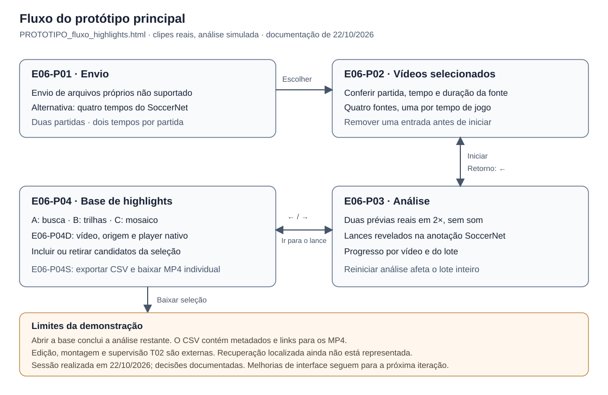

# Entrega 6 — Prototipação em papel

**Data da documentação:** 16/10/2026

**Status:** em elaboração; protótipo documentado e simulação formativa pendente

**Responsabilidade:** 1 solução integrada por equipe, Equipe 16

## Objetivo da atividade

Explorar a interação para enviar gravações de partidas, acompanhar a análise e escolher melhores momentos para download. A equipe usa um protótipo digital descartável para experimentar os fluxos antes da consolidação no Figma.

O ciclo da atividade compreende construir, simular, observar e revisar. Em 16/10/2026, Pedro confirmou que a simulação com uma pessoa que não participou do desenho ainda não ocorreu. As verificações técnicas registradas aqui não substituem essa atividade.

## 1. Escopo do protótipo

### 1.1 Personas, cenários e tarefas

As referências são as proto-personas da [Entrega 3](03_personas_contexto_jornada.md), os cenários hipotéticos da [Entrega 4](04_cenarios_problema.md) e as tarefas da [Entrega 5](05_analise_tarefas.md). Sua representação no protótipo não constitui validação empírica.

| Persona e contexto | Participação no fluxo | Relação com as tarefas |
|---|---|---|
| P01, Rafael, editor de vídeo esportivo; C01, seleção sob pressão de prazo | Referência principal para preparar gravações, acompanhar o lote e revisar candidatos com contexto | A01 como entrada, T03/A02 no acompanhamento e T01/A04 na revisão e obtenção; R01/R02 |
| P03, Jorginho Jr., criador amador; C03, decupagem com recursos limitados | Compartilha o acompanhamento e a revisão; a identificação do atleta depende da conferência humana | Aplicação de T03 e T01; R04/R05. Reconhecimento automático de jogadores permanece em investigação, H36 |
| P02, Arnaldo, supervisor editorial; C02, controle do processo editorial | Recebe o material por um canal externo após o trabalho do editor | T02 como continuidade externa, R03. O protótipo não inclui tela própria de aprovação |

O recorte é a pós-produção de partidas encerradas em computador. Edição detalhada, ajuste dos limites de cortes, montagem, publicação e chancela editorial continuam em ferramentas e canais externos. O protótipo demonstra uma aplicação potencial da contribuição do TCC.

Nesta entrega, cada vídeo é tratado como uma partida. O uso de "highlight" na interface foi aceito por Pedro; a escolha de vocabulário permanece sem validação empírica com participantes.

Os objetivos desta iteração são:

- Conferir quais gravações entram na análise antes de iniciá-la.
- Reconhecer a espera, o progresso por vídeo e um intervalo não analisado.
- Localizar candidatos e conferir origem, timecodes e contexto antes de incluir ou retirar da seleção.
- Comparar formas de organizar os resultados e obter uma relação identificável dos itens escolhidos.

### 1.2 Artefatos e limites da simulação

| Artefato | Papel nesta entrega |
|---|---|
| [Protótipo principal: fluxo de highlights](../assets/06_prototipos/PROTOTIPO_fluxo_highlights.html) | Versão de referência confirmada por Pedro em 16/10/2026. Quatro telas e três alternativas para a base de resultados |
| [Exploração anterior em baixa fidelidade](../assets/06_prototipos/PROTOTIPO_baixa_fidelidade_base_highlights.html) | Registro das alternativas anteriores: lista com filtros, galeria por partida, facetas por jogador e mapa das partidas. As facetas fictícias não confirmam a capacidade de identificar jogadores |
| [Mapa do fluxo documentado](../assets/06_prototipos/prototipo_fluxo_01.svg) | Identificação das quatro telas, transições e limites da demonstração |

Para executar a versão principal, baixe o HTML e abra-o no navegador. O botão **ou use 8 vídeos de exemplo** permite explorar o fluxo sem fornecer gravações. As setas esquerda e direita alternam as telas. Os parâmetros `?tela=1` até `?tela=4` abrem uma etapa diretamente; na tela 4, `&variant=A`, `B` ou `C` escolhe a visualização.

Partidas, durações, eventos e prévias são fictícios. Mesmo ao selecionar arquivos locais, a demonstração usa seus nomes e gera os demais dados, com limite de oito vídeos. Não há envio ao backend nem análise das imagens. A associação entre arquivo, partida e tempo é definida pelos exemplos, sem reconhecimento do conteúdo do arquivo.

As prévias são animações de um campo desenhado, sem controles de reprodução. O corte compreende o lance com até cinco segundos de contexto antes e depois, respeitando o início e o fim do vídeo de origem. A suficiência dessa margem para o julgamento editorial continua em investigação, conforme RC04/RC05.

**Baixar cortes** gera apenas `PROTOTIPO_cortes_selecionados.csv`, com metadados dos itens selecionados. Os vídeos dos cortes não existem na demonstração. A seleção permanece durante a sessão e a troca de visualização, mas não é salva após recarregar a página.

Pedro confirmou em 16/10/2026 que o contexto mostrado na prévia também deve acompanhar os clipes baixados. Essa decisão está aplicada aos metadados e à prévia do protótipo. O CSV registra o corte completo em `inicio_corte`, `fim_corte` e `duracao_corte_s`, mantendo o intervalo do lance separado em `inicio_lance` e `fim_lance`. Todos os timecodes se referem ao vídeo de origem.

A conferência técnica verificou os metadados do detalhe e a exportação CSV em cinco casos: lance comum, próximo ao início, no início, próximo ao fim e terminando no fim do vídeo. As prévias e os detalhes nas três alternativas também foram conferidos no navegador. Os casos de borda foram introduzidos apenas para verificação; os exemplos padrão não demonstram esse truncamento. Essas verificações não avaliam a qualidade de um vídeo exportado nem substituem o walkthrough.

O título da atividade foi preservado. Pedro confirmou em 16/10/2026 que o professor aceita o formato digital clicável adotado para esta entrega. A versão anterior conserva a aparência de baixa fidelidade, enquanto a principal tem maior acabamento visual. A exploração dos fluxos e a simulação formativa continuam como foco da atividade.

## 2. Fluxos escolhidos

| Fluxo | Tarefa e objetivo | Percurso | Por que foi priorizado |
|---|---|---|---|
| PF01 | Preparar entradas de A01, precondição de T03 | E06-P01 → E06-P02 → E06-P03 | Permite conferir arquivos e retirar uma entrada antes de iniciar, H08/H13/H16 |
| PF02 | Acompanhar o lote, recorte de T03/A02 | E06-P03, com espera, progresso e aviso de trecho não analisado | Explora a visibilidade do processamento e dos limites dos resultados, R02/R05 e RC03/RC05 |
| PF03 | Localizar, examinar e selecionar candidatos, recorte de T01/A04 | E06-P04A, B ou C → E06-P04D → inclusão ou retirada | Apoia o julgamento de pertinência e contexto; compara organizações dos mesmos resultados, R01/R04 e RC04/RC08 |
| PF04 | Obter a seleção e reconhecer a continuidade externa de T01 para T02 | Seleção em E06-P04 → E06-P04S → montagem e supervisão externas | Explora a identificação dos itens escolhidos, R03 e RC09. Nesta versão, a obtenção se limita ao CSV |

PF02 não cobre todos os métodos de recuperação de T03. PF03/PF04 representam parte de T01; conferência no original, correção externa, tratamento de dúvidas e retomada exigem aprofundamento. T02 fornece o contexto da entrega externa, sem ser executada dentro da interface.

## 3. Telas e estados

Os IDs `E06-Pxx` identificam telas desta entrega. `P01`, `P02` e `P03`, sem o prefixo, continuam identificando personas.

### 3.1 Inventário e navegação

| ID | Tela ou estado | Informação e controles | Transição ou retorno |
|---|---|---|---|
| E06-P01 | Envio das gravações | Arrastar ou selecionar vários arquivos; alternativa com oito vídeos fictícios | Entrada reconhecida abre E06-P02. Se nenhum arquivo for reconhecido como vídeo, uma mensagem aparece e a tela permanece |
| E06-P02 | Vídeos selecionados | Miniatura, nome, partida, tempo e duração fictícios; quantidade e duração total; remoção antes de iniciar | **Iniciar** abre E06-P03. **Adicionar vídeos** retorna a E06-P01; uma nova escolha substitui o lote. Após o início, o botão muda para **Ver análise** |
| E06-P03 | Análise do lote | Duas prévias simultâneas, identificação dos arquivos, detecções, progresso por vídeo e progresso geral; estados aguardando, processando e pronto | Seta direita abre E06-P04; seta esquerda retorna a E06-P02. **Reiniciar análise** reinicia o lote inteiro |
| E06-P03E | Trecho não analisado | Aviso sobre o vídeo 4 e o intervalo 12:00 a 14:50, com marcação na trilha | O restante da simulação continua e o aviso reaparece na base. Não há correção ou nova tentativa específica |
| E06-P04A | Base, alternativa A: Busca primeiro | Busca por lance, partida, time ou arquivo; filtros por tipo e tempo da partida; lista com inclusão no download | Clique na linha abre E06-P04D. Busca ou filtros sem correspondência mostram E06-P04V |
| E06-P04B | Base, alternativa B: Trilhas por partida | Partidas separadas em trilhas por tempo, marcadores e filtros por tipo; faixa do intervalo não analisado | Clique em marcador abre E06-P04D; controles anterior/próximo percorrem candidatos |
| E06-P04C | Base, alternativa C: Mosaico por tipo | Miniaturas agrupadas por tipo de lance e marcação para download | Clique na miniatura abre E06-P04D em uma janela sobre a base; **Fechar** ou `Esc` retorna |
| E06-P04D | Detalhe nas três alternativas | Prévia animada, tipo, partida, equipes, tempo e arquivo; início, fim e duração do corte completo; intervalo do lance e contexto disponível antes e depois | **+ Incluir** marca o item e passa a **No download**; novo clique o retira. Na lista, novo clique na linha ou `Esc` fecha o detalhe |
| E06-P04V | Nenhuma correspondência na alternativa A | **Nenhum lance encontrado** e **Limpar busca e filtros** | Limpar restaura a lista. Filtro vazio não demonstra uma análise que terminou sem candidatos |
| E06-P04S | Seleção vazia ou com itens | **Baixar cortes (0)** desabilitado sem seleção; contador atualizado após inclusão ou retirada | Com itens, gera o CSV e informa que os vídeos não existem no protótipo |

O seletor troca entre E06-P04A, B e C mantendo a seleção. Busca, filtros e detalhe aberto não são preservados nessa troca. O aviso da base informa que pode haver lances no intervalo não analisado e pode ser dispensado.

Nas alternativas A e C, a duração exibida é a do corte com contexto; o horário junto ao candidato continua indicando o início do lance. No detalhe, a prévia percorre o corte completo e distingue **LANCE** de **CONTEXTO**. A barra representa os segundos disponíveis antes e depois e informa quando o contexto é limitado pelo início ou fim do vídeo.

As setas entre telas são atalhos de demonstração. Na alternativa B, com detalhe aberto, e na C, com a janela aberta, as setas percorrem candidatos. É preciso fechar o detalhe para usar novamente as setas entre telas. A passagem de E06-P03 para E06-P04 conclui imediatamente qualquer análise restante. Esse atalho não demonstra acesso real a resultados parciais.

### 3.2 Alternativas para a base de resultados

| Alternativa | Questão de interação a investigar | Ponto a observar na simulação |
|---|---|---|
| A, Busca primeiro | Busca e filtros ajudam a localizar um lance conhecido e conferir sua origem? | Compreensão dos filtros, retorno da busca vazia e revisão de itens fora do recorte filtrado |
| B, Trilhas por partida | A posição temporal ajuda a compreender a distribuição dos candidatos e a lacuna? | Leitura dos marcadores, identificação do arquivo e distinção entre tempo do arquivo e minuto do jogo |
| C, Mosaico por tipo | Miniaturas e agrupamento por evento ajudam a percorrer candidatos? | Recuperação da partida de origem e continuidade ao abrir e fechar o detalhe |

A é a visualização inicial do HTML. Pedro confirmou em 16/10/2026 que as três alternativas permanecem em exploração para o walkthrough. Ainda não há resultado de avaliação que justifique declarar uma vencedora.

### 3.3 Cobertura e lacunas identificadas na revisão

A conferência documental e a inspeção do protótipo em 16/10/2026 incluíram uma revisão por subagente GPT-6.1-Sol, com esforço High e serviço Fast, solicitada por Pedro. Os achados abaixo não são observações de participantes. A prioridade considera a correspondência com as tarefas modeladas, sem medida empírica de gravidade.

| Prioridade e referência | Cobertura atual | Lacuna e evidência no protótipo |
|---|---|---|
| Alta, T03, recuperação localizada | Espera, progresso e aviso de intervalo não analisado; demais vídeos continuam | Falta orientação para corrigir, repetir somente a entrada afetada ou manter a pendência. **Reiniciar análise** reinicia o lote inteiro, conforme controle da tela 3 e função `startAnalysis` |
| Alta, T03 → T01, resultados disponíveis | Base com candidatos ao final da demonstração | Falta abrir resultados de uma partida pronta enquanto outras continuam. A função `go` força `finishAll` ao entrar na tela 4 |
| Alta, T01, inspeção do contexto | Origem, timecodes e animação do candidato com contexto | Faltam pausa e retorno no mesmo trecho. As funções `detail` e `paintLive` não oferecem esses controles |
| Alta, T01/T02, consolidação e obtenção | Contagem de selecionados e CSV com origem, intervalo do corte com contexto e intervalo separado do lance | Falta resumo apenas dos selecionados e representação de preparação, transferência, falha e retorno. O controle `#dl` exporta diretamente |
| Média, T01, dúvidas e retomada | Inclusão/retirada e seleção mantida ao trocar de visualização | Não distingue não vistos, descartados e dúvidas; filtro e detalhe aberto se perdem ao reconstruir a base. T01 admite anotação externa, que pode ser demonstrada sem criar um sistema próprio |
| Média, T01/T03, vazio e indisponibilidade | Busca sem correspondência e download bloqueado com seleção vazia | Faltam análise sem candidatos, prévia indisponível e falha de acesso aos resultados. A função `load` sempre gera candidatos fictícios |

A01 também exige aprofundar a validação das entradas e o comportamento de **Adicionar vídeos**, que hoje substitui o lote. A base representa o lote atual; o histórico de trabalhos anteriores de A03 não está implementado e sua tarefa própria continua pendente.

Essas lacunas podem ser exploradas com estados e transições simulados. Não exigem implementar o backend, gerar vídeos reais, criar edição detalhada, aprovação no produto, auditoria ou filtro automático por atleta. Dúvidas e correções externas precisam de referências demonstráveis, conforme T01, sem ampliar automaticamente o recorte.

## 4. Simulação e walkthrough

### 4.1 Situação da atividade

A sessão formativa está pendente, conforme confirmação de Pedro em 16/10/2026. Ainda não há participante, data de sessão, evidência de observação nem resultado de comparação das alternativas.

A sessão deve envolver uma pessoa que não participou da elaboração das telas. Um colega pode participar desta iteração formativa, sem substituir os participantes finais da Entrega 14.

### 4.2 Roteiro proposto

O roteiro prepara a próxima sessão. As situações não foram aplicadas e os resultados permanecem abertos.

| Passo | Situação proposta à pessoa | O que observar |
|---|---|---|
| 1 | Preparar um lote com os exemplos, retirar uma gravação e iniciar a análise | Se distingue seleção de envio e consegue conferir o lote |
| 2 | Identificar o que aguarda análise e o que aconteceu com o intervalo não analisado | Se compreende os estados, reconhece limites de cobertura e encontra uma continuidade possível |
| 3 | Localizar um candidato, conferir a origem e explicar se o trecho permite decidir sobre sua inclusão | Compreensão dos timecodes, contexto percebido e limites da prévia |
| 4 | Incluir dois candidatos, retirar um e repetir a localização nas alternativas A, B e C | Se distingue seleção de descarte e mantém a referência da partida nos agrupamentos |
| 5 | Fazer uma busca sem correspondência na alternativa A e recuperar a lista | Se diferencia ausência de correspondência de ausência de lances na partida |
| 6 | Obter a seleção e explicar o que enviaria a Arnaldo ou abriria no editor externo | Se percebe que o HTML fornece só um CSV e quais arquivos, informações e pendências ainda faltam |

Na comparação, variar a ordem de apresentação entre sessões, se houver mais de uma. Registrar a ajuda do facilitador, inclusive o ensino das setas entre telas, para distinguir descoberta espontânea de instrução recebida.

### 4.3 Registro de observações

| Observação | Tela ou ação | Evidência | Consequência para o design |
|---|---|---|---|
| Pendente de sessão com pessoa que não desenhou as telas | A definir pelo roteiro | Nenhuma evidência de participante disponível | Preencher após observar o uso; ainda não há decisão baseada nessa sessão |

## 5. Alterações após a simulação

Não há alterações decorrentes de simulação com participante, pois a sessão ainda não ocorreu.

| Antes | Problema observado | Depois | Justificativa |
|---|---|---|---|
| Versão principal documentada nesta entrega | Pendente de observação | Pendente | Registrar evidência e decisão após a sessão, inclusive se a equipe decidir manter o desenho |

A exploração anterior e a versão principal registram uma evolução do artefato. Sem relato de uma sessão, essa diferença não comprova revisão motivada por observação de outra pessoa. A inclusão do contexto nos metadados dos clipes e na prévia foi aplicada antes da sessão, por decisão de Pedro, e conferida tecnicamente. Sua adequação ao uso permanece sem avaliação com participantes.

## Checklist

- [x] O protótipo cobre tarefas relevantes da Entrega 5, com cobertura parcial e limites indicados.
- [x] Cada tela e estado documentado tem uma tarefa, decisão ou informação que o justifica.
- [x] O projeto mantém o recorte de envio, acompanhamento, revisão e obtenção, sem acrescentar login ou administração.
- [x] Telas e estados estão numerados, com controles e retornos descritos.
- [ ] Há pelo menos uma simulação ou walkthrough com pessoa que não desenhou as telas.
- [ ] As observações da simulação geraram decisões de revisão documentadas.
- [x] O formato digital clicável do protótipo principal foi confirmado como aceito para a Entrega 6, conforme informação de Pedro em 16/10/2026.

## Histórico de revisões

| Data | Versão | Descrição | Responsável |
|---|---|---|---|
| 16/10/2026 | 0.2 | Documentação do protótipo principal, fluxos, telas, alternativas, lacunas e roteiro formativo. Substituição do diagrama de exemplo pelo mapa do fluxo. Versão, alternativas, ausência de sessão e contexto nos clipes confirmados por Pedro. | Equipe 16, documentação assistida pelo Codex a pedido de Pedro |
| 16/10/2026 | 0.3 | Registrada a confirmação de Pedro de que o professor aceita o formato digital clicável. Encerrada essa pendência no checklist; walkthrough e revisões a partir da observação continuam pendentes. | Equipe 16, documentação assistida pelo Codex a pedido de Pedro |
| 16/10/2026 | 0.4 | Contexto incorporado ao intervalo e à duração do corte no detalhe, na prévia e no CSV, com limites do vídeo respeitados e intervalo do lance separado. Correção por Opus a pedido de Pedro, com verificações técnicas. Registradas as decisões de manter a terminologia e tratar cada vídeo como partida; sessão formativa continua pendente. | Equipe 16, implementação assistida por Opus e documentação assistida pelo Codex a pedido de Pedro |
