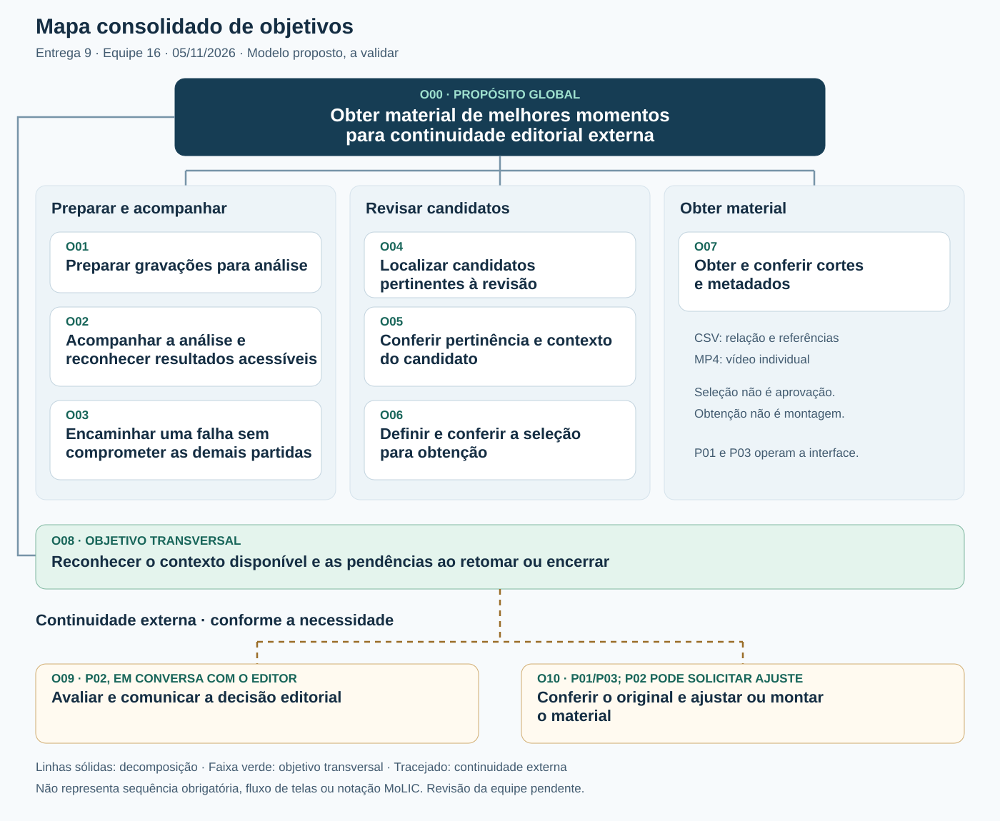

# Entrega 9 — Modelo conceitual e design centrado na comunicação

**Data:** 05/11/2026\
**Status:** 🟨 preenchimento documental concluído; revisão pelos integrantes e validação dos modelos pendentes\
**Responsabilidade:** recortes individuais de referência e consolidação do mapa de objetivos e do esquema de signos da Equipe 16.

## Objetivo da atividade

Transformar os cenários de problema em propostas de interação para preparar gravações, acompanhar sua análise, revisar candidatos a melhores momentos e obter cortes e metadados para continuidade externa. O modelo explicita o que usuário e preposto do designer precisam comunicar, sem definir componentes visuais nem descrever o funcionamento interno do detector.

### Base conceitual, autoria e limites

O [CC8122-ProjetoIHC-ModelosConceituais](../slides_plinio/CC8122-ProjetoIHC-ModelosConceituais.pdf.pdf), slides 5–10, 12–16 e 19, fundamenta cenários com ações e respostas, refinamento, conversas organizadas por tópicos e integração dos objetivos. O [CC8122-Esquema-Conceitual_Signos](../slides_plinio/CC8122-Esquema-Conceitual_Signos.pdf), slides 3–7, fundamenta origem, semântica, conteúdo, restrições, padrões e mecanismos de prevenção/recuperação dos signos. Ambos se referem a Barbosa e Silva (2010). O primeiro conjunto remete a um vídeo no Moodle para o mapa de objetivos; esse vídeo não está entre os materiais consultados. O mapa abaixo explicita a organização adotada, sem atribuir ao vídeo uma notação não verificada.

| Base do projeto | Uso nesta entrega | Limite preservado |
|---|---|---|
| [Entregas 1](01_conhecendo_o_problema.md), [3](03_personas_contexto_jornada.md), [4](04_cenarios_problema.md) e [rastreabilidade](../RASTREABILIDADE.md) | Personas, C01–C03, atividades A01/A02/A04 e relações R01–R05 | P01/Rafael e P03/Jorginho Jr. são primárias; P02/Arnaldo recebe material externamente. Contextos e benefícios permanecem hipóteses |
| [Entrega 5](05_analise_tarefas.md) | T01: revisão/seleção/obtenção; T03: acompanhamento/falhas; T02: supervisão externa | Envio inicial é precondição de T03; confirmar um pedido não comprova seu sucesso |
| [Entrega 2](02_analise_concorrencia.md) | RC02–RC09: entrada, estados, contexto, controle humano, linguagem, filtros e obtenção | Formatos, limites, recuperação e medidas de confiança dependem de investigação/viabilidade |
| [Entrega 6](06_prototipacao_papel.md#5-decisões-após-a-simulação) | E06-D01/D02/D05/D06: continuidade, legibilidade, saídas e interpretação temporal | A sessão de U01 teve ajuda; não valida o público profissional nem a obtenção independente de MP4 |
| [Entregas 7](07_coleta_dados.md) e [8](08_engenharia_usabilidade.md) | Questões de pesquisa e metas MQ01–MQ04/MU01–MU06 | Planejamento e critérios de aceitação não são resultados de avaliação |

**Escopo:** enviar → acompanhar → revisar → baixar. Ajustar cortes, montar, publicar, transferir material ao supervisor e chancelar a seleção continuam externos. Não se introduzem autenticação, administração, reconhecimento automático de atletas, histórico persistente ou parâmetros de IA. A03/histórico, H15/H29/H35, continua em investigação.

**Modelo proposto e demonstração atual:** os cenários descrevem o uso pretendido, incluindo condições ainda não implementadas. O protótipo da Entrega 6 utiliza quatro arquivos de exemplo, um por tempo de duas partidas, oito cortes MP4 e análise simulada; não envia arquivos próprios nem executa o detector. Falhas de análise, recuperação localizada e retomada após recarga permanecem lacunas. A seleção atual se mantém ao alternar visualizações, mas se perde ao recarregar. Essas condições devem ser explicitadas na apresentação da demonstração.

## 1. Cenários de interação

### Convenção de comparação e refinamento

Cada CI reescreve o **cenário refinado** de mesmo número da Entrega 4. O texto mantido literalmente aparece sem destaque; **acréscimos e substituições aparecem em negrito**. As supressões e mudanças de percurso estão resumidas nas tabelas de diferenças. Os números das questões originais não são repetidos: o quadro seguinte conserva o ciclo de contexto, ator, objetivo, planejamento, ações, eventos e avaliação.

| Elemento refinado | CI01: Rafael | CI02: Arnaldo e editor | CI03: Jorginho Jr. |
|---|---|---|---|
| Contexto e ator | Rodada, várias partidas, prazo no mesmo dia; editor experiente | Redação, vários editores e supervisão responsável pela decisão final | Produção amadora em casa, equipamento limitado e três jogos de interesse |
| Objetivo | Obter uma seleção pertinente e compreensível para edição externa | Receber material identificável e avaliar sua adequação editorial | Obter trechos úteis ao compilado de um atleta, conferindo sua participação manualmente |
| Planejamento | Conferir entradas, acompanhar análise e revisar por partida | Priorizar revisão externa; pedir referências e contexto quando faltarem | Trabalhar uma partida por vez e conferir arquivos/recursos antes de continuar |
| Ações e respostas | Informar gravações, interpretar estado, consultar candidatos, selecionar e obter arquivos | Editor solicita saídas; sistema comunica conteúdo; Arnaldo recebe, examina e devolve a decisão externamente | Solicitar análise, interpretar espera/falha, examinar candidatos e baixar os pertinentes |
| Eventos e rupturas | Pergunta do supervisor, contexto insuficiente e possível omissão | Corte de gol sem a falta anterior; não há chancela automática | Falha informada ou consulta indisponível; possível inadequação dos resultados ao atleta |
| Avaliação e término | Separar material obtido de dúvidas e cobertura desconhecida | Distinguir seleção liberada, ajuste solicitado e conferência pendente | Conferir arquivos, reconhecer jogos não revistos e adiar se os recursos forem insuficientes |

### CI01 — Revisar e obter candidatos com contexto sob pressão de prazo

**Autor de referência:** Pedro Alexandre Custódio Silva — 22.123.049-3; C01 e T01.\
**Origem:** [C01 — Seleção manual de melhores momentos sob pressão de prazo](04_cenarios_problema.md#cenário-c01--seleção-manual-de-melhores-momentos-sob-pressão-de-prazo).\
**Personas e tarefas:** P01; T01/A04, com A01 e T03/A02 como preparação; continuidade externa em T02.\
**Rastreabilidade:** R01/R02; H10/H11/H25/H28/H30/H32/H40/H41; RC02–RC09.

Em um dia de rodada na produtora de conteúdo esportivo, Rafael recebe pelo servidor as gravações integrais de várias partidas já encerradas **e precisa selecionar seus melhores momentos com apoio da análise automática.** Divide com outros dois editores uma sala de edição com pouca luz e trabalha diante de um computador com tela ampla. A seleção de cada partida precisa ficar pronta no mesmo dia, porque Arnaldo, que supervisiona a pós-produção, decide com base nela o que segue para a montagem.

**Antes de solicitar a análise, Rafael informa as gravações e confere a partida, o tempo correspondente e os arquivos reconhecidos. O sistema apresenta o conjunto e informa restrições conhecidas ou problemas de entrada. Rafael retira uma entrada indevida, confere as restantes e solicita o processamento. O sistema distingue a aceitação do envio do início e da conclusão da análise e associa o acompanhamento à referência da tentativa, quando fornecida. Sem essa referência, comunica a limitação, sem presumir qual tentativa produziu um resultado. Durante a espera, Rafael pode continuar outra edição e voltar para consultar o estado de cada entrada, sem interpretar a demora como falha.**

**Quando há resultados acessíveis, o sistema disponibiliza candidatos com tipo de lance, referência temporal, vídeo de origem e trecho para reprodução. Rafael trabalha uma partida por vez, examina a construção e o desfecho das jogadas e inclui na seleção os candidatos que considera pertinentes. A classificação automática é uma sugestão, não uma decisão editorial. Se nenhum candidato lhe servir, pode encerrar a revisão sem seleção e reconhecer a necessidade de busca externa.**

**Durante a revisão da última partida, chega pelo chat uma pergunta de Arnaldo sobre um lance de outra partida. Rafael usa a identificação e a referência temporal para localizar o material pedido. Ao voltar, confere a partida, o candidato e os itens selecionados ainda disponíveis na sessão; se o contexto não tiver sido preservado, reconhece que precisa reconstruí-lo. A proposta não presume recuperação após recarga. Ao reproduzir uma finalização, julga que o trecho começa tarde e não mostra a troca de passes. O sistema comunica a origem e os limites existentes, sem oferecer edição detalhada. Rafael confere o original na ferramenta externa, ajusta o corte quando viável e distingue esse arquivo externo dos candidatos gerados pelo sistema. Uma suspeita de omissão exige conferir a gravação; a lista de candidatos não demonstra cobertura completa.**

**Rafael confere os itens incluídos e solicita a relação em CSV e os vídeos individuais necessários. O sistema explica que o CSV contém metadados e endereços dos itens selecionados e requer seleção não vazia; cada MP4 disponível contém um vídeo e pode ser obtido individualmente sem inclusão na seleção, mesmo que ela esteja vazia. Informa o tamanho de cada MP4 e a soma dos vídeos escolhidos quando houver base, distinguindo valor conhecido, estimativa fundamentada e informação indisponível. Essa soma não representa uma montagem única nem inclui o CSV. Rafael abre a relação salva e reproduz os arquivos obtidos antes de copiá-los para o servidor e avisar Arnaldo pelo chat. Encerra esta etapa distinguindo cortes conferidos, ajustes externos e o que ficou sem revisão. Obter arquivos não significa aprovação editorial nem ausência de lances omitidos.**

#### Diferenças relevantes de CI01

| Alteração em relação a C01 | Por que foi necessária | Evidência/artefato que justifica |
|---|---|---|
| A procura manual integral deixa de ser o percurso principal; entram envio, análise e revisão de candidatos | Explorar a contribuição técnica preservando a decisão humana | A01/A02/A04; T01/T03; R01/R02; H28/H30 |
| A interrupção exige reconhecer referências e o contexto ainda disponível | Retomar a atividade não equivale a recuperar tudo automaticamente | C01/H41; T01; limites de persistência da Entrega 8 |
| Contexto insuficiente e omissão suspeita levam à conferência/correção externa | A interface não edita limites nem comprova cobertura | T01; RC04/RC05; H10/H25 |
| A cópia final é precedida pela distinção e conferência de CSV e MP4 | Comunicar o que foi efetivamente obtido | E06-D05/D06; MQ03/MQ04; MU02–MU04 |
| O desfecho não afirma eliminação do cansaço, redução de tempo ou seleção completa | Esses benefícios não foram medidos | H02 aberta; limites das Entregas 7 e 8 |

### CI02 — Obter material identificável para a supervisão editorial externa

**Autor de referência:** Lucas Roberto Boccia dos Santos — 22.123.012-1; C02 e T02.\
**Origem:** [C02 — Controle do Processo Editorial Engessado](04_cenarios_problema.md#cenário-c02--controle-do-processo-editorial-engessado).\
**Personas e tarefas:** P02, destinatária externa; P01 opera T01/A04; T02 ocorre fora da interface.\
**Rastreabilidade:** R03; H14/H22/H23/H25/H33/H35/H40; RC05/RC09.

Em um dia movimentado de rodada de futebol na redação da emissora esportiva, Arnaldo atua como editor-chefe responsável por supervisionar a produção de conteúdo digital e chancelar a publicação dos melhores momentos. Na área de pós-produção, vários editores trabalham simultaneamente em ilhas de edição, cada um encarregado de uma partida diferente. **O apoio do sistema ocorre na preparação do material pelo editor; Arnaldo continua a receber e avaliar as seleções por ferramentas e canais externos.**

**Após revisar os candidatos, Rafael confere com o sistema a seleção que pretende encaminhar, identificando a partida, o tempo e os cortes incluídos. Solicita o CSV com as referências e baixa os MP4 individuais necessários. O sistema distingue as saídas: o CSV exige seleção não vazia; um MP4 disponível pode ser obtido independentemente dela. Informa os tamanhos dos vídeos e sua soma quando houver dados, sem afirmar espaço livre suficiente. Não declara que os itens selecionados foram aprovados para publicação. Rafael confere os arquivos salvos, reúne também os cortes ajustados externamente e comunica pelo chat o material disponível e as dúvidas ainda sem decisão. A transferência e esse aviso são realizados fora da aplicação.**

**Arnaldo prioriza o atendimento e abre os arquivos recebidos nas ferramentas habituais. Usa a identificação e os tempos para discutir a mesma jogada com Rafael. Diante de um corte do gol da vitória que não mostra a falta anterior, avalia que o trecho não permite o julgamento editorial necessário. Pede a Rafael que confira o original e ajuste o recorte externamente. Se a referência não bastar ou o arquivo não abrir, solicita a identificação correta ou o reenvio pelo canal habitual; não recebe garantia automática de contexto ou imparcialidade.**

**Rafael devolve o trecho corrigido pelo mesmo fluxo externo. Arnaldo o assiste novamente e comunica a decisão de liberar ou solicitar novo ajuste pelo chat ou presencialmente na ilha de edição. A decisão não é registrada como aprovação dentro da interface do projeto. Se a revisão não couber no prazo, reconhece quais seleções continuam pendentes, sem equiparar obtenção ou seleção de arquivos à sua chancela.**

**A narrativa termina com material identificável e decisão externa, ou com uma pendência explícita. A intervenção pretende apoiar a conferência antes da publicação; não afirma que a crise de conteúdo descrita em C02 será necessariamente evitada. Montagem, publicação, eventual retirada e republicação permanecem externas.**

#### Diferenças relevantes de CI02

| Alteração em relação a C02 | Por que foi necessária | Evidência/artefato que justifica |
|---|---|---|
| O recebimento passa a incluir cortes e relação com origem e tempos | Dar referência comum à conversa entre editor e supervisor | T02; R03; H22/H23/H33; RC09 |
| A conversa com o sistema cabe ao editor; a chancela permanece externa | Preservar P02 como persona atendida | Entrega 3/P02; T02; H14/H35 abertas |
| O gol sem a falta anterior é tratado como descoberta na revisão, com ajuste e nova avaliação | Explorar a intervenção antes da publicação sem prometer eliminação de falhas | C02; T02; RC05 |
| Circulação, prancheta, crise pública e republicação deixam de compor o percurso principal | Concentrar o CI na obtenção e transferência apoiáveis pelo produto | Escopo da Entrega 1; continuidade externa da Entrega 8 |
| A decisão é comunicada por chat/presencialmente | Não inventar painel de aprovação ou auditoria editorial | T02, revisão de 27/10/2026; H35 aberta |

### CI03 — Acompanhar a análise e obter trechos para uma produção amadora

**Autor de referência:** Giovanni Chahin Morassi — 22.123.025-3; C03 e T03.\
**Origem:** [C03 — Decupagem manual de lances por jogador sob restrições de hardware](04_cenarios_problema.md#cenário-c03--decupagem-manual-de-lances-por-jogador-sob-restrições-de-hardware) e [ponte para T03](04_cenarios_problema.md#ponte-para-t03--acompanhamento-no-uso-proposto).\
**Personas e tarefas:** P03; A01, T03/A02 e aplicação de T01/A04. T03 também se aplica a P01.\
**Rastreabilidade:** R04/R05; H08/H16/H24/H25/H26/H36/H37/H38; RC02–RC08.

Em uma tarde de sábado, em sua casa, Jorginho Jr., estudante de 19 anos, prepara o próximo vídeo para seu canal esportivo no YouTube. Ele pretende produzir um compilado temático destacando a atuação de uma jovem promessa do futebol em seus três últimos jogos. **Mantém o critério de reconhecer a participação do atleta e compreender a construção e o desfecho da jogada. Usa seu computador modesto e a conexão disponível, mas precisa conferir se tem espaço para a entrada e os arquivos de saída; a análise remota proposta não comprova economia de disco.**

**Jorginho decide trabalhar uma partida por vez. Informa a primeira gravação, confere a origem e solicita a análise. O sistema comunica a aceitação ou a rejeição da entrada e, quando houver processamento aceito, o estado real conhecido. Durante a espera, Jorginho volta aos estudos e consulta a análise quando precisa decidir se já pode revisar os resultados. A proposta não define um canal de aviso nem garante processamento contínuo com a aplicação fechada.**

**Ao acessar os candidatos disponíveis, reproduz os trechos e identifica visualmente se o atleta participa. O sistema informa o tipo de lance e a origem, sem afirmar reconhecimento automático do jogador. Jorginho inclui os trechos úteis ao compilado e verifica o contexto. Antes de obter os vídeos, consulta seus tamanhos conhecidos e a soma dos escolhidos, quando calculável, e confere o espaço disponível por seus meios habituais. Se algum tamanho não puder ser informado, reconhece essa limitação; não substitui o valor por zero. O CSV requer seleção não vazia, enquanto um MP4 acessível pode ser obtido individualmente sem seleção. Jorginho baixa os vídeos necessários e a relação dos itens selecionados, quando houver seleção. Confere os arquivos salvos antes de decidir como organizar o espaço. Não interpreta o recebimento dos cortes como garantia de que pode apagar o original: ainda pode precisar dele para conferir omissões e produzir cortes externos.**

**Na segunda partida, a consulta pode informar uma falha da análise. O sistema identifica a entrada afetada, descreve o problema conhecido e as ações efetivamente suportadas. Se houver entrada corrigível e reenvio disponível, Jorginho corrige o arquivo e confere a resposta ao novo envio. Se houver repetição orientada, confere as consequências conhecidas e decide se confirma nova tentativa. Em ambos os casos, o sistema distingue pedido aceito de análise concluída. Quando a nova tentativa for aceita e sua referência estiver disponível, Jorginho a confere para acompanhar o estado e distinguir os resultados dessa análise dos anteriores. Se a referência ou a associação não estiver disponível, reconhece que essa distinção não pôde ser confirmada; o sistema não presume preservação nem substituição dos resultados anteriores. Se a ação não estiver disponível, a falha persistir ou a causa não for conhecida, Jorginho mantém a partida pendente e conserva a referência para buscar orientação externa. Os resultados das demais partidas devem ser preservados; não se presume recuperação garantida. Se apenas a consulta estiver indisponível, ele reconhece que não sabe o estado da análise, em vez de concluir que ela falhou.**

**Jorginho confere o que obteve da primeira partida, o encaminhamento da segunda e se há recursos e tempo para iniciar a terceira. Os melhores momentos gerais podem não incluir movimentações sem bola e passes que procura. Se os candidatos forem insuficientes, recorre à gravação e à edição externas quando viável, ou adia o compilado. Termina com arquivos conferidos e pendências reconhecidas, sem garantia de seleção temática completa, recuperação de marcações locais ou solução das limitações de hardware.**

#### Diferenças relevantes de CI03

| Alteração em relação a C03 | Por que foi necessária | Evidência/artefato que justifica |
|---|---|---|
| A busca manual passa a ser apoiada pela análise e revisão de candidatos | Explorar o backend sem afirmar adequação integral ao compilado de atleta | Jornadas de P03; R04/R05; H36/H37 abertas |
| A participação do jogador continua identificada pela pessoa | Reconhecimento automático por atleta não é capacidade assegurada | C03; H36; T01 aplicado a P03 |
| O travamento local não é convertido em prova de falha do backend; incluem-se alternativas hipotéticas de T03 | Modelar recuperação sem inventar diagnóstico a partir de C03 | Ponte para T03; H16/H26; RC03 |
| Reenvio, repetição orientada e adiamento são condicionais e exigem conferir a resposta | Uma ação solicitada não é recuperação concluída | T03, HTA/GOMS/CTT; R05 |
| Conferir o download não implica apagar originais nem liberar espaço suficiente | Preservar conferência externa e incerteza de armazenamento | H37; C03; Entrega 8 |

## 2. Design centrado na comunicação

**Convenção:** U = pessoa que opera a interface; D = preposto do designer/sistema. As falas indicam intenção e conteúdo, não textos finais de interface. E = conversa **externa**, sem transição de sistema implícita. S01–S34 remetem à tabela única da seção 4; O00–O10, ao mapa da seção 3.

### CI01 — Revisar e obter candidatos com contexto sob pressão de prazo

| Tópico > subtópico | Falas e signos envolvidos | Intenção/efeito esperado |
|---|---|---|
| Preparar gravações > conferir entradas, O01 | U: Quero analisar estas gravações. D: Estas são as partidas, tempos e arquivos reconhecidos; confira o conjunto. S01–S07 | Conferir associação e reconhecer exemplos na demonstração |
| > corrigir o conjunto, O01 | U: Quero retirar esta entrada e usar a correta. D: Este é o conjunto restante; esta entrada não foi aceita por este motivo conhecido. S03/S05/S06/S08 | Prevenir processamento de entrada indevida e permitir correção |
| Acompanhar a análise > interpretar estado, O02 | U: Já posso revisar esta partida? D: Esta é a referência da tentativa, quando disponível, seu estado conhecido e os resultados associados; se não puder confirmar a associação, informo essa limitação. Só informo previsão com cálculo confiável. S08–S12/S32 | Distinguir envio, espera, análise e acesso |
| Localizar candidatos > restringir consulta, O04 | U: Quero examinar os lances desta partida e deste tipo. D: Estes são os candidatos correspondentes; a consulta não altera sua seleção. S01/S02/S16/S17/S22 | Distinguir filtro e seleção |
| Conferir pertinência e contexto > interpretar trecho, O05 | U: Quero entender a jogada e onde ocorreu. D: Eis o corte, o tipo sugerido, a origem e os tempos, com o intervalo disponível. S16–S21 | Distinguir relógio do jogo, posição no arquivo e intervalo |
| > lidar com contexto insuficiente/omissão, O05/O10 | U: Falta a construção ou suspeito de um lance ausente. D: Estas são a origem e as limitações conhecidas; a correção ocorre externamente. S03/S12/S20/S30 | Preservar julgamento e continuidade externa |
| Definir a seleção > incluir, retirar e conferir, O06 | U: Quero este candidato; aquele não deve compor o material. D: Estes são os itens selecionados, a quantidade e a soma das durações. S23–S25 | Permitir revisão da escolha, sem prometer montagem única |
| Retomar a revisão > reconhecer contexto, O08 | U: Onde estava e o que falta conferir? D: Estas são as referências de partida, candidato e tentativa e a seleção ainda disponíveis; o restante precisa ser reconstruído. S23/S29/S30/S32 | Não confundir sessão com persistência garantida |
| Obter cortes e metadados > distinguir saídas, O07 | U: Preciso dos vídeos e da relação. D: O CSV contém referências dos itens selecionados e exige seleção não vazia. Cada MP4 disponível pode ser obtido individualmente, mesmo sem seleção. Informo seu tamanho e a soma dos vídeos selecionados quando houver dados; sem base, informo indisponível. Não há montagem única. S23/S26/S27/S33/S34 | Tratar a ambiguidade de E06-O04 |
| > conferir obtenção e encerrar, O07/O08 | U: Abri a relação e os vídeos; ainda faltam estas conferências. D: Informo o estado conhecido da disponibilização, sem afirmar salvamento local que não posso verificar. S28/S30 | Conferir resultado e reconhecer pendências |

### CI02 — Obter material identificável para a supervisão editorial externa

| Tópico > subtópico | Falas e signos envolvidos | Intenção/efeito esperado |
|---|---|---|
| Preparar material > conferir identidade/seleção, O06/O07 | U, editor: Quero obter estes cortes para a supervisão. D: Esta é a seleção, com partidas, tempos e referências. S01/S02/S16/S23–S25 | Referência comum sem declarar aprovação |
| > obter saídas, O07 | U, editor: Preciso da relação e dos vídeos individuais. D: O CSV corresponde à seleção não vazia; cada MP4 disponível pode ser obtido sem estar selecionado. Informo os tamanhos conhecidos e o total dos vídeos escolhidos quando calculável, ou sua indisponibilidade. A transferência ao destinatário acontece fora daqui. S23/S26–S28/S33/S34 | Delimitar a conversa apoiada pela interface |
| E: receber e avaliar > conferir contexto, O09 | Editor: Encaminhei estes arquivos; estas dúvidas permanecem. Arnaldo: Quero conferir o gol e a jogada anterior pela mesma referência. S01/S02/S16/S18–S20/S30 | Passagem externa de T01 para T02 |
| E: solicitar ajuste > voltar à origem, O10 | Arnaldo: Falta a falta anterior; confira o original e devolva o trecho corrigido. Editor: Vou conferir esta gravação e este intervalo. S03/S19/S20/S30/S31 | Localizar problema e ajustar externamente |
| E: deliberar > liberar, devolver ou adiar, O09 | Arnaldo: Este trecho atende ao critério, ou ainda precisa deste ajuste; esta outra seleção não foi conferida. S30/S31 | Distinguir decisão externa de seleção interna |

Não há falas D atribuídas à chancela de Arnaldo. O futuro MoLIC deve representar a conversa do editor até a obtenção e a saída para T02, sem converter a comunicação externa em função de aprovação.

### CI03 — Acompanhar a análise e obter trechos para uma produção amadora

| Tópico > subtópico | Falas e signos envolvidos | Intenção/efeito esperado |
|---|---|---|
| Preparar gravações > conferir uma partida, O01 | U: Quero analisar esta gravação antes da próxima. D: Estas são sua partida, tempo, duração e condições conhecidas de aceitação. S01–S08 | Dar previsibilidade sem exigir conhecimento de IA |
| Acompanhar a análise > decidir continuidade, O02 | U: Posso revisar ou preciso aguardar? D: Esta é a referência da tentativa, quando disponível, seu estado conhecido e sua atualização; estes resultados estão ou não acessíveis. Associações não confirmadas são informadas como tal. S09–S12/S32 | Decidir durante outras atividades |
| > consulta sem informação segura, O02 | U: A análise falhou? D: Não consegui consultar o estado; não posso concluir que a execução falhou. S09/S10/S12 | Separar ausência de informação e falha |
| Encaminhar uma falha > compreender o ocorrido, O03 | U: O que aconteceu e o que foi preservado? D: Este é o problema conhecido, a entrada e a tentativa identificáveis, quando disponíveis, e os resultados cuja associação e disponibilidade consigo confirmar. S12/S13/S32 | Localizar o problema, preservando as demais partidas |
| > corrigir ou tentar novamente, O03 | U: Quero reenviar a entrada corrigida ou confirmar a repetição orientada. D: Esta ação é suportada nestas condições; estas são as consequências conhecidas e a resposta ao pedido. Se aceito, identifico a nova tentativa quando a referência existir; caso contrário, informo que sua associação ao acompanhamento não foi confirmada. S05/S08/S14/S15/S32 | Decisão informada; conferir aceitação/rejeição |
| > reconhecer limite de recuperação, O03 | U: Não consigo corrigir agora ou a falha persiste. D: Esta referência e a orientação externa, quando disponível, permitem continuar depois; a partida permanece pendente. S13–S15/S29/S30 | Saída sem repetição ilimitada nem recuperação garantida |
| Conferir contexto > reconhecer atleta manualmente, O05 | U: Preciso ver se este jogador participa e se a jogada se entende. D: Eis o vídeo, a origem e os tempos; não asseguro identificação do atleta nem cobertura de todos os seus lances. S12/S16–S21 | Manter H36 explícita, sem filtro por jogador |
| Definir seleção e obter material, O06/O07 | U: Quero somente estes candidatos e suas referências. D: Esta é a seleção para o CSV, que exige ao menos um item. Cada MP4 disponível também pode ser obtido sem seleção; informo o tamanho e a soma dos vídeos escolhidos quando conhecidos, distinguindo estimativas com base disponível. Dados ausentes são informados como indisponíveis; confira o espaço no dispositivo. S23–S28/S33/S34 | Apoiar produção amadora sem impor ferramentas profissionais |
| Retomar ou encerrar > reconhecer pendências, O08 | U: Tenho os arquivos desta partida; a outra está pendente e a terceira não foi iniciada. D: Estas são as referências ainda disponíveis nesta sessão. S29/S30 | Não declarar seleção temática completa |

## 3. Mapa de objetivos

### Recortes individuais de referência

Os recortes foram derivados dos artefatos já atribuídos aos integrantes. São a base documental da consolidação; a apresentação e a revisão individual previstas na atividade ainda precisam ocorrer.

| Referência de autoria | Mapa textual do recorte | Integração |
|---|---|---|
| Pedro — 22.123.049-3; C01/T01 | O00 → preparação O01/O02 → O04/O05/O06 → O07; O08 transversal; O10 quando necessário | Revisão por P01 compartilhada com P03; seleção não equivale à chancela |
| Lucas — 22.123.012-1; C02/T02 | O00 → O06/O07 pelo editor → O09 por P02; O10 externo retorna à avaliação O09 | Fronteira após obtenção/transferência externa; não acrescenta uso direto de P02 |
| Giovanni — 22.123.025-3; C03/T03 | O00 → O01 → O02; O03 se houver falha → O04/O05/O06/O07 com resultados; O08 transversal | Acompanhamento comum a P01/P03; pertinência por atleta é manual |

As setas desses recortes indicam dependências narrativas, não sequência obrigatória nem notação MoLIC. O mapa visual representa **decomposição de objetivos**, com ligações tracejadas para a continuidade externa.

### Mapa consolidado

**Fonte editável:** [mapa_objetivos.svg](../assets/09_modelo_conceitual/mapa_objetivos.svg). O00 é o propósito global; os agrupamentos intermediários organizam a leitura. O08 é transversal. O09/O10 permanecem fora da interface. IDs e nomes são compartilhados com o dicionário e as conversas.

### Dicionário de objetivos

Prioridades são de projeto, justificadas pelas Entregas 5, 6 e 8; não são frequência, criticidade ou preferência medidas com o público.

| ID | Objetivo | Persona(s) | Cenário(s) | Prioridade |
|---|---|---|---|---|
| O00 | Obter material de melhores momentos para continuidade editorial externa | P01/P03; P02 destinatária | CI01/CI02/CI03 | Propósito global, H28; benefício a validar |
| O01 | Preparar gravações para análise | P01/P03 | CI01/CI03 | Essencial, A01; precondição de T03 |
| O02 | Acompanhar a análise e reconhecer resultados acessíveis | P01/P03 | CI01/CI03 | Essencial, T03; E06-D01/MU01 |
| O03 | Encaminhar uma falha sem comprometer as demais partidas | P01/P03 | CI03; alternativa comum a CI01 | Alta quando há falha; ações condicionadas ao suporte técnico |
| O04 | Localizar candidatos pertinentes à revisão | P01/P03 | CI01/CI03 | Essencial, T01; MU05; filtros a validar |
| O05 | Conferir pertinência e contexto do candidato | P01/P03 | CI01/CI03 | Essencial, T01; MQ03/MU02 |
| O06 | Definir e conferir a seleção para obtenção | P01/P03 | CI01/CI02/CI03 | Essencial, T01; MU03; não significa chancela |
| O07 | Obter e conferir cortes e metadados | P01/P03; P02 recebe externamente | CI01/CI02/CI03 | Essencial, A04; E06-D05; MU03/MU04 |
| O08 | Reconhecer o contexto disponível e as pendências ao retomar ou encerrar | P01/P03 | CI01/CI03 | Alta, H41/T01/T03; sem persistência assegurada |
| O09 | Avaliar e comunicar a decisão editorial | P02 em conversa com o editor | CI02 | Continuidade externa, T02 |
| O10 | Conferir o original e ajustar ou montar o material | P01/P03; P02 solicita ajuste | CI01/CI02/CI03 | Continuidade externa conforme necessidade e recursos |

### Decisões de consolidação

| Duplicidade ou conflito | Decisão consolidada | Consequência |
|---|---|---|
| Highlights, lances e cortes como sinônimos | Lance é o acontecimento; candidato é a sugestão; corte é o trecho audiovisual | Não tratar classificação como fato editorial; testar vocabulário na coleta |
| Selecionado, revisado e aprovado | Seleção é o conjunto escolhido; revisão é atividade humana; decisão editorial é externa | O06 não realiza O09; sem registro persistente de revisão presumido |
| Tempo com vários significados | Separar etapa da partida, relógio do jogo, posição no arquivo e duração | Reutilizar S02/S18–S21; tratar E06-O06 |
| Concluído como análise pronta, cobertura total ou arquivo salvo | Separar estado da análise, disponibilidade/limites e obtenção | O02 não comprova O05/O07; zero candidatos não prova ausência de lances |
| Supervisão como justificativa para painel/auditoria | Atender P02 por arquivos identificáveis e comunicação externa | O09 externo; H14/H35 abertas |
| Retomada confundida com histórico permanente | O08 usa contexto preservado e referências reconhecíveis | Não declarar A03 implementada nem armazenamento automático de pendências |

## 4. Esquema conceitual de signos

### Convenções e relações

**Origem** indica onde o conceito faz sentido, conforme os slides: **domínio**, conceitos da atividade; **aplicação**, conceitos introduzidos pelo sistema. A procedência do valor aparece separadamente na mesma coluna: **U**, informado/escolhido pelo usuário; **S**, produzido/derivado pelo sistema; **E**, recebido/decidido externamente. Um conceito do domínio pode ser preenchido automaticamente; domínio não significa digitado pelo usuário.

**PP — prevenção passiva:** explicar linguagem, conteúdo ou condição. **PA — prevenção ativa:** impedir fala inválida. **AL — prevenção apoiada/alerta:** apresentar consequência potencial e pedir decisão informada antes de prosseguir. **RA — recuperação apoiada:** explicar ruptura ocorrida e oferecer continuação pela interface. **CE — captura de erro:** reconhecer que a recuperação exige ação fora da interface e indicar orientação quando disponível. “—” significa ausência de padrão/mecanismo aplicável; informação desconhecida não deve virar zero. Os mecanismos são requisitos propostos, sem afirmar implementação atual.

Um lote S06 reúne entradas S03, associadas à partida S01 e ao tempo S02, sem presumir que toda gravação futura terá exatamente um tempo. A tentativa de análise S32 distingue as análises solicitadas para uma entrada; estados S09/S10, disponibilidade S12, falha S13 e resposta S15 devem ser relacionados à tentativa identificável. Uma resposta aceita não demonstra conclusão. Um candidato S16 remete à origem, à tentativa que o produziu quando essa associação for conhecida, aos tempos S18/S19, ao intervalo S20 e ao corte S27. Se a referência da tentativa ou sua associação não for fornecida, o sistema informa a limitação, sem inventá-la nem afirmar se resultados anteriores foram preservados ou substituídos. Essa relação não exige histórico permanente. A seleção S23 reúne candidatos sem duplicação; S24/S25 são derivados dela. O CSV S26 preserva as referências conhecidas, sem pressupor um novo campo de tentativa já implementado. S33 informa o tamanho de cada MP4; S34 soma esses tamanhos para os itens de S23. O CSV exige seleção não vazia; obter um MP4 individual acessível não exige seleção. A decisão S31 pertence ao processo externo e não altera automaticamente S23.

### Tabela única de signos

| Grupo | Signo | Origem | Observações/semântica | Tipo de conteúdo | Restrição | Valor padrão | Prevenção | Recuperação |
|---|---|---|---|---|---|---|---|---|
| Entrada | S01 — Partida | Domínio; U/S | Identifica o jogo da gravação e dos candidatos | Identificação textual e referência estável | Distinguir partidas; aproveitar dados conhecidos sem inventá-los | Reconhecida, se disponível | PP: identidade junto aos resultados | RA: conferir/corrigir associação se suportado; senão orientar externamente |
| Entrada | S02 — Tempo da partida | Domínio; U/S | Etapa, como 1º ou 2º tempo; não é duração | Categoria textual | Corresponder à origem; admitir desconhecido; demais etapas dependem das entradas aceitas | Da origem; senão não informado | PP: distinguir etapa, relógio e duração | RA: esclarecer associação antes de usar/exportar |
| Entrada | S03 — Vídeo de origem | Domínio; U/S | Gravação analisada e referência para conferência externa | Arquivo identificado; prévia se disponível | Origem verificável; não trocar associação de resultados já gerados | Nenhum arquivo próprio; exemplos identificados na demonstração | PP: mostrar origem; PA: não iniciar sem entrada válida | RA: substituir antes da análise se suportado; CE: obter cópia válida externamente |
| Entrada | S04 — Duração da origem | Domínio; S | Extensão temporal do arquivo de entrada | Duração com unidade | Positiva quando legível; desconhecida se não aferida | Calculada, se disponível | PP: unidade e ausência de informação | CE: orientar verificar a mídia se a leitura exigir correção externa |
| Entrada | S05 — Condições de aceitação da entrada | Aplicação; S | Formato, tamanho e legibilidade conhecidos; parâmetros reais a definir | Condições e validação | Expor só requisitos confirmados; sem prometer MP4 de qualquer tamanho | Não verificada antes da validação | PP: condições; PA: impedir início com invalidade conhecida; AL: decidir diante de possível duplicidade | RA: apontar entrada para substituição; CE: arquivo corrompido exige nova cópia |
| Entrada | S06 — Lote de análise | Aplicação; U/S | Conjunto de entradas conferidas; não é histórico | Conjunto de referências S03 | Ao menos uma válida para iniciar; retirada não apaga original | Vazio; exemplos após carga explícita | PP: conferir composição; PA: não iniciar vazio | RA: retirar/substituir antes de iniciar |
| Entrada | S07 — Modo de uso | Aplicação; S | Exemplos/análise simulada ou operação real | Informação de contexto | Declarar simulações e operações ausentes | Demonstração no protótipo atual | PP: explicar antes da solicitação | RA: esclarecer expectativa e permitir reiniciar exploração |
| Acompanhamento | S08 — Estado do envio | Aplicação; S | Entrada não enviada, em envio, aceita ou rejeitada, se o serviço oferecer esses estados | Estado textual por entrada | Aceitação não significa análise iniciada/concluída; protótipo sem envio real | Não enviada; demonstração indicada por S07 | PP: distinguir envio/análise; PA: impedir comandos incompatíveis com estado confirmado | RA: explicar rejeição/reenvio; CE: orientar correção externa quando necessária |
| Acompanhamento | S09 — Estado da análise | Aplicação; S | Situação conhecida da tentativa S32 de uma entrada: espera, andamento, conclusão ou falha, conforme backend | Estado textual | Apenas estados efetivos; associação à tentativa quando confirmada; consulta indisponível não é falha da execução | Sem solicitação; depois, estado informado | PP: significado/próximo passo; PA: só acessar resultado disponível | RA: consultar novamente; falha informada remete a S13–S15 |
| Acompanhamento | S10 — Atualização da consulta | Aplicação; S | Quando o estado da tentativa identificável foi consultado e se houve resposta | Data/hora e condição, se disponíveis | Não usar tempo decorrido como prova de travamento | Sem consulta | PP: atualidade/indisponibilidade da informação | RA: nova consulta ou pendência |
| Acompanhamento | S11 — Progresso da análise | Aplicação; S | Parcela realizada quando calculável; demonstração representa simulação | Quantidade/porcentagem com escopo | Só cálculo confiável; 100% não é seleção completa | Indisponível sem base de cálculo | PP: escopo e simulação; omitir estimativa sem base | RA: retornar ao estado confirmado se não puder informar progresso |
| Acompanhamento | S12 — Disponibilidade e limites dos resultados | Aplicação; S | Resultados acessíveis e tentativa de origem quando identificável; ausência de candidatos e falhas/partes não analisadas conhecidas | Situação textual e referências | Sem garantia de cobertura; distinguir vazio/falha; conferir preservação | Ainda não verificados/disponíveis | PP: explicar vazio/limites; PA: não oferecer resultado inexistente | RA: nova consulta ou tratar falha; CE: conferir original quando necessário |
| Recuperação | S13 — Ocorrência de falha | Aplicação; S | Problema conhecido, entrada e tentativa S32 quando identificável; causa desconhecida explícita | Descrição e referência | Sem inferir causa de demora ou travamento de outro software | Nenhuma falha informada | PP: identificar alcance | RA: orientar ação suportada; CE: orientação externa ou pendência sem recuperação interna |
| Recuperação | S14 — Encaminhamento de recuperação | Aplicação; U/S | Corrigir/reenviar, repetir de forma orientada ou adiar | Escolha condicionada e consequências | Somente ações suportadas; preservar demais entradas; sem inventar custo/prazo | Nenhuma ação confirmada | PP: condições; PA: impedir ação não suportada; AL: confirmar consequências conhecidas da tentativa | RA: rever opção rejeitada; CE: corrigir externamente/buscar orientação |
| Recuperação | S15 — Resposta ao pedido de recuperação | Aplicação; S | Pedido aceito, rejeitado ou sem resposta; referência da nova tentativa S32 quando fornecida | Situação vinculada à entrada e à tentativa identificável | Aceitação não comprova sucesso; referência ausente não deve ser presumida; falta de resposta não justifica repetição cega | Nenhum pedido realizado | PP: separar pedido e execução | RA: consultar situação ou manter pendência |
| Recuperação | S32 — Tentativa de análise | Aplicação; S | Referência de uma análise solicitada para a entrada/lote; distingue repetição da tentativa anterior, conforme T03 | Referência fornecida pelo serviço, quando disponível | Relacionar estado, falha, resposta e resultados à tentativa conhecida; não presumir associação ausente nem exigir histórico permanente | Não informada até disponibilização pelo serviço | PP: distinguir pedido, tentativa e resultado; informar referência/associação indisponível | RA: consultar a situação quando suportado; manter a associação não confirmada como pendência, sem repetir por suposição |
| Revisão | S16 — Candidato a melhor momento | Aplicação; S | Sugestão com corte, origem e tentativa S32 quando identificável; ID liga conversa, vídeo e CSV | Referência e vídeo associado | Unívoco no conjunto, sem confundir resultados de tentativas diferentes; associação desconhecida explícita; detectado não significa relevante/aprovado | Nenhum antes dos resultados | PP: sugestão e referência; PA: não selecionar item inexistente | RA: conferir/selecionar outro; CE: buscar lance ausente externamente |
| Revisão | S17 — Tipo de lance | Domínio; S | Categoria sugerida: gol, finalização, defesa ou ocorrência disciplinar | Categoria textual | Somente categorias disponíveis; não infere identidade de atleta ou precisão | Informado; senão não informado | PP: sugestão expressa em texto, sem depender só de cor | RA: rever pertinência/retirar da seleção; sem presumir edição da categoria |
| Revisão | S18 — Instante no relógio do jogo | Domínio; S | Referência esportiva do acontecimento, acompanhada de S02 | Tempo de jogo com unidade | Diferente de segundos no arquivo; acréscimos/conversão dependem da origem | Da origem; senão indisponível | PP: distinguir relógio e arquivo | RA: conferir referência disponível, sem fabricar conversão |
| Revisão | S19 — Instante no arquivo de origem | Domínio; S | Posição do acontecimento em S03 | Tempo com unidade | Não negativo e dentro da duração conhecida; sem presumir tempos concatenados | Da origem, se disponível | PP: arquivo e unidade | RA: conferir associação; CE: consultar original quando necessário |
| Revisão | S20 — Intervalo do corte | Domínio; S | Início/fim do trecho; suficiência da construção/desfecho depende de julgamento | Par de tempos no arquivo | Início menor que fim, dentro da origem; sem margem fixa universal; edição externa | Intervalo efetivo do corte | PP: limites/contexto; PA: não exportar intervalo tecnicamente inválido conhecido | RA: retirar candidato inadequado; CE: conferir/ajustar externamente |
| Revisão | S21 — Duração do corte | Domínio; S | Extensão do trecho, derivada de S20 | Duração com unidade | Positiva; coerente com fim menos início e mídia | Calculada do intervalo | PP: unidade e relação com o corte | RA: informar inconsistência conhecida e orientar nova obtenção se viável |
| Consulta | S22 — Critérios de consulta | Aplicação; U/S | Restringem visualização por partida, tempo e tipo disponíveis | Critérios e conjunto encontrado | Não alteram seleção; sem filtro por atleta ou confiança não fundamentada | Sem restrição | PP: critérios ativos e seleção preservada | RA: limpar/rever critérios em consulta vazia |
| Seleção | S23 — Seleção para obtenção | Aplicação; U | Candidatos escolhidos para compor a relação CSV; não registra aprovação nem todos os revisados e não é precondição do MP4 individual | Conjunto de referências S16 | Inclusão/retirada reversível; sem duplicação; seleção vazia válida, sem geração de CSV da seleção | Vazia | PP: seleção não é aprovação nem requisito do MP4 individual; PA: não gerar CSV de seleção vazia | RA: rever itens; informar perda de estado se não preservado |
| Seleção | S24 — Quantidade selecionada | Aplicação; S | Número de candidatos em S23, inclusive fora da consulta atual | Inteiro | Coerente com seleção total, não só itens visíveis | 0 | PP: escopo do total | RA: conferir seleção e ajustar itens |
| Seleção | S25 — Duração da seleção | Aplicação; S | Soma de durações; não é montagem final ou tempo sem sobreposição | Duração derivada | Somar S21; informar se algum valor faltar | 0 na seleção vazia | PP: soma e sobreposições | RA: conferir itens/durações inconsistentes |
| Obtenção | S26 — Relação de cortes em CSV | Aplicação; U/S | Metadados com referências, origem, tempos e endereço dos cortes; sem vídeo incorporado | Arquivo CSV | Exigir seleção não vazia e corresponder a ela no pedido; link não garante disponibilidade futura | Não gerada | PP: conteúdo e continuidade externa; PA: seleção não vazia | RA: gerar novamente se possível; conferir relação salva e vínculos |
| Obtenção | S27 — Vídeo do corte em MP4 | Domínio; U/S | Audiovisual individual; distinto de CSV e compilação | Arquivo MP4 | Corte acessível/identificável; pode ser obtido sem inclusão em S23, inclusive com seleção vazia; sem prometer download coletivo ou montagem | Não solicitado | PP: saída individual; PA: não oferecer mídia sabidamente indisponível | RA: nova obtenção se suportada; CE: se não conseguir salvar/reproduzir, verificar armazenamento e mídia externamente |
| Obtenção | S28 — Estado da obtenção | Aplicação; S/U | Preparação/disponibilização conhecida; pessoa confere salvamento e reprodução | Estado e conferência humana | Acionar download não comprova salvamento local | Não solicitada | PP: separar disponibilização e conferência | RA: explicar falha/repetir quando possível; CE: se a obtenção local falhar, verificar destino, espaço e reprodução externamente |
| Obtenção | S33 — Tamanho do corte em MP4 | Domínio; S | Tamanho do arquivo audiovisual disponibilizado; nos exemplos vem de sizeBytes do manifesto, distinto da duração e do tamanho da entrada | Número de bytes com apresentação em unidade legível | Usar valor conhecido ou estimativa identificada com base disponível; sem base, informar indisponível; não prova espaço livre nem salvamento | Conhecido dos metadados; senão indisponível | PP: informar tamanho/unidade antes da obtenção e distinguir estimativa de valor conhecido | RA: informar indisponibilidade ou inconsistência conhecida; CE: em falha local, conferir armazenamento externamente |
| Obtenção | S34 — Tamanho dos vídeos selecionados | Aplicação; S | Soma dos tamanhos S33 dos MP4 correspondentes a S23; informação para planejar obtenção individual, sem gerar arquivo único | Soma em bytes, apresentada com unidade legível | Somar cada item uma vez; total conhecido só com todos os tamanhos conhecidos; estimativa só com base declarada; se faltar dado, não apresentar subtotal como total; não inclui CSV nem comprova espaço livre | 0 para seleção vazia; para as demais, cálculo com dados disponíveis ou indisponível | PP: explicar escopo e valores estimados/ausentes; sem pressupor download coletivo | RA: conferir composição e tamanhos disponíveis; informar impossibilidade de total completo |
| Continuidade | S29 — Referência de retomada | Aplicação; U/S | Partida, candidato, tentativa S32 quando identificável e contexto reconhecíveis para voltar à atividade | Referências e contexto disponível | Sem presumir persistência após recarga nem histórico novo | Nenhuma até iniciar | PP: alcance da preservação; AL: avisar perda previsível se detectável | RA: reconstruir pelas referências disponíveis; reconhecer perda não recuperável |
| Continuidade | S30 — Pendência de conferência | Domínio; U/E | Dúvida, trecho não examinado, partida aguardando ou ajuste necessário | Informação de trabalho; pode ser externa | Não é necessariamente falha; sem presumir registro automático | Não informada; ausência não prova revisão completa | PP: material obtido não é trabalho concluído | —; a pendência requer continuidade do trabalho, sem ser necessariamente ruptura comunicativa |
| Supervisão externa | S31 — Decisão editorial | Domínio; E | Liberação ou pedido de ajuste por Arnaldo, T02, fora da aplicação | Decisão/justificativa externa | Não é estado interno, permissão ou consequência de S23 | Não comunicada | PP: selecionar/baixar não chancela publicação | —; decisão e ajuste integram T02; eventual incompreensão é esclarecida no canal externo |

Não se modelam confiança, nome de atleta reconhecido, tempo estimado restante, cobrança, credenciais ou auditoria editorial como dados disponíveis. Confiança só pode entrar com medida calibrada e compreensível, RC05; custos, formatos e limites exigem confirmação técnica. S30/S31 explicam a continuidade da atividade, sem exigir armazenamento desses dados pela aplicação.

## 5. Síntese e preparação para a Entrega 10

A metamensagem proposta é: entendemos que você precisa preparar material de partidas encerradas e conservar o controle sobre o que será utilizado. O sistema pode apoiar a localização de candidatos e disponibilizar cortes e referências; você confere pertinência, contexto e arquivos obtidos. O estado conhecido e as limitações precisam ficar claros. O trabalho editorial e as correções continuam nas ferramentas e nos canais externos apropriados. Essa compreensão do público é uma hipótese de design a confrontar com coleta e avaliação.

### Cobertura necessária nos futuros MoLIC

Estes agrupamentos orientam a Entrega 10; não são diagramas já elaborados nem registro de participação individual concluída.

| Recorte de conversa | Objetivos/signos necessários | Alternativas e rupturas |
|---|---|---|
| Preparar e solicitar análise, CI01/CI03 | O01; S01–S08 | Entrada incorreta/inválida, retirada/substituição, lote vazio, desistência antes do envio e demonstração explícita |
| Acompanhar e encaminhar falhas, CI03 e aplicação a CI01 | O02/O03; S08–S15/S29/S30/S32 | Espera, consulta indisponível, vazio, falha parcial, acesso a resultado que falha, recuperação suportada ou pendência; conferir resposta ao pedido e referência da tentativa, ou reconhecer associação não confirmada |
| Localizar, conferir e selecionar, CI01/CI03 | O04–O06/O08; S01–S03/S12/S16–S25/S29/S30/S32 | Consulta vazia, contexto insuficiente, suspeita de omissão, retirada, seleção vazia e retomada sem contexto preservado |
| Obter material e sair para o trabalho externo, CI01/CI02/CI03 | O07; S23–S28/S33/S34; referências externas S30/S31 | CSV da seleção não vazia, MP4 individual independente da seleção, tamanho conhecido/estimado/indisponível, total incompleto não tratado como completo, mídia indisponível, obtenção não confirmada e pendências; saída para O09/O10 |

Preparar, acompanhar, conferir, selecionar e obter são tópicos de conversa, independentemente de sua organização em telas. O MoLIC deverá distinguir falas, processamento, ruptura e encerramento conforme a notação da aula, mantendo os IDs e nomes. A divisão em soluções completas por integrante deve ser revisada pela equipe na Entrega 10.

### Verificações ainda necessárias

| Questão | Onde verificar | Impacto possível |
|---|---|---|
| O público distingue candidato, corte, seleção, relógio do jogo e posição no arquivo? | I01/I02/I03; MQ03/MU02 | Rever falas e S16–S23 |
| Conclusão da análise e acesso à revisão ficam claros sem ajuda? | E06-D01; MQ02/MU01 | Rever passagem O02 → O04/O05 |
| CSV e MP4 são obtidos e conferidos separadamente? | E06-D05/D06; MQ04/MU03/MU04 | Rever O07/S23/S26–S28/S33/S34 |
| Quais estados, limites, preservação e recuperação o backend suporta? | Equipe técnica; H24/H26; T03 | Refinar S05/S08–S15/S32 e O03, sem prometer identificação técnica disponível, retomada, custo ou prazo |
| O apoio geral atende ao compilado por atleta e ao espaço disponível? | I01/I03; H36/H37/H38 | Refinar adequação de P03/O05/O10 |
| O que acompanha o material e como retornam ajustes? | I01/I03 com editor/supervisor; H22/H23/H33/H40 | Refinar O07/O09/O10; uso direto de P02 exige fundamentação |
| Qual contexto deve sobreviver a interrupções? | I01/I03; H41; T01/T03 | Refinar O08/S29/S30; não equivale a adotar histórico permanente |

### Ajustes documentais da análise de coerência

Os tickets [AC-083 a AC-085](../analises%20de%20coerencia/05-11-2026-entrega-09.html) foram aplicados com a base já existente: T03 fundamenta S32 e as associações por tentativa; o detalhe e a exportação do protótipo fundamentam a independência do MP4 e a seleção não vazia do CSV; RC09 e sizeBytes no manifesto fundamentam S33/S34. Os IDs S01–S31 foram preservados. Os novos signos estão agrupados por assunto na mesma tabela.

São esclarecimentos do modelo proposto, sem execução de análise real, inclusão de campos no CSV atual, mudança de interface, nova coleta ou procedimento adicional para o usuário. A identificação de tentativas no backend futuro permanece condicionada ao dado fornecido; o tamanho individual já existe nos exemplos, enquanto a soma S34 é informação derivada prevista no modelo, sem afirmar que já aparece no protótipo. As pendências de validação anteriores permanecem com o mesmo alcance.

## Checklist

- [x] CI01–CI03 indicam origem, referências de autoria e alterações em destaque.
- [x] Refinamento conserva contexto, ator, objetivo, planejamento, ações, eventos e avaliação.
- [x] Narrativas descrevem ações e respostas sem antecipar widgets ou textos finais.
- [x] Cada CI possui tópicos, falas, signos e alternativas coerentes.
- [x] Recortes de referência integrados em mapa documental com dicionário de objetivos.
- [ ] Cada integrante revisou/apresentou seu recorte; a equipe confirmou a consolidação.
- [x] Esquema em tabela única; origem conceitual distinta da procedência do valor.
- [x] PP, PA, AL, RA e CE definidos e associados a situações pertinentes.
- [x] Objetivos/signos com IDs para reutilização na Entrega 10, ainda não preenchida.
- [x] Filtros apoiam consulta; histórico, dashboard analítico e administração não foram acrescentados sem tarefa fundamentada.
- [x] Simulação, capacidades propostas e atividades externas explicitadas.
      
## Histórico de revisões

| Data | Alteração | Responsabilidade |
|---|---|---|
| 05/11/2026 | Preenchimento de CI01–CI03 e diferenças, conversas, recortes de objetivos, mapa consolidado e tabela S01–S31. Integração de T01/T02/T03, RC02–RC09 e decisões/metas das Entregas 6–8. Hipóteses e fronteiras preservadas, sem nova evidência empírica | Elaboração assistida pelo Codex a pedido da equipe; revisão individual e consolidação pela equipe pendentes |
| 05/11/2026 | Aplicação documental de AC-083–AC-085: tentativa S32 e associações conhecidas; CSV condicionado à seleção não vazia e MP4 individual independente; tamanhos S33/S34 com dado conhecido, estimativa fundamentada ou indisponibilidade explícita. Base: T03, comportamento existente do protótipo, RC09 e manifesto. Sem novos procedimentos, implementação ou evidência empírica | Equipe 16; elaboração assistida pelo Codex a pedido da equipe |
