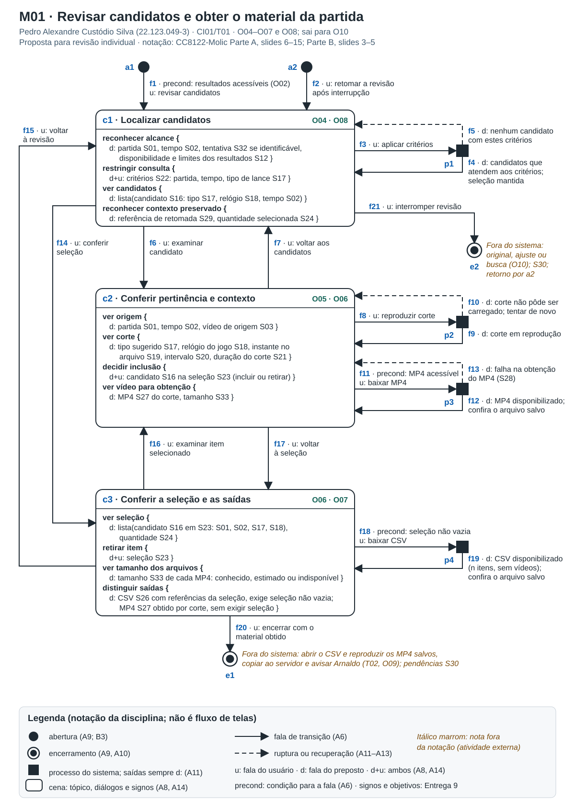
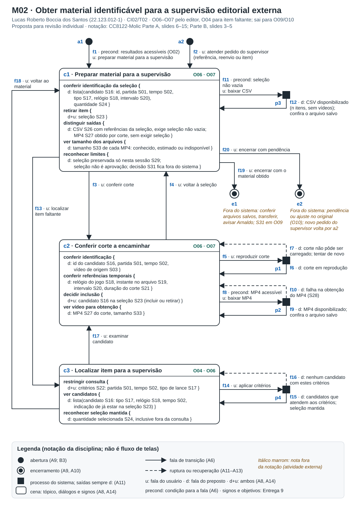

# Entrega 10: MoLIC

- **Data:** M01/M02 em 08/11/2026; M03 em 09/11/2026; integração em 12/11/2026
- **Status:** 🟨 em andamento. M01 e M02 elaborados, com revisão individual de Pedro e Lucas pendente; M03 de Giovanni registrado com cobertura parcial e verificações pendentes no seu checklist.
- **Responsabilidade:** uma solução completa por integrante.

## Objetivo da atividade

Modelar a interação como uma conversa entre o usuário e o preposto do designer, com os caminhos até cada objetivo, as alternativas e as rupturas. Cada integrante modela um objetivo grande, com abertura, encerramento e cenas detalhadas por tópico, diálogos e signos.

O projeto trata da obtenção de melhores momentos em gravações de futebol. Os modelos não descrevem o detector, e sim a conversa para usar seus resultados: consultar os candidatos sabendo seus limites, conferir o contexto de um corte, decidir a seleção e obter o CSV e os MP4. Ajustar, montar, transferir e publicar o material acontecem fora do sistema e aparecem como notas nos encerramentos. Autenticação, histórico persistente, reconhecimento de atletas e aprovação editorial ficam fora dos modelos M01 e M02. O M03 preserva propostas de login, exclusão e cancelamento que ainda precisam ser compatibilizadas com o escopo da Entrega 9 e com o suporte técnico; sua presença no desenho não altera a decisão de escopo.

Objetivos (O00 a O10), signos, cenários e tarefas seguem a [Entrega 9](09_modelo_conceitual.md).

**Base de notação:** [MoLIC — Parte A](../slides_plinio/CC8122-Molic-ParteA.pdf), slides 5–15, e [Parte B](../slides_plinio/CC8122-Molic-ParteB.pdf), slides 2–5: cenas, falas de transição, acessos ubíquos, abertura/encerramento, processamento, rupturas e detalhamento de diálogos e signos.

### Legenda de M01 e M02

| Elemento | Representação |
|---|---|
| Abertura | Círculo preto preenchido, seguido da fala que inicia a conversa |
| Encerramento | Círculo preto com anel externo |
| Cena | Retângulo arredondado com o tópico no cabeçalho e os diálogos no corpo |
| Processo do sistema | Quadrado preto, que recebe fala do usuário e responde com fala do preposto |
| Seta contínua ou tracejada | Fala de transição, ou ruptura e recuperação |
| u:, d:, d+u: | Fala do usuário, fala do preposto, ou diálogo em que o preposto apresenta e o usuário informa ou escolhe |
| precond: | Condição para que a fala esteja disponível |
| Nota em itálico marrom | Atividade fora do sistema |

Nos diagramas M01 e M02, as letras a, c, p e e identificam aberturas, cenas, processos e encerramentos, numerados dentro de cada modelo. Não há acesso ubíquo, porque nenhum tópico precisa estar disponível a partir de qualquer cena, nem cena de alerta, porque incluir, retirar e baixar são ações reversíveis ou repetíveis.

## M01: Revisar candidatos e obter o material da partida

- **Responsável:** Pedro Alexandre Custódio Silva, RA 22.123.049-3
- **Cenário e tarefa:** CI01 e T01 (atividade A04), com continuidade em T02
- **Objetivos:** O04 a O07, e O08 na retomada. O02 é precondição e O10 acontece fora do sistema.
- **Signos:** S01 a S03, S12, S16 a S24, S26 a S29, S32 e S33. S30 aparece só nas notas externas.

### Diagrama

**Fonte editável:** [molic_m01.svg](../assets/10_molic/molic_m01.svg)

### Leitura do diagrama

As cenas são c1 (localizar candidatos), c2 (conferir pertinência e contexto) e c3 (conferir a seleção e as saídas). Os processos respondem à consulta (p1), carregam o corte (p2), disponibilizam um MP4 (p3) e geram o CSV (p4).

#### Caminho principal

1. Com os resultados da análise acessíveis, Rafael inicia a revisão. Em c1, o sistema informa partida, tempo, disponibilidade e limites dos resultados e, quando possível, a tentativa de análise.
2. Rafael aplica critérios de partida, tempo ou tipo de lance. O sistema responde com os candidatos correspondentes e mantém a seleção feita até ali.
3. Ele examina um candidato. Em c2, vê a origem do corte (partida, tempo e vídeo), o tipo sugerido, o relógio do jogo, o instante no arquivo, o intervalo e a duração.
4. Reproduz o corte, julga a construção e o desfecho do lance e, se servir, inclui o candidato na seleção.
5. Volta aos candidatos e repete os passos 3 e 4 enquanto o prazo permitir.
6. Em c3, confere os itens selecionados, a quantidade e o tamanho de cada MP4.
7. Com a seleção não vazia, baixa o CSV, com os metadados e o endereço de cada corte, sem os vídeos. O sistema avisa que o arquivo foi disponibilizado e pede que Rafael confira o arquivo salvo.
8. Para cada vídeo de que precisa, abre o item selecionado, baixa o MP4 e volta à seleção.
9. Encerra com o material obtido. Fora do sistema, abre o CSV, reproduz os MP4 salvos, copia os arquivos para o servidor e avisa Arnaldo. As pendências continuam com ele.

#### Alternativas e rupturas

| Situação | Onde ocorre | Como o usuário percebe | Caminho de recuperação/saída |
|---|---|---|---|
| Consulta sem candidatos | c1, após p1 | "Nenhum candidato com estes critérios", com a seleção mantida | Revê ou limpa os critérios |
| Nenhum candidato acessível ou útil | c1 | O sistema informa a ausência de candidatos ou os limites conhecidos. Lista vazia não prova que não houve lances | Interrompe em e2, deixando a busca no original pendente |
| Contexto insuficiente | c2 | Pela reprodução, pelo intervalo e pela duração, Rafael vê que o corte começa tarde ou corta o desfecho | Não inclui ou retira o candidato. Se precisar do lance, interrompe para ajustar no original, pois o sistema não edita o corte |
| Suspeita de omissão | c1 | O lance esperado não aparece, e os tempos dos candidatos vizinhos delimitam onde procurar | Interrompe em e2 para conferir a gravação. O sistema não afirma cobertura completa |
| Arnaldo pergunta sobre outra partida | c1 ou c2 | Rafael muda de assunto sem perder a seleção | Consulta a outra partida e depois reaplica os critérios anteriores, sem encerrar a conversa |
| Interrupção e retomada | c1, depois a2 | Ao retomar, c1 mostra o que a sessão preservou, se algo foi preservado | O estado anterior não é garantido. Se a seleção se perdeu, por exemplo ao recarregar a página, Rafael a reconstrói. Não há recuperação automática |
| Corte não carrega | c2, após p2 | "Corte não pôde ser carregado; tentar de novo" | Tenta de novo. Se persistir, decide sem reproduzir ou mantém a pendência |
| MP4 indisponível ou falha na obtenção | c2, após p3 | A condição da fala impede pedir um MP4 sabidamente indisponível. Se a obtenção falhar, o sistema avisa | Tenta de novo ou mantém o item pendente |
| Arquivo salvo não abre | Fora do sistema | O sistema informa que disponibilizou o arquivo, não que ele foi salvo | Baixa de novo ou confere destino e espaço por conta própria |
| Seleção esvaziada | c3 | A quantidade vai a zero e o CSV deixa de ser oferecido. O MP4 continua disponível sem seleção | Inclui itens de novo, baixa MP4 avulsos ou encerra sem CSV |
| Tamanho do MP4 indisponível | c3 | O tamanho de cada arquivo aparece como conhecido, estimado ou indisponível | Confere o espaço e baixa item a item |

## M02: Obter material identificável para a supervisão editorial externa

- **Responsável:** Lucas Roberto Boccia dos Santos, RA 22.123.012-1
- **Cenário e tarefa:** CI02, com T02 como continuidade externa e a obtenção de T01 (atividade A04)
- **Objetivos:** O06 e O07, conduzidos pelo editor, e O04 apenas para localizar um item que falta. O02 é precondição. O09 e O10 são externos.
- **Signos:** S01 a S03, S16 a S24, S26 a S29, S31 e S33

Quem conversa com o sistema é o editor, Rafael. Arnaldo recebe os arquivos e decide fora do sistema, por isso não há cena de aprovação. A seleção costuma vir pronta da revisão de M01, mas M02 se lê sozinho: a cena c3 localiza um item que falta ou que o supervisor pediu, e a cena c2 permite incluí-lo.

### Diagrama

**Fonte editável:** [molic_m02.svg](../assets/10_molic/molic_m02.svg)

### Leitura do diagrama

As cenas são c1 (preparar material para a supervisão), c2 (conferir corte a encaminhar) e c3 (localizar item para a supervisão). Os processos carregam o corte (p1), disponibilizam um MP4 (p2), geram o CSV (p3) e respondem à consulta (p4).

#### Caminho principal

1. Com os resultados acessíveis e a seleção montada, o editor começa a preparar o material. Em c1, confere a identificação de cada item (id, partida, tempo, tipo, relógio do jogo e intervalo), a quantidade.
2. Abre um corte em c2 e confere o vídeo de origem, o instante no arquivo e a duração. Se quiser, reproduz o corte.
3. Baixa o MP4 e volta à seleção, repetindo os passos 2 e 3 para cada corte necessário.
4. Em c1, baixa o CSV, que leva as mesmas referências dos cortes.
5. Encerra com o material obtido. Fora do sistema, confere os arquivos salvos, transfere-os e avisa Arnaldo pelo chat. A decisão editorial é dele.

#### Alternativas e rupturas

| Situação | Onde ocorre | Como o usuário percebe | Caminho de recuperação/saída |
|---|---|---|---|
| Seleção vazia, incompleta ou não preservada | c1 | A quantidade está em zero ou falta um corte. O sistema avisa que a seleção vale só nesta sessão e não oferece CSV vazio | Localiza o item em c3, inclui-o em c2 e volta a c1, onde o CSV passa a ser oferecido |
| Pedido de item fora da seleção | De volta por a2 | O item pedido por Arnaldo não está em c1 | O mesmo caminho. Se Arnaldo pediu só o vídeo, baixa o MP4 sem incluir o item |
| Consulta sem candidatos | c3, após p4 | "Nenhum candidato com estes critérios", com a seleção mantida | Revê os critérios. Se o item não aparece, encerra com pendência em e2 para conferir o original |
| Item que não deve seguir | c1 ou c2 | O editor retira o item e a quantidade diminui. Em zero, o CSV deixa de ser oferecido | O MP4 continua disponível sem seleção. Para ter o CSV de novo, inclui um item |
| Referência insuficiente para o supervisor | De volta por a2 | Arnaldo pede identificação, e o editor a confere em c1 e c2. Um dado ausente aparece como indisponível, nunca inventado | Gera o CSV de novo e responde pelo canal externo |
| Arquivo recebido não abre | De volta por a2 | Arnaldo avisa pelo chat | Baixa o MP4 de novo e confere antes de reenviar. Se falhar outra vez, mantém a pendência |
| Corte não carrega | c2, após p1 | "Corte não pôde ser carregado; tentar de novo" | Tenta de novo. A identificação continua disponível |
| MP4 indisponível ou falha na obtenção | c2, após p2 | A condição da fala impede pedir um MP4 sabidamente indisponível. Se a obtenção falhar, o sistema avisa | Tenta de novo ou registra a pendência fora do sistema |
| Tamanho do MP4 indisponível | c1 | O tamanho informado se refere ao arquivo individual e não comprova espaço livre | Confere o espaço e baixa item a item |
| Corte sem o contexto necessário, como um gol sem a falta anterior | Fora do sistema | Arnaldo julga o corte insuficiente | O ajuste é feito no original e circula pelo canal externo. Se o prazo acabar, encerra com pendência em e2 |
| Seleção não conferida no prazo | c1 | Há itens sem conferência | Encerra em e2 com a pendência explícita, sem registrar aprovação |

### Checklist específico de modelagem de M01 e M02

- [x] Cada modelo abre no início do objetivo e tem uma segunda abertura, para retomada (M01) ou para pedido do supervisor (M02).
- [x] As cenas são tópicos das conversas de CI01 e CI02, não páginas.
- [x] Falas que saem de cenas são do usuário, e falas que saem de processos são do preposto.
- [x] Os dois modelos encerram com material obtido (e1) ou com interrupção e pendência (e2).
- [x] Toda ruptura tem feedback e caminho de volta ou saída com nota.
- [x] Os modelos cobrem consulta vazia, contexto insuficiente, omissão, seleção vazia, item faltante, mídia indisponível, tamanho desconhecido e retomada.
- [x] Objetivos e signos são os da Entrega 9.
- [x] Não há acesso ubíquo, pelo motivo dado na legenda.
- [x] Os modelos representam a conversa entre usuário e sistema, não o detector nem a sequência de telas.
- [x] O texto dos diagramas é legível em largura reduzida.
- [ ] Pedro e Lucas revisaram seus modelos.

## M03 — Enviar vídeos, acompanhar análises e consultar resultados

**Autor(a):** Giovanni Chahin Morassi — 22.123.025-3\
**Persona de referência:** P03 — Jorginho Jr.\
**Cenário de interação de origem:** CI03 — Acompanhar a análise e obter trechos para uma produção amadora\
**Objetivo(s):** O01/O02/O04; cobertura parcial de O03/O05/O07/O08, detalhada na tabela de cobertura abaixo\
**Tarefa(s) relacionada(s):** T03 — Acompanhar o processamento de partidas em lote e tratar falhas; A01 como preparação e trechos de T01/A04 na consulta e no download\
**Signos relevantes:** S01–S03 (partida, tempo e arquivo de origem); S05/S06/S08 (validade, conjunto de entradas e envio); S09–S14/S32 (análise, atualização, progresso, resultados, falha, orientação e tentativa); S16–S22 (candidato, tipo, referências temporais, intervalo, duração e consulta); S27/S28/S33 (MP4, obtenção e tamanho); S30 (pendência).

### Diagrama

**Fonte editável:** [arquivo Excalidraw](../assets/10_molic/objetivos_p03.excalidraw). Para ler os signos em tamanho ampliado, [abrir o PNG original](../assets/10_molic/molic_persona3.png).

**Legenda:** círculo preenchido = abertura; círculo duplo = encerramento; retângulo arredondado = cena; retângulo preto = processamento; barra cinza = acesso ubíquo. `u:` identifica fala do usuário; `d:` identifica fala do preposto do designer; `d+u:` indica signo informado e passível de intervenção do usuário. Os diálogos aparecem abaixo do título da cena, com os signos entre chaves. `precond:` condiciona um caminho; `x` e `y` identificam resultado e partida, e `n` representa quantidade ou percentual conforme a fala. As marcações tracejadas devem ser verificadas pelos critérios do checklist; a legenda não pressupõe que todos os usos estejam corretos.

### Leitura do diagrama

O percurso de envio parte do acesso ubíquo `u: enviar vídeos`. O desenho também apresenta abertura para login, acesso ubíquo aos resultados e saída global. O login está desenhado separadamente, sem transição para o envio; a leitura abaixo descreve os caminhos efetivamente conectados.

#### Caminho principal

1. Em **Fazer upload do(s) vídeo(s) para análise**, o usuário informa os arquivos, confere partida e tempo e recebe informações de validade e estado do envio.
2. Com `u: iniciar análise`, solicita o processamento. O bloco preto representa a decisão do sistema entre comunicar progresso, apresentar resultados ou informar erro.
3. Em **Progresso da análise**, consulta partida/tentativa, estado, atualização, disponibilidade dos resultados e percentual quando calculável. O desenho apresenta essa cena como retorno do processamento; não explicita uma fala de nova consulta ou uma ligação dela para os resultados.
4. Com `d: n resultados encontrados`, o sistema chega a **Visualizar os resultados das análises**. O usuário também pode acessar essa conversa por `u: ver resultados`. Consulta partida, estado, candidatos, tipo, origem, contexto, critérios e limites disponíveis.
5. Quando há resultado de análise bem-sucedida, solicita `u: ver os detalhes do resultado obtido x`. Em **Visualizar metadados do resultado x**, confere referência, origem, tipo sugerido, prévia, instante, intervalo, duração e tamanho.
6. O download pode ser solicitado na consulta de resultados ou nos detalhes. Pela consulta, passa por um bloco de processamento; pelos detalhes, a ligação vai diretamente a **Examinar progresso de download**. Nessa cena, confere corte, tamanho, estado conhecido e percentual quando calculável.
7. A fala `d: download concluído` retorna à consulta de resultados. Esse retorno comunica a conclusão representada no desenho; a conferência do arquivo salvo e de sua reprodução continua necessária fora da aplicação. A saída global `u: sair` leva ao encerramento da conversa.

#### Alternativas e rupturas

| Situação | Onde ocorre | Como o usuário percebe | Caminho de recuperação/saída |
|---|---|---|---|
| Análise ainda em andamento | Processamento → Progresso da análise | `d: %n concluída`; estado e atualização na cena | O usuário acompanha a situação ou solicita cancelamento. Nova consulta e passagem dessa cena aos resultados não estão ligadas explicitamente. |
| Falha de processamento | Processamento → Registro do erro | `d: erro no processamento`; descrição, causa e referência da tentativa | A cena comunica orientação e pendência. O desenho não liga uma ação de recuperação, reenvio ou retorno a partir dela. |
| Consultar erro de uma análise | Visualizar os resultados das análises | Precondição de erro e `u: visualizar erro ocorrido` | Abre Registro do erro, com o mesmo limite de saída descrito acima. |
| Cancelar análise | Progresso da análise → confirmação à esquerda | `u: cancelar`; identificação da análise e aviso de consequências | A ligação seguinte comunica cancelamento, passa por processamento e retorna ao upload. O título da confirmação é “Confirmar exclusão”, e a fala de confirmação está atribuída a `d:`; essa divergência fica registrada para revisão. |
| Desistir do download | Examinar progresso de download | `u: cancelar` | Retorna à consulta de resultados. O desenho não apresenta confirmação de cancelamento da transferência pelo serviço. |
| Excluir resultado | Visualizar os resultados → confirmação à direita | `u: excluir resultado`; identificação do alvo e consequências | `u: confirmar` leva ao processamento; `d: res deleted` retorna à consulta. A exclusão é uma proposta deste desenho, sem semântica definida na Entrega 9. |
| Desistir da exclusão | Confirmação à direita | `u: cancelar exclusão` | Retorna à consulta sem percorrer o processamento de exclusão. |
| Encerrar o uso | Acesso ubíquo de saída | `u: sair` | Leva ao ponto de encerramento. Preservação da sessão e continuidade de operações não são especificadas. |

Entrada inválida, consulta indisponível, ausência de candidatos e falha de download não possuem caminhos completos específicos neste desenho. “Validade” e “disponibilidade” aparecem nos diálogos, mas não substituem as transições de tratamento dessas situações. Resultado vazio não comprova ausência de lances; percentual só pode ser informado com base confiável.

### Checklist específico de modelagem

- [ ] Existe **ponto de abertura** coerente com o início do objetivo.
- [x] As **cenas de conversa** representam tópicos/assuntos, não nomes de páginas apenas.
- [ ] As transições/falas deixam claro o que o usuário ou o sistema comunica: revisar a confirmação de cancelamento atribuída a `d:` e o retorno sem prefixo.
- [x] Há **ponto(s) de encerramento** para objetivos concluídos/abandonados quando aplicável: saída global.
- [ ] Processamentos do sistema estão representados conforme a notação adotada em aula, sem “inventar” fala do usuário.
- [ ] Rupturas (breakdowns) relevantes têm feedback e caminho de recuperação, não becos sem saída.
- [ ] Acessos ubíquos/atalhos só aparecem quando semanticamente justificáveis.
- [x] O diagrama cobre caminhos alternativos importantes, e não apenas o “happy path”: erro, cancelamento e desistência de exclusão.
- [ ] Nomes de objetivos, tópicos e signos são coerentes com a Entrega 9.
- [ ] O diagrama é legível em tamanho normal no GitHub.
- [x] O MoLIC representa a conversa usuário–sistema, não o fluxo interno do algoritmo.
- [ ] Processamento, filtros, administração, relatórios e históricos incluem retornos/rupturas quando relevantes.

Os itens não assinalados permanecem como verificações do modelo: conectar a abertura/login ao percurso principal; completar a saída de Registro do erro e a continuidade do acompanhamento; conferir emissores das falas, tracejados de ruptura e confirmações conforme a notação da aula; fundamentar os acessos ubíquos e as capacidades adicionais; verificar a legibilidade em exibição normal no GitHub. O PNG permite ampliação, mas isso não comprova leitura confortável no tamanho reduzido.

Login, exclusão de resultados e cancelamento efetivo do processamento não estão estabelecidos no esquema da Entrega 9. Permanecem como propostas do diagrama de Giovanni, sujeitas à compatibilização com aquela entrega e ao suporte técnico. “Confirmar exclusão”, à esquerda, é lido aqui pelo caminho de cancelamento ao qual está conectado. O arquivo editável e o PNG foram preservados.

## Consolidação da equipe

### Cobertura dos objetivos

| Objetivo | MoLIC que cobre | Lacunas/duplicidades | Decisão |
|---|---|---|---|
| O00 Obter material para continuidade editorial | M01, M02 e M03, em parte | M03 cobre envio e acompanhamento parcialmente; conclusão do trabalho externo não é comprovada | Propósito global, benefício a validar |
| O01 a O03 Preparar gravações, acompanhar a análise e encaminhar falhas | M03; O03 parcial | O02 é precondição de M01/M02; no M03 faltam tratamento de entrada, continuidade explícita do progresso e encaminhamento de recuperação | Preservar as lacunas registradas no checklist do M03 |
| O04 Localizar candidatos | M01 c1; M02 c3; M03 consulta de resultados | Sobreposição restrita: M02 só localiza um item que falta, sem julgar pertinência | M02 repete os diálogos de consulta para se ler sozinho; M03 também oferece consulta, sem presumir filtro por atleta |
| O05 Conferir pertinência e contexto | M01 c2; M03 parcial | M02 confere identificação, não pertinência; M03 oferece prévia e metadados, com lacunas para contexto insuficiente e omissão | Julgamento de pertinência continua humano |
| O06 Definir e conferir a seleção | M01 c2 e c3; M02 c1, c2 e c3 | M01 monta a seleção e M02 a confere ou completa antes de encaminhar | Cenas parecidas usam os mesmos diálogos; O06 não é representado no M03 |
| O07 Obter cortes e metadados | M01 c2 e c3; M02 c1 e c2; M03 parcial | A mesma obtenção encerra objetivos diferentes; M03 cobre MP4 individual, sem CSV da seleção | Material para a edição em M01 e para a supervisão em M02; manter explícitos os limites de M03 |
| O08 Reconhecer contexto ao retomar | M01 e M02, em a2 e c1; M03 parcial | Retomada limitada à sessão; M03 informa tentativa e pendência, sem retomada após recarga | Sem histórico persistente |
| O09 Avaliar a decisão editorial | Nenhum | Decisão de Arnaldo | Fora do sistema, nota em M02; não introduzir aprovação no M03 |
| O10 Conferir o original e ajustar | Nenhum | Ajuste no vídeo original | Fora do sistema, nota em e2 em M01/M02; M03 também não modela edição/montagem |

### Cobertura detalhada do M03

O quadro abaixo detalha o recorte de Giovanni; a cobertura conjunta de M01, M02 e M03 está no quadro anterior. A revisão conjunta permanece pendente. Os IDs internos dos elementos do Excalidraw não substituem os IDs conceituais: a cena “Visualizar metadados” apoia O05/O07, independentemente do nome técnico do elemento.

| Objetivo | MoLIC que cobre | Lacunas/duplicidades | Decisão |
|---|---|---|---|
| O00 — Obter material para continuidade externa | M03, apoio parcial | Envio e obtenção de resultado individual; não comprova seleção pertinente nem trabalho externo concluído | Tratar como propósito geral, não como conclusão automática |
| O01 — Preparar gravações para análise | M03 | Upload, origem e validade presentes; rejeição/correção de entrada sem caminho próprio | Cobertura do percurso principal, com tratamento de entrada a completar |
| O02 — Acompanhar a análise e reconhecer resultados acessíveis | M03 | Estado, tentativa, atualização e resultados presentes; falta continuidade explícita da cena de progresso | Registrar limite do acompanhamento |
| O03 — Encaminhar falha sem comprometer outras partidas | M03, parcial | Erro e orientação presentes; recuperação, resposta ao pedido e preservação das demais partidas não estão conectadas | Não declarar recuperação completa |
| O04 — Localizar candidatos pertinentes à revisão | M03 | Consulta por partida, tempo e tipo; ausência de retorno específico para consulta vazia | Não presumir filtro por atleta |
| O05 — Conferir pertinência e contexto | M03, parcial | Prévia, origem, tipo e tempos presentes; contexto insuficiente e omissão suspeita sem saída própria | Julgamento continua humano |
| O06 — Definir e conferir seleção | Não representado | Não há conversa de inclusão/retirada nem conferência da seleção | Exclusão de resultado não equivale a retirar item da seleção |
| O07 — Obter e conferir cortes e metadados | M03, parcial | Download e metadados em consulta; CSV e conferência do arquivo salvo não são modelados | Interpretar como obtenção individual, sem afirmar exportação de CSV |
| O08 — Reconhecer contexto e pendências ao retomar/encerrar | M03, parcial | Referência de pendência no erro e saída global; retomada sem conversa própria | Não presumir persistência após recarga |
| O09 — Avaliar e comunicar decisão editorial | Fora do recorte | T02/P02 permanece externa | Não equiparar download a aprovação |
| O10 — Conferir original e ajustar/montar | Fora do recorte | Nenhuma conversa de edição detalhada | Manter continuidade nas ferramentas externas |

### Preparação para prototipagem de M01 e M02

O protótipo é a [demonstração em HTML/JS](../assets/06_prototipos/PROTOTIPO_fluxo_highlights.html) da Entrega 6. Ela usa quatro tempos de exemplo de duas partidas, oito cortes MP4 e uma análise simulada, sem aceitar arquivos próprios nem executar o detector. A tabela compara o que os modelos pedem com o que a demonstração faz hoje. As propostas ainda não foram implementadas.

| Estado ou feedback | Protótipo atual | Proposta |
|---|---|---|
| Resultados e limites (M01 c1) | A tela "Base de highlights" mostra a contagem de lances e partidas | Informar limites conhecidos e a tentativa de análise, sem afirmar cobertura completa |
| Consulta vazia (M01 c1, M02 c3) | Só a variante A diz "Nenhum lance encontrado" e oferece limpar os filtros. A variante B mostra "0 lances" e a C não filtra | A mesma mensagem em todas as variantes, dizendo que a seleção foi mantida |
| Detalhe do candidato (c2) | Partida, data, tempo, relógio do jogo, início, fim e duração no arquivo | Mostrar o id que vai no CSV |
| Reprodução e falha (M01 p2, M02 p1) | Mensagem de carregamento com o tamanho do corte e, na falha, opção de tentar de novo | Manter |
| Inclusão e retirada | O mesmo botão inclui e retira o item, nas três variantes | Manter |
| Revisão da seleção (M01 c3, M02 c1) | Sem lista própria. A seleção aparece como marcação nos itens e na contagem do botão do CSV | Lista com os itens selecionados, quantidade e retirada de item |
| Tamanho do MP4 | Tamanho de cada arquivo no link de download | Manter a informação individual e indicar quando ela estiver indisponível |
| CSV | Botão desativado com seleção vazia | Manter e lembrar de conferir o arquivo salvo |
| MP4 | Link direto, disponível sem seleção e sem mensagem da aplicação. O arquivo salvo tem o nome do servidor, sem partida nem tempo | Comunicar a disponibilização e as falhas detectáveis, e avaliar um nome de arquivo identificável |
| Retomada (a2 e c1) | A seleção se mantém ao trocar de variante ou de tela. Num carregamento novo, ela se perde sem aviso e a demonstração volta à tela de entrada | Informar até onde a seleção é preservada, sem prometer persistência |
| Encerramento e pendências | Sem suporte, como previsto | Nenhuma tela de aprovação, histórico ou registro de pendências |

Os estados de falha da demonstração não foram testados, e os modelos não passaram por sessão com usuários.

### Preparação para o Figma de M03

| Conversa do MoLIC | Estados e informações a representar no Figma |
|---|---|
| Enviar vídeos | Arquivos informados, partida/tempo conferidos, validade e estado do envio; ação de iniciar análise |
| Acompanhar análise | Partida e tentativa identificáveis, estado conhecido, atualização e percentual apenas quando calculável |
| Consultar resultados | Análises/candidatos disponíveis, origem, tipo, critérios de consulta, prévia e limites dos resultados |
| Examinar detalhes | Referência do corte, partida/arquivo, tipo sugerido, prévia, instante, intervalo, duração e tamanho |
| Consultar erro | Partida e tentativa afetadas, descrição, causa conhecida ou desconhecida, orientação e referência da pendência |
| Confirmar cancelamento | Identificação da análise e consequências; ação de confirmação a compatibilizar com o desenho e o suporte do serviço |
| Obter resultado | Corte e tamanho, estado conhecido da transferência, progresso quando calculável, desistência e retorno após conclusão |
| Confirmar exclusão | Resultado/partida afetados, consequências, confirmação e desistência; comportamento ainda a compatibilizar com a Entrega 9 |
| Acesso e saída | Login e saída global conforme o desenho; autenticação depende de definição de escopo e backend |

Os caminhos de recuperação ainda ausentes devem ser resolvidos no MoLIC antes de serem introduzidos no Figma. Para obter um corte, a indicação de conclusão da aplicação deve ser distinguida da verificação humana de salvamento e reprodução. A exibição dos metadados não significa que um CSV foi gerado ou baixado.

## Registro de elaboração

Em 09/11/2026, Giovanni elaborou o diagrama e exportou o PNG para exibição no GitHub. Os diálogos/signos e esta documentação foram preenchidos com assistência do Codex. A leitura, a cobertura e o checklist descrevem o artefato disponível, sem declarar validação pelo professor, com usuários ou pelo backend. Os arquivos PNG e Excalidraw são, respectivamente, a visualização e a fonte de edição.
