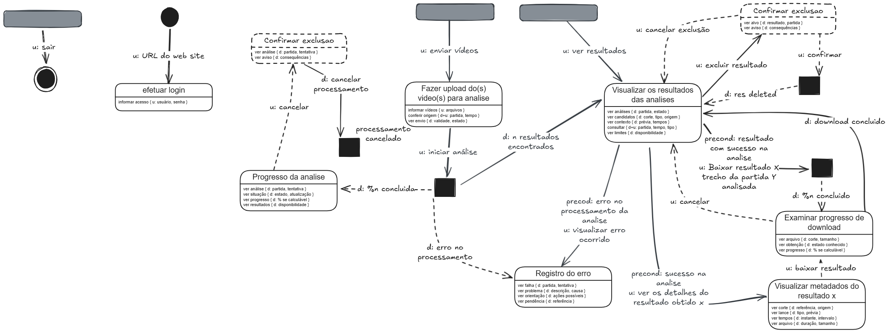

# Entrega 10 — MoLIC

**Data:** 09/11/2026\
**Status:** 🟨 em andamento\
**Responsabilidade:** 1 solução completa por integrante

## Objetivo da atividade

Modelar a interação como uma **conversa entre usuário e preposto do designer**, oferecendo visão global dos caminhos que permitem ao usuário atingir seus objetivos — incluindo alternativas e rupturas relevantes. MoLIC não deve ser reduzida a um fluxograma de telas.

**Base de notação:** [MoLIC — Parte A](../slides_plinio/CC8122-Molic-ParteA.pdf), slides 5–15, e [Parte B](../slides_plinio/CC8122-Molic-ParteB.pdf), slides 2–5: cenas, falas de transição, acessos ubíquos, abertura/encerramento, processamento, rupturas e detalhamento de diálogos e signos.

O recorte representa o envio de gravações, o acompanhamento da análise e a consulta/obtenção de resultados. O detector é tratado como processamento do sistema; suas etapas internas não são modeladas. Trata-se de uma proposta de interação, sem validação com usuários nem comprovação de suporte pelo backend.

## M03 — Enviar vídeos, acompanhar análises e consultar resultados

**Autor(a):** Giovanni Chahin Morassi — 22.123.025-3\
**Persona de referência:** P03 — Jorginho Jr.\
**Cenário de interação de origem:** CI03 — Acompanhar a análise e obter trechos para uma produção amadora\
**Objetivo(s):** O01/O02/O04; cobertura parcial de O03/O05/O07/O08, detalhada na tabela de cobertura abaixo\
**Tarefa(s) relacionada(s):** T03 — Acompanhar o processamento de partidas em lote e tratar falhas; A01 como preparação e trechos de T01/A04 na consulta e no download\
**Signos relevantes:** S01–S03 (partida, tempo e arquivo de origem); S05/S06/S08 (validade, conjunto de entradas e envio); S09–S14/S32 (análise, atualização, progresso, resultados, falha, orientação e tentativa); S16–S22 (candidato, tipo, referências temporais, intervalo, duração e consulta); S27/S28/S33 (MP4, obtenção e tamanho); S30 (pendência).

### Diagrama

**Fonte editável:** [arquivo Excalidraw](../assets/10_molic/objetivos_p03.excalidraw). Para ler os signos em tamanho ampliado, [abrir o PNG original](../assets/10_molic/molic_persona3.png).

**Legenda:** círculo preenchido = abertura; círculo duplo = encerramento; retângulo arredondado = cena; retângulo preto = processamento; barra cinza = acesso ubíquo. `u:` identifica fala do usuário; `d:` identifica fala do preposto do designer; `d+u:` indica signo informado e passível de intervenção do usuário. Os diálogos aparecem abaixo do título da cena, com os signos entre chaves. `precond:` condiciona um caminho; `x` e `y` identificam resultado e partida, e `n` representa quantidade ou percentual conforme a fala. As marcações tracejadas devem ser verificadas pelos critérios do checklist; a legenda não pressupõe que todos os usos estejam corretos.

### Leitura do diagrama

O percurso de envio parte do acesso ubíquo `u: enviar vídeos`. O desenho também apresenta abertura para login, acesso ubíquo aos resultados e saída global. O login está desenhado separadamente, sem transição para o envio; a leitura abaixo descreve os caminhos efetivamente conectados.

#### Caminho principal

1. Em **Fazer upload do(s) vídeo(s) para análise**, o usuário informa os arquivos, confere partida e tempo e recebe informações de validade e estado do envio.
2. Com `u: iniciar análise`, solicita o processamento. O bloco preto representa a decisão do sistema entre comunicar progresso, apresentar resultados ou informar erro.
3. Em **Progresso da análise**, consulta partida/tentativa, estado, atualização, disponibilidade dos resultados e percentual quando calculável. O desenho apresenta essa cena como retorno do processamento; não explicita uma fala de nova consulta ou uma ligação dela para os resultados.
4. Com `d: n resultados encontrados`, o sistema chega a **Visualizar os resultados das análises**. O usuário também pode acessar essa conversa por `u: ver resultados`. Consulta partida, estado, candidatos, tipo, origem, contexto, critérios e limites disponíveis.
5. Quando há resultado de análise bem-sucedida, solicita `u: ver os detalhes do resultado obtido x`. Em **Visualizar metadados do resultado x**, confere referência, origem, tipo sugerido, prévia, instante, intervalo, duração e tamanho.
6. O download pode ser solicitado na consulta de resultados ou nos detalhes. Pela consulta, passa por um bloco de processamento; pelos detalhes, a ligação vai diretamente a **Examinar progresso de download**. Nessa cena, confere corte, tamanho, estado conhecido e percentual quando calculável.
7. A fala `d: download concluído` retorna à consulta de resultados. Esse retorno comunica a conclusão representada no desenho; a conferência do arquivo salvo e de sua reprodução continua necessária fora da aplicação. A saída global `u: sair` leva ao encerramento da conversa.

#### Alternativas e rupturas

| Situação | Onde ocorre | Como o usuário percebe | Caminho de recuperação/saída |
|---|---|---|---|
| Análise ainda em andamento | Processamento → Progresso da análise | `d: %n concluída`; estado e atualização na cena | O usuário acompanha a situação ou solicita cancelamento. Nova consulta e passagem dessa cena aos resultados não estão ligadas explicitamente. |
| Falha de processamento | Processamento → Registro do erro | `d: erro no processamento`; descrição, causa e referência da tentativa | A cena comunica orientação e pendência. O desenho não liga uma ação de recuperação, reenvio ou retorno a partir dela. |
| Consultar erro de uma análise | Visualizar os resultados das análises | Precondição de erro e `u: visualizar erro ocorrido` | Abre Registro do erro, com o mesmo limite de saída descrito acima. |
| Cancelar análise | Progresso da análise → confirmação à esquerda | `u: cancelar`; identificação da análise e aviso de consequências | A ligação seguinte comunica cancelamento, passa por processamento e retorna ao upload. O título da confirmação é “Confirmar exclusão”, e a fala de confirmação está atribuída a `d:`; essa divergência fica registrada para revisão. |
| Desistir do download | Examinar progresso de download | `u: cancelar` | Retorna à consulta de resultados. O desenho não apresenta confirmação de cancelamento da transferência pelo serviço. |
| Excluir resultado | Visualizar os resultados → confirmação à direita | `u: excluir resultado`; identificação do alvo e consequências | `u: confirmar` leva ao processamento; `d: res deleted` retorna à consulta. A exclusão é uma proposta deste desenho, sem semântica definida na Entrega 9. |
| Desistir da exclusão | Confirmação à direita | `u: cancelar exclusão` | Retorna à consulta sem percorrer o processamento de exclusão. |
| Encerrar o uso | Acesso ubíquo de saída | `u: sair` | Leva ao ponto de encerramento. Preservação da sessão e continuidade de operações não são especificadas. |

Entrada inválida, consulta indisponível, ausência de candidatos e falha de download não possuem caminhos completos específicos neste desenho. “Validade” e “disponibilidade” aparecem nos diálogos, mas não substituem as transições de tratamento dessas situações. Resultado vazio não comprova ausência de lances; percentual só pode ser informado com base confiável.

### Checklist específico de modelagem

- [ ] Existe **ponto de abertura** coerente com o início do objetivo.
- [x] As **cenas de conversa** representam tópicos/assuntos, não nomes de páginas apenas.
- [ ] As transições/falas deixam claro o que o usuário ou o sistema comunica: revisar a confirmação de cancelamento atribuída a `d:` e o retorno sem prefixo.
- [x] Há **ponto(s) de encerramento** para objetivos concluídos/abandonados quando aplicável: saída global.
- [ ] Processamentos do sistema estão representados conforme a notação adotada em aula, sem “inventar” fala do usuário.
- [ ] Rupturas (breakdowns) relevantes têm feedback e caminho de recuperação, não becos sem saída.
- [ ] Acessos ubíquos/atalhos só aparecem quando semanticamente justificáveis.
- [x] O diagrama cobre caminhos alternativos importantes, e não apenas o “happy path”: erro, cancelamento e desistência de exclusão.
- [ ] Nomes de objetivos, tópicos e signos são coerentes com a Entrega 9.
- [ ] O diagrama é legível em tamanho normal no GitHub.
- [x] O MoLIC representa a conversa usuário–sistema, não o fluxo interno do algoritmo.
- [ ] Processamento, filtros, administração, relatórios e históricos incluem retornos/rupturas quando relevantes.

Os itens não assinalados permanecem como verificações do modelo: conectar a abertura/login ao percurso principal; completar a saída de Registro do erro e a continuidade do acompanhamento; conferir emissores das falas, tracejados de ruptura e confirmações conforme a notação da aula; fundamentar os acessos ubíquos e as capacidades adicionais; verificar a legibilidade em exibição normal no GitHub. O PNG permite ampliação, mas isso não comprova leitura confortável no tamanho reduzido.

Login, exclusão de resultados e cancelamento efetivo do processamento não estão estabelecidos no esquema da Entrega 9. Permanecem como propostas do diagrama de Giovanni, sujeitas à compatibilização com aquela entrega e ao suporte técnico. “Confirmar exclusão”, à esquerda, é lido aqui pelo caminho de cancelamento ao qual está conectado. O arquivo editável e o PNG foram preservados.

## Consolidação da equipe

### Cobertura dos objetivos

Esta consolidação registra apenas o M03 disponível, de Giovanni. Os recortes dos demais integrantes e a revisão conjunta ainda não estão registrados nesta entrega. Os IDs internos dos elementos do Excalidraw não substituem os IDs conceituais: a cena “Visualizar metadados” apoia O05/O07, independentemente do nome técnico do elemento.

| Objetivo | MoLIC que cobre | Lacunas/duplicidades | Decisão |
|---|---|---|---|
| O00 — Obter material para continuidade externa | M03, apoio parcial | Envio e obtenção de resultado individual; não comprova seleção pertinente nem trabalho externo concluído | Tratar como propósito geral, não como conclusão automática |
| O01 — Preparar gravações para análise | M03 | Upload, origem e validade presentes; rejeição/correção de entrada sem caminho próprio | Cobertura do percurso principal, com tratamento de entrada a completar |
| O02 — Acompanhar a análise e reconhecer resultados acessíveis | M03 | Estado, tentativa, atualização e resultados presentes; falta continuidade explícita da cena de progresso | Registrar limite do acompanhamento |
| O03 — Encaminhar falha sem comprometer outras partidas | M03, parcial | Erro e orientação presentes; recuperação, resposta ao pedido e preservação das demais partidas não estão conectadas | Não declarar recuperação completa |
| O04 — Localizar candidatos pertinentes à revisão | M03 | Consulta por partida, tempo e tipo; ausência de retorno específico para consulta vazia | Não presumir filtro por atleta |
| O05 — Conferir pertinência e contexto | M03, parcial | Prévia, origem, tipo e tempos presentes; contexto insuficiente e omissão suspeita sem saída própria | Julgamento continua humano |
| O06 — Definir e conferir seleção | Não representado | Não há conversa de inclusão/retirada nem conferência da seleção | Exclusão de resultado não equivale a retirar item da seleção |
| O07 — Obter e conferir cortes e metadados | M03, parcial | Download e metadados em consulta; CSV e conferência do arquivo salvo não são modelados | Interpretar como obtenção individual, sem afirmar exportação de CSV |
| O08 — Reconhecer contexto e pendências ao retomar/encerrar | M03, parcial | Referência de pendência no erro e saída global; retomada sem conversa própria | Não presumir persistência após recarga |
| O09 — Avaliar e comunicar decisão editorial | Fora do recorte | T02/P02 permanece externa | Não equiparar download a aprovação |
| O10 — Conferir original e ajustar/montar | Fora do recorte | Nenhuma conversa de edição detalhada | Manter continuidade nas ferramentas externas |

### Preparação para o Figma

| Conversa do MoLIC | Estados e informações a representar no Figma |
|---|---|
| Enviar vídeos | Arquivos informados, partida/tempo conferidos, validade e estado do envio; ação de iniciar análise |
| Acompanhar análise | Partida e tentativa identificáveis, estado conhecido, atualização e percentual apenas quando calculável |
| Consultar resultados | Análises/candidatos disponíveis, origem, tipo, critérios de consulta, prévia e limites dos resultados |
| Examinar detalhes | Referência do corte, partida/arquivo, tipo sugerido, prévia, instante, intervalo, duração e tamanho |
| Consultar erro | Partida e tentativa afetadas, descrição, causa conhecida ou desconhecida, orientação e referência da pendência |
| Confirmar cancelamento | Identificação da análise e consequências; ação de confirmação a compatibilizar com o desenho e o suporte do serviço |
| Obter resultado | Corte e tamanho, estado conhecido da transferência, progresso quando calculável, desistência e retorno após conclusão |
| Confirmar exclusão | Resultado/partida afetados, consequências, confirmação e desistência; comportamento ainda a compatibilizar com a Entrega 9 |
| Acesso e saída | Login e saída global conforme o desenho; autenticação depende de definição de escopo e backend |

Os caminhos de recuperação ainda ausentes devem ser resolvidos no MoLIC antes de serem introduzidos no Figma. Para obter um corte, a indicação de conclusão da aplicação deve ser distinguida da verificação humana de salvamento e reprodução. A exibição dos metadados não significa que um CSV foi gerado ou baixado.

## Registro de elaboração

Em 09/11/2026, Giovanni elaborou o diagrama e exportou o PNG para exibição no GitHub. Os diálogos/signos e esta documentação foram preenchidos com assistência do Codex. A leitura, a cobertura e o checklist descrevem o artefato disponível, sem declarar validação pelo professor, com usuários ou pelo backend. Os arquivos PNG e Excalidraw são, respectivamente, a visualização e a fonte de edição.
