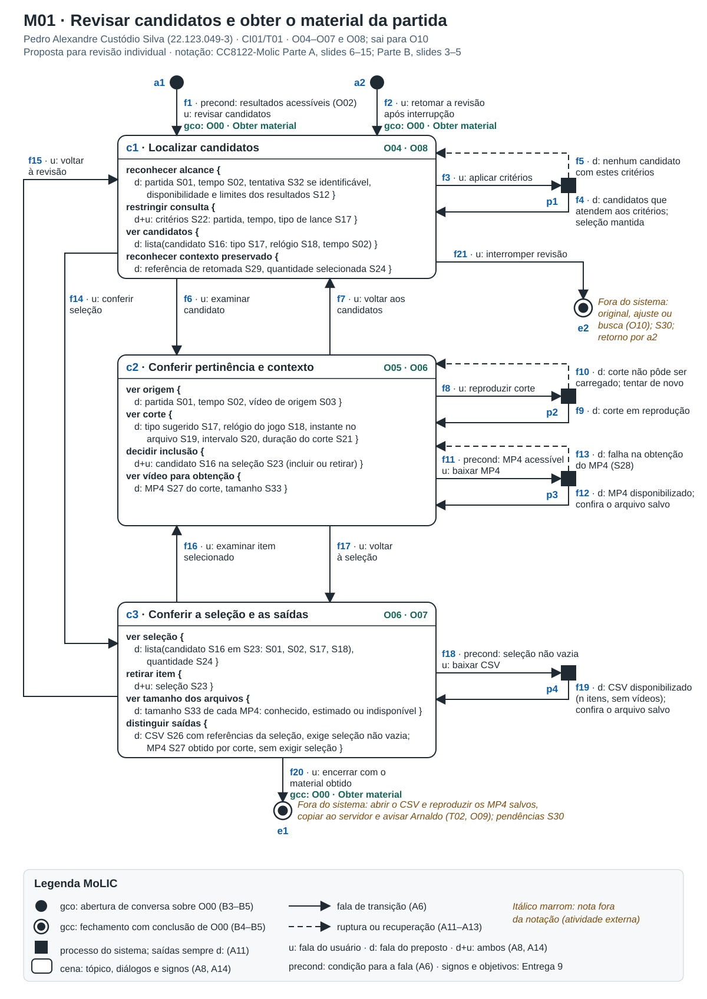
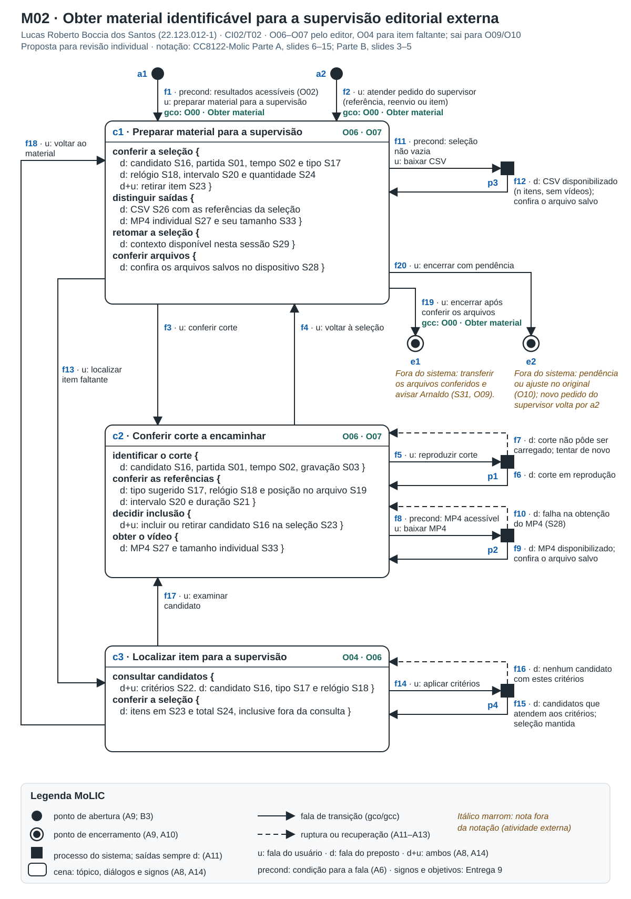
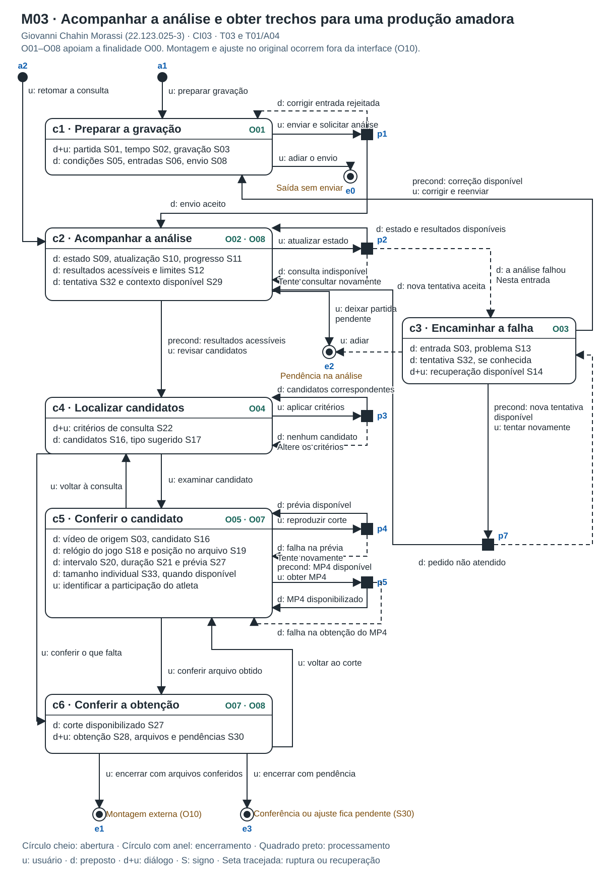

# Entrega 10: MoLIC

- **Data:** M01/M02 em 08/11/2026; M03 em 09/11/2026; integração em 12/11/2026 (versão original)
- **Revisão:** 18/11/2026, aplicação do [feedback do professor](../feedbacks_professor/Feedback_Professor_Entrega10_Equipe16.md)
- **Status:** 🟨 revisão documental dos três modelos concluída. Apresentação e confirmação individual de Pedro, Lucas e Giovanni e consolidação com a equipe pendentes.
- **Responsabilidade:** uma solução completa por integrante.

## Objetivo da atividade

Modelar a interação como uma conversa entre o usuário e o preposto do designer, com os caminhos até cada objetivo, as alternativas e as rupturas. Cada integrante modela um objetivo grande, com abertura, encerramento e cenas detalhadas por tópico, diálogos e signos.

O projeto trata da obtenção de melhores momentos em gravações de futebol. Os modelos não descrevem o detector, e sim a conversa para usar seus resultados: consultar os candidatos sabendo seus limites, conferir o contexto de um corte, decidir a seleção e obter o CSV e os MP4. Ajustar, montar, transferir e publicar o material acontecem fora do sistema e aparecem como notas nos encerramentos. Autenticação, histórico persistente, reconhecimento de atletas e aprovação editorial ficam fora dos modelos M01 e M02. O M03 cobre também o preparo, o acompanhamento e a recuperação de falhas de análise.

Objetivos (O00 a O10), signos, cenários e tarefas seguem a [Entrega 9](09_modelo_conceitual.md).

**Base de notação:** [MoLIC — Parte A](../slides_plinio/CC8122-Molic-ParteA.pdf), slides 5–15, e [Parte B](../slides_plinio/CC8122-Molic-ParteB.pdf), slides 2–5: cenas, falas de transição, acessos ubíquos, abertura/encerramento, processamento, rupturas e detalhamento de diálogos e signos.

### Legenda dos três modelos

| Elemento | Representação |
|---|---|
| Abertura | Círculo preto preenchido, seguido da fala que inicia a conversa |
| Encerramento | Círculo preto com anel externo |
| GCO | `gco: O00` na fala que abre a conversa para obter material. A retomada abre outra conversa com a mesma finalidade. |
| GCC | `gcc: O00` na transição que encerra a conversa depois de a pessoa conferir os arquivos necessários no dispositivo. |
| Alerta | Cena tracejada em que o preposto apresenta a consequência e a pessoa decide. |
| Cena | Retângulo arredondado com o tópico no cabeçalho e os diálogos no corpo |
| Processo do sistema | Quadrado preto, que recebe fala do usuário e responde com fala do preposto |
| Seta contínua ou tracejada | Fala de transição, ou ruptura e recuperação |
| u:, d:, d+u: | Fala do usuário, fala do preposto, ou diálogo em que o preposto apresenta e o usuário informa ou escolhe |
| precond: | Condição para que a fala esteja disponível |
| Nota em itálico marrom | Atividade fora do sistema |

[F] As letras a, c, p e e identificam aberturas, cenas, processos e encerramentos. As falas a partir de a1 e a2 abrem O00 (GCO). A chegada a e1 fecha O00 (GCC), depois de a pessoa confirmar que abriu o CSV e reproduziu os MP4 de que precisa, conforme as saídas solicitadas. As demais saídas identificam adiamento ou pendência. Na Entrega 9, O01–O08 são objetivos instrumentais identificados nas cenas e precondições. O09 e O10 ocorrem fora da interface. Os mecanismos de prevenção e recuperação seguem a [legenda da Entrega 9](09_modelo_conceitual.md#convenções-e-relações).

Em M01 e M02, não há acesso ubíquo, porque nenhum tópico precisa estar disponível a partir de qualquer cena, nem cena de alerta, porque incluir, retirar e baixar são ações reversíveis ou repetíveis.

## M01: Revisar candidatos e obter o material da partida

- **Responsável:** Pedro Alexandre Custódio Silva, RA 22.123.049-3
- **Cenário e tarefa:** CI01 e T01 (atividade A04), com continuidade em T02
- **Objetivos:** O00, apoiado por O04 a O07 e por O08 na retomada. O02 é precondição e O10 acontece fora do sistema.
- **Signos:** S01 a S03, S12, S16 a S24, S26 a S29, S32 e S33. S30 aparece só nas notas externas.

### Diagrama

**Fonte editável:** [molic_m01.svg](../assets/10_molic/molic_m01.svg)

### Leitura do diagrama

As cenas são c1 (localizar candidatos), c2 (conferir pertinência e contexto) e c3 (conferir a seleção e as saídas). Os processos respondem à consulta (p1), carregam o corte (p2), disponibilizam um MP4 (p3) e geram o CSV (p4).

#### Caminho principal

1. Com os resultados da análise acessíveis, Rafael inicia a revisão. Em c1, o sistema informa partida, tempo, disponibilidade e limites dos resultados e, quando possível, a tentativa de análise.
2. Rafael aplica critérios de partida, tempo ou tipo de lance. O sistema responde com os candidatos correspondentes e mantém a seleção feita até ali.
3. Ele examina um candidato. Em c2, vê a origem do corte (partida, tempo e vídeo), o tipo sugerido, o relógio do jogo, o instante no arquivo, o intervalo e a duração.
4. Reproduz o corte, julga a construção e o desfecho do lance e, se servir, inclui o candidato na seleção.
5. Volta aos candidatos e repete os passos 3 e 4 enquanto o prazo permitir.
6. Em c3, confere os itens selecionados, a quantidade e o tamanho de cada MP4.
7. Com a seleção não vazia, baixa o CSV, com os metadados e o endereço de cada corte, sem os vídeos. O sistema avisa que o arquivo foi disponibilizado e pede que Rafael confira o arquivo salvo.
8. Para cada vídeo de que precisa, abre o item selecionado, baixa o MP4 e volta à seleção.
9. [H] No dispositivo, Rafael abre o CSV e reproduz os MP4 salvos de que precisa. Se a conferência der certo, encerra em e1 e encaminha o material a Arnaldo. Se um arquivo não abrir ou faltar material, tenta obtê-lo novamente, volta à revisão ou interrompe em e2.

#### Alternativas e rupturas

| Situação | Onde ocorre | Como o usuário percebe | Caminho de recuperação/saída |
|---|---|---|---|
| Consulta sem candidatos | c1, após p1 | "Nenhum candidato com estes critérios", com a seleção mantida | Revê ou limpa os critérios |
| Nenhum candidato acessível ou útil | c1 | O sistema informa a ausência de candidatos ou os limites conhecidos. Lista vazia não prova que não houve lances | Interrompe em e2, deixando a busca no original pendente |
| Contexto insuficiente | c2 | Pela reprodução, pelo intervalo e pela duração, Rafael vê que o corte começa tarde ou corta o desfecho | Não inclui ou retira o candidato. Se precisar do lance, interrompe para ajustar no original, pois o sistema não edita o corte |
| Suspeita de omissão | c1 | O lance esperado não aparece, e os tempos dos candidatos vizinhos delimitam onde procurar | Interrompe em e2 para conferir a gravação. O sistema não afirma cobertura completa |
| Arnaldo pergunta sobre outra partida | c1 ou c2 | Rafael muda de assunto sem perder a seleção | Consulta a outra partida e depois reaplica os critérios anteriores, sem encerrar a conversa |
| Interrupção e retomada | c1, depois a2 | Ao retomar, c1 mostra o que a sessão preservou, se algo foi preservado | O estado anterior não é garantido. Se a seleção se perdeu, por exemplo ao recarregar a página, Rafael a reconstrói. Não há recuperação automática |
| Corte não carrega | c2, após p2 | "Corte não pôde ser carregado; tentar de novo" | Tenta de novo. Se persistir, decide sem reproduzir ou mantém a pendência |
| MP4 indisponível ou falha na obtenção | c2, após p3 | A condição da fala impede pedir um MP4 sabidamente indisponível. Se a obtenção falhar, o sistema avisa | Tenta de novo ou mantém o item pendente |
| Arquivo salvo não abre | Fora do sistema | O sistema informa que disponibilizou o arquivo, não que ele foi salvo | Baixa de novo ou confere destino e espaço por conta própria |
| Seleção esvaziada | c3 | A quantidade vai a zero e o CSV deixa de ser oferecido. O MP4 continua disponível sem seleção | Inclui itens de novo, baixa MP4 avulsos ou encerra sem CSV |
| Tamanho do MP4 indisponível | c3 | O tamanho de cada arquivo aparece como conhecido, estimado ou indisponível | Confere o espaço e baixa item a item |

## M02: Obter material identificável para a supervisão editorial externa

- **Responsável:** Lucas Roberto Boccia dos Santos, RA 22.123.012-1
- **Cenário e tarefa:** CI02, com T02 como continuidade externa e a obtenção de T01 (atividade A04)
- **Objetivos:** O00, apoiado por O06 e O07, por O04 quando falta um item e por O08 na retomada. O02 é precondição. O09 e O10 são externos.
- **Signos:** S01 a S03, S16 a S24, S26 a S29, S31 e S33

[H] Rafael conversa com o sistema para conferir a seleção e obter as saídas. A passagem para T02 começa quando ele encaminha os arquivos no canal externo. Arnaldo avalia o material e comunica a decisão nesse canal. A seleção costuma vir pronta da revisão de M01, mas M02 se lê sozinho: a cena c3 localiza um item que falta ou que o supervisor pediu, e a cena c2 permite incluí-lo.

### Diagrama

**Fonte editável:** [molic_m02.svg](../assets/10_molic/molic_m02.svg)

### Leitura do diagrama

As cenas são c1 (preparar material para a supervisão), c2 (conferir corte a encaminhar) e c3 (localizar item para a supervisão). Os processos carregam o corte (p1), disponibilizam um MP4 (p2), geram o CSV (p3) e respondem à consulta (p4).

#### Caminho principal

1. Com os resultados acessíveis e a seleção montada, o editor começa a preparar o material. Em c1, confere a identificação de cada item (id, partida, tempo, tipo, relógio do jogo e intervalo) e a quantidade.
2. Abre um corte em c2 e confere o vídeo de origem, o instante no arquivo e a duração. Se quiser, reproduz o corte.
3. Baixa o MP4 e volta à seleção, repetindo os passos 2 e 3 para cada corte necessário.
4. Em c1, baixa o CSV, que leva as mesmas referências dos cortes.
5. [H] O editor abre o CSV e reproduz os MP4 necessários no dispositivo. Encerra em e1 após conferir os arquivos e só então transfere o material e avisa Arnaldo pelo chat. Se um arquivo não abrir ou faltar material, tenta obtê-lo novamente, completa a seleção ou encerra com pendência em e2.

#### Alternativas e rupturas

| Situação | Onde ocorre | Como o usuário percebe | Caminho de recuperação/saída |
|---|---|---|---|
| Seleção vazia, incompleta ou não preservada | c1 | A quantidade está em zero ou falta um corte. O sistema avisa que a seleção vale só nesta sessão e não oferece CSV vazio | Localiza o item em c3, inclui-o em c2 e volta a c1, onde o CSV passa a ser oferecido |
| Pedido de item fora da seleção | De volta por a2 | O item pedido por Arnaldo não está em c1 | O mesmo caminho. Se Arnaldo pediu só o vídeo, baixa o MP4 sem incluir o item |
| Consulta sem candidatos | c3, após p4 | "Nenhum candidato com estes critérios", com a seleção mantida | Revê os critérios. Se o item não aparece, encerra com pendência em e2 para conferir o original |
| Item que não deve seguir | c1 ou c2 | O editor retira o item e a quantidade diminui. Em zero, o CSV deixa de ser oferecido | O MP4 continua disponível sem seleção. Para ter o CSV de novo, inclui um item |
| Referência insuficiente para o supervisor | De volta por a2 | Arnaldo pede identificação, e o editor a confere em c1 e c2. Um dado ausente aparece como indisponível, nunca inventado | Gera o CSV de novo e responde pelo canal externo |
| Arquivo recebido não abre | De volta por a2 | Arnaldo avisa pelo chat | Baixa o MP4 de novo e confere antes de reenviar. Se falhar outra vez, mantém a pendência |
| Corte não carrega | c2, após p1 | "Corte não pôde ser carregado; tentar de novo" | Tenta de novo. A identificação continua disponível |
| MP4 indisponível ou falha na obtenção | c2, após p2 | A condição da fala impede pedir um MP4 sabidamente indisponível. Se a obtenção falhar, o sistema avisa | Tenta de novo ou registra a pendência fora do sistema |
| Tamanho do MP4 indisponível | c1 | O tamanho informado se refere ao arquivo individual e não comprova espaço livre | Confere o espaço e baixa item a item |
| Corte sem o contexto necessário, como um gol sem a falta anterior | Fora do sistema | Arnaldo julga o corte insuficiente | O ajuste é feito no original e circula pelo canal externo. Se o prazo acabar, encerra com pendência em e2 |
| Seleção não conferida no prazo | c1 | Há itens sem conferência | Encerra em e2 com a pendência explícita, sem registrar aprovação |

### Checklist específico de modelagem de M01 e M02

- [x] Cada modelo abre no início do objetivo e tem uma segunda abertura, para retomada (M01) ou para pedido do supervisor (M02).
- [x] As cenas são tópicos das conversas de CI01 e CI02, não páginas.
- [x] Falas que saem de cenas são do usuário, e falas que saem de processos são do preposto.
- [x] Os dois modelos encerram com material obtido (e1) ou com interrupção e pendência (e2).
- [x] [F] Em M01 e M02, GCO marca a abertura de O00. A fala com GCC indica que a pessoa conferiu os arquivos antes de encerrar em e1.
- [x] Toda ruptura tem feedback e caminho de volta ou saída com nota.
- [x] Os modelos cobrem consulta vazia, contexto insuficiente, omissão, seleção vazia, item faltante, mídia indisponível, tamanho desconhecido e retomada.
- [x] Objetivos e signos são os da Entrega 9.
- [x] Não há acesso ubíquo, pelo motivo dado na legenda.
- [x] Os modelos representam a conversa entre usuário e sistema, não o detector nem a sequência de telas.
- [x] [F] Diagramas renderizados e conferidos em largura de 900 px.
- [ ] [?] Pedro apresentou e confirmou o modelo M01.
- [ ] [?] Lucas apresentou e confirmou o modelo M02.

## M03 — Enviar vídeos, acompanhar análises e consultar resultados

**Autor(a):** Giovanni Chahin Morassi — 22.123.025-3

**Persona de referência:** P03, Jorginho Jr.

**Cenário de interação de origem:** CI03, acompanhar a análise e obter trechos para uma produção amadora.

**Tarefas relacionadas:** A01 no preparo, T03/A02 no acompanhamento e T01/A04 na revisão e obtenção.

**Objetivo final e instrumentais:** O00, com O01 a O08. O10 ocorre fora da aplicação.

**Signos:** S01–S03, S05, S06, S08–S24, S26–S30, S32 e S33.

### Diagrama

**Fonte editável:** [molic_m03.svg](../assets/10_molic/molic_m03.svg).

### Leitura do diagrama

1. [H] Jorginho abre a conversa para preparar uma gravação (a1). Em c1, confere arquivo, partida e tempo. Ao solicitar a análise (p1), recebe a aceitação do pedido ou retorna à entrada para corrigir a rejeição. Pode adiar o envio (e0).
2. [H] Em c2, consulta o estado da análise (p2). Se houver resultados acessíveis, pode passar à revisão (c4). Se ainda aguarda, pode consultar novamente ou sair com pendência (e2). Abertura a2 retoma a consulta ao estado com o contexto disponível.
3. [H] Se o sistema informar falha, c3 apresenta a entrada afetada e as ações disponíveis. O usuário pode voltar ao preparo para corrigir a entrada, pedir nova tentativa quando suportada ou sair deixando a partida pendente. O alerta c7 identifica a entrada e a tentativa, quando conhecida, e apresenta as consequências conhecidas (S14, AL). A pessoa pode confirmar ou voltar à falha. O pedido aceito retorna a c2. Uma recusa confirmada volta a c3. Se o pedido fica sem resposta, c8 informa que a aceitação ainda é desconhecida. Em p8, Jorginho consulta o pedido identificável quando o serviço permite. Se confirmar a tentativa, volta a c2. Se confirmar a recusa, volta a c3. Enquanto a situação seguir desconhecida, permanece em c8 ou sai com pendência em e4. A consulta de p8 apenas verifica o pedido.
4. [H] Em c4, localiza candidatos pelos critérios. Em c5, confere a prévia e identifica visualmente a participação do atleta. A consulta vazia convida a rever os critérios. Uma falha de mídia devolve a pessoa ao candidato com possibilidade de outra tentativa.
5. [H] Em c5, Jorginho inclui ou retira candidatos e pode obter cada MP4 acessível (p5). Em c6, confere a seleção e pede o CSV quando há itens (p6). Abre os arquivos salvos e encerra com o material conferido (e1) ou com pendência (e3). A montagem ocorre externamente (O10).

[F] Em M03, as falas `u:` saem das aberturas e das cenas. As respostas `d:` saem dos quadrados de processamento. Em p1, a resposta distingue rejeição e aceitação do envio. Em p7, há uma fala de saída para cada condição de S15. Em p8, o preposto comunica se foi possível confirmar aceitação ou recusa. Reenvio e nova tentativa ficam disponíveis quando o estado da entrada permite a ação.

[F] O escopo da Entrega 9 sustenta preparar, acompanhar, revisar e obter material. Login, exclusão de resultados e cancelamento do processamento ficam fora do M03. Adiar encerra a conversa com uma pendência. Retirar um item altera a seleção (S23). Retomar usa o contexto disponível (S29).

[H] M03 oferece preparo (a1) e retomada (a2) como aberturas. Os tópicos de correção, obtenção e saída são locais a suas cenas e dependem do contexto mostrado. O modelo usa transições locais para esses tópicos.

### Checklist específico de modelagem

- [x] [F] As transições indicam o emissor e as saídas de processos são respostas do preposto.
- [x] [F] O modelo liga abertura, acompanhamento, resultados, recuperação e saídas.
- [x] [F] Os objetivos e signos do modelo correspondem à Entrega 9. A cobertura inclui seleção, CSV, MP4 e conferência humana.
- [x] [F] GCO identifica a abertura de O00 em a1/a2. GCC identifica a conclusão em e1.
- [x] [F] O alerta indica o alvo e a decisão. O retorno do alerta volta à cena da falha.
- [ ] [?] Giovanni apresentou e revisou o modelo com a equipe.

## Consolidação da equipe

- [ ] [?] A equipe confirmou a consistência entre os recortes, a Entrega 9 e o protótipo.

### Cobertura dos objetivos

| Objetivo | MoLIC que cobre | Lacunas/duplicidades | Decisão |
|---|---|---|---|
| O00 Obter material para continuidade editorial | M01, M02 e M03 | Cada recorte contribui para a mesma finalidade. A verificação de arquivos cabe à pessoa | [H] Benefício a validar |
| O01 a O03 Preparar gravações, acompanhar a análise e encaminhar falhas | M03 c1–c3, c7 e c8 | O02 é precondição de M01/M02 | [H] O sistema informa o resultado conhecido. A pessoa pode corrigir, pedir nova tentativa, verificar o pedido ou adiar conforme a situação. |
| O04 Localizar candidatos | M01 c1; M02 c3; M03 consulta de resultados | Sobreposição restrita: M02 só localiza um item que falta, sem julgar pertinência | M02 repete os diálogos de consulta para se ler sozinho; M03 também oferece consulta, sem presumir filtro por atleta |
| O05 Conferir pertinência e contexto | M01 c2; M03 c5 | M02 confere identificação, não pertinência; M03 oferece prévia e metadados, com julgamento da participação do atleta pela pessoa | Julgamento de pertinência continua humano |
| O06 Definir e conferir a seleção | M01 c2/c3; M02 c1/c2/c3; M03 c5/c6 | M01 e M03 montam e conferem a seleção. M02 prepara o envio externo | [H] A seleção define os itens do CSV |
| O07 Obter cortes e metadados | M01 c2/c3; M02 c1/c2; M03 c5/c6 | Os três distinguem CSV da seleção e MP4 individual | [H] O material prepara edição, supervisão ou montagem amadora |
| O08 Reconhecer contexto ao retomar | M01 e M02 a2/c1; M03 a2/c2 e c6 | [H] A pessoa confere partida, tentativa e seleção que ainda estiverem acessíveis. Se o contexto faltar, refaz a consulta ou reconstrói a seleção | [?] Persistência após recarga depende de investigação (H15/H29/H35) |
| O09 Avaliar a decisão editorial | Nenhum | Decisão de Arnaldo | Fora do sistema, nota em M02; não introduzir aprovação no M03 |
| O10 Conferir o original e ajustar | Nenhum | Ajuste no vídeo original | Fora do sistema, nota em e2 em M01/M02; M03 também não modela edição/montagem |

### Preparação para prototipagem de M01 e M02

[F] A [Entrega 11](11_figma.md#estados-alternativas-e-recuperação) registra quais conversas aparecem no protótipo navegável. A busca de A oferece limpeza da consulta vazia. O player informa falha e permite tentar novamente. F06 apresenta as saídas da seleção e a conferência do salvamento cabe à pessoa.

### Preparação para prototipagem de M03

[F] O percurso encenado da Entrega 11 apresenta falha localizada, oferece nova tentativa ou permite deixar o vídeo pendente e revisar os outros. Desistir da confirmação da nova tentativa devolve a pessoa à falha. Em M03, e2 encerra a conversa sobre a partida pendente. Outra consulta pode começar por a2.

[?] O protótipo usa exemplos. Validação de envio real, associação à tentativa e recuperação de um serviço de análise dependem de confirmação técnica.

## Registro de elaboração

Em 09/11/2026, Giovanni elaborou o diagrama e exportou o PNG para exibição no GitHub. Os diálogos/signos e esta documentação foram preenchidos com assistência do Codex. [F] O [PNG original](../assets/10_molic/molic_persona3.png) e a [fonte Excalidraw original](../assets/10_molic/objetivos_p03.excalidraw) registram a primeira versão. O diagrama em SVG é a fonte editável do modelo atual.

[F] Em 18/11/2026, Pedro aplicou o parecer aos três modelos a pedido da equipe. A autoria de M01, M02 e M03 corresponde aos responsáveis identificados em cada recorte. [?] A apresentação individual, a confirmação da equipe e a avaliação com usuários seguem pendentes.
