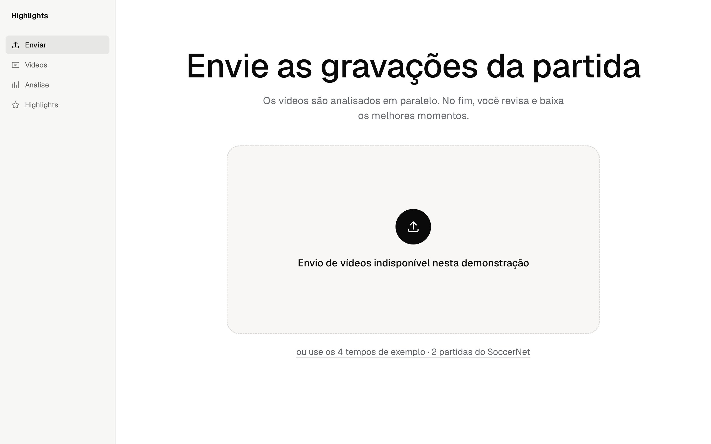
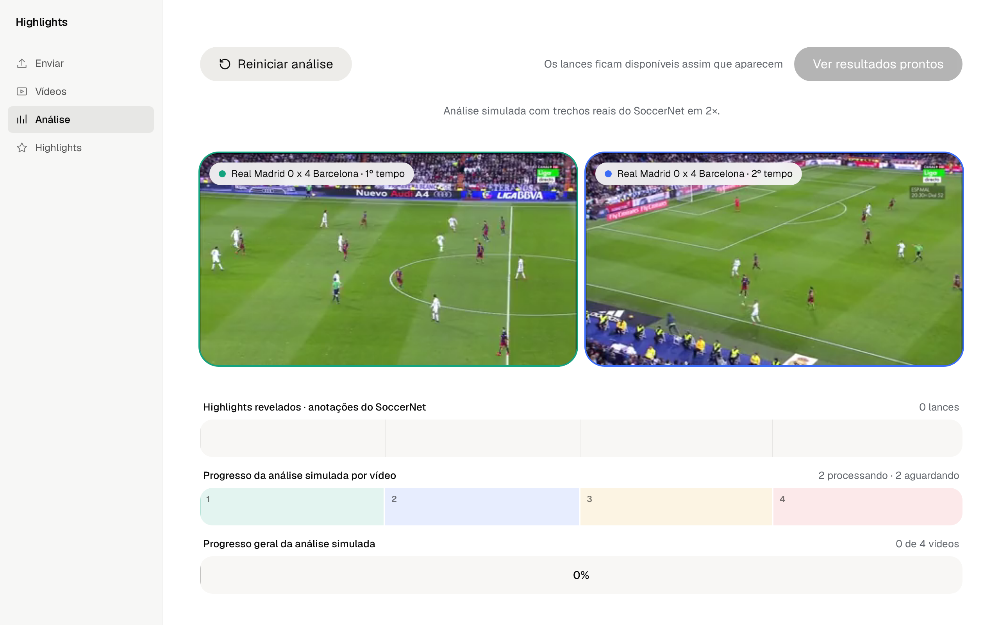
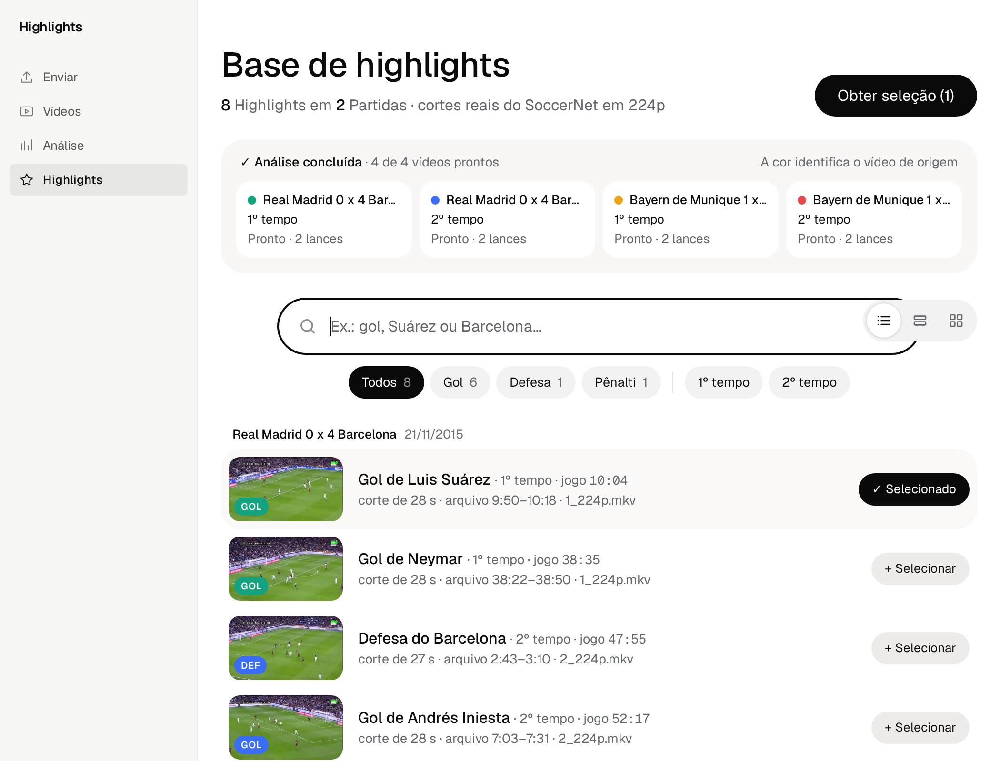
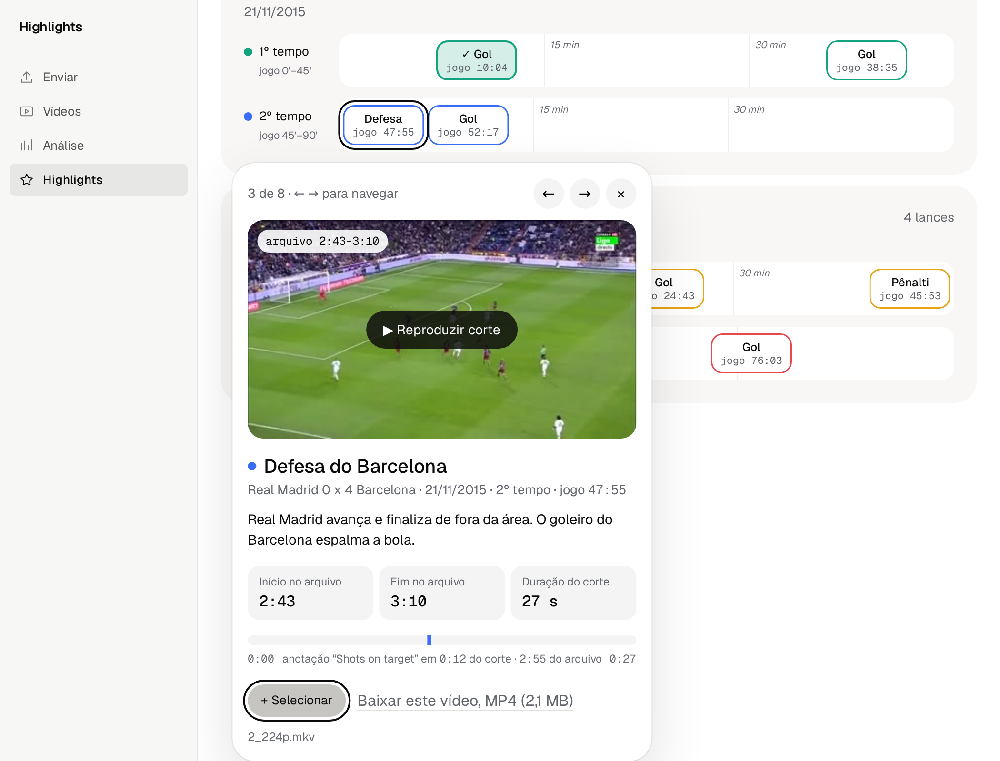
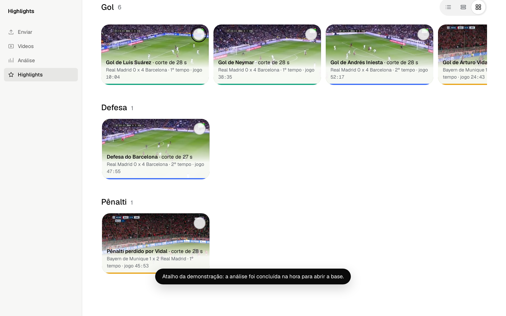
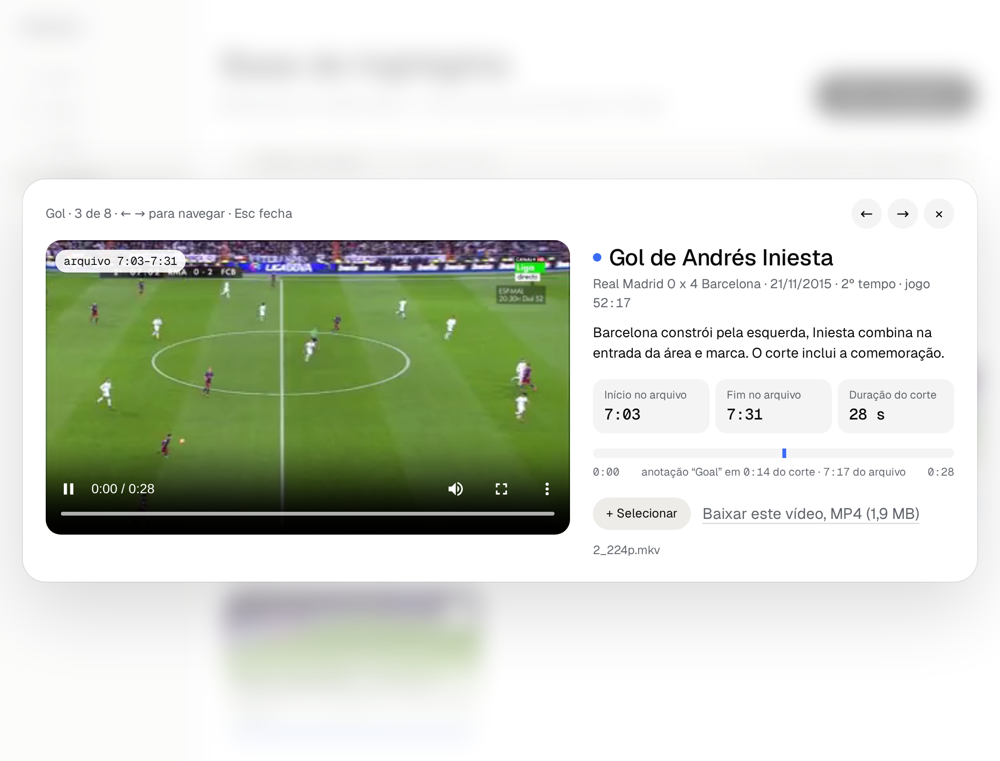
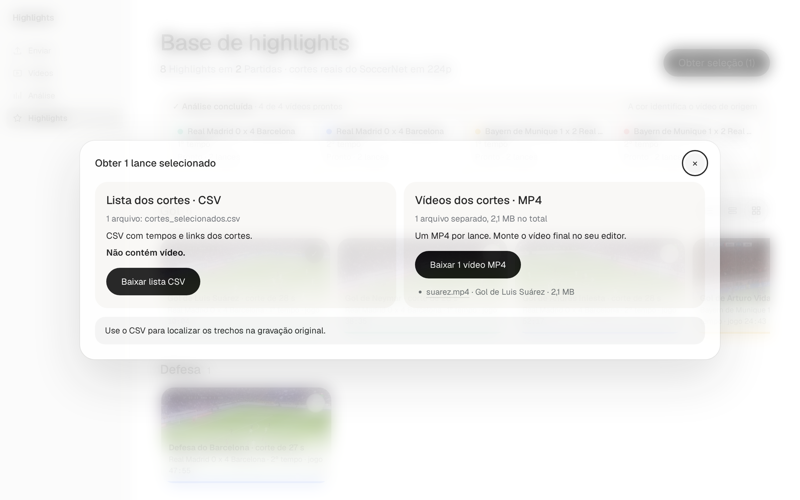

# Entrega 11: protótipo navegável integrado

**Data:** 13/11/2026\
**Status:** 🟨 protótipo publicado em preview e documentação preparada; revisão final da equipe pendente.\
**Responsabilidade:** Equipe 16, Pedro Alexandre Custódio Silva, Lucas Roberto Boccia dos Santos e Giovanni Chahin Morassi. Integração conduzida por Pedro com assistência de agentes Codex. A revisão final pelos integrantes permanece pendente.

## Objetivo e escolha do artefato

Materializar os fluxos da [Entrega 10](10_molic.md), com os objetivos e signos da [Entrega 9](09_modelo_conceitual.md). O percurso integrado prepara exemplos, acompanha uma análise simulada, permite revisar candidatos e obter cortes e metadados para edição externa.

A equipe utiliza HTML, CSS e JavaScript como alternativa ao Figma, que é uma sugestão de ferramenta nesta atividade. O artefato evolui o protótipo da Entrega 6, sem criar uma aplicação separada. O nome deste documento e a pasta de imagens foram mantidos para preservar os links do repositório.

A revisão acrescenta navegação lateral para **Enviar**, **Vídeos**, **Análise** e **Highlights**, remove os avisos flutuantes superiores e ajusta textos, contraste, controles de teclado e diálogos. As três visualizações A, B e C são modos da mesma base, com seleção compartilhada.

## Acesso e fonte editável

| Artefato | Acesso | Situação em 13/11/2026 |
|---|---|---|
| Fonte editável da revisão | [PROTOTIPO_fluxo_highlights.html](../assets/06_prototipos/PROTOTIPO_fluxo_highlights.html) | HTML único, sem etapa de compilação |
| Dados e mídia dos exemplos | [manifest.json](../assets/06_prototipos/media/manifest.json) | Quatro tempos de duas partidas e oito cortes reais do SoccerNet |
| Revisão em desenvolvimento | [Servidor via Tailscale](http://100.82.157.113:8730/PROTOTIPO_fluxo_highlights.html) | Acesso restrito à rede Tailscale; não é link público de entrega |
| Preview público desta revisão | [ihc-11.p4cs.com.br](https://ihc-11.p4cs.com.br/) | Publicado em 13/11/2026; HTML e mídia conferidos por HTTPS sem autenticação |
| Publicação anterior | [ihc.p4cs.com.br](https://ihc.p4cs.com.br/) | Mantida na versão anterior |

Para reproduzir a revisão a partir deste checkout:

```sh
python3 -m http.server 8730 --bind 0.0.0.0 --directory assets/06_prototipos
```

Abra `http://localhost:8730/PROTOTIPO_fluxo_highlights.html`. Servir por HTTP é necessário para carregar o manifesto e a mídia. O servidor de desenvolvimento existente permanece disponível para iteração.

O preview público foi publicado pelo ambiente `entrega11` de `site/wrangler.jsonc`, no Worker `ihc-11`, com o D1 `ihc-feedback-preview`. A configuração de produção permanece separada. Foram conferidos por HTTPS sem autenticação o HTML idêntico à fonte, o manifesto, um MP4 idêntico ao arquivo local, o guia e a rejeição de GET na API de feedback. Não houve envio de feedback de teste. As capturas abaixo registram a revisão publicada.

## Cobertura MoLIC e limites

Os responsáveis abaixo são os autores dos modelos de origem, sem atribuir assinatura ou aprovação desta interface a quem ainda não a revisou.

| Modelo e origem | Objetivos e tarefas | Telas e interações | Cobertura e limites | Autor do modelo |
|---|---|---|---|---|
| M01, c1 e p1; CI01 | O04, T01 | F04, busca em A e filtros em A/B | Localizar por metadados, tipo e tempo. A oferece limpar uma consulta sem resultados. B indica contagens; C agrupa por tipo e não tem busca | Pedro |
| M01, c2 e p2; CI01 | O05, T01 | F04 → F05 → F04 | Abrir e reproduzir corte, conferir origem, relógio do jogo, posição no arquivo, intervalo e duração. Contexto insuficiente e suspeita de omissão exigem julgamento humano e conferência externa | Pedro |
| M01, c3, p3 e p4; CI01 | O06/O07, T01 e continuidade em T02 | Seleção em F04/F05 → F06 | CSV exige seleção não vazia; MP4 individual pode ser obtido sem seleção. Não há lista editável exclusiva da seleção nem confirmação de salvamento local | Pedro |
| M02, c1/c2/c3 e p1–p4; CI02 | O04/O06/O07, T01/T02 | F04, F05 e F06 | Identificação, reprodução e saídas apoiam o preparo para o supervisor. Transferência, aprovação editorial e pedidos de ajuste ocorrem fora do sistema | Lucas |
| M03, envio e progresso; CI03 | O01/O02, preparação de T03 | F01 → F02 → F03 → F04 | Entrada própria indisponível; preparação usa exemplos. Progresso, fila e conclusão são simulados, com mídia real | Giovanni |
| M03, erro e consulta; CI03 | O03/O04/O05/O07, T03 | F02 escolhe cenário; F03/F04 comunicam estado; F05 apresenta o corte | Falha encenada permite nova tentativa localizada ou deixar pendente. Não representa recuperação de um detector real, login, exclusão de resultados ou cancelamento de análise/download desenhados no M03 | Giovanni |
| M01/M02, retomada; M03, encerramento | O08 | Troca entre telas e A/B/C | Seleção mantida na sessão, sem persistência garantida após recarga. Não há histórico nem registro permanente de pendências | Equipe |

O09 e O10 continuam externos. A navegação lateral dá acesso às etapas existentes, sem introduzir uma nova tarefa ou alterar o escopo de IHC ou do TCC.

A seção de preparação da Entrega 10 descreve a demonstração no momento da modelagem. Esta entrega registra o estado posterior. A obtenção agora reúne links e saídas em um diálogo, mas não implementa todas as propostas daquele documento.

## Catálogo de telas e estados

### F01: entrada da demonstração



**Objetivo:** preparar a entrada, O01, proposta de M03. O aviso informa que vídeos próprios não podem ser enviados. O botão de exemplos carrega os quatro tempos. Origem, conjunto de entradas e envio correspondem a S01–S03 e S05/S06/S08, com cobertura limitada aos exemplos.

### F02: vídeos do lote

**Objetivo:** conferir os exemplos e iniciar o acompanhamento, O01/O02, M03. Exibe partida, tempo, arquivo e estado. Permite remover entradas antes do início, restaurá-las pelos exemplos e escolher os percursos **normal**, **falha em um vídeo** e **vídeo sem lances**. O botão de remoção fica visível ao receber foco, além do hover.

### F03: análise simulada



**Objetivo:** acompanhar a análise e acessar resultados, O02/O03, M03 e T03. Estados incluem fila, processamento, conclusão, falha encenada e conclusão sem lances. Os signos S09–S14 e S32 orientam a leitura do estado, sem comprovar uma execução técnica real. Marcadores são botões de acesso ao lance. A análise usa trechos reais em 2×.

### F04: base de highlights







**Objetivo:** localizar candidatos e definir a seleção, O04/O06, M01 c1/c3 e M02 c1/c3. A apresenta lista e busca textual; B dispõe os lances nas trilhas dos arquivos; C apresenta miniaturas agrupadas por tipo. Os modos compartilham os candidatos e a seleção, S16/S17/S22–S24. A seleção não representa aprovação editorial.

Na consulta vazia de A, a interface permite limpar os critérios. A busca não reconhece atletas: encontra apenas texto dos metadados dos exemplos. Resultados novos podem ser incorporados à base sem reiniciar os demais vídeos.

### F05: detalhe do corte



**Objetivo:** conferir pertinência e contexto, O05/O07, M01 c2 e M02 c2. Mostra player, origem, tempo da partida, relógio do jogo, posição e intervalo no arquivo, duração e tamanho do MP4, S01–S03/S16–S21/S27/S33. Pode incluir ou retirar o item e baixar o vídeo individual.

Em A, o detalhe expande na lista; em B, abre junto ao marcador; em C, usa diálogo. Carregamento e falha da mídia têm feedback e nova tentativa. Não há ajuste do intervalo do corte nem garantia de que todos os lances foram detectados.

### F06: obter a seleção



**Objetivo:** obter material para continuidade externa, O07, M01 c3 e M02 c1. Distingue a relação CSV, S26, dos vídeos MP4, S27; informa quantidade e tamanho, S24/S33. O CSV contém referências, tempos e links, sem vídeo incorporado. Cada MP4 é um corte separado. A montagem permanece no editor externo.

Seleção vazia desativa a obtenção da seleção. Os MP4 individuais continuam acessíveis pelo detalhe. O navegador pode solicitar permissão para vários downloads; links individuais continuam disponíveis. Disparar o download não comprova salvamento, reprodução ou espaço disponível, S28.

## Estados, alternativas e recuperação

| Estado | Resposta do protótipo | Limite |
|---|---|---|
| Manifesto em carregamento ou indisponível | Exemplos desativados durante carga; erro textual se o manifesto falhar | Não é validação de arquivo enviado |
| Lote vazio | Mensagem e caminho para carregar os exemplos | Remoção afeta apenas a demonstração |
| Fila e processamento | Estado por vídeo, progresso e acesso à análise | Progresso simulado, sem previsão técnica de prazo |
| Falha em um vídeo | Preserva os outros vídeos; oferece confirmação de nova tentativa ou deixar pendente | Falha e recuperação encenadas; reenvio não implementado |
| Vídeo sem lances | Conclusão com ausência de candidatos nesse tempo | Não prova ausência de eventos na partida |
| Consulta sem resultados | Mensagem em A e limpeza dos critérios, preservando a seleção | B e C não têm o mesmo mecanismo de busca |
| Mídia indisponível | Feedback de falha e nova tentativa do player | Falha real de rede não repetida nesta rodada |
| Seleção vazia | Obtenção da seleção indisponível; inclusão reversível | MP4 individual independe da seleção |
| Retomada | Contexto mantido enquanto a sessão permanece aberta | Recarga perde a seleção; sem recuperação persistente |

## Sistema visual e acessibilidade

| Elemento | Regra aplicada | Motivo |
|---|---|---|
| Navegação | Sidebar fixa, quatro links com ícones e etapa ativa por `aria-current` | Orientar a localização sem sobrepor o conteúdo |
| Tipografia | Geist e Geist Mono; títulos e grupos com hierarquia semântica | Distinguir conteúdo e referências temporais |
| Cores | Tons secundários #62666c e #686c72; cor por vídeo de origem | Melhorar contraste e manter associação entre lote e lances |
| Controles | Botões reais para detalhes e marcadores; seleção/filtros com `aria-pressed` | Permitir teclado e expor estado |
| Foco | Contorno visível, atalho para conteúdo e restauração após renderizações | Preservar o ponto de interação |
| Diálogos | Nome acessível, fundo inerte, contenção e retorno de foco, rolagem limitada | Manter a navegação no conteúdo aberto |
| Movimento | Preferência de movimento reduzido remove efeitos decorativos e rolagem suave | Reduzir animação sem interromper mídia ou relógio da análise |

O contraste calculado do texto #62666c varia de 4,84:1 a 5,77:1 nos fundos sólidos usados. Para #686c72, foram calculados 5,28:1 sobre branco e 4,93:1 sobre #f8f7f5. Essas medições não constituem auditoria global de conformidade WCAG.

## Verificações e limites da evidência

Em 13/11/2026, a revisão foi exercitada no navegador em desktop, nas larguras de 1280 e 1050 px. Foram verificados exemplos, início da análise, acesso por marcador, A/B/C, busca, filtros, seleção, detalhe, diálogos e navegação com Tab, Shift+Tab, Enter e Escape. Alguns testes partiram de foco programático; não se afirma um percurso completo apenas com teclado desde a abertura.

A mídia da análise e do detalhe avançou durante os testes. Para conferir todos os oito resultados, também foi usado o atalho existente `?tela=4`, que conclui a análise simuladamente. O percurso completo de processamento não foi aguardado nesta rodada. O ramo de movimento reduzido foi exercitado por emulação controlada na aba, sem validar a integração com a preferência do sistema operacional.

As capturas são do protótipo após os ajustes aprovados, sem anotações de proposta. Foram conferidos o parse do JavaScript, a ausência de overflow horizontal nos percursos verificados e `git diff --check`. Downloads CSV/MP4 não foram repetidos nesta rodada. Não houve sessão com participantes, teste com leitor de tela, avaliação mobile ou comprovação de metas das Entregas 7 e 8.

## Checklist e pendências para entrega

- [x] Um protótipo integrado com fonte editável versionada.
- [x] Capturas representativas no repositório.
- [x] Cobertura e lacunas de M01, M02 e M03 registradas.
- [x] Estados de processamento, vazio, falha e recuperação considerados.
- [x] Objetivos, tarefas e signos vinculados às Entregas 9 e 10.
- [x] Revisão, seleção e obtenção clicáveis com os exemplos.
- [x] Simulação, mídia real e trabalho externo diferenciados.
- [x] Ajustes básicos de contraste, foco, teclado e diálogos verificados.
- [ ] Equipe revisou e aprovou os fluxos e a cobertura parcial dos modelos.
- [x] Revisão publicada e acesso público por HTTPS conferido sem autenticação.
- [ ] Downloads e reprodução dos arquivos salvos conferidos na revisão final.
- [ ] Pendências dos modelos compatibilizadas, sem presumir cobertura completa do MoLIC.

## Registro de elaboração

Em 13/11/2026, Pedro conduziu a evolução do protótipo original e aprovou as propostas de limpeza antes da implementação. Agentes GPT-6 Astra e GPT-6.1 Sol, pelo harness Codex no T3 Code, auxiliaram a implementação, as verificações e a documentação. As capturas e os registros técnicos não substituem revisão acadêmica dos integrantes, avaliação com participantes.
