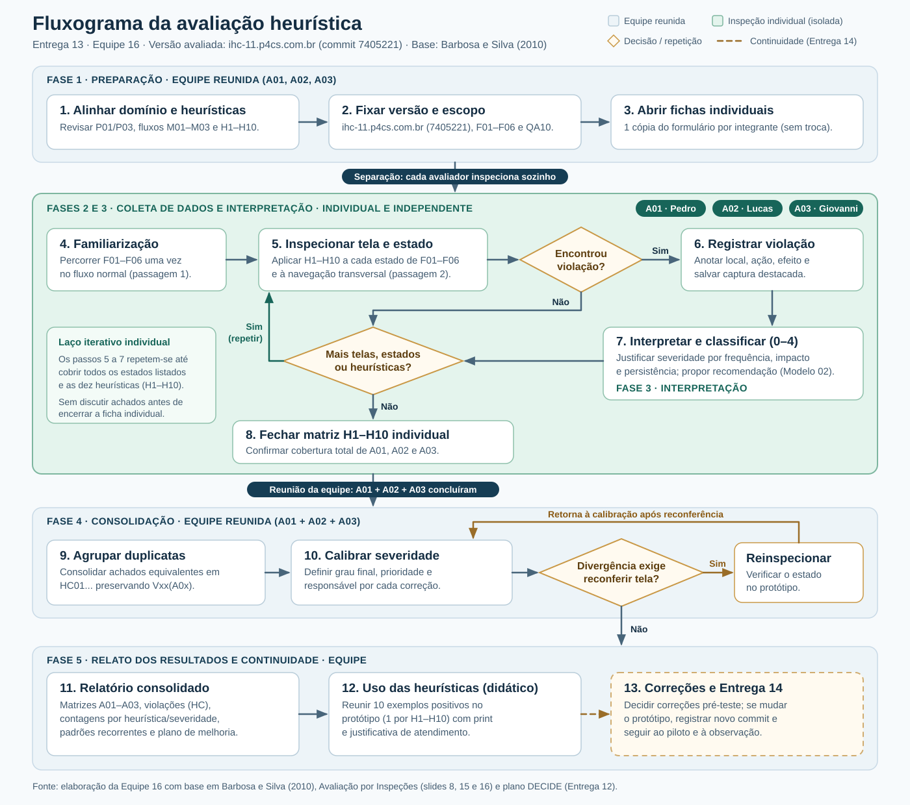

# Entrega 13 — Avaliação de IHC por inspeção heurística

**Data:** 20/11/2026 (versão original)\
**Revisão:** 24/11/2026, correção do alfa de Krippendorff e da descrição de HC03\
**Status:** 🟩 inspeções A01, A02 e A03, consolidação em 33 achados e exemplos da seção 8 preenchidos; pedido nativo de permissão para múltiplos downloads não observado\
**Responsabilidade:** 1 avaliação completa por integrante e consolidação por equipe. Equipe 16, Pedro Alexandre Custódio Silva, Lucas Roberto Boccia dos Santos e Giovanni Chahin Morassi.

## Objetivo da atividade

Encontrar problemas de usabilidade no protótipo **Melhores Momentos** por inspeção sistemática com as **10 heurísticas de Nielsen**. Cada avaliador percorre todas as telas e estados individualmente antes de qualquer discussão; depois a equipe consolida violações equivalentes, define severidades finais e prepara as correções para depois da observação com usuários ([Entrega 14](14_observacao_usuario.md)).

A inspeção avalia exclusivamente a interface e o diálogo do protótipo. A precisão da detecção de lances, a cobertura dos eventos e o desempenho do modelo híbrido pertencem à avaliação técnica do TCC ([Entrega 12](12_planejamento_avaliacao.md#o-que-está-sendo-avaliado)).

## 1. Heurísticas adotadas

1. **H1:** Visibilidade do status do sistema
2. **H2:** Compatibilidade entre o sistema e o mundo real
3. **H3:** Controle e liberdade do usuário
4. **H4:** Consistência e padrões
5. **H5:** Prevenção de erros
6. **H6:** Reconhecimento em vez de memorização
7. **H7:** Flexibilidade e eficiência de uso
8. **H8:** Estética e design minimalista
9. **H9:** Ajudar usuários a reconhecer, diagnosticar e recuperar-se de erros
10. **H10:** Ajuda e documentação

### Cobertura de estados no escopo de Melhores Momentos

A inspeção não se limita ao fluxo feliz. A tabela abaixo separa os estados críticos que existem no protótipo daqueles que estão fora do recorte definido na [Entrega 1](01_conhecendo_o_problema.md) e na [Entrega 11](11_figma.md).

| Categoria | Situação no protótipo | Onde inspecionar |
|---|---|---|
| Processamento, fila e progresso | Aplicável (simulado com mídia real em 2×) | F02 e F03 (fila, andamento, resultados parciais, conclusão e reinício) |
| Filtros, busca sem resultado e modos alternativos | Aplicável | F04 A (busca textual, filtros por tipo/vídeo e limpeza de consulta vazia), F04 B (trilhas) e F04 C (mosaico) |
| Exportação e obtenção de saídas | Aplicável | F05 (download individual de MP4) e F06 (seleção vazia, separação CSV × MP4, tamanhos e aviso do navegador) |
| Falha, recuperação e confirmação de ação | Aplicável (cobre `QA10`) | F01 (indisponibilidade de manifesto, se simulada), F02 (lote vazio), F03/F04 (falha encenada, confirmação/cancelamento de nova tentativa localizada e opção de deixar pendente), F05 (falha e nova tentativa do player) |
| Tradução de termos técnicos e metadados | Aplicável | F02, F04, F05 e F06 (partida, tempo, relógio do jogo, posição no arquivo, duração, tamanho e distinção entre relação CSV e arquivos MP4) |
| Navegação transversal, foco e teclado | Aplicável | Barra lateral (`aria-current`), contorno de foco, atalhos de teclado (`Tab`, `Enter`, `Esc`, setas, `/`), preservação na sessão e efeito da recarga |
| Dashboard administrativo, CRUD de permissões, histórico persistente e comparação de modelos do TCC | Fora do escopo de IHC | Não existem no protótipo ([Entrega 11](11_figma.md#cobertura-molic-e-limites) e [Entrega 12](12_planejamento_avaliacao.md#o-que-está-sendo-avaliado)) |

## 2. Escopo da inspeção

| Item | Definição |
|---|---|
| Versão avaliada | Preview público em [ihc-11.p4cs.com.br](https://ihc-11.p4cs.com.br/), correspondente ao commit `7405221` (arquivo-fonte de `7d52cdd`, publicado em 13/11/2026). SHA-256 do HTML verificado em 19/11/2026: `aa6ec94773a783559e352f69ff5507bd3a8af9301c3830b832de879104b6f33c`. O commit local `62bbbed` (18/11/2026) não foi publicado nesse link e fica fora desta rodada. |
| Telas e estados | **F01** (entrada: carregamento de exemplos, envio próprio indisponível e erro de manifesto quando reproduzido); **F02** (lote: 4 tempos, remoção, lote vazio, reposição e seleção dos cenários normal, falha e vídeo sem lances); **F03** (análise: fila, progresso, resultados parciais, conclusão, falha encenada, vídeo sem lances e transições para F04); **F04** (destaques: lista A com busca/filtros/vazio, trilhas B, mosaico C, preservação de seleção e faixa de falha com confirmação/cancelamento de nova tentativa e opção de deixar pendente); **F05** (detalhe: origem, relógio do jogo, posição no arquivo, player, erro de mídia quando reproduzido, seleção e retorno); **F06** (obtenção: seleção vazia, diálogo, distinção CSV × MP4 e downloads); **Navegação transversal** (barra lateral, foco, teclado, contexto na sessão e recarga). |
| Fluxos e perguntas | Modelos `M01`, `M02` e `M03` ([Entrega 10](10_molic.md)), tarefas `T01`, continuidade de `T02` e `T03` ([Entrega 5](05_analise_tarefas.md)) e pergunta `QA10` ([Entrega 12](12_planejamento_avaliacao.md#b-perguntas-de-avaliação)). |
| Dispositivo e viewport | Computador desktop. Cada avaliador registra navegador, versão, largura da janela e meios de interação na própria seção. |
| Avaliadores | **A01:** Pedro Alexandre Custodio Silva (`22.123.049-3`); **A02:** Lucas Roberto Boccia dos Santos (`22.123.012-1`); **A03:** Giovanni Chahin Morassi (`22.123.025-3`). |

## Processo e fluxograma da avaliação heurística

O fluxo abaixo segue as cinco fases descritas por Barbosa e Silva (2010) e pelos materiais da disciplina: preparação em equipe, coleta de dados individual, interpretação individual, consolidação em reunião e relato dos resultados.

*Figura 1. Fluxograma do processo de avaliação heurística da Equipe 16, destacando a separação para inspeção independente, os dois laços iterativos (verificação individual por tela/estado/heurística e reconferência durante a consolidação) e o ponto em que os três avaliadores se reúnem. Fonte: elaboração da equipe com base em Barbosa e Silva (2010) e [Avaliação de Usabilidade por Inspeções](../slides_plinio/Avaliacao%20Usabilidade%20Inspecoes.pdf) (slides 8, 15 e 16).*

As etapas ocorrem nesta ordem:

1. **Preparação (equipe reunida):** alinhar perfis (`P01` e `P03`), fluxos (`M01`–`M03`) e heurísticas (`H1`–`H10`), congelar a versão publicada (`ihc-11.p4cs.com.br`, commit `7405221`) e abrir uma ficha individual por integrante.
2. **Coleta de dados e interpretação (individual e independente):** cada avaliador percorre o fluxo normal uma vez para familiarização e depois entra no laço iterativo de inspeção. Para cada tela, estado e heurística, verifica se há violação, registra evidência com captura destacada, classifica severidade (`0`–`4`) com justificativa de frequência, impacto e persistência e propõe correção. O ciclo repete até fechar a matriz `H1`–`H10` sem discussão prévia entre integrantes.
3. **Consolidação dos resultados (reunião da equipe):** somente após `A01`, `A02` e `A03` concluírem suas fichas, os três se reúnem para agrupar violações equivalentes (`HC01...`) preservando a autoria original e calibrar severidade final, prioridade e responsável. Quando surge divergência sobre o comportamento de um estado, a equipe reinspeciona o protótipo em um segundo laço curto antes de fechar a classificação.
4. **Relato dos resultados e continuidade (equipe):** produzir a síntese por heurística e severidade, definir o plano de correções para depois da [Entrega 14](14_observacao_usuario.md) e reunir os dez exemplos na seção [Uso das heurísticas](#8-uso-das-heurísticas).

## 3. Procedimento individual

Cada integrante preenche primeiro sua ficha independente, baseada em [entrega12_formulario_heuristica.md](../instrumentos/entrega12_formulario_heuristica.md), para evitar influência mútua e conflitos de edição:

- **A01 (Pedro):** [artifacts/entrega13/inspecao_A01_pedro.md](../artifacts/entrega13/inspecao_A01_pedro.md)
- **A02 (Lucas):** [artifacts/entrega13/inspecao_A02_lucas.md](../artifacts/entrega13/inspecao_A02_lucas.md)
- **A03 (Giovanni):** [artifacts/entrega13/inspecao_A03_giovanni.md](../artifacts/entrega13/inspecao_A03_giovanni.md)

Regras de execução individual:

1. Percorra os fluxos e telas ao menos uma vez para familiarização.
2. Inspecione novamente aplicando `H1`–`H10` a todas as telas e estados definidos no escopo.
3. Registre cada problema com ação, local, consequência e captura anotada destacando a região afetada em `assets/13_heuristica/` (`a01_v01.png`, `a02_v01.png`, `a03_v01.png`).
4. Atribua severidade somente depois de compreender o problema, justificando por **frequência**, **impacto** e **persistência**.
5. Não leia as fichas dos colegas nem discuta achados antes de encerrar a sua matriz de cobertura.

### Escala de severidade (0–4)

| Grau | Interpretação |
|---:|---|
| 0 | Não é considerado problema de usabilidade |
| 1 | Problema cosmético; corrigir se houver tempo |
| 2 | Problema menor; baixa prioridade |
| 3 | Problema maior; alta prioridade |
| 4 | Catástrofe de usabilidade; correção imperativa antes de disponibilizar |

---

## Avaliador A01: Pedro Alexandre Custodio Silva

**Autor:** Pedro Alexandre Custodio Silva — 22.123.049-3\
**Ficha de trabalho:** [inspecao_A01_pedro.md](../artifacts/entrega13/inspecao_A01_pedro.md)

### 4.1 Matriz de cobertura das 10 heurísticas (A01)

| Heurística | Telas e estados examinados | Houve violação? | IDs dos achados |
| --- | --- | --- | --- |
| H1 | F01 espera e erro. F02 tamanho e estado do lote. F03 fila, avanço, falha, conclusão e vídeo sem lances. F04 contagens, atualização parcial e foco em QA10. F05 estado do player. F06 confirmação de download. Etapa ativa na barra lateral. | sim | V05, V06, V09 |
| H2 | F01 chamada e aviso de envio. F02 partidas, tempos e publicação. F03 análise simulada. F04 origem dos lances e mensagem QA10. F05 relógio do jogo, posição no arquivo e anotação. F06 CSV e MP4. | sim | V01, V04, V10 |
| H3 | F01 retorno à entrada. F02 remoção e reposição. F03 reinício e saída para a base. F04 limpar busca, cancelar e deixar pendente. F05 retirar seleção e fechar. F06 fechar por botão ou Esc. Retorno pelo navegador e recarga. | sim | V12, V13 |
| H4 | F01 e F02 rótulos das ações. F03 e F04 atalhos para resultados. F04 modos, filtros e confirmação QA10. F05 abertura e retorno em A, B e C. F06 diálogo e foco. Comportamento do botão Voltar. | sim | V07, V09, V12 |
| H5 | F01 envio indisponível. F02 lote vazio. F03 acesso antes do primeiro lance e resultado sem lances. F04 confirmação localizada e recarga com seleção. F05 inclusão, retirada e tamanho do MP4. F06 seleção vazia e conferência antes de baixar. | sim | V13 |
| H6 | F01 ação para avançar. F02 identificação de partidas e controle de remoção. F03 correspondência entre prévias e progresso. F04 filtros, origem e seleção. F05 tempos e controles. F06 identificação de arquivos. Etapa ativa e foco. | sim | V03, V05, V11 |
| H7 | F01 caminho pelos exemplos. F02 remoção e reposição. F03 acesso antecipado e abertura por marcador. F04 combinação de filtros, troca de modos e rolagem. F05 atalhos de detalhe. F06 download individual e em lote. | sim | V07, V08 |
| H8 | F01 hierarquia da entrada. F02 cartões e cenário. F03 prévias e faixas. F04 densidade na lista, trilhas, mosaico e faixa de falha. F05 detalhe e player. F06 legibilidade do diálogo. Contraste e foco na navegação. | sim | V01 |
| H9 | F01 falha ao carregar exemplos. F02 bloqueio do lote vazio. F03 interrupção e processamento sem lances. F04 consulta vazia e opções de QA10. F05 falha de reprodução e nova tentativa. F06 aviso de múltiplos downloads. | sim | V02 |
| H10 | F01 limites da demonstração. F02 descrições dos cenários. F03 continuidade da análise. F04 instruções das trilhas, mosaico e recuperação. F05 orientação para navegar no detalhe. F06 explicação de formatos e aviso do navegador. | sim | V08 |

### 5.1 Declaração de violações (A01)

| ID | Heurística | Tela e estado | Problema observado | Evidência | Severidade | Justificativa da severidade | Recomendação |
| --- | --- | --- | --- | --- | ---: | --- | --- |
| V01 | H2, H8 | F01, Entrada com exemplos prontos | Na entrada, o título «Envie as gravações da partida» e a área central com ícone de envio dão destaque à ação indisponível. O botão que inicia a demonstração aparece abaixo, como um link secundário. P03 pode procurar como iniciar na área central antes de perceber o botão de exemplos. | [A01 V01](../assets/13_heuristica/a01_v01.png) | 2 | A hierarquia se repete em toda entrada. Pode atrasar o primeiro uso, mas o botão de exemplos está visível na mesma tela. A dificuldade diminui assim que P03 aprende onde clicar. | Usar um título sobre a demonstração e destacar «Usar os vídeos de exemplo» como ação principal. Mostrar a indisponibilidade do envio próprio como aviso junto à ação. |
| V02 | H9 | F01, Falha no carregamento dos exemplos | Com o carregamento dos exemplos interrompido, o botão some e o aviso manda servir a pasta por HTTP com `python3 -m http.server`, embora a página já esteja aberta no site. P03 fica sem uma instrução aplicável para retomar. | [A01 V02](../assets/13_heuristica/a01_v02.png) | 2 | A mensagem aparece quando a lista de exemplos falha. Nesse estado impede o início do fluxo. Depois de restabelecer o acesso, recarregar devolve o botão, mas a mensagem não orienta essa ação. | Informar que os vídeos de exemplo estão temporariamente indisponíveis e oferecer «Tentar carregar novamente» no próprio aviso. |
| V03 | H6 | F02, Lote com quatro tempos | Os cartões escondem o botão × até o ponteiro passar sobre um cartão ou o botão receber foco. P01 precisa passar o ponteiro sobre a miniatura ou chegar ao botão com Tab para descobrir como retirar um tempo antes de iniciar o lote. | [A01 V03](../assets/13_heuristica/a01_v03.png) | 2 | Acontece em todos os cartões em repouso. Atrasa a conferência inicial sem impedir a remoção. Depois que P01 descobre o controle, a posição se repete. | Deixar a ação «Remover» visível e associada ao cartão mesmo em repouso. Usar partida e tempo também no nome acessível, pois os nomes dos arquivos se repetem. |
| V04 | H2 | F02, Lote pronto para análise | O resumo diz que as gravações completas não são publicadas e que só os cortes são. O percurso observado entrega arquivos para edição externa. P03 pode entender que iniciar a análise publica os cortes, antes de decidir quais quer baixar. | [A01 V04](../assets/13_heuristica/a01_v04.png) | 2 | O texto aparece sempre que há vídeos no lote. A dúvida afeta a decisão de iniciar, embora o diálogo de obtenção explique depois o trabalho no editor. O aviso permanece durante a conferência do lote. | Dizer que os cortes ficam disponíveis para revisão e download. Descrever a publicação como etapa posterior do trabalho editorial. |
| V05 | H1, H6 | F03, Fila e progresso por vídeo | A faixa de progresso mostra segmentos numerados por cor. No início, os dois tempos de Bayern x Real Madrid aguardam, mas seus nomes só aparecem ao passar o ponteiro pelos segmentos 3 e 4. P01 precisa consultar as dicas ou lembrar a ordem do lote para localizar cada tempo. | [A01 V05](../assets/13_heuristica/a01_v05.png) | 2 | A associação precisa ser refeita sempre que o usuário consulta a faixa. Aumenta o esforço de acompanhar as partidas, sobretudo quando as duas prévias mudam de vídeo. As dicas com o nome permitem recuperar a informação. | Identificar cada segmento com partida e tempo e expor o estado por vídeo em texto, inclusive para quem navega pelo teclado. |
| V06 | H1 | F04, Lista A com filtros de tipo e tempo | Ao combinar «Gol» e «2º tempo», a lista mostra três lances e o filtro ativo continua exibindo «Gol 6». Sem um total dos resultados filtrados, P01 precisa contar as linhas para verificar quantos candidatos vai revisar. | [A01 V06](../assets/13_heuristica/a01_v06.png) | 2 | Ocorre ao restringir a lista sem alterar os totais da base. Prejudica a conferência do subconjunto, mas todos os resultados da consulta ficam acessíveis. A divergência permanece enquanto os filtros estão ativos. | Mostrar o total filtrado junto da lista, por exemplo «3 de 8 lances». Atualizar as contagens por tipo conforme o contexto ou identificá-las como totais da base. |
| V07 | H4, H7 | F04, Troca da lista A para trilhas B e retorno | Depois de filtrar «Gol» e «2º tempo» na lista, as trilhas voltam a mostrar lances de outras categorias e dos dois tempos. Ao retornar à lista, «Todos» está ativo e os oito lances voltam sem aviso. P01 precisa reaplicar os filtros para continuar a revisão do mesmo conjunto. | [A01 V07](../assets/13_heuristica/a01_v07.png) | 2 | A perda acontece ao trocar de visualização com filtros ativos. Gera retrabalho e expande o conjunto à vista. A seleção de cortes é preservada e os filtros podem ser reaplicados. | Compartilhar os filtros compatíveis entre as visualizações. Se algum filtro ficar indisponível em um modo, indicar a mudança e restaurá-lo ao voltar. |
| V08 | H7, H10 | F04, Mosaico C, faixa de gols | A faixa anuncia seis gols, exibe três cartões completos e corta o quarto na borda. Com o ponteiro sobre a faixa, não há seta, dica nem barra de rolagem perceptível. P03 pode parar antes de alcançar os dois gols de Cristiano Ronaldo. | [A01 V08](../assets/13_heuristica/a01_v08.png) | 2 | Ocorre quando a faixa tem mais lances do que cabem na tela. Pode deixar candidatos fora da revisão, embora a rolagem horizontal, o Tab e as outras visualizações ofereçam acesso. A falta de indicação persiste enquanto há cartões fora da faixa. | Adicionar controles visíveis para avançar e voltar na faixa, com rótulos acessíveis e indicação de que ainda há cartões. |
| V09 | H1, H4 | F04, QA10, confirmação e cancelamento pelo teclado | Ao pressionar Enter em «Tentar de novo este vídeo», surgem «Confirmar nova tentativa» e «Cancelar», mas o foco visível desaparece. O mesmo acontece ao cancelar. P01 precisa pressionar Tab para localizar de novo onde está antes de prosseguir. | [A01 V09](../assets/13_heuristica/a01_v09.png) | 2 | Ocorreu na abertura e no cancelamento da confirmação pelo teclado. A ausência de foco interrompe a sequência, mas Tab alcança o próximo controle e o lote fica intacto. O efeito dura até a próxima ação de navegação. | Ao abrir a confirmação, colocar o foco visível na ação segura «Cancelar». Ao cancelar, devolver o foco ao botão «Tentar de novo este vídeo». |
| V10 | H2 | F05, Detalhe da Defesa do Barcelona na lista A | A linha temporal abaixo dos tempos do corte mostra «anotação ‘Shots on target’» sem traduzir o termo. P03 lê «Defesa do Barcelona» no título e precisa interpretar a expressão em inglês para entender o que o marcador destaca. | [A01 V10](../assets/13_heuristica/a01_v10.png) | 1 | O texto aparece ao abrir esse detalhe e permanece durante a revisão. O título e a descrição em português permitem reconhecer e revisar o lance. A dificuldade fica restrita à leitura da anotação. | Exibir «Finalização no alvo» e indicar que o marcador assinala o instante da jogada no corte. |
| V11 | H6 | F06, Download de MP4 de duas partidas | Ao baixar os gols de Suárez e Vidal, os arquivos salvos se chamam `suarez.mp4` e `vidal.mp4`. O diálogo também lista esses nomes sem partida ou minuto. Para identificar a origem no editor externo, P01 precisa voltar à base, consultar o CSV ou reconhecer o lance pela imagem. | [A01 V11](../assets/13_heuristica/a01_v11.png) | 2 | Acontece ao obter MP4 com nomes sem contexto, em especial ao reunir cortes de várias partidas. Aumenta o esforço na passagem para o editor. A identificação não acompanha o nome do arquivo e exige uma consulta separada. | Incluir partida, tempo e minuto do jogo no nome do MP4 e na lista do diálogo, preservando um identificador único no caso de nomes iguais. |
| V12 | H3, H4 | Navegação transversal, Voltar do navegador de F04 para F01 | Com a entrada no histórico, ao abrir Vídeos, avançar para Highlights pela barra lateral e acionar Voltar do navegador, reaparece Enviar. P01 não retorna ao lote que acabou de consultar e precisa reencontrá-lo pela navegação interna. | [A01 V12](../assets/13_heuristica/a01_v12.png) | 2 | Ocorre quando se usa Voltar depois de mudar de etapa dentro da página. O salto quebra o percurso esperado. A barra lateral permite regressar a Vídeos, o que limita o retrabalho neste caso. | Registrar as mudanças de etapa no histórico do navegador e restaurar a etapa anterior ao acionar Voltar. |
| V13 | H3, H5 | F04, Recarga com um lance selecionado no mosaico C | Depois de selecionar Suárez, mudar para o mosaico e recarregar, o mosaico permanece, mas «Obter seleção» passa de 1 para 0. A tela reaparece sem oferecer recuperação. P01 precisa lembrar quais lances marcou para montar a seleção de novo. | [A01 V13](../assets/13_heuristica/a01_v13.png) | 3 | Ocorre a cada recarga com uma seleção ainda aberta. Perde decisões feitas durante a revisão e o retrabalho cresce com o número de cortes marcados, embora os lances continuem disponíveis. A perda persiste até refazer a seleção. | Preservar a seleção ao recarregar a aba. Se não for possível restaurá-la, avisar sobre a perda antes de recarregar quando houver seleção em andamento. |

---

## Avaliador A02: Lucas Roberto Boccia dos Santos

**Autor:** Lucas Roberto Boccia dos Santos — 22.123.012-1\
**Ficha de trabalho:** [inspecao_A02_lucas.md](../artifacts/entrega13/inspecao_A02_lucas.md)

### 4.2 Matriz de cobertura das 10 heurísticas (A02)

| Heurística | Telas e estados examinados | Houve violação? | IDs dos achados |
| --- | --- | --- | --- |
| H1 | F01 (normal, manifesto), F02 (lote, vazio, cenários), F03 (fila, andamento, parcial, conclusão, falha, vazio), F04 (A/B/C, parcial, QA10), F05, F06 e barra lateral | sim | V04, V06, V08 |
| H2 | F01 (manifesto), F02 (cartões), F03 (legendas), F04 (A/B/C, QA10), F05 (metadados e erro de mídia) e F06 (diálogo e CSV baixado) | sim | V02, V03, V13 |
| H3 | F01, F02 (remoção e reposição), F03 (prévias, reinício e lote sem lances), F04 (A/B/C e QA10), F05 (abertura/fechamento), F06 e navegação transversal (Voltar e Esc) | sim | V01, V04, V07, V12, V14, V15 |
| H4 | F01–F06 completos, comparação entre visualizações A, B e C, detalhe F05 nos três modos e convenções entre interface e CSV | sim | V09, V12, V13 |
| H5 | F01, F02 (remoção sem desfazer e lote vazio), F03 (reinício com seleção), F04 (QA10 confirmação/cancelamento), F06 (seleção vazia e distinção CSV/MP4) e recarga | sim | V08, V15 |
| H6 | F01 (entrada), F02 (cartões e remoção), F03 (barras e marcadores), F04 (seletor de modos, filtros, trilhas B e mosaico C), F05 e F06 (resumo de seleção) | sim | V01, V05, V06, V09, V10, V11, V14 |
| H7 | F02, F03 (acesso antecipado e marcadores), F04 (busca, filtros, rolagem em C e leitura em B), F05, F06 e atalhos de teclado | sim | V10, V11, V16 |
| H8 | F01 (hierarquia da entrada), F02 (cartões e lote vazio), F03, F04 (A/B/C e faixa do lote), F05 e F06 | sim | V02, V05 |
| H9 | F01 (falha de manifesto), F02 (lote vazio), F03/F04 (falha encenada e QA10), F04 (busca vazia) e F05 (falha de mídia e nova tentativa) | sim | V03 |
| H10 | Todas as telas (F01 a F06), barra lateral, dicas de teclado e explicação de termos técnicos e saídas | sim | V16 |

### 5.2 Declaração de violações (A02)

| ID | Heurística | Tela e estado | Problema observado | Evidência | Severidade | Justificativa da severidade | Recomendação |
| --- | --- | --- | --- | --- | ---: | --- | --- |
| V01 | H6, H3 | F02, lote (quatro tempos carregados) | Nos cartões de vídeo em F02, o botão `×` de remoção fica oculto (`opacity: 0`) em repouso e só aparece ao passar o mouse sobre o cartão. Ao clicar em `×`, o vídeo some imediatamente sem opção de desfazer; para recolocar só um vídeo removido por engano, a pessoa precisa voltar a F01 ("Adicionar vídeos") e recarregar os quatro exemplos. P01 e P03 podem achar que não é possível ajustar o lote antes da análise ou perder o ajuste ao tentar corrigir um clique acidental. | [A02 V01](../assets/13_heuristica/a02_v01.png) | 3 | Frequência alta, pois ocorre em toda preparação de lote em F02. Impacto alto, pois oculta uma ação central da etapa e dificulta desfazer erro. Persistência alta, já que o controle segue invisível em repouso em todos os cartões. | Manter o botão "Remover" sempre visível em cada cartão com rótulo ou ícone contrastado, e oferecer ação imediata de "Desfazer" em aviso ou botão para restaurar o vídeo removido sem resetar todo o lote. |
| V02 | H2, H8 | F02, lote (cartões dos quatro tempos) | Cada cartão em F02 usa como título em negrito o nome técnico do arquivo (`1_224p.mkv`, `2_224p.mkv`), que se repete de forma idêntica em duas partidas diferentes, enquanto o nome da partida e o tempo (`Real Madrid 0 x 4 Barcelona · 1º tempo`) ficam em fonte menor e cinza abaixo. O rótulo acessível do botão de remoção também repete `Remover 1_224p.mkv` sem citar a partida. P01 sob prazo e P03 precisam ler a linha secundária para diferenciar os arquivos e podem remover o tempo da partida errada. | [A02 V02](../assets/13_heuristica/a02_v02.png) | 2 | Frequência alta, visível em todos os cartões do lote. Impacto moderado, pois a partida consta logo abaixo, mas a hierarquia invertida exige releitura e gera ambiguidade em leitores de tela. Persistência alta sempre que as gravações seguem nomes genéricos por tempo. | Inverter a hierarquia do cartão para destacar partida e tempo no título principal, mover o nome do arquivo para os metadados secundários e incluir partida e tempo no `aria-label` do botão de remoção. |
| V03 | H9, H2 | F01, entrada (falha de carregamento do manifesto) | Quando a requisição de `media/manifest.json` falha, o botão dos exemplos desaparece e o alerta exibe jargão técnico e uma orientação de desenvolvedor local (`Não foi possível carregar media/manifest.json (Failed to fetch). Sirva a pasta do protótipo por HTTP, por exemplo com python3 -m http.server, em vez de abrir o arquivo direto.`), mesmo com a página aberta em HTTPS. Não existe botão "Tentar novamente". P01 e P03 não programam nem usam terminal, ficando bloqueados sem diagnóstico compreensível nem ação de recuperação. | [A02 V03](../assets/13_heuristica/a02_v03.png) | 3 | Frequência baixa, restrita a quedas de rede ou indisponibilidade do servidor. Impacto alto, pois bloqueia o início do fluxo com instrução técnica inadequada e sem saída na interface. Persistência média, pois exige recarga manual do navegador. | Substituir a mensagem por linguagem clara para o usuário final explicando que os vídeos de exemplo não carregaram agora e incluir um botão "Tentar novamente" no próprio alerta. |
| V04 | H1, H3 | F01, entrada (navegação pela barra lateral) | Em F01, antes de carregar os exemplos ou confirmar o lote em F02, os links `Análise` e `Highlights` na barra lateral permanecem habilitados com a mesma aparência da etapa atual. Ao clicar em `Análise` ou `Highlights` diretamente de F01, o sistema carrega os quatro exemplos e dispara o processamento automaticamente sem passar por F02. P01 ou P03 explorando a barra lateral podem iniciar uma análise sem conferir quais vídeos entraram no lote. | [A02 V04](../assets/13_heuristica/a02_v04.png) | 2 | Frequência baixa a moderada, ocorrendo quando a pessoa clica no menu lateral antes de carregar o lote. Impacto moderado, pois inicia processamento inesperado, embora permita voltar a Vídeos depois. Persistência baixa após aprender o percurso linear. | Desabilitar ou sinalizar como indisponíveis as etapas `Análise` e `Highlights` enquanto não houver lote confirmado, ou exibir aviso explicando que é necessário selecionar e iniciar o lote primeiro. |
| V05 | H8, H6 | F01, entrada (carregamento dos exemplos) | Na tela inicial, a caixa desativada "Envio de vídeos indisponível nesta demonstração" ocupa o centro da tela com ícone preto de forte destaque visual, enquanto a única ação funcional disponível (`ou use os 4 tempos de exemplo · 2 partidas do SoccerNet`) aparece abaixo como link cinza pequeno (`16 px`) e discreto. No primeiro contato, P01 e P03 têm a atenção puxada para uma área que não responde a clique antes de localizar o ponto real de entrada. | [A02 V05](../assets/13_heuristica/a02_v05.png) | 2 | Frequência alta no primeiro contato com o protótipo. Impacto moderado, pois atrasa a entrada no fluxo e faz o usuário testar uma área morta antes de notar o link. Persistência baixa depois que o usuário conhece a tela. | Promover "Usar os 4 tempos de exemplo" a botão primário de destaque e reduzir o peso visual do aviso de envio indisponível para um bloco informativo secundário. |
| V06 | H6, H1 | F03, análise (trilhas de progresso por vídeo e marcadores) | Na barra "Progresso da análise simulada por vídeo", os quatro segmentos são identificados apenas pelos números `1`, `2`, `3` e `4` sobre cores, sem legenda que associe cada bloco à partida e ao tempo. Acima dela, a trilha "Highlights revelados" mostra marcadores clicáveis com apenas 5 px de largura, sem rótulo nem atributo `title` visível ao passar o mouse. Quando as prévias avançam para os vídeos 3 e 4, P01 e P03 precisam memorizar a qual partida corresponde cada cor e dificilmente percebem que os traços abrem o detalhe do lance. | [A02 V06](../assets/13_heuristica/a02_v06.png) | 2 | Frequência alta, presente durante toda a análise e na tela concluída. Impacto moderado, pois dificulta acompanhar qual jogo terminou e esconde o atalho direto dos marcadores. Persistência alta durante toda a permanência em F03. | Exibir legenda curta de partida e tempo em cada segmento da barra de progresso por vídeo e ampliar os marcadores de lances com tooltip visível indicando jogador, tipo e ação de clique. |
| V07 | H3 | F03, análise (prévias de vídeo em processamento) | Durante a análise em F03, as duas prévias reproduzem cortes automaticamente em velocidade 2× sem controles nativos nem botão para pausar ou ocultar a prévia. Caso P01 receba uma interrupção da supervisão ou P03 queira ler as informações da tela sem movimento contínuo, não há meio direto na interface para pausar as prévias sem trocar de aba. | [A02 V07](../assets/13_heuristica/a02_v07.png) | 2 | Frequência alta em toda execução natural da análise. Impacto moderado, pois incomoda quem precisa ler a tela ou pausar movimento contínuo sem afetar o processamento (critério WCAG 2.2.2). Persistência alta ao longo de toda a simulação. | Adicionar um botão explícito "Pausar prévias" em F03 que interrompa a animação visual das prévias sem cancelar o acompanhamento do progresso. |
| V08 | H5, H1 | F03 e F04, reinício da análise com seleção existente | Clicar em `Reiniciar análise` em F03 reinicia imediatamente todo o lote sem pedir confirmação, mesmo quando o usuário já revisou e marcou lances em F04. Ao abrir F04 durante esse reinício, a interface exibe `0 Highlights em 0 Partidas` ao mesmo tempo em que mantém ativo `Obter seleção (2)`, preservando uma seleção antiga contraditória com a base vazia. P01 pode disparar um reinício acidental, perder o andamento concluído e se confundir ao ver dois cortes selecionados em uma base zerada. | [A02 V08](../assets/13_heuristica/a02_v08.png) | 3 | Frequência baixa, ligada a clique acidental ou necessidade de recomeçar. Impacto alto, pois reinicia a análise sem aviso e deixa o contador de seleção incoerente com os resultados visíveis. Persistência média, até todos os vídeos concluírem de novo ou a seleção ser revista. | Exigir confirmação antes de reiniciar quando já houver análise concluída ou lances selecionados, informando claramente se a seleção atual será mantida ou limpa, e não exibir contador ativo acima dos lances disponíveis na base. |
| V09 | H4, H6 | F04, destaques (alternador de modos e filtros entre A, B e C) | O alternador de visualizações em F04 usa três ícones sem rótulo textual visível para "Busca primeiro" (A), "Trilhas por partida" (B) e "Mosaico por tipo" (C). Além disso, os filtros mudam de padrão e disponibilidade entre modos: A tem busca, pílulas pretas de tipo e filtro de `1º`/`2º tempo`; B remove busca e tempo e troca o padrão visual para botões com `✓`; C remove todos os filtros. Ao sair de A com filtros ativos para B ou C e voltar, os filtros de A são perdidos. Em B, desmarcar os três tipos deixa as trilhas vazias (`0 lances`) sem mensagem nem botão para restaurar filtros. | [A02 V09](../assets/13_heuristica/a02_v09.png) | 2 | Frequência moderada a alta sempre que P01 ou P03 exploram modos e filtros em F04. Impacto moderado, pois obriga a refazer filtros e exige tentativa e erro para entender ícones e o estado vazio em B. Persistência alta enquanto o usuário alterna visualizações. | Adicionar rótulos curtos ao alternador de modos ("Lista", "Trilhas", "Mosaico"), unificar e preservar os filtros entre visualizações e exibir aviso com botão "Limpar filtros" quando nenhum lance corresponder em B. |
| V10 | H7, H6 | F04, destaques — Mosaico C (faixa horizontal de gols) | No modo Mosaico C, a fileira `Gol 6` dispõe os seis cartões em uma faixa horizontal (`1696 px` dentro de `976 px`) sem botões laterais de avançar ou voltar. No viewport 1440×900, o quarto cartão (`Gol de Arturo Vidal`) aparece cortado e os dois gols de Cristiano Ronaldo ficam totalmente fora da área visível à direita. Para P01 ou P03 usando mouse desktop sem rolagem horizontal dedicada, há risco real de não alcançar ou nem notar os lances ocultos à direita, provocando omissão no compacto. | [A02 V10](../assets/13_heuristica/a02_v10.png) | 3 | Frequência alta para quem utiliza o Mosaico C já com seis gols. Impacto alto, pois oculta um terço dos gols fora da tela sem controle explícito de navegação horizontal, alimentando o risco de omissão temido por P01. Persistência alta e pior conforme cresce o volume de partidas. | Substituir o carrossel horizontal por grade com quebra de linha ou adicionar botões laterais visíveis de avançar/voltar acompanhados de indicador de quantidade oculta (por exemplo, "mostrando 3 de 6"). |
| V11 | H6, H7 | F04, destaques — Trilhas B (marcadores nas faixas de tempo) | Na visualização Trilhas B, cada marcador sobre a faixa de tempo exibe apenas a categoria genérica e o relógio do jogo (`Gol / jogo 10:04`, `Gol / jogo 38:35`), sem o nome do jogador nem resumo do lance. Para P03, que procura jogadas de um atleta específico, ou P01 revisando uma partida com vários gols, é preciso clicar em cada marcador individualmente para descobrir quem participou do lance. | [A02 V11](../assets/13_heuristica/a02_v11.png) | 2 | Frequência alta para quem usa o modo Trilhas B. Impacto moderado, pois aumenta o número de cliques para localizar um jogador ou lance específico em jogos movimentados. Persistência alta em toda partida com múltiplos gols. | Incluir o nome curto do jogador ou título resumido no marcador (ou em tooltip imediato ao passar o mouse e focar por teclado) mantendo a leitura limpa da faixa temporal. |
| V12 | H4, H3 | F05, detalhe expandido na Lista A | Ao abrir o detalhe de um lance na Lista A (visualização padrão), o painel expandido omite os botões `Anterior`, `Próximo`, `× Fechar` e a legenda de navegação por teclado que existem em B e C. Além disso, o cabeçalho da linha mantém `+ Selecionar` visível logo acima de um segundo botão `+ Selecionar` idêntico dentro do detalhe aberto. P01 e P03 que revisam lances em sequência na Lista A não veem controle explícito para avançar ou fechar o detalhe e encontram controles duplicados para a mesma ação. | [A02 V12](../assets/13_heuristica/a02_v12.png) | 2 | Frequência alta, pois a Lista A é a tela padrão de entrada em F04. Impacto moderado, gerando redundância visual e falta de affordance para navegar entre lances e recolher o detalhe. Persistência alta a cada lance inspecionado em A. | Adicionar barra superior discreta no detalhe da Lista A com `Anterior`, `Próximo`, `Fechar` e dica de teclas (`↑ ↓` e `Esc`), e evitar duplicar o botão `+ Selecionar` quando a linha já está expandida. |
| V13 | H2, H4 | F05, detalhe e F06, CSV baixado (`cortes_selecionados.csv`) | O detalhe F05 (assim como legendas em F03) exibe categorias técnicas em inglês do SoccerNet (`anotação "Shots on target"`, `"Goal"`, `"Penalty"`). No arquivo `cortes_selecionados.csv` baixado em F06, que a interface indica usar para localizar os trechos na gravação original, as colunas `inicio_corte_no_arquivo_s` e `fim_corte_no_arquivo_s` trazem apenas segundos brutos (`1849`, `1877`) em vez do formato `mm:ss` mostrado na tela (`30:49–31:17`), ao lado da coluna técnica `anotacao_gameTime` (`2 - 31:03`) que diverge de `relogio_jogo` (`76:03`). P03 encontra termos sem tradução e P01/P02 precisam converter segundos manualmente no editor externo. | [A02 V13](../assets/13_heuristica/a02_v13.png) | 2 | Frequência alta, afetando todo detalhe de defesa em F05 e toda exportação CSV em F06. Impacto moderado, pois exige conversão mental de segundos e pode gerar confusão de tempo no 2º tempo ao passar o CSV a P02. Persistência alta em todas as exportações. | Traduzir as categorias de anotação exibidas na interface para português e incluir no CSV colunas formatadas em `mm:ss` (início e fim no arquivo) alinhadas exatamente aos rótulos da tela, mantendo os segundos brutos apenas como dado complementar se necessário. |
| V14 | H6, H3 | F06, diálogo "Obter seleção" | No diálogo de obtenção (F06), a lista sob "Vídeos dos cortes · MP4" mostra apenas o nome do arquivo, o título do lance e o tamanho (`suarez.mp4 · Gol de Luis Suárez · 2,1 MB`), sem informar a partida de origem, o tempo (`1º`/`2º tempo`) nem o relógio do jogo. O diálogo também não oferece botão para remover um corte da seleção diretamente no resumo, nem há comando de "Limpar seleção". Em lotes com várias partidas, P01 precisa fechar o diálogo, procurar o lance na base para conferir a origem ou desmarcá-lo e abrir F06 de novo. | [A02 V14](../assets/13_heuristica/a02_v14.png) | 2 | Frequência alta, presente em toda exportação de seleção. Impacto moderado, pois enfraquece a conferência final antes do download e adiciona passos extras para corrigir a seleção. Persistência alta especialmente com várias partidas no lote. | Exibir partida, tempo e relógio do jogo ao lado de cada item na lista de F06, permitir retirar itens individualmente dentro do diálogo e incluir uma ação de "Limpar seleção" com confirmação. |
| V15 | H3, H5 | Navegação transversal (Voltar do navegador e recarga em F04) | As trocas internas entre F01, F02, F03 e F04 usam `history.replaceState`, sem registrar histórico no navegador; ao percorrer o fluxo normal e acionar o botão **Voltar** do navegador esperando regressar à etapa anterior, o usuário é levado para fora da aplicação. Além disso, recarregar a página em F04 descarta silenciosamente todos os lances selecionados (`Obter seleção` volta a `0`) sem alerta prévio nem persistência em sessão. P01 sob pressão de prazo e sujeito a interrupções, ou P03 por hábito de navegação web, pode perder toda a seleção revisada em um único gesto. | [A02 V15](../assets/13_heuristica/a02_v15.png) | 3 | Frequência moderada, pois usar o botão Voltar e recarregar a página são ações rotineiras na web. Impacto alto, causando perda imediata e silenciosa de todo o trabalho de seleção feito na sessão. Persistência alta enquanto não houver histórico de estados nem armazenamento em sessão. | Registrar as transições de etapa com `history.pushState` (tratando `popstate`), salvar a seleção e os filtros em `sessionStorage` para sobreviver a recargas e exibir confirmação `beforeunload` quando houver seleção não exportada. |
| V16 | H10, H7 | Navegação transversal e F04, Lista A (ausência de ajuda e referência de atalhos) | A interface não oferece botão de ajuda, glossário rápido nem resumo de atalhos de teclado em nenhuma tela. Atalhos implementados (`/` para focar a busca em F04-A, `←`/`→` para trocar etapas em F01–F03 e `↑`/`↓` na Lista A) permanecem ocultos, e termos como `224p`, `SoccerNet`, `relógio do jogo` × `posição no arquivo` e `CSV` não dispõem de explicação sob demanda no local de uso. P01 deixa de aproveitar ganhos de produtividade no teclado e P03 não encontra apoio rápido ao deparar com termos menos familiares. | [A02 V16](../assets/13_heuristica/a02_v16.png) | 1 | Frequência moderada no primeiro uso e na adoção de atalhos. Impacto baixo, pois o fluxo principal permanece operável sem ajuda externa e parte das telas já traz frases breves de contexto. Persistência baixa depois que o usuário aprende os termos. | Adicionar um botão discreto de "Ajuda e atalhos" na barra lateral com guia curto de termos (relógio do jogo, posição no arquivo, CSV × MP4) e lista de atalhos de teclado disponíveis, além de indicar `/` no placeholder da busca. |

---

## Avaliador A03: Giovanni Chahin Morassi

**Autor:** Giovanni Chahin Morassi — 22.123.025-3\
**Ficha de trabalho:** [inspecao_A03_giovanni.md](../artifacts/entrega13/inspecao_A03_giovanni.md)

### 4.3 Matriz de cobertura das 10 heurísticas (A03)

<!-- e13:cobertura-a03:inicio -->
| Heurística | Telas e estados examinados | Houve violação? | IDs dos achados |
| --- | --- | --- | --- |
| H1 | F01, disponibilidade dos exemplos. F02, cenário e quantidade no lote. F03, fila e conclusão. F04, análise parcial, falha, recuperação e base sem lances. F06, seleção e retorno dos downloads. Recarga da base. | sim | V06, V10, V11 |
| H2 | F02, partida, tempo e arquivo. F03 e F04, lances e mensagens de falha. F05, relógio do jogo, posições no arquivo e texto do player. F06, nomes e conteúdo das saídas. | sim | V08, V09 |
| H3 | F02, retirada e reposição. F03, prévias e passagem à base. F04, limpar busca, cancelar e deixar pendente. F05 e F06, fechamento e retorno. Voltar do navegador. | sim | V04, V05, V12 |
| H4 | F02 e F03, continuidade entre etapas. F04, seleção em A, B e C. F05, abertura e retorno. F06, atalhos usuais do diálogo. Barra lateral e Voltar. | sim | V05, V07, V12 |
| H5 | F01, envio indisponível. F02, lote vazio e cenário após retirada do vídeo. F04, confirmação da tentativa e recarga. F06, obtenção sem seleção e distinção entre arquivos. | sim | V10, V11 |
| H6 | F01, ação disponível. F02, cartões e remoção. F03, prévias e estados. F04, busca, seleção e origem dos candidatos. F05 e F06, identificação dos cortes e saídas. | sim | V01, V03, V07 |
| H7 | F02, retirada por teclado. F03, acesso antecipado e por marcador. F04, buscas por nome, filtros e modos alternativos. F05 e F06, setas, Tab, Enter, Esc e links individuais. | não | Sem achados |
| H8 | F01, destaque da ação disponível. F02, identificação dos cartões. F03, organização da fila e do andamento. F04, densidade e contraste em A, B e C. F05 e F06, leitura dos tempos e dos formatos. | sim | V01 |
| H9 | F01, falha de carregamento. F02, lote vazio. F04, busca vazia, falha localizada, cancelamento e recuperação. F05, falha de mídia e nova tentativa. F06, orientação para downloads múltiplos. | sim | V02, V09 |
| H10 | F01, orientação para usar os exemplos ou recuperar o carregamento. F03, indicação do próximo passo. F04, legenda das trilhas e opções de falha. F05, dicas de teclado. F06, conteúdo das saídas e links individuais. | sim | V02 |

### 5.3 Declaração de violações (A03)

| ID | Heurística | Tela e estado | Problema observado | Evidência | Severidade | Justificativa da severidade | Recomendação |
| --- | --- | --- | --- | --- | ---: | --- | --- |
| V01 | H8, H6 | F01, entrada com exemplos disponíveis | Em Enviar, a maior área e o título convidam ao envio de gravações, indisponível na demonstração. O link para usar os exemplos fica abaixo desse bloco e começa com 'ou use'. P03 precisa procurar pela única ação que inicia o fluxo. | [A03 V01](../assets/13_heuristica/a03_v01.png) | 2 | A hierarquia aparece a cada entrada. Pode atrasar o início, pois a ação está abaixo do elemento mais saliente. Depois que P03 encontra o link, consegue seguir normalmente. | Apresentar 'Usar os 4 tempos de exemplo' como ação principal e mostrar a indisponibilidade do envio junto a ela. |
| V02 | H9, H10 | F01, falha controlada no carregamento do manifesto | Quando os exemplos deixam de carregar, Enviar mostra 'media/manifest.json', 'Failed to fetch' e recomenda servir a pasta por HTTP com Python, embora a página já esteja on-line. O link dos exemplos desaparece. P03 fica sem um próximo passo aplicável à página aberta. | [A03 V02](../assets/13_heuristica/a03_v02.png) | 2 | Ocorre quando o carregamento falha. Impede iniciar o fluxo e a orientação fica na tela enquanto os exemplos estiverem indisponíveis. Recarregar resolveu após restabelecer a requisição. A mensagem não indica essa ação. | Informar que os vídeos de exemplo não carregaram e oferecer 'Tentar carregar os exemplos novamente'. Manter os detalhes técnicos fora da mensagem principal. |
| V03 | H6 | F02, lote pronto com ponteiro fora dos cartões | Em Vídeos, os quatro cartões aparecem sem indicação de como retirar uma gravação. O × só se revela quando o ponteiro entra no cartão ou o botão recebe foco pelo teclado. P03 precisa explorar o cartão para encontrar a ação. | [A03 V03](../assets/13_heuristica/a03_v03.png) | 1 | Acontece em todos os cartões enquanto o ponteiro está fora deles e o botão está sem foco. A retirada funciona assim que o controle aparece. O problema retorna ao tirar o ponteiro ou mudar o foco. | Deixar a ação Remover visível em cada cartão e manter o contorno de foco para quem usa teclado. |
| V04 | H3 | F03, análise normal em andamento com duas prévias | Ao clicar em Iniciar, as duas prévias da análise começam a tocar em 2×. A tela de acompanhamento não oferece pausa nem opção de esconder as prévias. P01 precisa lidar com o movimento das duas gravações enquanto tenta ler a fila e o progresso. | [A03 V04](../assets/13_heuristica/a03_v04.png) | 2 | Ocorre durante o fluxo normal com as prévias ativas. Dificulta a leitura do andamento para quem precisa reduzir movimento. Cessa quando a etapa termina ou ao sair da tela. | Oferecer um controle para pausar ou ocultar só as prévias e deixar os estados de processamento acessíveis. |
| V05 | H3, H4 | F03, análise concluída com lote sem lances | Ao analisar apenas o segundo tempo de Bayern x Real Madrid no cenário sem lances, a etapa termina com 'Ver os 0 lances na base' desativado. A base com o resumo continua acessível pelo item Highlights na barra lateral. P03 perde a passagem que usaria na conclusão normal. | [A03 V05](../assets/13_heuristica/a03_v05.png) | 2 | Acontece no caso em que todo o lote termina sem cortes. A ação principal fica indisponível durante o estado final. É possível contornar pela barra lateral. | Na conclusão sem cortes, trocar o botão por 'Ver resumo da análise' e abrir a base vazia com o resultado por vídeo. |
| V06 | H1 | F04, lista após analisar somente um tempo sem lances | Na base após analisar um único tempo sem lances, o subtítulo mostra '0 Highlights em 0 Partidas'. A faixa logo abaixo confirma um de um vídeo pronto. P01 precisa ler a faixa para saber se uma partida foi analisada ou se a base abriu sem lote. | [A03 V06](../assets/13_heuristica/a03_v06.png) | 1 | A leitura ambígua aparece nesse estado vazio e permanece no cabeçalho. O cartão do vídeo esclarece o que foi analisado e a sequência continua acessível. | Distinguir a quantidade de partidas analisadas da quantidade de partidas com lances. No estado vazio, informar quantos vídeos foram analisados e que nenhum lance foi encontrado. |
| V07 | H6, H4 | F04, mosaico C com lances ainda não selecionados | Ao trocar para Mosaico por tipo, o controle no canto superior direito do cartão de Suárez aparece como um círculo claro sem símbolo. O detalhe oferece '+ Selecionar'. No mosaico, P03 precisa experimentar o círculo para descobrir como marcar um lance diretamente. | [A03 V07](../assets/13_heuristica/a03_v07.png) | 2 | O círculo vazio aparece nos cartões ainda não selecionados e continua assim enquanto a seleção não é acionada. É possível selecionar pelo detalhe, ao custo de abrir o lance. | Exibir um sinal de adição com contraste no círculo vazio e manter a marca de seleção para o estado ativo. Identificar a ação também ao passar o mouse ou focar o controle. |
| V08 | H2 | F05, detalhe da defesa do Barcelona | Ao abrir a defesa do Barcelona, o detalhe descreve a defesa em português. A marca de 0:12 no corte aparece como 'Shots on target'. P03 precisa interpretar um termo em inglês para associar o marcador à finalização descrita. | [A03 V08](../assets/13_heuristica/a03_v08.png) | 1 | É visível toda vez que o detalhe desse lance abre. Afeta uma referência de tempo secundária e os rótulos de jogo, arquivo e duração continuam disponíveis. O termo persiste ao longo da revisão. | Apresentar 'Finalização no alvo' na linha do tempo e preservar a categoria original nos metadados de origem. |
| V09 | H2, H9 | F05, falha controlada de reprodução da defesa do Barcelona | Ao tentar reproduzir a defesa do Barcelona com a mídia indisponível, o botão mostra 'Não deu para carregar (Failed to fetch). Tentar de novo'. P03 recebe uma expressão técnica em inglês no meio da ação em português. | [A03 V09](../assets/13_heuristica/a03_v09.png) | 1 | Ocorre na falha de carregamento, sob condição controlada. A mensagem dificulta entender o ocorrido. O botão de nova tentativa funcionou quando a mídia voltou. O termo fica até a ação de recuperação. | Informar em português que o corte não pôde ser carregado e apresentar 'Tentar de novo' como ação separada do diagnóstico. |
| V10 | H1, H5 | F04, recarga depois de selecionar um lance no mosaico | Selecionei Suárez no mosaico e recarreguei a página. A base reabriu no mesmo modo com 'Obter seleção (0)', sem explicar o descarte da seleção. P01 precisa reconhecer a mudança no contador e refazer as marcações antes de baixar. | [A03 V10](../assets/13_heuristica/a03_v10.png) | 2 | Ocorre a cada recarga com seleção aberta. A obtenção continua possível após refazer as marcações. | Avisar junto a Obter seleção que recarregar limpa as marcações e sinalizar antes da recarga quando houver uma seleção em andamento. |
| V11 | H1, H5 | F02, cenário de falha com o vídeo afetado retirado do lote | Em Vídeos, selecionei 'Falha em um vídeo' e retirei o primeiro tempo de Bayern x Real Madrid. O cenário continuou ativo e a descrição ainda dizia que a análise desse primeiro tempo seria interrompida. P01 pode iniciar o lote esperando tratar a falha de um vídeo que deixou de fazer parte da análise. | [A03 V11](../assets/13_heuristica/a03_v11.png) | 2 | Ocorre ao retirar o alvo com o cenário ativo. A promessa incorreta persiste até mudar o lote ou o cenário. Iniciar permanece disponível com uma previsão que já não corresponde aos vídeos escolhidos. | Ao retirar o vídeo necessário, desativar o cenário de falha e informar que aquele cenário depende do primeiro tempo de Bayern x Real Madrid. |
| V12 | H3, H4 | F04 → F01, voltar do navegador após passar de Vídeos a Highlights | Com Enviar como página anterior no histórico, abri Vídeos e avancei até Highlights pela barra lateral. O Voltar do navegador retornou a Enviar e pulou Vídeos. Para rever o lote, P01 precisa escolher a etapa pela barra lateral. | [A03 V12](../assets/13_heuristica/a03_v12.png) | 2 | Acontece quando se usa Voltar após essa troca interna de etapa. Interrompe a revisão e exige recuperar o caminho no menu. O menu oferece um contorno imediato. | Registrar no histórico do navegador as mudanças de etapa acionadas pela pessoa e restaurar a etapa ao usar Voltar ou Avançar. |

---

## 6. Consolidação da equipe

Os 41 registros individuais foram agrupados pela causa do problema no mesmo controle, estado ou transição. Quando um registro descrevia problemas com causas distintas, seu ID aparece nos HCs correspondentes. O [registro da consolidação](../artifacts/entrega13/consolidacao.json) guarda as atribuições, as justificativas das notas divergentes.

A prioridade segue a escala da seção 3. Pedro responde pela entrada, pelo lote e por parte da navegação dos resultados. Giovanni responde pelo acompanhamento, pela recuperação e pela navegação transversal. Lucas responde pela revisão, seleção e obtenção dos cortes.

| ID consolidado | Achados individuais | Heurísticas | Tela e estado | Problema consolidado | Severidade final | Prioridade | Responsável pela correção |
| --- | --- | --- | --- | --- | ---: | --- | --- |
| HC01 | V01(A01), V05(A02), V01(A03) | **H8**, H2, H6 | F01 · Exemplos prontos | A área de envio indisponível domina a entrada. O botão que carrega os exemplos fica abaixo, com aparência de link secundário. | 2 | Baixa | Pedro |
| HC02 | V02(A01), V03(A02), V02(A03) | **H9**, H2, H10 | F01 · Falha ao carregar exemplos | O erro ao carregar os exemplos oculta a ação inicial e orienta a executar um servidor local. A página publicada fica sem uma ação de nova tentativa. | 3 | Alta | Pedro |
| HC03 | V04(A02) | **H5**, H1, H3 | F01 · Atalhos da barra lateral antes da confirmação do lote | Abrir Análise pela barra lateral inicia o processamento dos exemplos sem passar pela conferência do lote. Highlights abre a base já concluída, com um aviso de atalho da demonstração, também sem essa conferência. | 2 | Baixa | Pedro |
| HC04 | V03(A01), V01(A02), V03(A03) | **H6** | F02 · Cartões do lote em repouso | O botão de remover fica invisível até passar o ponteiro no cartão ou alcançar o controle pelo teclado. | 2 | Baixa | Pedro |
| HC05 | V01(A02) | **H3** | F02 · Após remover um vídeo | A remoção não tem desfazer nem reposição individual. Usar os exemplos de novo repõe o lote inteiro. | 2 | Baixa | Pedro |
| HC06 | V02(A02) | **H2**, H8 | F02 · Cartões dos quatro tempos | Os nomes de arquivo repetidos têm mais destaque que partida e tempo. O usuário precisa ler a linha secundária antes de distinguir cartões de jogos diferentes. | 2 | Baixa | Pedro |
| HC07 | V04(A01) | **H2** | F02 · Resumo do lote | O resumo informa que “só os cortes” são publicados, o que sugere publicação automática. O percurso termina com a obtenção de arquivos para uso externo. | 2 | Baixa | Pedro |
| HC08 | V11(A03) | **H5**, H1 | F02 · Cenário de falha após retirar o vídeo afetado | O cenário de falha continua selecionado e anuncia a interrupção de um tempo que já saiu do lote. | 2 | Baixa | Pedro |
| HC09 | V05(A01), V06(A02) | **H6**, H1 | F03 · Fila e progresso por vídeo | Segmentos identificados por números e cores exigem consultar a dica do ponteiro ou lembrar a ordem do lote para identificar partida e tempo. | 2 | Baixa | Giovanni |
| HC10 | V06(A02) | **H6**, H7 | F03 · Trilha de lances revelados | Marcadores clicáveis de 5 px têm pouca área de interação e pouca indicação visual de que abrem o lance. A prévia com título só aparece ao passar o ponteiro sobre o marcador. | 2 | Baixa | Giovanni |
| HC11 | V07(A02), V04(A03) | **H3** | F03 · Prévias durante a análise | As duas prévias começam em 2× sem controle para pausar ou ocultar os vídeos enquanto o usuário acompanha o progresso. | 2 | Baixa | Giovanni |
| HC12 | V08(A02) | **H5**, H1 | F03 e F04 · Reinício com seleção anterior | O reinício é imediato, sem confirmação. Durante a nova execução, a base pode mostrar zero lances e manter ativa a obtenção de cortes da execução anterior. | 3 | Alta | Giovanni |
| HC13 | V05(A03) | **H3**, H4 | F03 · Lote concluído sem lances | A ação final convida a ver zero lances e fica desabilitada. O resumo da base continua acessível pela barra lateral. | 2 | Baixa | Giovanni |
| HC14 | V06(A03) | **H1** | F04 · Base após analisar um único vídeo sem lances | O cabeçalho informa zero partidas, enquanto o resumo do lote mostra o vídeo concluído e identifica a partida analisada. | 1 | Se houver tempo | Giovanni |
| HC15 | V06(A01) | **H1** | F04 · Lista A com tipo e tempo filtrados | O filtro Gol ainda mostra seis após a escolha de 2º tempo. A lista contém três resultados e exige contagem manual. | 2 | Baixa | Pedro |
| HC16 | V07(A01), V09(A02) | **H4**, H7, H6 | F04 · Troca entre lista A, trilhas B e mosaico C | A troca muda os critérios disponíveis. Ao sair da lista A e voltar, os filtros anteriores se perdem e reaparece o conjunto completo sem aviso. | 2 | Baixa | Pedro |
| HC17 | V09(A02) | **H6**, H4 | F04 · Alternador de visualizações | O alternador mostra três ícones sem nomes visíveis. A pessoa precisa consultar as dicas ou experimentar cada modo para identificá-lo. | 2 | Baixa | Pedro |
| HC18 | V09(A02) | **H9**, H1 | F04 · Trilhas B após desmarcar todos os tipos | As trilhas ficam sem marcadores e mostram zero lances por partida. Falta explicar que os filtros ocultaram os resultados e oferecer uma ação para restaurá-los. | 2 | Baixa | Giovanni |
| HC19 | V11(A02) | **H6**, H7 | F04 · Marcadores de lance nas trilhas B | Os marcadores mostram tipo e relógio do jogo. O título do lance fica na dica do ponteiro e não aparece na leitura direta da trilha. | 2 | Baixa | Giovanni |
| HC20 | V08(A01), V10(A02) | **H7**, H6, H10 | F04 · Faixa de gols no mosaico C | A faixa mostra três cartões completos e parte do quarto. Dois gols ficam fora da área visível sem seta, barra perceptível ou instrução de rolagem horizontal. | 3 | Alta | Lucas |
| HC21 | V07(A03) | **H6**, H4 | F04 · Miniatura ainda não selecionada no mosaico C | O controle de seleção aparece como um círculo vazio. A função fica mais evidente depois de marcar o lance ou abrir o detalhe. | 2 | Baixa | Lucas |
| HC22 | V09(A01) | **H1**, H4 | F04 · Confirmação e cancelamento de nova tentativa pelo teclado | Abrir ou cancelar a confirmação com Enter remove o foco visível. A pessoa precisa usar Tab para reencontrar o ponto de interação na faixa de falha. | 2 | Baixa | Giovanni |
| HC23 | V12(A02) | **H4**, H3 | F05 · Detalhe expandido na lista A | Na lista, faltam os controles visíveis Anterior, Próximo e Fechar e a dica de teclado que aparecem no detalhe dos outros modos. | 2 | Baixa | Lucas |
| HC24 | V12(A02) | **H8**, H4 | F05 · Controles de seleção no detalhe da lista A | A linha expandida e o detalhe exibem dois botões Selecionar ao mesmo tempo para o mesmo lance. | 2 | Baixa | Lucas |
| HC25 | V10(A01), V13(A02), V08(A03) | **H2**, H4 | F05 · Anotação no detalhe da defesa do Barcelona | A linha temporal mostra a categoria “Shots on target” em inglês, embora o título e o restante do detalhe estejam em português. | 1 | Se houver tempo | Lucas |
| HC26 | V13(A02) | **H2**, H4 | F06 · CSV aberto fora do protótipo | Os tempos no arquivo são exportados em segundos, enquanto a tela usa minutos e segundos. O CSV também expõe o relógio da anotação original ao lado do relógio do jogo sem explicar a diferença. | 2 | Baixa | Lucas |
| HC27 | V09(A03) | **H9**, H2 | F05 · Falha do player | A mensagem do player mostra “Failed to fetch” junto à ação Tentar de novo. | 1 | Se houver tempo | Lucas |
| HC28 | V11(A01), V14(A02) | **H6** | F06 · Resumo de MP4 com seleção de jogos diferentes | A lista mostra nome de arquivo, título e tamanho, sem partida, tempo ou relógio do jogo para conferir a origem antes do download. | 2 | Baixa | Lucas |
| HC29 | V14(A02) | **H3** | F06 · Ajuste da seleção no diálogo de obtenção | Para retirar um item, o usuário precisa fechar o diálogo, localizar o corte na base, desmarcá-lo e abrir o diálogo de novo. | 2 | Baixa | Lucas |
| HC30 | V12(A01), V15(A02), V12(A03) | **H3**, H4 | F01 a F04 · Voltar do navegador após navegação interna | O botão Voltar segue o histórico de documentos e pula a última etapa interna. Pode voltar à entrada, sair para outro documento ou manter a etapa atual quando não há entrada anterior. | 2 | Baixa | Giovanni |
| HC31 | V13(A01), V15(A02), V10(A03) | **H3**, H5, H1 | F04 · Recarga com cortes marcados | A recarga conserva o modo de visualização, mas descarta toda a seleção sem aviso ou recuperação. | 3 | Alta | Lucas |
| HC32 | V16(A02) | **H10**, H7 | F01 a F06 · Ajuda transversal e atalhos na lista A | A interface não reúne os atalhos das etapas e da lista A em um guia consultável. As explicações sobre os relógios e os formatos CSV e MP4 aparecem só localmente, nas trilhas B e no diálogo de obtenção. | 1 | Se houver tempo | Giovanni |
| HC33 | V11(A01) | **H6** | F06 · MP4 depois de salvo | Os nomes dos MP4 salvos, como suarez.mp4 e vidal.mp4, não indicam partida, tempo ou relógio do jogo. Fora da interface, a conferência depende da imagem ou do CSV. | 2 | Baixa | Lucas |

## 7. Síntese e plano de melhoria

### Distribuição consolidada por heurística e severidade

Cada HC conta uma vez, na heurística principal indicada em negrito na seção 6.

| Heurística principal | Sev. 0 | Sev. 1 | Sev. 2 | Sev. 3 | Sev. 4 | Total |
| --- | ---: | ---: | ---: | ---: | ---: | ---: |
| H1 | 0 | 1 | 2 | 0 | 0 | 3 |
| H2 | 0 | 1 | 3 | 0 | 0 | 4 |
| H3 | 0 | 0 | 5 | 1 | 0 | 6 |
| H4 | 0 | 0 | 2 | 0 | 0 | 2 |
| H5 | 0 | 0 | 2 | 1 | 0 | 3 |
| H6 | 0 | 0 | 8 | 0 | 0 | 8 |
| H7 | 0 | 0 | 0 | 1 | 0 | 1 |
| H8 | 0 | 0 | 2 | 0 | 0 | 2 |
| H9 | 0 | 1 | 1 | 1 | 0 | 3 |
| H10 | 0 | 1 | 0 | 0 | 0 | 1 |
| **Total** | **0** | **4** | **25** | **4** | **0** | **33** |

### Descoberta por avaliador

A matriz indica qual registro de cada avaliador contribuiu para cada HC. A sobreposição de um par inclui os HCs encontrados pelos três.

| Achado | A01 | A02 | A03 |
| --- | --- | --- | --- |
| [HC01](#hc01) | V01 | V05 | V01 |
| [HC02](#hc02) | V02 | V03 | V02 |
| [HC03](#hc03) | — | V04 | — |
| [HC04](#hc04) | V03 | V01 | V03 |
| [HC05](#hc05) | — | V01 | — |
| [HC06](#hc06) | — | V02 | — |
| [HC07](#hc07) | V04 | — | — |
| [HC08](#hc08) | — | — | V11 |
| [HC09](#hc09) | V05 | V06 | — |
| [HC10](#hc10) | — | V06 | — |
| [HC11](#hc11) | — | V07 | V04 |
| [HC12](#hc12) | — | V08 | — |
| [HC13](#hc13) | — | — | V05 |
| [HC14](#hc14) | — | — | V06 |
| [HC15](#hc15) | V06 | — | — |
| [HC16](#hc16) | V07 | V09 | — |
| [HC17](#hc17) | — | V09 | — |
| [HC18](#hc18) | — | V09 | — |
| [HC19](#hc19) | — | V11 | — |
| [HC20](#hc20) | V08 | V10 | — |
| [HC21](#hc21) | — | — | V07 |
| [HC22](#hc22) | V09 | — | — |
| [HC23](#hc23) | — | V12 | — |
| [HC24](#hc24) | — | V12 | — |
| [HC25](#hc25) | V10 | V13 | V08 |
| [HC26](#hc26) | — | V13 | — |
| [HC27](#hc27) | — | — | V09 |
| [HC28](#hc28) | V11 | V14 | — |
| [HC29](#hc29) | — | V14 | — |
| [HC30](#hc30) | V12 | V15 | V12 |
| [HC31](#hc31) | V13 | V15 | V10 |
| [HC32](#hc32) | — | V16 | — |
| [HC33](#hc33) | V11 | — | — |
| **HCs encontrados** | 14 | 24 | 12 |
| **Contribuição exclusiva** | 4 | 13 | 5 |

| Par de avaliadores | HCs em comum | Proporção do total do par |
| --- | ---: | ---: |
| A01 e A02 | 10 | 0,36 |
| A01 e A03 | 6 | 0,30 |
| A02 e A03 | 7 | 0,24 |

### Concordância de severidade

O alfa ordinal de Krippendorff entre os avaliadores foi **0,0955**, com 28 notas individuais de 11 HCs encontrados por pelo menos dois avaliadores.

O cálculo usa só as notas das fichas individuais, sem a severidade final. O valor fica próximo da concordância esperada por acaso e não sustenta a confiabilidade das notas isoladas. A amostra tem 11 HCs e 19 das 28 notas são 2, o que reduz o alfa mesmo com diferenças pequenas. Só HC04 teve notas a mais de um grau de distância (2, 3 e 1). A severidade final vem da consolidação com reinspeção. Quando um registro cobre mais de um problema, a nota original vale para todos os HCs associados e o registro conta em cada um deles. Isso aumenta os totais e a contribuição exclusiva de A02, que reuniu mais de um problema em sete registros.

### Achados prioritários e encaminhamento

Quatro achados receberam severidade 3. Nenhum recebeu severidade 4.

| Achado | Efeito no percurso | Correção prioritária após a Entrega 14 |
|---|---|---|
| [HC02](#hc02) | A falha ao carregar os exemplos impede iniciar a demonstração. | Explicar que os exemplos não carregaram e oferecer Tentar novamente na própria entrada. |
| [HC12](#hc12) | Reiniciar a análise deixa disponível uma seleção de uma execução anterior enquanto a base está vazia. | Pedir confirmação antes de reiniciar e indicar a qual análise pertencem os itens selecionados. Impedir a exportação de uma seleção sem correspondência com a base atual. |
| [HC20](#hc20) | O mosaico pode levar à revisão incompleta de uma fileira de gols. | Expor todos os cartões por quebra de linha ou oferecer controles visíveis para percorrer a fileira inteira. |
| [HC31](#hc31) | Recarregar durante a revisão apaga todas as marcações. | Restaurar a seleção da análise correspondente na sessão e avisar quando algum item já não estiver disponível. |

Três padrões se repetiram em pontos diferentes do percurso.

- **Ações e contexto pouco visíveis.** O destaque da entrada compete com a ação que carrega os exemplos. Na conferência do lote, a remoção só aparece com ponteiro ou foco. Nos resultados, ícones sem rótulo e faixas sem controle visível dificultam a revisão. Na próxima iteração, explicitar a ação principal e rotular os controles que a pessoa precisa descobrir. [HC01](#hc01), [HC04](#hc04), [HC17](#hc17), [HC20](#hc20) e [HC21](#hc21).
- **Continuidade ao mudar de estado.** Trocar de visualização perde filtros. Voltar no navegador pula a etapa interna, reiniciar pode manter uma seleção de outra execução e recarregar descarta as marcações. Preservar os critérios compatíveis e vincular a seleção à análise de origem. Dar retorno explícito quando o conjunto mudar. [HC12](#hc12), [HC16](#hc16), [HC30](#hc30) e [HC31](#hc31).
- **Identificação de gravações e cortes.** Nomes técnicos se repetem no lote, números substituem partida e tempo em F03 e os dados de origem somem no resumo dos MP4. Destacar partida e tempo onde se decide o que analisar ou baixar. Usar rótulos distintos para relógio do jogo e posição no arquivo na interface e na exportação. [HC06](#hc06), [HC09](#hc09), [HC26](#hc26), [HC28](#hc28) e [HC33](#hc33).

A observação da [Entrega 14](14_observacao_usuario.md) usa a versão congelada `7405221`. A equipe aplica o plano depois que essa observação terminar. Os achados orientam o registro de dificuldades nas tarefas previstas no [plano DECIDE](12_planejamento_avaliacao.md#d-lista-de-tarefas-de-avaliação).

## 8. Uso das heurísticas

| Heurística | Tela e estado | Exemplo no protótipo | Evidência | Por que atende |
|---|---|---|---|---|
| H1 | F03, análise iniciada | O painel distingue dois vídeos em processamento e dois em espera. O progresso geral informa quantos vídeos já estão prontos. | [Captura H1](../assets/13_heuristica/uso_h01.png) | A pessoa sabe que o lote está ativo e que parte dele ainda aguarda. |
| H2 | F05, defesa do Barcelona no segundo tempo | O detalhe apresenta o placar, o tempo da partida e o relógio do jogo em 47:55. Os limites do corte aparecem como posições no arquivo. | [Captura H2](../assets/13_heuristica/uso_h02.png) | O editor reconhece o minuto da partida e localiza o trecho na gravação com as duas referências. |
| H3 | F06, diálogo de obtenção aberto | O botão Fechar e Esc voltam à base. Ao fechar com Esc, o foco voltou a Obter seleção e o corte continuou marcado. | [Captura H3](../assets/13_heuristica/uso_h03.png) | A pessoa pode sair do diálogo para continuar a revisão sem perder a seleção. |
| H4 | F02, lote aberto | A barra lateral mantém a ordem Enviar, Vídeos, Análise e Highlights e aplica a mesma marca visual à etapa ativa ao mudar de tela. | [Captura H4](../assets/13_heuristica/uso_h04.png) | A posição, o nome e o ícone de cada etapa continuam reconhecíveis ao longo do fluxo. |
| H5 | F02, lote vazio | Ao retirar todos os vídeos, a tela mostra Nenhum vídeo e desativa Iniciar. Adicionar vídeos continua disponível. | [Captura H5](../assets/13_heuristica/uso_h05.png) | O controle impede iniciar uma análise sem gravações e mantém um caminho para repor o lote. |
| H6 | F04, lista A sem filtros aplicados | As opções Gol, Defesa, Pênalti, 1º tempo e 2º tempo estão visíveis junto à lista. | [Captura H6](../assets/13_heuristica/uso_h06.png) | A pessoa reconhece critérios de busca disponíveis enquanto consulta os lances. |
| H7 | F05, detalhe no mosaico C | O cabeçalho mostra botões de navegação e a dica das setas. A seta direita passou do gol de Suárez para o de Neymar. | [Captura H7](../assets/13_heuristica/uso_h07.png) | Quem revisa vários lances pode avançar pelo teclado com o detalhe aberto. |
| H8 | F06, duas saídas da seleção | O diálogo agrupa a lista CSV e os vídeos MP4 em dois blocos com ação, quantidade e descrição do conteúdo. | [Captura H8](../assets/13_heuristica/uso_h08.png) | A organização dá destaque às duas decisões de download e aproxima cada ação da informação necessária para escolhê-la. |
| H9 | F04, falha encenada no primeiro tempo de Bayern x Real Madrid | O aviso identifica o tempo afetado e o ponto da interrupção no arquivo. Informa quais resultados foram preservados e oferece nova tentativa localizada. | [Captura H9](../assets/13_heuristica/uso_h09.png) | A pessoa entende a extensão da falha e pode recuperar o resultado do vídeo afetado enquanto os demais ficam disponíveis. |
| H10 | F04, legenda das trilhas B | A legenda junto às trilhas explica as unidades das faixas, o relógio dos marcadores, a cor da origem e o símbolo de seleção. | [Captura H10](../assets/13_heuristica/uso_h10.png) | A explicação está no ponto de uso e permite interpretar a trilha enquanto se consulta a partida. |

## Checklist

O aviso do protótipo sobre downloads múltiplos apareceu. O navegador salvou os MP4 sem exibir o pedido nativo de permissão nesta configuração.

- [x] O fluxograma mostra a inspeção individual, a repetição das verificações e a consolidação da equipe.
- [x] Cada integrante fez uma inspeção completa e identificada.
- [x] Todas as telas/estados relevantes foram examinados.
- [x] Estados administrativos, filtros, relatórios, históricos, processamento e erros foram incluídos quando existentes.
- [x] A inspeção avaliou a interface/protótipo, não o mérito técnico do algoritmo/modelo.
- [x] H1–H10 foram verificadas e preenchidas na matriz de cobertura de cada avaliador.
- [x] Parte de violações contém apenas violações, sem “forçar” exemplos.
- [x] Todo problema tem print/localização e contexto.
- [x] Severidade possui justificativa, não apenas número.
- [x] Recomendação resolve a causa ou reduz o impacto.
- [x] Achados duplicados foram consolidados ao final.
- [x] A seção Uso das heurísticas apresenta dez exemplos positivos com evidência, um por heurística.

## Referências

- BARBOSA, Simone Diniz Junqueira; SILVA, Bruno Santana da. *Interação Humano-Computador*. Rio de Janeiro: Elsevier, 2010. (Referenciada em [BIBLIOGRAFIA.md](../BIBLIOGRAFIA.md).)
- NIELSEN, Jakob. *10 Usability Heuristics for User Interface Design*. Nielsen Norman Group, 1994 (atualizado em 2024).
- Slides da disciplina: [Avaliação de Usabilidade por Inspeções](../slides_plinio/Avaliacao%20Usabilidade%20Inspecoes.pdf) (slides 8–16) e [Modelo 02 Avaliacao Heuristica.doc](../slides_plinio/Modelo%2002%20Avaliacao%20Heuristica.doc).
- Artefatos do projeto: [Entrega 11 — protótipo navegável](11_figma.md), [Entrega 12 — plano DECIDE](12_planejamento_avaliacao.md) e [formulário de inspeção heurística](../instrumentos/entrega12_formulario_heuristica.md).
