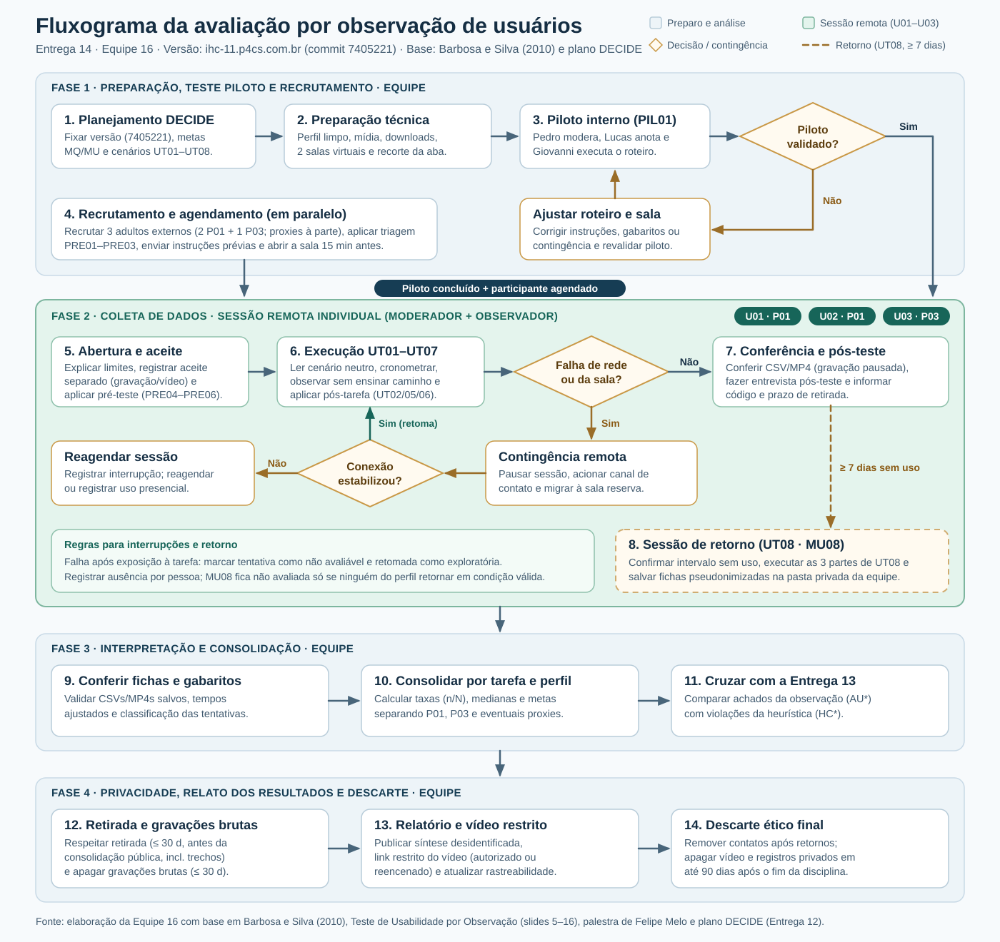

# Entrega 14: avaliação de usabilidade por observação de usuários

**Data:** 19/11/2026 (fluxograma, protocolo, tarefas e materiais operacionais preparados; piloto e coleta pendentes)\
**Status:** 🟨 em andamento (preparação pronta; piloto `PIL01`, recrutamento, sessões `U01`–`U03`, vídeo ilustrativo e comparação com a Entrega 13 pendentes)\
**Responsabilidade:** solução consolidada pela Equipe 16 (Pedro Alexandre Custodio Silva, Lucas Roberto Boccia dos Santos e Giovanni Chahin Morassi). O número de participantes finais observados é igual ao número de integrantes (3 participantes externos), com cada integrante moderando uma sessão e observando outra.

## Objetivo da atividade

Observar usuários representativos dos perfis `P01` (editor profissional de vídeo esportivo) e `P03` (criador amador) executando tarefas delimitadas no protótipo **Melhores Momentos** para identificar problemas de eficácia, eficiência, compreensão, taxa de erro, memorização e satisfação que não podem ser inferidos apenas por inspeção heurística.

> **Regra da amostra:** participantes finais são adultos externos à equipe. Integrantes participam somente do teste piloto (`PIL01`) para validar roteiro, ambiente remoto e registro, fora da amostra final.

O teste avalia a **interação com o protótipo**, não o desempenho científico do modelo híbrido de visão computacional do TCC. Os vídeos são exemplos do SoccerNet-v2 e o processamento em fila, progresso, falha e ausência de lances é simulado, conforme declarado na [Entrega 12](12_planejamento_avaliacao.md#o-que-está-sendo-avaliado).

## A. Fluxograma do processo

O diagrama abaixo representa o processo completo da avaliação remota por observação, incluindo o planejamento DECIDE, a preparação técnica, o ciclo do piloto (`PIL01`), o recrutamento em paralelo, o consentimento, a condução de `UT01`–`UT07` com tratamento de falhas de conexão e reagendamento, o retorno (`UT08`), a consolidação por perfil, o cruzamento com a [Entrega 13](13_avaliacao_heuristica.md), o vídeo ilustrativo restrito e o descarte ético dos dados.

*Figura 1. Fluxograma do processo de avaliação por observação de usuários da Equipe 16, detalhando preparação, piloto iterativo, recrutamento paralelo, sessão remota, contingência para falhas de rede/sala, retorno após sete dias, análise e descarte ético. Fonte: elaboração da equipe com base em Barbosa e Silva (2010), [Teste de Usabilidade por Observação](../slides_plinio/Teste%20Usabilidade%20Observacao%20Usuario.pdf) (slides 5–16), palestra de Felipe Melo e [Entrega 12](12_planejamento_avaliacao.md).*

## B. Procedimento de preparação e execução

### Passo 1: objetivos e versão avaliada

- **Protótipo avaliado:** [ihc-11.p4cs.com.br](https://ihc-11.p4cs.com.br/), commit `7405221` (arquivo-fonte de `7d52cdd`, publicado em 13/11/2026; SHA-256 conferido do HTML: `aa6ec94773a783559e352f69ff5507bd3a8af9301c3830b832de879104b6f33c`), mesma versão congelada para a [Entrega 13](13_avaliacao_heuristica.md#2-escopo-da-inspeção). Caso alguma correção da Entrega 13 seja aplicada antes da coleta, a equipe registrará o novo commit e repetirá as verificações afetadas no piloto, sem misturar resultados de versões diferentes.
- **Metas de usabilidade relacionadas ([Entrega 8](08_engenharia_usabilidade.md#3-metas-de-usabilidade)):**
  - Qualitativas: `MQ01` (conferência do lote), `MQ02` (estado e continuidade), `MQ03` (origem, relógio do jogo e posição no arquivo) e `MQ04` (seleção, distinção CSV × MP4 e continuidade externa).
  - Quantitativas confirmadas: `MU01` (acesso independente à base após fim natural), `MU02` (compreensão dos três itens temporais em corte do 2º tempo), `MU03` (CSV correto com os dois IDs), `MU04` (MP4 correto e reproduzido), `MU05` (mediana ajustada ≤ 90 s em `UT03`) e `MU06` (mediana de facilidade percebida ≥ 4 em `UT02`, `UT05` e `UT06`).
  - Quantitativas propostas (a confirmar pela equipe antes de `U01`): `MU07` (taxa de erro de operação) e `MU08` (memorização no retorno após ≥ 7 dias sem uso).
- **Pergunta qualitativa de falha:** `QA10` (interpretação da falha encenada e decisão de continuidade em `UT07`).

### Passo 2: participantes

Divisão planejada no [plano DECIDE](12_planejamento_avaliacao.md#c-escopo-e-participantes) e apoio operacional em [guia_recrutamento_e_agenda.md](../artifacts/entrega14/guia_recrutamento_e_agenda.md). Participantes proxy, caso necessários, serão justificados antes da sessão e relatados à parte.

| ID | Perfil | Critérios que justificam participação | Integrante responsável | Situação |
|---|---|---|---|---|
| U01 | P01 (editor profissional de vídeo esportivo) | Adulto externo (≥ 18 anos) com seleção ou recorte de lances de partidas encerradas nos últimos 6 meses em trabalho profissional | Pedro (modera) · Lucas (anota) | ⬜ recrutamento pendente |
| U02 | P01 (editor profissional de vídeo esportivo) | Mesmo critério de inclusão para P01 | Lucas (modera) · Giovanni (anota) | ⬜ recrutamento pendente |
| U03 | P03 (criador amador) | Adulto externo (≥ 18 anos) com seleção ou recorte de lances de partidas encerradas nos últimos 6 meses em produção própria ou amadora | Giovanni (modera) · Pedro (anota) | ⬜ recrutamento pendente |

### Passo 3: consentimento e privacidade

- **Instrumentos:** [consentimento](../instrumentos/entrega12_consentimento.md) e [ficha privada de observação](../instrumentos/entrega12_ficha_observacao.md).
- **Autorizações separadas:** registrar separadamente o aceite de participação, a autorização para gravar somente a aba do protótipo (sem câmera, áudio nem tela inteira) para conferência interna e a autorização adicional para incluir trechos desidentificados no vídeo ilustrativo restrito.
- **Anonimização:** todas as notas, sínteses e relatórios públicos usam apenas os códigos `U01`, `U02` e `U03`, sem nomes de pessoas, empresas, canais ou partidas privadas.
- **Armazenamento, retirada e descarte:** contatos e aceites ficam em pasta institucional privada, separados das notas e gravações, com acesso restrito aos três integrantes. O participante pode pedir retirada dos registros pelo canal do convite com seu código em até 30 dias após sua última sessão, antes da consolidação pública. Gravações brutas são apagadas em até 30 dias da sessão após conferência das notas; contatos são removidos após os retornos; vídeo ilustrativo e demais registros privados são descartados em até 90 dias após o fim da disciplina.

### Passo 4: teste piloto (`PIL01`)

**Data:** *pendente*\
**Papéis planejados:** Pedro modera, Lucas anota e Giovanni executa o roteiro em computador separado (`PIL01` fora da amostra).\
**Ficha do piloto:** [ficha_PIL01_piloto.md](../artifacts/entrega14/ficha_PIL01_piloto.md)\
**O que será validado:** clareza das instruções neutras, duração da sessão (meta de 45 min), estados iniciais e pré-seleções (`UT05` e `UT08`), controle remoto do navegador e impacto sobre o tempo, troca para sala alternativa, recorte de gravação apenas da aba, cronômetro, gabaritos, conferência de downloads e concordância de classificação entre moderador e observador.\
**Mudanças após piloto:** *a registrar após a execução de `PIL01`.*

### Passo 5: tarefas

Os cenários abaixo reproduzem a [seção D da Entrega 12](12_planejamento_avaliacao.md#d-lista-de-tarefas-de-avaliação). Preparos privados e gabaritos ficam restritos à equipe em [entrega12_roteiro_observacao.md](../instrumentos/entrega12_roteiro_observacao.md#estados-iniciais-e-gabaritos).

| ID | Cenário neutro apresentado ao participante | Critério de sucesso | Métricas | Ligação com modelo e metas |
|---|---|---|---|---|
| UT01 | "Você vai preparar um resumo de duas partidas. Confira quais partidas e tempos estão disponíveis e deixe de fora o segundo tempo de Bayern de Munique contra Real Madrid. Mostre onde conferiu o que ficou no lote e avise antes de iniciar a análise." | Identifica as duas partidas e os quatro tempos na interface e deixa três entradas no lote, removendo apenas `bayern-real-2017-2t`. Limite: 3 min. | Sucesso, erros, ajudas e tempo | A01, O01, M03, F01–F02 · MQ01, MU07 |
| UT02 | "Agora você recebeu o lote completo. Coloque os vídeos para análise. Enquanto acompanha, diga quais estão esperando, quais estão em andamento e quando terminaram. Quando tudo estiver pronto, abra o material disponível para revisão." | Abre a base de oito candidatos pela primeira vez após a conclusão natural (`MU01`). Registrar separadamente a distinção entre espera, andamento e conclusão (`MQ02`). Limite: 6 min. | Sucesso, compreensão de estados, erros, ajudas, tempo e facilidade (1–5) | T03 → T01, O02/O04, M03, F02–F04 · MQ02, MU01, MU06 |
| UT03 | "Encontre e abra o gol que ocorreu por volta de 52 minutos de jogo, no segundo tempo de Real Madrid contra Barcelona." | Abre o detalhe de `iniesta` (52:17). Meta de mediana ajustada: ≤ 90 s. Limite: 4 min. | Sucesso, tempo total, esperas técnicas, tempo ajustado, erros e ajudas | T01, O04, M01, F04–F05 · MU05 |
| UT04 | "Uma colega precisa localizar na gravação o lance aberto. Diga de qual partida e tempo ele veio. Explique o que os tempos mostrados dizem sobre o jogo e sobre onde achar o trecho no arquivo. Você precisaria rever a gravação antes de usar o lance? Por quê?" | Identifica Real Madrid × Barcelona, 2º tempo, e distingue 47:55 no relógio do jogo do intervalo 2:43 a 3:10 no arquivo desse tempo; justifica necessidade de rever o original. Limite: 3 min. | Acerto independente dos 3 itens, justificativa de contexto e ajudas | T01, O05, M01, F05 · MQ03, MU02 |
| UT05 | "A relação para a edição já tem o gol de Neymar. A pauta mudou. Deixe na relação somente o gol de Suárez e o gol de Vidal. Salve no computador a relação final que você enviaria à produção, com as referências para localizar os trechos. Explique o que o arquivo contém e o que aconteceu com o corte de Neymar." | Retira `neymar`, inclui `suarez` e `vidal`, salva CSV contendo exatamente esses dois IDs com origens corretas e explica que a retirada afeta só a seleção e que o CSV contém referências e links. Limite: 5 min. | Sucesso, conferência do CSV, compreensão, erros, ajudas, tempo e facilidade (1–5) | T01/A04 → T02, O06/O07, M01/M02, F04–F06 · MQ04, MU03, MU06, MU07 |
| UT06 | "Seu resumo vai incluir o gol de Cristiano Ronaldo aos 76 minutos de jogo, no segundo tempo de Bayern de Munique contra Real Madrid. Salve o vídeo desse lance e abra o arquivo no computador." | Salva `ronaldo-2.mp4` e confirma reprodução local; explica separadamente o conteúdo do vídeo e onde continuaria montagem e aprovação. Limite: 4 min. | Sucesso, conferência e reprodução do MP4, compreensão, erros, ajudas, tempo e facilidade (1–5) | T01/A04 → T02, O07, M01/M02, F05–F06 · MQ04, MU04, MU06, MU07 |
| UT07 | "Parte do lote já está disponível, mas uma gravação ficou incompleta. Descubra qual foi e o que isso significa para os demais vídeos. Decida como prosseguir com a revisão sem recomeçar o lote inteiro." | Identifica o 1º tempo de Bayern × Real Madrid como incompleto, reconhece os demais resultados disponíveis e deixa pendente ou solicita nova tentativa apenas desse vídeo. Limite: 5 min. | Interpretação qualitativa, ação escolhida, preservação dos demais vídeos e ajudas | T03, O03, M03, F03/F04 · QA10 |
| UT08 | "Você voltou para preparar o material de outra rodada. Primeiro, coloque o lote completo para análise e, depois de concluído, abra o material para revisão. Em seguida, encontre e abra o gol de Cristiano Ronaldo por volta de 46 minutos de jogo, no segundo tempo de Bayern de Munique contra Real Madrid. Por fim, na relação que já contém o pênalti perdido de Vidal, deixe somente a defesa do Barcelona e o gol de Iniesta. Salve a relação final de referências e explique o que ficou no arquivo." *(Ler uma parte por vez com o estado inicial previsto.)* | Cumpre as três partes de forma independente: abre a base após fim natural, abre `ronaldo-1` e salva CSV com `bravo` e `iniesta` sem `vidal-penalti`, com origens corretas e compreensão do conteúdo. Limites: 6 min, 4 min e 5 min. | Sucesso nas 3 partes, tempo de localização, conferência do CSV, erros e ajudas | Retorno T03 → T01, O02/O04/O06/O07, M03/M01, F02–F06 · MU08 |

### Passo 6: protocolo do moderador

O roteiro completo de fala e preparo está em [entrega12_roteiro_observacao.md](../instrumentos/entrega12_roteiro_observacao.md). Em todas as sessões:

1. Receber o participante, apresentar moderador e observador e explicar que a interface está em avaliação, não a pessoa.
2. Apresentar o [termo de consentimento](../instrumentos/entrega12_consentimento.md) e registrar separadamente participação, gravação da aba e uso de trechos no vídeo.
3. Aplicar o pré-teste mínimo ([entrega12_questionarios.md](../instrumentos/entrega12_questionarios.md#pré-teste)), sem revelar navegação, significado dos tempos ou diferença entre CSV e MP4.
4. Ler cada cenário neutro literalmente e aguardar confirmação de entendimento antes de iniciar o cronômetro.
5. Observar sem ensinar o caminho; registrar pedidos de ajuda e intervenções separadamente.
6. Acolher comentários em voz alta de forma opcional e consistente, sem interromper nem induzir respostas durante a tarefa.
7. Após `UT02`, `UT05` e `UT06`, aplicar a pergunta de facilidade percebida (escala 1 a 5) e registrar o motivo, inclusive após falha ou ajuda.
8. Conferir os arquivos baixados com a gravação pausada, aplicar as perguntas pós-teste e retomar dúvidas anotadas.
9. Encerrar, informar código e prazo de retirada (30 dias), convidar para o retorno após ≥ 7 dias sem uso e salvar as fichas pseudonimizadas na pasta privada.

### Recomendações de Felipe Melo adotadas

Recomendações de testes remotos extraídas da palestra de Felipe Melo e incorporadas ao [roteiro de observação](../instrumentos/entrega12_roteiro_observacao.md#preparar-a-sessão) (avaliação do funcionamento real pendente da execução do piloto e das sessões):

| Recomendação adotada no protocolo | Onde está operacionalizada | Como funcionou no piloto e nas sessões |
|---|---|---|
| Enviar instruções técnicas prévias antes da sessão | Convite em [guia_recrutamento_e_agenda.md](../artifacts/entrega14/guia_recrutamento_e_agenda.md) e roteiro | *Pendente de execução* |
| Abrir e testar a sala, conexão e equipamentos 15 min antes | Passo de preparo em `entrega12_roteiro_observacao.md` | *Pendente de execução* |
| Usar ambiente limpo (perfil temporário, sem notificações, pasta vazia) | Passo 2 do preparo em `entrega12_roteiro_observacao.md` | *Pendente de execução* |
| Manter sala virtual alternativa e canal de contato para contingência | Passo 1 e regra de falha em `entrega12_roteiro_observacao.md` | *Pendente de execução* |
| Testar compartilhamento da janela, controle remoto e recorte de gravação no piloto | [ficha_PIL01_piloto.md](../artifacts/entrega14/ficha_PIL01_piloto.md) | *Pendente de execução* |
| Pausar compartilhamento ao preparar o estado inicial entre tarefas | Passo 4 do preparo em `entrega12_roteiro_observacao.md` | *Pendente de execução* |
| Definir regra prévia para interrupções externas e reagendamento | Regra de tentativa não avaliável em `entrega12_roteiro_observacao.md` | *Pendente de execução* |

## C. Resultados por participante

*Pendente: preencher após a conclusão das sessões com `U01`, `U02` e `U03`, usando apenas dados desidentificados.*

### U01: P01 (editor profissional de vídeo esportivo)

**Moderação e registro:** Pedro (modera) · Lucas (anota) · *sessão pendente*

| Tarefa | Grau de sucesso | Erros | Tipos de erro ou dificuldade | Ajudas | Tempo (total / ajustado) | Satisfação (1–5) | Evidência e observação |
|---|---|---:|---|---:|---|---|---|
| UT01 | *Pendente* | | | | | não se aplica | |
| UT02 | *Pendente* | | | | | *Pendente* | |
| UT03 | *Pendente* | | | | | não se aplica | |
| UT04 | *Pendente* | | | | | não se aplica | |
| UT05 | *Pendente* | | | | | *Pendente* | |
| UT06 | *Pendente* | | | | | *Pendente* | |
| UT07 | *Pendente* | | | | | não se aplica | |
| UT08 (retorno) | *Pendente* | | | | | não se aplica | |

**Registro da sessão:** *pendente (anotações privadas / gravação autorizada)*\
**Resposta pós-teste:** *pendente*

### U02: P01 (editor profissional de vídeo esportivo)

**Moderação e registro:** Lucas (modera) · Giovanni (anota) · *sessão pendente*

| Tarefa | Grau de sucesso | Erros | Tipos de erro ou dificuldade | Ajudas | Tempo (total / ajustado) | Satisfação (1–5) | Evidência e observação |
|---|---|---:|---|---:|---|---|---|
| UT01 | *Pendente* | | | | | não se aplica | |
| UT02 | *Pendente* | | | | | *Pendente* | |
| UT03 | *Pendente* | | | | | não se aplica | |
| UT04 | *Pendente* | | | | | não se aplica | |
| UT05 | *Pendente* | | | | | *Pendente* | |
| UT06 | *Pendente* | | | | | *Pendente* | |
| UT07 | *Pendente* | | | | | não se aplica | |
| UT08 (retorno) | *Pendente* | | | | | não se aplica | |

**Registro da sessão:** *pendente (anotações privadas / gravação autorizada)*\
**Resposta pós-teste:** *pendente*

### U03: P03 (criador amador)

**Moderação e registro:** Giovanni (modera) · Pedro (anota) · *sessão pendente*

| Tarefa | Grau de sucesso | Erros | Tipos de erro ou dificuldade | Ajudas | Tempo (total / ajustado) | Satisfação (1–5) | Evidência e observação |
|---|---|---:|---|---:|---|---|---|
| UT01 | *Pendente* | | | | | não se aplica | |
| UT02 | *Pendente* | | | | | *Pendente* | |
| UT03 | *Pendente* | | | | | não se aplica | |
| UT04 | *Pendente* | | | | | não se aplica | |
| UT05 | *Pendente* | | | | | *Pendente* | |
| UT06 | *Pendente* | | | | | *Pendente* | |
| UT07 | *Pendente* | | | | | não se aplica | |
| UT08 (retorno) | *Pendente* | | | | | não se aplica | |

**Registro da sessão:** *pendente (anotações privadas / gravação autorizada)*\
**Resposta pós-teste:** *pendente*

## D. Consolidação por tarefa e perfil

*Pendente: preencher após a coleta.* Em `n/N`, registrar sucessos independentes sobre tentativas avaliáveis (incluindo ajuda, parcial, falha e abandono no denominador). Quando uma tarefa verifica mais de uma meta (como `MQ02` e `MU01` em `UT02`, ou `MQ04` e `MU03`/`MU04` em `UT05`/`UT06`), registrar cada meta separadamente, conforme o [plano de análise da Entrega 12](12_planejamento_avaliacao.md#f-plano-de-análise). Para `P03`, a tentativa única planejada fornece uma observação por tarefa; quando houver tempo ou nota, a mediana coincide com esse valor e será identificada como observação única. Eventuais participantes proxy entram em tabela separada.

| Tarefa | Perfil | Sucesso independente (n/N e %) | Tempo típico (bruto / ajustado) | Erros recorrentes | Satisfação (mediana) | Metas atendidas? (por meta) | Problemas prioritários |
|---|---|---:|---|---|---|---|---|
| UT01 | P01 | *Pendente* | | | não se aplica | MQ01: *pendente* · MU07: *pendente* | |
| UT01 | P03 | *Pendente* | | | não se aplica | MQ01: *pendente* · MU07: *pendente* | |
| UT02 | P01 | *Pendente* | | | *Pendente* | MQ02: *pendente* · MU01: *pendente* · MU06: *pendente* | |
| UT02 | P03 | *Pendente* | | | *Pendente* | MQ02: *pendente* · MU01: *pendente* · MU06: *pendente* | |
| UT03 | P01 | *Pendente* | | | não se aplica | MU05: *pendente* | |
| UT03 | P03 | *Pendente* | | | não se aplica | MU05: *pendente* | |
| UT04 | P01 | *Pendente* | | | não se aplica | MQ03: *pendente* · MU02: *pendente* | |
| UT04 | P03 | *Pendente* | | | não se aplica | MQ03: *pendente* · MU02: *pendente* | |
| UT05 | P01 | *Pendente* | | | *Pendente* | MQ04: *pendente* · MU03: *pendente* · MU06: *pendente* · MU07: *pendente* | |
| UT05 | P03 | *Pendente* | | | *Pendente* | MQ04: *pendente* · MU03: *pendente* · MU06: *pendente* · MU07: *pendente* | |
| UT06 | P01 | *Pendente* | | | *Pendente* | MQ04: *pendente* · MU04: *pendente* · MU06: *pendente* · MU07: *pendente* | |
| UT06 | P03 | *Pendente* | | | *Pendente* | MQ04: *pendente* · MU04: *pendente* · MU06: *pendente* · MU07: *pendente* | |
| UT07 | P01 | *Pendente* | | | não se aplica | QA10: qualitativa | |
| UT07 | P03 | *Pendente* | | | não se aplica | QA10: qualitativa | |
| UT08 | P01 | *Pendente* | | | não se aplica | MU08: *pendente* | |
| UT08 | P03 | *Pendente* | | | não se aplica | MU08: *pendente* | |

## E. Achados e recomendações

*Pendente: consolidar após análise das fichas de `U01`–`U03`.*

| ID | Achado | Evidência (quantitativa e qualitativa) | Impacto | Recomendação | Artefatos a revisar |
|---|---|---|---|---|---|
| *Pendente* | *A preencher após coleta* | | | | |

### Vídeo ilustrativo do teste e dos resultados

O vídeo apresentará o procedimento do teste remoto, os resultados desidentificados e as melhorias propostas, com acesso restrito à equipe e ao docente. Incluirá somente trechos da aba com autorização específica de uso no vídeo; na ausência de trechos autorizados, usará demonstração reencenada pela equipe mediante aprovação prévia do docente e identificação explícita no vídeo.

**Link do vídeo ilustrativo:** *pendente (link de acesso restrito à equipe e ao docente)*

## F. Comparação com a avaliação heurística

*Pendente: cruzar os achados `AU*` desta entrega com os achados consolidados `HC*` da [Entrega 13](13_avaliacao_heuristica.md#6-consolidação-da-equipe), preservando os IDs e a versão avaliada.*

| Problema | IDs (HC / AU) | Detectado na heurística? | Detectado por usuários? | O que aprendemos |
|---|---|---|---|---|
| *Pendente* | | sim / não | sim / não | *A preencher após conclusão das Entregas 13 e 14* |

## G. Conclusão

*Pendente: responder após consolidação das seções C a F.*

1. Quais metas de usabilidade (`MQ01`–`MQ04`, `MU01`–`MU08`) foram atingidas, não atingidas ou não avaliadas por perfil?
2. Quais problemas foram recorrentes e em quais perfis e tarefas ocorreram?
3. O que surpreendeu a equipe na comparação entre inspeção heurística e uso real?
4. Quais mudanças são prioritárias no protótipo e nos modelos (`MoLIC`, signos, rastreabilidade)?
5. Que limitações da amostra exploratória (`N = 3`, conveniência, simulação, conjunto de oito cortes e eventuais proxies) impedem generalizações amplas?

## Checklist

- [ ] Número de participantes finais atende ao enunciado.
- [ ] Participantes são representativos do público e não são membros da equipe.
- [ ] Se foram usados participantes proxy, a justificativa e a limitação estão explícitas.
- [ ] O teste avalia a interação; não confunde usabilidade do protótipo com desempenho técnico do TCC.
- [ ] Tarefas administrativas/analíticas usadas no teste são rastreáveis a objetivos e cenários.
- [ ] Há consentimento e anonimização.
- [ ] Foi realizado teste piloto.
- [x] O fluxograma representa o piloto, a observação, a análise e o relato.
- [ ] O relatório registra as recomendações de teste remoto adotadas e como funcionaram nas sessões.
- [x] Tarefas têm critérios de sucesso definidos antes do teste.
- [ ] Moderadores não ensinaram o caminho durante a tarefa.
- [ ] Resultados estão separados por usuário e por tarefa.
- [ ] Foram registrados sucesso, erros, ajudas, tempo e satisfação quando aplicáveis.
- [ ] Conclusão combina evidência quantitativa e qualitativa.
- [ ] Achados geram recomendações e atualização da rastreabilidade.
- [ ] O vídeo ilustrativo tem link de acesso restrito no relatório. Os trechos de sessões incluídos têm autorização específica.

## Referências

- BARBOSA, Simone Diniz Junqueira; SILVA, Bruno Santana da. *Interação Humano-Computador*. Rio de Janeiro: Elsevier, 2010. (Referenciada em [BIBLIOGRAFIA.md](../BIBLIOGRAFIA.md).)
- Slides da disciplina: [Teste de Usabilidade por Observação do Usuário](../slides_plinio/Teste%20Usabilidade%20Observacao%20Usuario.pdf) (slides 2–16) e [Planejamento da Avaliação de IHC](../slides_plinio/Planejamento%20Avaliacao%20IHC.pdf).
- MELO, Felipe. *Palestra sobre testes de usabilidade remotos*. Referenciada no [plano DECIDE](12_planejamento_avaliacao.md#a-método-decide).
- Artefatos do projeto: [Entrega 8 — metas de usabilidade](08_engenharia_usabilidade.md#3-metas-de-usabilidade), [Entrega 11 — protótipo navegável](11_figma.md), [Entrega 12 — plano DECIDE](12_planejamento_avaliacao.md), [Entrega 13 — avaliação heurística](13_avaliacao_heuristica.md) e [instrumentos da Entrega 12](../instrumentos/README.md).
